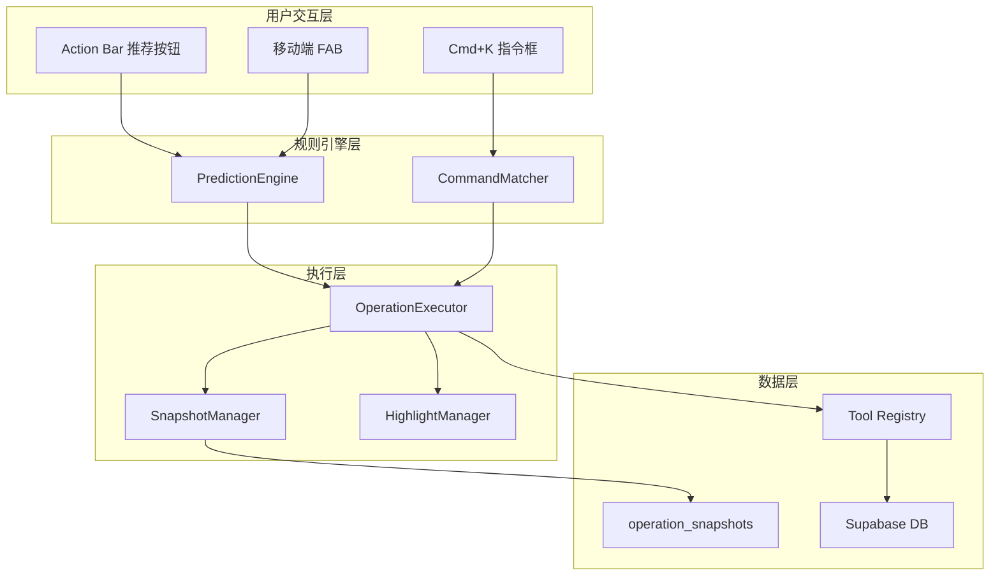

# 双模式智能体系统 - 技术设计文档 (V3.0 独立开发者版)

## Overview

本设计文档基于 `requirements-V3.0.md` 需求规格，采用**独立开发者友好**的精简策略：用规则引擎冒充 AI，用覆盖式恢复替代复杂事务，3 周内交付可用版本。

### 设计目标

| 目标       | 策略                         |
| ---------- | ---------------------------- |
| 快速交付   | 3 周完成 MVP                 |
| 低复杂度   | 砍掉 LLM、Undo Log、复杂动画 |
| 高感知智能 | 规则引擎 + 假 AI 延迟        |
| 可维护性   | 复用现有组件和工具           |

---

## Code Reuse Analysis

### Existing Components to Leverage

| 组件/服务          | 位置                                       | 复用方式            |
| ------------------ | ------------------------------------------ | ------------------- |
| **Tool Registry**  | `src/lib/ai-agent/tools/`                  | 直接调用现有 Tools  |
| **Skills Router**  | `src/lib/ai-skills/`                       | 复用 Skill 执行逻辑 |
| **Toast 组件**     | `src/components/ui/toast`                  | 操作反馈通知        |
| **Bottom Sheet**   | `src/components/ui/sheet`                  | 移动端推荐列表      |
| **FAB 组件**       | `src/components/ui/floating-action-button` | 移动端入口          |
| **Command Dialog** | `src/components/ui/command`                | Cmd+K 指令框        |
| **React Query**    | 已配置                                     | 乐观更新和缓存管理  |

### Integration Points

| 系统                    | 集成方式                      |
| ----------------------- | ----------------------------- |
| **Supabase Database**   | 新增 `operation_snapshots` 表 |
| **现有 Tools**          | 规则引擎触发 Tool 串联执行    |
| **SubscriptionService** | 电池系统配额检查              |

---

## Architecture

### 系统架构图



### 模块职责

```
src/lib/fluid-agent/              # 新模块根目录
├── prediction/                   # 规则引擎
│   ├── prediction-engine.ts      # 规则匹配核心
│   ├── rules/                    # 规则定义
│   │   ├── language-rules.ts     # 语言相关规则
│   │   ├── content-rules.ts      # 内容相关规则
│   │   ├── quantity-rules.ts     # 数量相关规则
│   │   └── index.ts              # 规则聚合
│   └── types.ts                  # 类型定义
│
├── execution/                    # 执行引擎
│   ├── operation-executor.ts     # 操作执行器
│   ├── snapshot-manager.ts       # 快照管理
│   └── types.ts
│
├── commands/                     # 指令框
│   ├── command-matcher.ts        # 关键词匹配
│   ├── preset-commands.ts        # 预设命令
│   └── types.ts
│
└── ui/                          # UI 组件
    ├── hooks/
    │   ├── use-prediction.ts     # 预测性操作 Hook
    │   ├── use-agent-highlight.ts # 高亮 Hook
    │   └── use-battery.ts        # 电池系统 Hook
    └── components/
        ├── prediction-button.tsx  # 推荐按钮
        ├── execution-status.tsx   # 状态栏
        ├── undo-toast.tsx         # 撤销 Toast
        └── battery-indicator.tsx  # 电池图标
```

---

## Components and Interfaces

### 1. PredictionEngine (规则引擎核心)

- **Purpose:** 根据选中内容匹配推荐操作
- **Location:** `src/lib/fluid-agent/prediction/prediction-engine.ts`

```typescript
// 规则定义
interface PredictionRule {
  id: string;
  name: string;
  icon: string;
  priority: number; // 0-100，越高越优先
  condition: (selection: Bookmark[]) => boolean;
  action: string; // 对应的 Skill 或 Tool 名称
  params?: (selection: Bookmark[]) => Record<string, any>;
}

// 匹配结果
interface PredictionResult {
  ruleId: string;
  action: string;
  icon: string;
  label: string;
  confidence: number;
  affectedCount: number;
}

// 引擎接口
interface PredictionEngine {
  // 获取推荐操作（返回前 3 个）
  predict(selection: Bookmark[]): PredictionResult[];

  // 记录用户反馈（用于未来权重调整）
  recordFeedback(ruleId: string, accepted: boolean): void;
}
```

- **Dependencies:** 无外部依赖，纯函数
- **Reuses:** 无

### 2. OperationExecutor (操作执行器)

- **Purpose:** 执行推荐操作，管理进度和状态
- **Location:** `src/lib/fluid-agent/execution/operation-executor.ts`

```typescript
interface OperationStep {
  id: string;
  name: string;
  status: "pending" | "running" | "completed" | "failed";
  progress?: number; // 0-100
}

interface OperationContext {
  operationId: string;
  userId: string;
  selection: Bookmark[];
  steps: OperationStep[];
  startedAt: Date;
}

interface OperationExecutor {
  // 开始执行
  execute(
    action: string,
    selection: Bookmark[],
    params?: Record<string, any>,
  ): Promise<OperationResult>;

  // 取消执行
  cancel(operationId: string): Promise<void>;

  // 获取当前状态
  getStatus(operationId: string): OperationContext | null;

  // 订阅状态变化
  subscribe(
    operationId: string,
    callback: (ctx: OperationContext) => void,
  ): () => void;
}
```

- **Dependencies:** Tool Registry, SnapshotManager
- **Reuses:** `src/lib/ai-agent/tools/tool-registry.ts`

### 3. SnapshotManager (快照管理)

- **Purpose:** 操作前保存快照，支持覆盖式恢复
- **Location:** `src/lib/fluid-agent/execution/snapshot-manager.ts`

```typescript
interface OperationSnapshot {
  id: string;
  operation_id: string;
  user_id: string;
  entity_type: "bookmark" | "folder" | "tag";
  entity_id: string;
  original_data: JsonB;
  created_at: Date;
  expires_at: Date; // 24 小时后
}

interface SnapshotManager {
  // 创建快照（操作前调用）
  createSnapshot(
    operationId: string,
    entities: Array<{ type: string; id: string; data: any }>,
  ): Promise<void>;

  // 执行回滚（覆盖式恢复）
  rollback(operationId: string): Promise<RollbackResult>;

  // 清理过期快照
  cleanup(): Promise<number>;
}
```

- **Dependencies:** Supabase Client
- **Reuses:** 无

### 4. CommandMatcher (指令匹配器)

- **Purpose:** Cmd+K 指令框的关键词匹配
- **Location:** `src/lib/fluid-agent/commands/command-matcher.ts`

```typescript
interface PresetCommand {
  id: string;
  keywords: string[];
  name: string;
  description: string;
  icon: string;
  action: string;
  requiresSelection: boolean;
}

interface CommandMatcher {
  // 匹配命令
  match(input: string): PresetCommand[];

  // 获取所有命令（用于展示）
  getAll(): PresetCommand[];

  // 执行命令
  execute(commandId: string, selection?: Bookmark[]): Promise<void>;
}
```

- **Dependencies:** OperationExecutor
- **Reuses:** `src/components/ui/command`

### 5. HighlightManager (高亮管理)

- **Purpose:** 管理 Agent 操作时的 UI 高亮效果
- **Location:** `src/lib/fluid-agent/ui/hooks/use-agent-highlight.ts`

```typescript
interface HighlightEvent {
  entityId: string;
  type: "processing" | "completed";
  duration: number;
}

interface HighlightManager {
  // 触发高亮
  highlight(entityId: string, type: "processing" | "completed"): void;

  // 批量高亮
  highlightMany(entityIds: string[], type: "processing" | "completed"): void;

  // 清除高亮
  clear(entityId: string): void;
}

// React Hook
function useAgentHighlight(entityId: string): {
  isHighlighted: boolean;
  highlightType: "processing" | "completed" | null;
};
```

- **Dependencies:** 无
- **Reuses:** 无

### 6. BatterySystem (电池系统)

- **Purpose:** 管理使用配额，模糊化成本显示
- **Location:** `src/lib/fluid-agent/ui/hooks/use-battery.ts`

```typescript
type BatteryLevel = "full" | "medium" | "low" | "empty";

interface BatteryState {
  level: BatteryLevel;
  remaining: number;
  total: number;
  resetAt: Date;
}

interface BatterySystem {
  // 获取当前电量
  getLevel(): BatteryLevel;

  // 消耗一次
  consume(): Promise<boolean>; // false = 配额耗尽

  // 检查是否可用
  canUse(): boolean;

  // 获取完整状态
  getState(): BatteryState;
}

// React Hook
function useBattery(): {
  level: BatteryLevel;
  canUse: boolean;
  consume: () => Promise<boolean>;
  showUpgradePrompt: () => void;
};
```

- **Dependencies:** SubscriptionService
- **Reuses:** `src/lib/subscription/`

---

## Data Models

### operation_snapshots 表

```sql
CREATE TABLE operation_snapshots (
  id UUID PRIMARY KEY DEFAULT gen_random_uuid(),
  operation_id UUID NOT NULL,
  user_id UUID NOT NULL REFERENCES auth.users(id),
  entity_type TEXT NOT NULL CHECK (entity_type IN ('bookmark', 'folder', 'tag')),
  entity_id UUID NOT NULL,
  original_data JSONB NOT NULL,
  created_at TIMESTAMPTZ NOT NULL DEFAULT now(),
  expires_at TIMESTAMPTZ NOT NULL DEFAULT (now() + INTERVAL '24 hours'),

  -- 索引
  CONSTRAINT idx_operation_snapshots_operation_id
    CREATE INDEX ON operation_snapshots(operation_id),
  CONSTRAINT idx_operation_snapshots_user_id
    CREATE INDEX ON operation_snapshots(user_id),
  CONSTRAINT idx_operation_snapshots_expires_at
    CREATE INDEX ON operation_snapshots(expires_at)
);

-- RLS 策略
ALTER TABLE operation_snapshots ENABLE ROW LEVEL SECURITY;

CREATE POLICY "Users can view own snapshots"
  ON operation_snapshots FOR SELECT
  USING (auth.uid() = user_id);

CREATE POLICY "Users can insert own snapshots"
  ON operation_snapshots FOR INSERT
  WITH CHECK (auth.uid() = user_id);

CREATE POLICY "Users can delete own snapshots"
  ON operation_snapshots FOR DELETE
  USING (auth.uid() = user_id);
```

### user_operation_quota 表

```sql
CREATE TABLE user_operation_quota (
  id UUID PRIMARY KEY DEFAULT gen_random_uuid(),
  user_id UUID NOT NULL REFERENCES auth.users(id) UNIQUE,
  daily_used INTEGER NOT NULL DEFAULT 0,
  last_reset_at DATE NOT NULL DEFAULT CURRENT_DATE,

  CONSTRAINT idx_user_operation_quota_user_id
    CREATE INDEX ON user_operation_quota(user_id)
);

-- RLS 策略
ALTER TABLE user_operation_quota ENABLE ROW LEVEL SECURITY;

CREATE POLICY "Users can view own quota"
  ON user_operation_quota FOR SELECT
  USING (auth.uid() = user_id);

CREATE POLICY "Users can update own quota"
  ON user_operation_quota FOR UPDATE
  USING (auth.uid() = user_id);
```

---

## UI Components

### 1. PredictionButton (推荐按钮)

```typescript
// src/lib/fluid-agent/ui/components/prediction-button.tsx

interface PredictionButtonProps {
  prediction: PredictionResult;
  onClick: () => void;
  loading?: boolean;
}

function PredictionButton({ prediction, onClick, loading }: PredictionButtonProps) {
  return (
    <Button
      variant="secondary"
      className="gap-2 bg-gradient-to-r from-purple-500/10 to-blue-500/10"
      onClick={onClick}
      disabled={loading}
    >
      <span>{prediction.icon}</span>
      <span>✨ {prediction.label}</span>
      {loading && <Spinner size="sm" />}
    </Button>
  );
}
```

### 2. ExecutionStatus (状态栏)

```typescript
// src/lib/fluid-agent/ui/components/execution-status.tsx

interface ExecutionStatusProps {
  context: OperationContext;
  onCancel: () => void;
}

function ExecutionStatus({ context, onCancel }: ExecutionStatusProps) {
  const currentStep = context.steps.find(s => s.status === 'running');
  const completedCount = context.steps.filter(s => s.status === 'completed').length;

  return (
    <div className="fixed bottom-4 left-1/2 -translate-x-1/2 z-50">
      <Card className="flex items-center gap-4 px-4 py-2 shadow-lg">
        <span className="text-lg">✨</span>
        <span>{currentStep?.name || '处理中'}...</span>
        <span className="text-muted-foreground">
          {completedCount}/{context.steps.length}
        </span>
        <Button variant="ghost" size="sm" onClick={onCancel}>
          ✕ 取消
        </Button>
      </Card>
    </div>
  );
}
```

### 3. UndoToast (撤销 Toast)

```typescript
// src/lib/fluid-agent/ui/components/undo-toast.tsx

interface UndoToastProps {
  message: string;
  operationId: string;
  onUndo: (operationId: string) => void;
  duration?: number;  // 默��� 10 秒
}

function UndoToast({ message, operationId, onUndo, duration = 10000 }: UndoToastProps) {
  const [visible, setVisible] = useState(true);

  useEffect(() => {
    const timer = setTimeout(() => setVisible(false), duration);
    return () => clearTimeout(timer);
  }, [duration]);

  if (!visible) return null;

  return (
    <Toast>
      <ToastTitle>✅ {message}</ToastTitle>
      <ToastAction altText="撤销" onClick={() => onUndo(operationId)}>
        撤销
      </ToastAction>
    </Toast>
  );
}
```

### 4. BatteryIndicator (电池图标)

```typescript
// src/lib/fluid-agent/ui/components/battery-indicator.tsx

function BatteryIndicator() {
  const { level, canUse } = useBattery();

  // 只在低电量时显示
  if (level === 'full' || level === 'medium') return null;

  const icon = level === 'low' ? '🪫' : '⚡';
  const message = level === 'low'
    ? '今日 AI 次数即将用完'
    : '今日 AI 次数已用完';

  return (
    <Tooltip content={message}>
      <span className="text-lg">{icon}</span>
    </Tooltip>
  );
}
```

---

## 规则引擎实现

### 规则定义示例

```typescript
// src/lib/fluid-agent/prediction/rules/language-rules.ts

export const languageRules: PredictionRule[] = [
  {
    id: "all_english",
    name: "翻译",
    icon: "🌐",
    priority: 95,
    condition: (selection) => {
      return selection.every((b) => detectLanguage(b.title) === "en");
    },
    action: "translate_batch",
    params: (selection) => ({
      targetLang: "zh",
      bookmarkIds: selection.map((b) => b.id),
    }),
  },
  {
    id: "mixed_language",
    name: "统一翻译",
    icon: "🌐",
    priority: 85,
    condition: (selection) => {
      const langs = new Set(selection.map((b) => detectLanguage(b.title)));
      return langs.size > 1 && langs.has("en");
    },
    action: "translate_batch",
  },
];
```

### 规则匹配器

```typescript
// src/lib/fluid-agent/prediction/prediction-engine.ts

import { allRules } from "./rules";

export class PredictionEngine {
  predict(selection: Bookmark[]): PredictionResult[] {
    if (selection.length === 0) return [];

    const matches = allRules
      .filter((rule) => rule.condition(selection))
      .sort((a, b) => b.priority - a.priority)
      .slice(0, 3)
      .map((rule) => ({
        ruleId: rule.id,
        action: rule.action,
        icon: rule.icon,
        label: rule.name,
        confidence: rule.priority,
        affectedCount: selection.length,
      }));

    return matches;
  }

  recordFeedback(ruleId: string, accepted: boolean): void {
    // V1: 仅记录到 localStorage，供未来��析
    const key = `rule_feedback_${ruleId}`;
    const current = JSON.parse(
      localStorage.getItem(key) || '{"accept":0,"reject":0}',
    );
    if (accepted) current.accept++;
    else current.reject++;
    localStorage.setItem(key, JSON.stringify(current));
  }
}
```

---

## 执行流程

### 推荐操作执行流程

```
用户选中书签
      ↓
PredictionEngine.predict()
      ↓
显示推荐按钮 (10ms)
      ↓
用户点击按钮
      ↓
显示 "✨ AI 正在分析..." (300-500ms 假延迟)
      ↓
BatterySystem.consume() 检查配额
      ↓
SnapshotManager.createSnapshot() 保存快照
      ↓
OperationExecutor.execute() 执行操作
      ↓
HighlightManager.highlight() 高亮受影响项
      ↓
显示完成 Toast + 撤销入口 (10秒)
```

### 撤销流程

```
用户点击 "撤销"
      ↓
SnapshotManager.rollback()
      ↓
用快照 JSON 覆盖当前数据
      ↓
React Query invalidateQueries()
      ↓
显示 "已撤销" Toast
```

---

## Error Handling

### Error Scenarios

1. **操作执行失败**
   - **Handling:** 捕获异常，显示错误 Toast，自动刷新列表
   - **User Impact:** "操作失败，请重试"

2. **快照保存失败**
   - **Handling:** 中止操作，不执行任何更改
   - **User Impact:** "无法保存状态，请重试"

3. **回滚失败**
   - **Handling:** 记录错误日志，提示手动刷新
   - **User Impact:** "撤销失败，请刷新页面"

4. **配额耗尽**
   - **Handling:** 阻断操作，显示升级提示
   - **User Impact:** 升级弹窗

---

## Testing Strategy

### Unit Testing

- **PredictionEngine:** 测试 20 条规则的匹配逻辑
- **SnapshotManager:** 测试快照创建和覆盖恢复
- **CommandMatcher:** 测试关键词匹配准确性
- **BatterySystem:** 测试配额计算和重置逻辑

```typescript
// 示例测试
describe("PredictionEngine", () => {
  it("should recommend translate for all English bookmarks", () => {
    const engine = new PredictionEngine();
    const selection = [
      { id: "1", title: "React Tutorial", language: "en" },
      { id: "2", title: "TypeScript Guide", language: "en" },
    ];
    const results = engine.predict(selection);
    expect(results[0].action).toBe("translate_batch");
  });
});
```

### Integration Testing

- **操作执行流程:** 选中 → 推荐 → 执行 → 完成
- **撤销流程:** 执行 → 撤销 → 验证数据恢复
- **配额流程:** 消耗 → 耗尽 → 重置

### End-to-End Testing

- **桌面端场景:** 选中书签 → 点击推荐按钮 → 验证结果
- **移动端场景:** 选中书签 → 点击 FAB → Bottom Sheet → 执行
- **Cmd+K 场景:** 打开指令框 → 输入关键词 → 选择命令 → 执行

---

## 开发任务分解

### Week 1: 规则引擎 + 推荐 UI

| 任务                    | 预估时间 | 文件                                  |
| ----------------------- | -------- | ------------------------------------- |
| 创建模块目录结构        | 0.5h     | `src/lib/fluid-agent/`                |
| 实现 PredictionEngine   | 4h       | `prediction/prediction-engine.ts`     |
| 实现 20 条规则          | 4h       | `prediction/rules/*.ts`               |
| 实现 PredictionButton   | 2h       | `ui/components/prediction-button.tsx` |
| 实现 usePrediction Hook | 2h       | `ui/hooks/use-prediction.ts`          |
| 集成到 Action Bar       | 2h       | 修改现有组件                          |
| 移动端 FAB 变形         | 3h       | 修改现有组件                          |
| 移动端 Bottom Sheet     | 2h       | `ui/components/prediction-sheet.tsx`  |

### Week 2: 执行引擎 + 监控 UI

| 任务                        | 预估时间 | 文件                                 |
| --------------------------- | -------- | ------------------------------------ |
| 实现 OperationExecutor      | 4h       | `execution/operation-executor.ts`    |
| 实现 ExecutionStatus 状态栏 | 2h       | `ui/components/execution-status.tsx` |
| 实现 HighlightManager       | 2h       | `ui/hooks/use-agent-highlight.ts`    |
| 集成高亮到列表组件          | 2h       | 修改现有组件                         |
| 实现 CommandMatcher         | 2h       | `commands/command-matcher.ts`        |
| 实现预设命令                | 2h       | `commands/preset-commands.ts`        |
| 集成到 Command Dialog       | 2h       | 修改现有组件                         |
| React Query 乐观更新配置    | 2h       | 修改现有配置                         |

### Week 3: 回滚 + 电��系统

| 任务                         | 预估时间 | 文件                                       |
| ---------------------------- | -------- | ------------------------------------------ |
| 创建 operation_snapshots 表  | 1h       | `supabase/migrations/`                     |
| 实现 SnapshotManager         | 4h       | `execution/snapshot-manager.ts`            |
| 实现 UndoToast               | 2h       | `ui/components/undo-toast.tsx`             |
| 创建 user_operation_quota 表 | 1h       | `supabase/migrations/`                     |
| 实现 BatterySystem           | 3h       | `ui/hooks/use-battery.ts`                  |
| 实现 BatteryIndicator        | 1h       | `ui/components/battery-indicator.tsx`      |
| 实现配额耗尽弹窗             | 2h       | `ui/components/quota-exhausted-dialog.tsx` |
| 删除确认对话框               | 2h       | `ui/components/delete-confirm-dialog.tsx`  |
| 测试和修复                   | 4h       | -                                          |

---

## 与 V2.1 的设计差异

| 模块         | V2.1 设计                       | V3.0 设计                 |
| ------------ | ------------------------------- | ------------------------- |
| **AI 后端**  | IntentClassifier + LLM          | PredictionEngine (纯规则) |
| **回滚**     | UndoLog + Snapshot + SoftDelete | SnapshotManager (覆盖式)  |
| **乐观更新** | 自定义状态机 + 动画             | React Query 原生          |
| **成本显示** | 精确能量追踪                    | BatterySystem (三档图标)  |
| **执行监控** | 复杂的步骤预览                  | 简单状态栏                |
| **检查点**   | 多级规则                        | 仅删除确认                |
