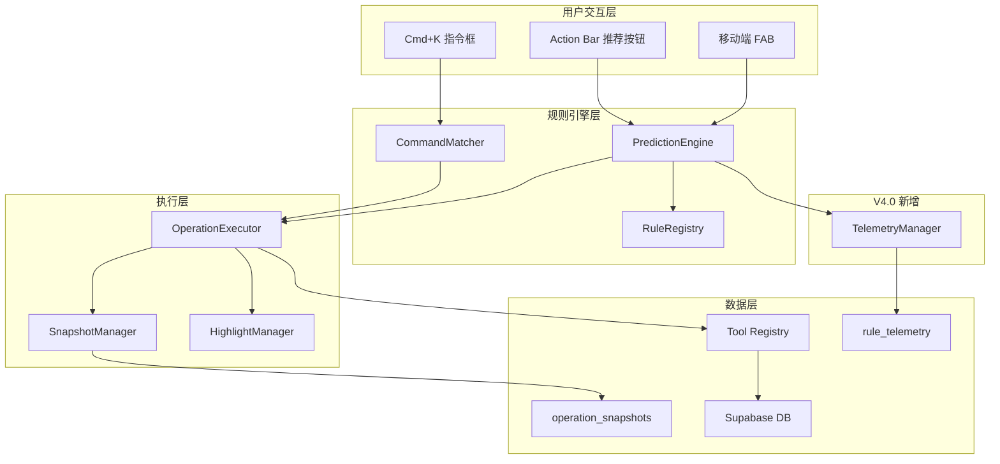

# 双模式智能体系统 - 技术设计文档 (V4.0 增强版)

## Overview

本设计文档基于 `requirements-V4.0.md` 需求规格，整合架构评审会的专家建议，在 V3.0 基础上增强可扩展性、可观测性和用户体验。

### 设计目标

| 目标                | 策略                          |
| ------------------- | ----------------------------- |
| 快速交付            | 3 周完成 MVP                  |
| 低复杂度            | 砍掉 LLM、Undo Log、复杂动画  |
| 高感知智能          | 规则引擎 + 智能推荐延迟       |
| 可维护性            | 复用现有组件和工具            |
| **[V4.0] 可扩展性** | RuleRegistry 支持动态规则注册 |
| **[V4.0] 可观测性** | 规则遥测系统验证假设          |

---

## Code Reuse Analysis

### Existing Components to Leverage

| 组件/服务          | 位置                                       | 复用方式            |
| ------------------ | ------------------------------------------ | ------------------- |
| **Tool Registry**  | `src/lib/ai-agent/tools/`                  | 直接调用现有 Tools  |
| **Skills Router**  | `src/lib/ai-skills/`                       | 复用 Skill 执行逻辑 |
| **Toast 组件**     | `src/components/ui/toast`                  | 操作反馈通知        |
| **Bottom Sheet**   | `src/components/ui/sheet`                  | 移动端推荐列表      |
| **FAB 组件**       | `src/components/ui/floating-action-button` | 移动端入口          |
| **Command Dialog** | `src/components/ui/command`                | Cmd+K 指令框        |
| **React Query**    | 已配置                                     | 乐观更新和缓存管理  |

### New Dependencies (V4.0)

| 依赖          | 用途     | 大小 |
| ------------- | -------- | ---- |
| **franc-min** | 语言检测 | ~3KB |

### Integration Points

| 系统                    | 集成方式                                        |
| ----------------------- | ----------------------------------------------- |
| **Supabase Database**   | 新增 `operation_snapshots`, `rule_telemetry` 表 |
| **现有 Tools**          | 规则引擎触发 Tool 串联执行                      |
| **SubscriptionService** | 电池系统配额检查                                |
| **pg_cron**             | 快照自动清理                                    |

---

## Architecture

### 系统架构图



### 模块职责

```
src/lib/fluid-agent/              # 新模块根目录
├── prediction/                   # 规则引擎
│   ├── rule-registry.ts          # [V4.0] 可扩展规则注册表
│   ├── prediction-engine.ts      # 规则匹配核心
│   ├── language-detector.ts      # [V4.0] franc-min 封装
│   ├── rules/                    # 规则定义
│   │   ├── language-rules.ts     # 语言相关规则
│   │   ├── content-rules.ts      # 内容相关规则
│   │   ├── quantity-rules.ts     # 数量相关规则
│   │   ├── time-rules.ts         # 时间相关规则
│   │   ├── source-rules.ts       # 来源相关规则
│   │   └── index.ts              # 规则聚合
│   └── types.ts                  # 类型定义
│
├── telemetry/                    # [V4.0] 遥测系统
│   ├── telemetry-manager.ts      # 遥测管理器
│   ├── telemetry-hooks.ts        # React Hooks
│   └── types.ts
│
├── execution/                    # 执行引擎
│   ├── operation-executor.ts     # 操作执行器
│   ├── snapshot-manager.ts       # 快照管理
│   └── types.ts
│
├── commands/                     # 指令框
│   ├── command-matcher.ts        # 关键词匹配
│   ├── preset-commands.ts        # 预设命令
│   └── types.ts
│
└── ui/                          # UI 组件
    ├── hooks/
    │   ├── use-prediction.ts     # 预测性操作 Hook
    │   ├── use-agent-highlight.ts # 高亮 Hook
    │   ├── use-battery.ts        # 电池系统 Hook
    │   └── use-reduce-motion.ts  # [V4.0] 减少动效 Hook
    └── components/
        ├── prediction-button.tsx  # 推荐按钮
        ├── prediction-sheet.tsx   # [V4.0] 可展开 Bottom Sheet
        ├── execution-status.tsx   # 状态栏
        ├── undo-toast.tsx         # 撤销 Toast
        └── battery-indicator.tsx  # 电池图标
```

---

## Components and Interfaces

### 1. RuleRegistry (V4.0 新增 - 规则注册表)

- **Purpose:** 管理规则的注册、查询和扩展
- **Location:** `src/lib/fluid-agent/prediction/rule-registry.ts`

```typescript
interface PredictionRule {
  id: string;
  name: string;
  icon: string;
  priority: number; // 0-100，越高越优先
  condition: (selection: Bookmark[]) => boolean;
  action: string;
  params?: (selection: Bookmark[]) => Record<string, any>;
  // V4.0 新增
  category:
    | "language"
    | "content"
    | "quantity"
    | "time"
    | "source"
    | "tag"
    | "folder";
  enabled: boolean;
}

class RuleRegistry {
  private rules: Map<string, PredictionRule> = new Map();
  private sortedRules: PredictionRule[] = [];

  // 注册单条规则
  register(rule: PredictionRule): void {
    this.rules.set(rule.id, rule);
    this.rebuildSortedList();
  }

  // 批量注册
  registerMany(rules: PredictionRule[]): void {
    rules.forEach((rule) => this.rules.set(rule.id, rule));
    this.rebuildSortedList();
  }

  // 按 ID 获取规则
  getById(ruleId: string): PredictionRule | null {
    return this.rules.get(ruleId) || null;
  }

  // 获取所有启用的规则（按优先级排序）
  getEnabled(): PredictionRule[] {
    return this.sortedRules.filter((r) => r.enabled);
  }

  // 启用/禁用规��
  setEnabled(ruleId: string, enabled: boolean): void {
    const rule = this.rules.get(ruleId);
    if (rule) {
      rule.enabled = enabled;
    }
  }

  // 动态调整优先级（用于未来权重学习）
  setPriority(ruleId: string, priority: number): void {
    const rule = this.rules.get(ruleId);
    if (rule) {
      rule.priority = priority;
      this.rebuildSortedList();
    }
  }

  // 从配置加载（未来扩展）
  async loadFromConfig(configPath: string): Promise<void> {
    // TODO: 支持 JSON/YAML 配置文件
  }

  private rebuildSortedList(): void {
    this.sortedRules = Array.from(this.rules.values()).sort(
      (a, b) => b.priority - a.priority,
    );
  }
}

// 单例导出
export const ruleRegistry = new RuleRegistry();
```

- **Dependencies:** 无外部依赖
- **Reuses:** 无

### 2. LanguageDetector (V4.0 新增)

- **Purpose:** 封装 franc-min 库进行语言检测
- **Location:** `src/lib/fluid-agent/prediction/language-detector.ts`

```typescript
import { franc } from "franc-min";

type LanguageCode = "en" | "zh" | "ja" | "ko" | "unknown";

interface LanguageDetectionResult {
  code: LanguageCode;
  confidence: number;
}

class LanguageDetector {
  // 检测单个文本
  detect(text: string): LanguageDetectionResult {
    if (!text || text.length < 10) {
      return { code: "unknown", confidence: 0 };
    }

    const langCode = franc(text);

    // 映射 franc 代码到简化代码
    const mapping: Record<string, LanguageCode> = {
      eng: "en",
      cmn: "zh",
      jpn: "ja",
      kor: "ko",
    };

    return {
      code: mapping[langCode] || "unknown",
      confidence: langCode === "und" ? 0 : 0.8,
    };
  }

  // 批量检测并判断是否全部为某语言
  isAllLanguage(texts: string[], targetLang: LanguageCode): boolean {
    return texts.every((text) => this.detect(text).code === targetLang);
  }

  // 检测是否为混合语言
  isMixedLanguage(texts: string[]): boolean {
    const langs = new Set(texts.map((t) => this.detect(t).code));
    langs.delete("unknown");
    return langs.size > 1;
  }
}

export const languageDetector = new LanguageDetector();
```

### 3. PredictionEngine (规则引擎核心)

- **Purpose:** 根据选中内容匹配推荐操作
- **Location:** `src/lib/fluid-agent/prediction/prediction-engine.ts`

```typescript
import { ruleRegistry } from "./rule-registry";
import { telemetryManager } from "../telemetry/telemetry-manager";

interface PredictionResult {
  ruleId: string;
  action: string;
  icon: string;
  label: string;
  confidence: number;
  affectedCount: number;
  params?: Record<string, any>;
}

class PredictionEngine {
  // 获取推荐操作（返回前 N 个）
  predict(selection: Bookmark[], limit: number = 3): PredictionResult[] {
    if (selection.length === 0) return [];

    const enabledRules = ruleRegistry.getEnabled();
    const matches: PredictionResult[] = [];

    for (const rule of enabledRules) {
      try {
        if (rule.condition(selection)) {
          matches.push({
            ruleId: rule.id,
            action: rule.action,
            icon: rule.icon,
            label: rule.name,
            confidence: rule.priority,
            affectedCount: selection.length,
            params: rule.params?.(selection),
          });

          // [V4.0] 记录规则匹配遥测
          telemetryManager.recordMatch(rule.id, selection.length);

          if (matches.length >= limit) break;
        }
      } catch (error) {
        console.error(`Rule ${rule.id} evaluation failed:`, error);
      }
    }

    return matches;
  }

  // 记录用户反馈
  recordFeedback(ruleId: string, accepted: boolean): void {
    // [V4.0] 遥测记录
    telemetryManager.recordDecision(ruleId, accepted);

    // 本地存储（用于未来权重学习）
    const key = `rule_feedback_${ruleId}`;
    const current = JSON.parse(
      localStorage.getItem(key) || '{"accept":0,"reject":0}',
    );
    if (accepted) current.accept++;
    else current.reject++;
    localStorage.setItem(key, JSON.stringify(current));
  }
}

export const predictionEngine = new PredictionEngine();
```

### 4. TelemetryManager (V4.0 新增)

- **Purpose:** 收集规则匹配和用户决策数据
- **Location:** `src/lib/fluid-agent/telemetry/telemetry-manager.ts`

```typescript
import { createClient } from "@/lib/supabase/client";

interface TelemetryEvent {
  id: string;
  user_id: string;
  rule_id: string;
  selection_count: number;
  matched_at: Date;
  accepted: boolean | null;
  decided_at: Date | null;
  session_id: string;
}

interface RuleStats {
  ruleId: string;
  matchCount: number;
  acceptCount: number;
  ignoreCount: number;
  acceptRate: number;
}

class TelemetryManager {
  private sessionId: string;
  private pendingMatches: Map<string, TelemetryEvent> = new Map();
  private batchQueue: TelemetryEvent[] = [];
  private flushTimer: NodeJS.Timeout | null = null;

  constructor() {
    this.sessionId = this.generateSessionId();
  }

  // 记录规则匹配
  async recordMatch(ruleId: string, selectionCount: number): Promise<void> {
    const event: TelemetryEvent = {
      id: crypto.randomUUID(),
      user_id: "", // 将在 flush 时填充
      rule_id: ruleId,
      selection_count: selectionCount,
      matched_at: new Date(),
      accepted: null,
      decided_at: null,
      session_id: this.sessionId,
    };

    this.pendingMatches.set(ruleId, event);
    this.scheduleBatchFlush();
  }

  // 记录用户决策
  async recordDecision(ruleId: string, accepted: boolean): Promise<void> {
    const pending = this.pendingMatches.get(ruleId);
    if (pending) {
      pending.accepted = accepted;
      pending.decided_at = new Date();
      this.pendingMatches.delete(ruleId);
      this.batchQueue.push(pending);
      this.scheduleBatchFlush();
    }
  }

  // 获取规则统计
  async getRuleStats(ruleId?: string): Promise<RuleStats[]> {
    const supabase = createClient();

    let query = supabase
      .from("rule_telemetry")
      .select("rule_id, accepted")
      .not("accepted", "is", null);

    if (ruleId) {
      query = query.eq("rule_id", ruleId);
    }

    const { data, error } = await query;
    if (error) throw error;

    // 聚合统计
    const statsMap = new Map<string, RuleStats>();

    for (const row of data || []) {
      const existing = statsMap.get(row.rule_id) || {
        ruleId: row.rule_id,
        matchCount: 0,
        acceptCount: 0,
        ignoreCount: 0,
        acceptRate: 0,
      };

      existing.matchCount++;
      if (row.accepted) existing.acceptCount++;
      else existing.ignoreCount++;

      statsMap.set(row.rule_id, existing);
    }

    // 计算接受率
    const stats = Array.from(statsMap.values());
    stats.forEach((s) => {
      const total = s.acceptCount + s.ignoreCount;
      s.acceptRate = total > 0 ? s.acceptCount / total : 0;
    });

    return stats;
  }

  // 批量刷新到数据库
  private async flush(): Promise<void> {
    if (this.batchQueue.length === 0) return;

    const supabase = createClient();
    const {
      data: { user },
    } = await supabase.auth.getUser();

    if (!user) return;

    const events = this.batchQueue.map((e) => ({
      ...e,
      user_id: user.id,
    }));

    this.batchQueue = [];

    await supabase.from("rule_telemetry").insert(events);
  }

  private scheduleBatchFlush(): void {
    if (this.flushTimer) return;

    this.flushTimer = setTimeout(() => {
      this.flush();
      this.flushTimer = null;
    }, 5000); // 5 秒批量刷新
  }

  private generateSessionId(): string {
    return `${Date.now()}-${Math.random().toString(36).substr(2, 9)}`;
  }
}

export const telemetryManager = new TelemetryManager();
```

### 5. OperationExecutor (操作执行器)

- **Purpose:** 执行推荐操作，管理进度和状态
- **Location:** `src/lib/fluid-agent/execution/operation-executor.ts`

```typescript
import { snapshotManager } from "./snapshot-manager";
import { highlightManager } from "../ui/hooks/use-agent-highlight";

interface OperationStep {
  id: string;
  name: string;
  status: "pending" | "running" | "completed" | "failed";
  progress?: number;
}

interface OperationContext {
  operationId: string;
  userId: string;
  selection: Bookmark[];
  steps: OperationStep[];
  startedAt: Date;
  isCancelled: boolean;
}

interface OperationResult {
  success: boolean;
  operationId: string;
  affectedCount: number;
  error?: string;
}

class OperationExecutor {
  private activeOperations: Map<string, OperationContext> = new Map();
  private subscribers: Map<string, Set<(ctx: OperationContext) => void>> =
    new Map();

  async execute(
    action: string,
    selection: Bookmark[],
    params?: Record<string, any>,
  ): Promise<OperationResult> {
    const operationId = crypto.randomUUID();

    const context: OperationContext = {
      operationId,
      userId: "", // 从 session 获取
      selection,
      steps: [],
      startedAt: new Date(),
      isCancelled: false,
    };

    this.activeOperations.set(operationId, context);

    try {
      // 1. 创建快照
      await snapshotManager.createSnapshot(
        operationId,
        selection.map((b) => ({ type: "bookmark", id: b.id, data: b })),
      );

      // 2. 执行操作
      const tool = this.getToolForAction(action);

      for (let i = 0; i < selection.length; i++) {
        // 检查是否已取消
        if (context.isCancelled) {
          // [V4.0] 取消时回滚已执行部分
          await snapshotManager.rollback(operationId);
          return {
            success: false,
            operationId,
            affectedCount: i,
            error: "Cancelled",
          };
        }

        const bookmark = selection[i];

        // 高亮当前处理项
        highlightManager.highlight(bookmark.id, "processing");

        // 执行单个操作
        await tool.execute(bookmark, params);

        // 完成高亮
        highlightManager.highlight(bookmark.id, "completed");

        // 更新进度
        this.notifySubscribers(operationId);
      }

      return { success: true, operationId, affectedCount: selection.length };
    } catch (error) {
      // 操作失败，自动回滚
      await snapshotManager.rollback(operationId);
      return {
        success: false,
        operationId,
        affectedCount: 0,
        error: error instanceof Error ? error.message : "Unknown error",
      };
    } finally {
      this.activeOperations.delete(operationId);
    }
  }

  // [V4.0] 取消执行并回滚已执行部分
  async cancel(operationId: string): Promise<void> {
    const context = this.activeOperations.get(operationId);
    if (context) {
      context.isCancelled = true;
    }
  }

  getStatus(operationId: string): OperationContext | null {
    return this.activeOperations.get(operationId) || null;
  }

  subscribe(
    operationId: string,
    callback: (ctx: OperationContext) => void,
  ): () => void {
    if (!this.subscribers.has(operationId)) {
      this.subscribers.set(operationId, new Set());
    }
    this.subscribers.get(operationId)!.add(callback);

    return () => {
      this.subscribers.get(operationId)?.delete(callback);
    };
  }

  private notifySubscribers(operationId: string): void {
    const context = this.activeOperations.get(operationId);
    if (!context) return;

    this.subscribers.get(operationId)?.forEach((cb) => cb(context));
  }

  private getToolForAction(action: string): any {
    // 从 Tool Registry 获取对应工具
    return {}; // TODO: 实现
  }
}

export const operationExecutor = new OperationExecutor();
```

### 6. SnapshotManager (快照管理)

- **Purpose:** 操作前保存快照，支持覆盖式恢复
- **Location:** `src/lib/fluid-agent/execution/snapshot-manager.ts`

```typescript
import { createClient } from "@/lib/supabase/client";

interface OperationSnapshot {
  id: string;
  operation_id: string;
  user_id: string;
  entity_type: "bookmark" | "folder" | "tag";
  entity_id: string;
  original_data: any;
  created_at: Date;
  expires_at: Date;
}

interface RollbackResult {
  success: boolean;
  restoredCount: number;
  error?: string;
}

class SnapshotManager {
  // 创建快照（操作前调用）
  async createSnapshot(
    operationId: string,
    entities: Array<{ type: string; id: string; data: any }>,
  ): Promise<void> {
    const supabase = createClient();
    const {
      data: { user },
    } = await supabase.auth.getUser();

    if (!user) throw new Error("User not authenticated");

    const expiresAt = new Date();
    expiresAt.setHours(expiresAt.getHours() + 24);

    const snapshots = entities.map((entity) => ({
      operation_id: operationId,
      user_id: user.id,
      entity_type: entity.type,
      entity_id: entity.id,
      original_data: entity.data,
      expires_at: expiresAt.toISOString(),
    }));

    const { error } = await supabase
      .from("operation_snapshots")
      .insert(snapshots);

    if (error) throw error;
  }

  // 执行回滚（覆盖式恢复）
  async rollback(operationId: string): Promise<RollbackResult> {
    const supabase = createClient();

    try {
      // 获取快照
      const { data: snapshots, error: fetchError } = await supabase
        .from("operation_snapshots")
        .select("*")
        .eq("operation_id", operationId);

      if (fetchError) throw fetchError;
      if (!snapshots || snapshots.length === 0) {
        return {
          success: false,
          restoredCount: 0,
          error: "No snapshots found",
        };
      }

      // 按实体类型分组恢复
      for (const snapshot of snapshots) {
        if (snapshot.entity_type === "bookmark") {
          await supabase.from("bookmarks").upsert(snapshot.original_data);
        } else if (snapshot.entity_type === "folder") {
          await supabase.from("folders").upsert(snapshot.original_data);
        } else if (snapshot.entity_type === "tag") {
          await supabase.from("tags").upsert(snapshot.original_data);
        }
      }

      // 恢复软删除的实体
      await supabase
        .from("bookmarks")
        .update({ deleted_at: null })
        .eq("operation_id", operationId)
        .not("deleted_at", "is", null);

      // 清理快照
      await supabase
        .from("operation_snapshots")
        .delete()
        .eq("operation_id", operationId);

      return { success: true, restoredCount: snapshots.length };
    } catch (error) {
      return {
        success: false,
        restoredCount: 0,
        error: error instanceof Error ? error.message : "Unknown error",
      };
    }
  }

  // 手动清理过期快照（备用，主要依赖 Cron Job）
  async cleanup(): Promise<number> {
    const supabase = createClient();

    const { data, error } = await supabase
      .from("operation_snapshots")
      .delete()
      .lt("expires_at", new Date().toISOString())
      .select("id");

    if (error) throw error;
    return data?.length || 0;
  }
}

export const snapshotManager = new SnapshotManager();
```

### 7. HighlightManager (高亮管理 - V4.0 优化)

- **Purpose:** 管理 Agent 操作时的 UI 高亮效果
- **Location:** `src/lib/fluid-agent/ui/hooks/use-agent-highlight.ts`

```typescript
import { create } from "zustand";

type HighlightType = "processing" | "completed";

interface HighlightState {
  highlights: Map<string, { type: HighlightType; expiresAt: number }>;
  highlight: (entityId: string, type: HighlightType) => void;
  highlightMany: (entityIds: string[], type: HighlightType) => void;
  clear: (entityId: string) => void;
  isHighlighted: (entityId: string) => boolean;
  getType: (entityId: string) => HighlightType | null;
}

const HIGHLIGHT_DURATION = 1500; // ms

export const useHighlightStore = create<HighlightState>((set, get) => ({
  highlights: new Map(),

  highlight: (entityId, type) => {
    const expiresAt = Date.now() + HIGHLIGHT_DURATION;
    set((state) => {
      const newHighlights = new Map(state.highlights);
      newHighlights.set(entityId, { type, expiresAt });
      return { highlights: newHighlights };
    });

    // 自动清理
    setTimeout(() => {
      get().clear(entityId);
    }, HIGHLIGHT_DURATION);
  },

  highlightMany: (entityIds, type) => {
    const expiresAt = Date.now() + HIGHLIGHT_DURATION;
    set((state) => {
      const newHighlights = new Map(state.highlights);
      entityIds.forEach((id) => {
        newHighlights.set(id, { type, expiresAt });
      });
      return { highlights: newHighlights };
    });

    setTimeout(() => {
      entityIds.forEach((id) => get().clear(id));
    }, HIGHLIGHT_DURATION);
  },

  clear: (entityId) => {
    set((state) => {
      const newHighlights = new Map(state.highlights);
      newHighlights.delete(entityId);
      return { highlights: newHighlights };
    });
  },

  isHighlighted: (entityId) => {
    const highlight = get().highlights.get(entityId);
    if (!highlight) return false;
    return Date.now() < highlight.expiresAt;
  },

  getType: (entityId) => {
    const highlight = get().highlights.get(entityId);
    if (!highlight || Date.now() >= highlight.expiresAt) return null;
    return highlight.type;
  },
}));

// React Hook
export function useAgentHighlight(entityId: string) {
  const { isHighlighted, getType } = useHighlightStore();
  const reduceMotion = useReduceMotion();

  return {
    isHighlighted: isHighlighted(entityId),
    highlightType: getType(entityId),
    // [V4.0] 边框发光样式
    highlightClassName: getHighlightClassName(getType(entityId), reduceMotion),
  };
}

// [V4.0] 边框发光样式
function getHighlightClassName(
  type: HighlightType | null,
  reduceMotion: boolean,
): string {
  if (!type) return "";

  const baseStyles = {
    processing: "ring-2 ring-blue-400 ring-opacity-75",
    completed: "ring-2 ring-green-400 ring-opacity-75",
  };

  const animation = reduceMotion
    ? ""
    : type === "processing"
      ? " animate-pulse"
      : "";

  return baseStyles[type] + animation;
}
```

### 8. useReduceMotion (V4.0 新增)

- **Purpose:** 支持用户偏好减少动效
- **Location:** `src/lib/fluid-agent/ui/hooks/use-reduce-motion.ts`

```typescript
import { useEffect, useState } from "react";

export function useReduceMotion(): boolean {
  const [reduceMotion, setReduceMotion] = useState(false);

  useEffect(() => {
    // 检查系统偏好
    const mediaQuery = window.matchMedia("(prefers-reduced-motion: reduce)");
    setReduceMotion(mediaQuery.matches);

    // 检查用户设置
    const userPref = localStorage.getItem("reduce-motion");
    if (userPref !== null) {
      setReduceMotion(userPref === "true");
    }

    // 监听系统偏好变化
    const handler = (e: MediaQueryListEvent) => {
      const userPref = localStorage.getItem("reduce-motion");
      if (userPref === null) {
        setReduceMotion(e.matches);
      }
    };

    mediaQuery.addEventListener("change", handler);
    return () => mediaQuery.removeEventListener("change", handler);
  }, []);

  return reduceMotion;
}

// 设置用户偏好
export function setReduceMotionPreference(value: boolean): void {
  localStorage.setItem("reduce-motion", String(value));
}
```

### 9. BatterySystem (电池系统 - V4.0 增强)

- **Purpose:** 管理使用配额，模糊化成本显示
- **Location:** `src/lib/fluid-agent/ui/hooks/use-battery.ts`

```typescript
import { createClient } from "@/lib/supabase/client";

type BatteryLevel = "full" | "medium" | "low" | "empty";

interface BatteryState {
  level: BatteryLevel;
  remaining: number;
  total: number;
  resetAt: Date;
}

const FREE_DAILY_LIMIT = 5;

class BatterySystem {
  // 获取当前电量
  async getState(): Promise<BatteryState> {
    const supabase = createClient();
    const {
      data: { user },
    } = await supabase.auth.getUser();

    if (!user) throw new Error("User not authenticated");

    // 检查是否为 Pro 用户
    const { data: profile } = await supabase
      .from("profiles")
      .select("membership_type")
      .eq("id", user.id)
      .single();

    if (profile?.membership_type === "pro") {
      return {
        level: "full",
        remaining: -1,
        total: -1,
        resetAt: new Date(),
      };
    }

    // 获取配额使用情况
    const { data: quota } = await supabase
      .from("user_operation_quota")
      .select("*")
      .eq("user_id", user.id)
      .single();

    // [V4.0] 使用用户本地时区检查重置
    const today = this.getLocalDateString();
    const lastResetDate = quota?.last_reset_at;

    let dailyUsed = quota?.daily_used || 0;

    if (lastResetDate !== today) {
      // 需要重置
      dailyUsed = 0;
      await this.resetQuota(user.id, today);
    }

    const remaining = FREE_DAILY_LIMIT - dailyUsed;
    const resetAt = this.getNextResetTime();

    return {
      level: this.calculateLevel(remaining, FREE_DAILY_LIMIT),
      remaining,
      total: FREE_DAILY_LIMIT,
      resetAt,
    };
  }

  // 消耗一次配额
  async consume(): Promise<boolean> {
    const state = await this.getState();

    if (state.remaining === -1) return true; // Pro 用户
    if (state.remaining <= 0) return false; // 配额耗尽

    const supabase = createClient();
    const {
      data: { user },
    } = await supabase.auth.getUser();

    await supabase
      .from("user_operation_quota")
      .update({ daily_used: FREE_DAILY_LIMIT - state.remaining + 1 })
      .eq("user_id", user!.id);

    return true;
  }

  // 检查是否可用
  async canUse(): Promise<boolean> {
    const state = await this.getState();
    return state.remaining === -1 || state.remaining > 0;
  }

  private calculateLevel(remaining: number, total: number): BatteryLevel {
    if (remaining <= 0) return "empty";
    const ratio = remaining / total;
    if (ratio > 0.5) return "full";
    if (ratio > 0.2) return "medium";
    return "low";
  }

  // [V4.0] 获取用户本地日期字符串
  private getLocalDateString(): string {
    return new Date().toLocaleDateString("en-CA"); // YYYY-MM-DD
  }

  // [V4.0] 获取下次重置时间（用户本地时区 00:00）
  private getNextResetTime(): Date {
    const tomorrow = new Date();
    tomorrow.setDate(tomorrow.getDate() + 1);
    tomorrow.setHours(0, 0, 0, 0);
    return tomorrow;
  }

  private async resetQuota(userId: string, dateString: string): Promise<void> {
    const supabase = createClient();
    await supabase.from("user_operation_quota").upsert({
      user_id: userId,
      daily_used: 0,
      last_reset_at: dateString,
    });
  }
}

export const batterySystem = new BatterySystem();

// React Hook
export function useBattery() {
  const [state, setState] = useState<BatteryState | null>(null);
  const [loading, setLoading] = useState(true);

  useEffect(() => {
    batterySystem.getState().then((s) => {
      setState(s);
      setLoading(false);
    });
  }, []);

  return {
    level: state?.level || "full",
    remaining: state?.remaining || 0,
    total: state?.total || FREE_DAILY_LIMIT,
    resetAt: state?.resetAt || new Date(),
    loading,
    canUse: state ? state.remaining === -1 || state.remaining > 0 : true,
    consume: () => batterySystem.consume(),
    showUpgradePrompt: () => {
      // TODO: 打开升级弹窗
    },
  };
}
```

---

## Data Models

### operation_snapshots 表

```sql
CREATE TABLE operation_snapshots (
  id UUID PRIMARY KEY DEFAULT gen_random_uuid(),
  operation_id UUID NOT NULL,
  user_id UUID NOT NULL REFERENCES auth.users(id),
  entity_type TEXT NOT NULL CHECK (entity_type IN ('bookmark', 'folder', 'tag')),
  entity_id UUID NOT NULL,
  original_data JSONB NOT NULL,
  created_at TIMESTAMPTZ NOT NULL DEFAULT now(),
  expires_at TIMESTAMPTZ NOT NULL DEFAULT (now() + INTERVAL '24 hours')
);

-- 索引
CREATE INDEX idx_operation_snapshots_operation_id ON operation_snapshots(operation_id);
CREATE INDEX idx_operation_snapshots_user_id ON operation_snapshots(user_id);
CREATE INDEX idx_operation_snapshots_expires_at ON operation_snapshots(expires_at);

-- RLS 策略
ALTER TABLE operation_snapshots ENABLE ROW LEVEL SECURITY;

CREATE POLICY "Users can view own snapshots"
  ON operation_snapshots FOR SELECT
  USING (auth.uid() = user_id);

CREATE POLICY "Users can insert own snapshots"
  ON operation_snapshots FOR INSERT
  WITH CHECK (auth.uid() = user_id);

CREATE POLICY "Users can delete own snapshots"
  ON operation_snapshots FOR DELETE
  USING (auth.uid() = user_id);

-- [V4.0] Cron Job 自动清理
SELECT cron.schedule(
  'cleanup-expired-snapshots',
  '0 * * * *',  -- 每小时执行
  $$DELETE FROM operation_snapshots WHERE expires_at < now()$$
);
```

### rule_telemetry 表 (V4.0 新增)

```sql
CREATE TABLE rule_telemetry (
  id UUID PRIMARY KEY DEFAULT gen_random_uuid(),
  user_id UUID NOT NULL REFERENCES auth.users(id),
  rule_id TEXT NOT NULL,
  selection_count INTEGER NOT NULL,
  matched_at TIMESTAMPTZ NOT NULL DEFAULT now(),
  accepted BOOLEAN,
  decided_at TIMESTAMPTZ,
  session_id TEXT NOT NULL
);

-- 索引
CREATE INDEX idx_rule_telemetry_user_id ON rule_telemetry(user_id);
CREATE INDEX idx_rule_telemetry_rule_id ON rule_telemetry(rule_id);
CREATE INDEX idx_rule_telemetry_matched_at ON rule_telemetry(matched_at);

-- RLS 策略
ALTER TABLE rule_telemetry ENABLE ROW LEVEL SECURITY;

CREATE POLICY "Users can insert own telemetry"
  ON rule_telemetry FOR INSERT
  WITH CHECK (auth.uid() = user_id);

-- 管理员可以查询所有遥���数据（用于分析）
CREATE POLICY "Admins can view all telemetry"
  ON rule_telemetry FOR SELECT
  USING (
    auth.uid() IN (
      SELECT id FROM profiles WHERE membership_type = 'admin'
    )
  );

-- [V4.0] 保留 30 天遥测数据
SELECT cron.schedule(
  'cleanup-old-telemetry',
  '0 3 * * *',  -- 每天凌晨 3 点
  $$DELETE FROM rule_telemetry WHERE matched_at < now() - INTERVAL '30 days'$$
);
```

### user_operation_quota 表

```sql
CREATE TABLE user_operation_quota (
  id UUID PRIMARY KEY DEFAULT gen_random_uuid(),
  user_id UUID NOT NULL REFERENCES auth.users(id) UNIQUE,
  daily_used INTEGER NOT NULL DEFAULT 0,
  last_reset_at DATE NOT NULL DEFAULT CURRENT_DATE
);

-- 索引
CREATE INDEX idx_user_operation_quota_user_id ON user_operation_quota(user_id);

-- RLS 策略
ALTER TABLE user_operation_quota ENABLE ROW LEVEL SECURITY;

CREATE POLICY "Users can view own quota"
  ON user_operation_quota FOR SELECT
  USING (auth.uid() = user_id);

CREATE POLICY "Users can upsert own quota"
  ON user_operation_quota FOR ALL
  USING (auth.uid() = user_id)
  WITH CHECK (auth.uid() = user_id);
```

---

## UI Components

### 1. PredictionButton (推荐按钮)

```typescript
// src/lib/fluid-agent/ui/components/prediction-button.tsx

interface PredictionButtonProps {
  prediction: PredictionResult;
  onClick: () => void;
  loading?: boolean;
}

function PredictionButton({ prediction, onClick, loading }: PredictionButtonProps) {
  return (
    <Button
      variant="secondary"
      className="gap-2 bg-gradient-to-r from-purple-500/10 to-blue-500/10 hover:from-purple-500/20 hover:to-blue-500/20"
      onClick={onClick}
      disabled={loading}
    >
      <span>{prediction.icon}</span>
      <span>✨ {prediction.label}</span>
      {loading && <Spinner size="sm" />}
    </Button>
  );
}
```

### 2. PredictionSheet (V4.0 可展开 Bottom Sheet)

```typescript
// src/lib/fluid-agent/ui/components/prediction-sheet.tsx

interface PredictionSheetProps {
  predictions: PredictionResult[];
  onSelect: (prediction: PredictionResult) => void;
  onClose: () => void;
}

function PredictionSheet({ predictions, onSelect, onClose }: PredictionSheetProps) {
  const [expanded, setExpanded] = useState(false);
  const displayCount = expanded ? predictions.length : 3;

  return (
    <Sheet open onOpenChange={onClose}>
      <SheetContent side="bottom" className="pb-8">
        <SheetHeader>
          <SheetTitle className="flex items-center gap-2">
            <span>✨</span>
            <span>智能推荐</span>
          </SheetTitle>
        </SheetHeader>

        <div className="mt-4 space-y-2">
          {predictions.slice(0, displayCount).map(prediction => (
            <button
              key={prediction.ruleId}
              className="w-full flex items-center justify-between p-3 rounded-lg hover:bg-muted"
              onClick={() => onSelect(prediction)}
            >
              <div className="flex items-center gap-3">
                <span className="text-xl">{prediction.icon}</span>
                <span>{prediction.label}</span>
              </div>
              <span className="text-sm text-muted-foreground">
                {prediction.affectedCount} 项
              </span>
            </button>
          ))}
        </div>

        {predictions.length > 3 && !expanded && (
          <Button
            variant="ghost"
            className="w-full mt-2"
            onClick={() => setExpanded(true)}
          >
            展开更多推荐 ▼
          </Button>
        )}
      </SheetContent>
    </Sheet>
  );
}
```

### 3. ExecutionStatus (状态栏 - V4.0 增强)

```typescript
// src/lib/fluid-agent/ui/components/execution-status.tsx

interface ExecutionStatusProps {
  context: OperationContext;
  onCancel: () => void;
}

function ExecutionStatus({ context, onCancel }: ExecutionStatusProps) {
  const currentStep = context.steps.find(s => s.status === 'running');
  const completedCount = context.steps.filter(s => s.status === 'completed').length;

  return (
    <>
      {/* 状态栏 */}
      <div className="fixed bottom-4 left-1/2 -translate-x-1/2 z-50">
        <Card className="flex items-center gap-4 px-4 py-2 shadow-lg">
          <span className="text-lg">✨</span>
          <span>{currentStep?.name || '正在处理'}...</span>
          <span className="text-muted-foreground">
            {completedCount}/{context.steps.length}
          </span>
          <Button variant="ghost" size="sm" onClick={onCancel}>
            ✕ 取消
          </Button>
        </Card>
      </div>

      {/* [V4.0] 移动端 FAB 位移占位 */}
      <style jsx global>{`
        .fab-container {
          transform: translateY(-60px);
          transition: transform 0.2s ease-out;
        }
      `}</style>
    </>
  );
}
```

### 4. UndoToast (撤销 Toast)

```typescript
// src/lib/fluid-agent/ui/components/undo-toast.tsx

interface UndoToastProps {
  message: string;
  operationId: string;
  onUndo: (operationId: string) => void;
  duration?: number;
}

function UndoToast({ message, operationId, onUndo, duration = 10000 }: UndoToastProps) {
  const [visible, setVisible] = useState(true);
  const [progress, setProgress] = useState(100);

  useEffect(() => {
    const startTime = Date.now();
    const timer = setInterval(() => {
      const elapsed = Date.now() - startTime;
      const remaining = Math.max(0, 100 - (elapsed / duration) * 100);
      setProgress(remaining);

      if (remaining <= 0) {
        setVisible(false);
        clearInterval(timer);
      }
    }, 100);

    return () => clearInterval(timer);
  }, [duration]);

  if (!visible) return null;

  return (
    <div className="fixed bottom-4 right-4 z-50">
      <Card className="p-4 shadow-lg min-w-[300px]">
        <div className="flex items-center justify-between">
          <div className="flex items-center gap-2">
            <span>✅</span>
            <span>{message}</span>
          </div>
          <div className="flex items-center gap-2">
            <Button
              variant="ghost"
              size="sm"
              onClick={() => onUndo(operationId)}
            >
              撤销
            </Button>
            <Button
              variant="ghost"
              size="icon"
              onClick={() => setVisible(false)}
            >
              ✕
            </Button>
          </div>
        </div>
        {/* 进度条 */}
        <div className="mt-2 h-1 bg-muted rounded-full overflow-hidden">
          <div
            className="h-full bg-primary transition-all"
            style={{ width: `${progress}%` }}
          />
        </div>
      </Card>
    </div>
  );
}
```

### 5. BatteryIndicator (电池图标)

```typescript
// src/lib/fluid-agent/ui/components/battery-indicator.tsx

function BatteryIndicator() {
  const { level, remaining, total, resetAt } = useBattery();

  // 只在低电量时显示
  if (level === 'full' || level === 'medium') return null;

  const icon = level === 'low' ? '🪫' : '⚡';
  const message = level === 'low'
    ? `今日智能推荐次数即将用完 (${remaining}/${total})`
    : '今日智能推荐次数已用完';

  return (
    <Tooltip content={message}>
      <span className="text-lg cursor-help">{icon}</span>
    </Tooltip>
  );
}
```

---

## 执行流程

### 推荐操作执行流程

```
用户选中书签
      ↓
PredictionEngine.predict()
      ↓
[遥测] recordMatch()
      ↓
显示推荐按钮 (<10ms)
      ↓
用户点击按钮
      ↓
[遥测] recordDecision(accepted=true)
      ↓
显示 "✨ 正在分析..." (300-500ms)
      ↓
BatterySystem.consume() 检查配额
      ↓
SnapshotManager.createSnapshot() 保存快照
      ↓
OperationExecutor.execute() 执行操作
      ↓
HighlightManager.highlight() 边框发光高亮
      ↓
显示完成 Toast + 撤销入口 (10秒)
```

### 取消与回滚流程 (V4.0 增强)

```
用户点击 "取消"
      ↓
OperationExecutor.cancel()
      ↓
设置 context.isCancelled = true
      ↓
循环检测到取消标志
      ↓
SnapshotManager.rollback() 回滚已执行部分
      ↓
React Query invalidateQueries()
      ↓
显示 "已取消" Toast
```

### 撤销流程

```
用户点击 "撤销"
      ↓
SnapshotManager.rollback()
      ↓
用快照 JSON 覆盖当前数据
      ↓
React Query invalidateQueries()
      ↓
显示 "已撤销" Toast
```

---

## Error Handling

### Error Scenarios

1. **操作执行失败**
   - **Handling:** 捕获异常，自动回滚，显示错误 Toast，刷新列表
   - **User Impact:** "操作失败，已自动恢复"

2. **快照保存失败**
   - **Handling:** 中止操作，不执行任何更改
   - **User Impact:** "无法保存状态，请重试"

3. **回滚失败**
   - **Handling:** 记录错误日志，提示手动刷新
   - **User Impact:** "撤销失败，请刷新页面"

4. **配额耗尽**
   - **Handling:** 阻断操作，显示升级提示
   - **User Impact:** 升级弹窗

5. **[V4.0] 遥测写入失败**
   - **Handling:** 静默失败，不影响用户操作
   - **User Impact:** 无感知

6. **[V4.0] 语言检测失败**
   - **Handling:** 返回 'unknown'，规则不匹配
   - **User Impact:** 可能错过某些推荐

---

## Testing Strategy

### Unit Testing

- **RuleRegistry:** 测试规则注册、查询、优先级排序
- **PredictionEngine:** 测试 20 条规则的匹配逻辑
- **LanguageDetector:** 测试语言检测准确性
- **SnapshotManager:** 测试快照创建和覆盖恢复
- **CommandMatcher:** 测试关键词匹配准确性
- **BatterySystem:** 测试配额计算和时区重置逻辑
- **TelemetryManager:** 测试事件记录和批量刷新

```typescript
// 示例测试
describe("PredictionEngine", () => {
  it("should recommend translate for all English bookmarks", () => {
    const selection = [
      { id: "1", title: "React Tutorial" },
      { id: "2", title: "TypeScript Guide" },
    ];
    const results = predictionEngine.predict(selection);
    expect(results[0].action).toBe("translate_batch");
  });

  it("should record telemetry on match", () => {
    const spy = jest.spyOn(telemetryManager, "recordMatch");
    predictionEngine.predict([{ id: "1", title: "React Tutorial" }]);
    expect(spy).toHaveBeenCalled();
  });
});

describe("LanguageDetector", () => {
  it("should detect English text", () => {
    const result = languageDetector.detect(
      "This is a React tutorial for beginners",
    );
    expect(result.code).toBe("en");
  });

  it("should detect Chinese text", () => {
    const result = languageDetector.detect("这是一个 React 入门教程");
    expect(result.code).toBe("zh");
  });
});
```

### Integration Testing

- **操作执行流程:** 选中 → 推荐 → 执行 → 遥测 → 完成
- **撤销流程:** 执行 → 撤销 → 验证数据恢复
- **取消流程:** 执行中 → 取消 → 验证部分回滚
- **配额流程:** 消耗 → 耗尽 → 重置

### Performance Testing (V4.0 新增)

```typescript
describe("Performance", () => {
  it("should match rules within 10ms for 100 rules", () => {
    // 注册 100 条规则
    for (let i = 0; i < 100; i++) {
      ruleRegistry.register({
        id: `rule_${i}`,
        name: `Rule ${i}`,
        icon: "📝",
        priority: i,
        condition: () => Math.random() > 0.5,
        action: "test_action",
        category: "content",
        enabled: true,
      });
    }

    const selection = Array.from({ length: 10 }, (_, i) => ({
      id: `${i}`,
      title: `Bookmark ${i}`,
    }));

    const start = performance.now();
    predictionEngine.predict(selection);
    const duration = performance.now() - start;

    expect(duration).toBeLessThan(10);
  });
});
```

### End-to-End Testing

- **桌面端场景:** 选中书签 → 点击推荐按钮 → 验证结果
- **移动端场景:** 选中书签 → 点击 FAB → Bottom Sheet → 执行
- **Cmd+K 场景:** 打开指令框 → 输入关键词 → 选择命令 → 执行

---

## 开发任务分解 (V4.0 更新)

### Week 1: 规则引擎 + 推荐 UI + 遥测

| 任务                    | 预估时间 | 文件                                  |
| ----------------------- | -------- | ------------------------------------- |
| 创建模块目录结构        | 0.5h     | `src/lib/fluid-agent/`                |
| 实现 RuleRegistry       | 2h       | `prediction/rule-registry.ts`         |
| 实现 LanguageDetector   | 1h       | `prediction/language-detector.ts`     |
| 实现 PredictionEngine   | 3h       | `prediction/prediction-engine.ts`     |
| 实现 20 条规则          | 4h       | `prediction/rules/*.ts`               |
| 实现 TelemetryManager   | 3h       | `telemetry/telemetry-manager.ts`      |
| 创建 rule_telemetry 表  | 0.5h     | `supabase/migrations/`                |
| 实现 PredictionButton   | 2h       | `ui/components/prediction-button.tsx` |
| 实现 usePrediction Hook | 2h       | `ui/hooks/use-prediction.ts`          |
| 集成到 Action Bar       | 2h       | 修改现有组件                          |
| 移动端 FAB 变形         | 3h       | 修改现有组件                          |
| 实现 PredictionSheet    | 2h       | `ui/components/prediction-sheet.tsx`  |

### Week 2: 执行引擎 + 监控 UI

| 任务                        | 预估时间 | 文件                                 |
| --------------------------- | -------- | ------------------------------------ |
| 实现 OperationExecutor      | 4h       | `execution/operation-executor.ts`    |
| 实现 ExecutionStatus 状态栏 | 2h       | `ui/components/execution-status.tsx` |
| 实现 HighlightManager       | 2h       | `ui/hooks/use-agent-highlight.ts`    |
| 实现 useReduceMotion        | 1h       | `ui/hooks/use-reduce-motion.ts`      |
| 集成高亮到列表组件          | 2h       | 修改现有组件                         |
| 实现 FAB 自动位移           | 1h       | CSS 调整                             |
| 实现 CommandMatcher         | 2h       | `commands/command-matcher.ts`        |
| 实现预设命令                | 2h       | `commands/preset-commands.ts`        |
| 集成到 Command Dialog       | 2h       | 修改现有组件                         |
| React Query 乐观更新配置    | 2h       | 修改现有配置                         |

### Week 3: 回滚 + 电池系统 + 测试

| 任务                         | 预估时间 | 文件                                       |
| ---------------------------- | -------- | ------------------------------------------ |
| 创建 operation_snapshots 表  | 1h       | `supabase/migrations/`                     |
| 配置 Cron Job 自动清理       | 0.5h     | Supabase Dashboard                         |
| 实现 SnapshotManager         | 4h       | `execution/snapshot-manager.ts`            |
| 实现 UndoToast               | 2h       | `ui/components/undo-toast.tsx`             |
| 创建 user_operation_quota 表 | 1h       | `supabase/migrations/`                     |
| 实现 BatterySystem           | 3h       | `ui/hooks/use-battery.ts`                  |
| 实现 BatteryIndicator        | 1h       | `ui/components/battery-indicator.tsx`      |
| 实现配额耗尽弹窗             | 2h       | `ui/components/quota-exhausted-dialog.tsx` |
| 删除确认对话框               | 2h       | `ui/components/delete-confirm-dialog.tsx`  |
| 单元测试 (40+ 用例)          | 4h       | `__tests__/`                               |
| 性能回归测试                 | 2h       | `__tests__/performance/`                   |

---

## 与 V3.0 的设计差异

| 模块             | V3.0 设计             | V4.0 设计                 |
| ---------------- | --------------------- | ------------------------- |
| **规则管理**     | 硬编码���组           | RuleRegistry 类           |
| **语言检测**     | 未定义                | franc-min 库封装          |
| **遥测**         | localStorage 简单记录 | TelemetryManager + 数据库 |
| **高亮效果**     | 背景色变化            | 边框发光 + animate-pulse  |
| **动效偏好**     | 无                    | useReduceMotion Hook      |
| **快照清理**     | 应用层清理            | pg_cron 定时任务          |
| **取消操作**     | 仅停止                | 停止 + 自动回滚           |
| **配额时区**     | 未定义                | 用户本地时区              |
| **Bottom Sheet** | 固定 3 项             | 可展开更多                |
| **FAB 位移**     | 无                    | 状态栏显示时上移          |
| **测试**         | 基础测试              | 性能回归测试              |
