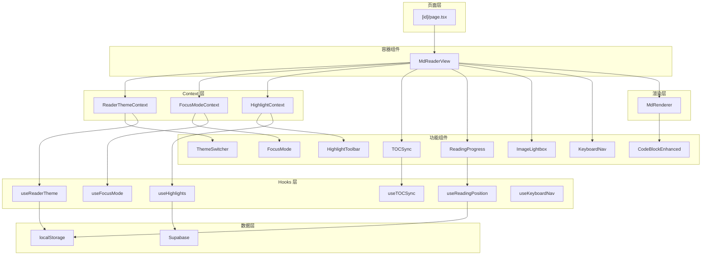

# Design Document: MD Reader Upgrade

## Overview

本设计文档描述 AnyKeep Markdown 阅读器升级的技术实现方案，涵盖 10 个需求的架构设计、组件接口、数据模型和测试策略。

**核心设计原则**：

- **渐进增强**：在现有 `md-reader-view.tsx` 基础上扩展，不破坏现有功能
- **模块化**：每个功能独立封装为 Hook 或组件
- **性能优先**：使用 CSS Variables、IntersectionObserver 等原生 API
- **类型安全**：完整 TypeScript 类型覆盖

---

## Steering Document Alignment

### Technical Standards (tech.md)

- **框架**: Next.js 14 App Router + React 18
- **样式**: Tailwind CSS 4 + CSS Variables（主题切换）
- **状态管理**: React Hooks + Context（阅读器状态）
- **数据获取**: SWR（高亮数据缓存）
- **类型系统**: TypeScript 5 + Zod（运行时验证）

### Project Structure (structure.md)

```
src/features/md-collections/
├── components/
│   ├── reader/                    # 新增：阅读器增强组件
│   │   ├── theme-switcher.tsx     # REQ-1: 主题切换器
│   │   ├── toc-sync.tsx           # REQ-3: 目录同步
│   │   ├── reading-progress.tsx   # REQ-4: 进度增强
│   │   ├── focus-mode.tsx         # REQ-6: 专注模式
│   │   ├── image-lightbox.tsx     # REQ-7: 图片放大
│   │   ├── code-block-enhanced.tsx # REQ-8: 代码块增强
│   │   ├── highlight-toolbar.tsx  # REQ-10: 高亮工具栏
│   │   └── keyboard-nav.tsx       # REQ-9: 键盘导航
│   ├── md-reader-view.tsx         # 修改：集成新功能
│   └── md-renderer.tsx            # 修改：排版优化 + 高亮渲染
├── hooks/
│   ├── reader/                    # 新增：阅读器 Hooks
│   │   ├── use-reader-theme.ts    # 主题状态
│   │   ├── use-toc-sync.ts        # 目录同步
│   │   ├── use-reading-position.ts # 位置记忆
│   │   ├── use-focus-mode.ts      # 专注模式
│   │   ├── use-highlights.ts      # 高亮管理
│   │   └── use-keyboard-nav.ts    # 键盘导航
│   └── ...
├── lib/
│   └── reader/                    # 新增：阅读器工具
│       ├── theme-config.ts        # 主题配置
│       ├── typography.ts          # 排版配置
│       └── highlight-utils.ts     # 高亮工具函数
├── types/
│   └── reader.ts                  # 新增：阅读器类型
└── constants/
    └── reader.ts                  # 新增：阅读器常量
```

---

## Code Reuse Analysis

### Existing Components to Leverage

| 现有组件/工具                   | 复用方式                             |
| ------------------------------- | ------------------------------------ |
| `md-reader-view.tsx`            | 扩展：添加主题 Context、专注模式状态 |
| `md-renderer.tsx`               | 扩展：高亮标记渲染、排版样式         |
| `use-md-view-preference.ts`     | 参考：偏好存储模式                   |
| `use-md-collections-swr.ts`     | 参考：SWR 缓存策略                   |
| `src/components/ui/button.tsx`  | 直接使用：工具栏按钮                 |
| `src/components/ui/popover.tsx` | 直接使用：高亮颜色选择器             |
| `src/components/ui/dialog.tsx`  | 直接使用：快捷键帮助                 |

### Integration Points

| 集成点                        | 集成方式                               |
| ----------------------------- | -------------------------------------- |
| `md_collections` 表           | 新增 `last_read_position` 字段（可选） |
| `md_collection_highlights` 表 | 新增表，存储高亮数据                   |
| Supabase RLS                  | 用户只能访问自己的高亮                 |
| Next.js App Router            | 无变化，复用现有路由                   |

---

## Architecture

### 整体架构图



### 模块化设计原则

- **Single File Responsibility**: 每个文件专注单一功能
  - `theme-switcher.tsx`: 仅处理主题 UI
  - `use-reader-theme.ts`: 仅处理主题状态逻辑
  - `theme-config.ts`: 仅存储主题配置

- **Component Isolation**: 功能组件独立，通过 Context 通信
  - `HighlightToolbar` 不直接修改 DOM，通过 `HighlightContext` 管理状态
  - `FocusMode` 通过 `FocusModeContext` 控制侧边栏和工具栏

- **Service Layer Separation**:
  - UI 层：组件渲染
  - Hook 层：状态管理和副作用
  - Lib 层：纯函数工具

---

## Components and Interfaces

### 1. ReaderThemeContext + ThemeSwitcher

**Purpose:** 管理阅读主题状态，提供主题切换 UI

**接口:**

```typescript
// types/reader.ts
type ThemeId = "light" | "dark" | "sepia" | "paper";

interface ReaderTheme {
  id: ThemeId;
  name: string;
  colors: {
    background: string;
    foreground: string;
    accent: string;
    muted: string;
    border: string;
  };
}

interface ReaderThemeContextValue {
  theme: ReaderTheme;
  setTheme: (id: ThemeId) => void;
  themes: ReaderTheme[];
}

// hooks/reader/use-reader-theme.ts
function useReaderTheme(): ReaderThemeContextValue;

// components/reader/theme-switcher.tsx
interface ThemeSwitcherProps {
  className?: string;
}
function ThemeSwitcher(props: ThemeSwitcherProps): JSX.Element;
```

**Dependencies:** localStorage, CSS Variables

**Reuses:** `use-md-view-preference.ts` 存储模式

---

### 2. TOCSync

**Purpose:** 目录滚动同步高亮

**接口:**

```typescript
// hooks/reader/use-toc-sync.ts
interface TOCItem {
  id: string;
  text: string;
  level: number;
}

interface UseTOCSyncOptions {
  containerRef: RefObject<HTMLElement>;
  tocItems: TOCItem[];
}

interface UseTOCSyncResult {
  activeId: string | null;
  scrollToHeading: (id: string) => void;
}

function useTOCSync(options: UseTOCSyncOptions): UseTOCSyncResult;

// components/reader/toc-sync.tsx
interface TOCSyncProps {
  items: TOCItem[];
  activeId: string | null;
  onItemClick: (id: string) => void;
  className?: string;
}
function TOCSync(props: TOCSyncProps): JSX.Element;
```

**Dependencies:** IntersectionObserver

**Reuses:** 现有 `parseTableOfContents` 函数

---

### 3. ReadingProgress

**Purpose:** 增强的阅读进度显示

**接口:**

```typescript
// hooks/reader/use-reading-position.ts
interface ReadingPosition {
  scrollTop: number;
  progress: number; // 0-100
  timestamp: number;
}

interface UseReadingPositionOptions {
  collectionId: number;
  contentRef: RefObject<HTMLElement>;
  readingTimeMinutes: number;
}

interface UseReadingPositionResult {
  progress: number;
  remainingMinutes: number;
  savedPosition: ReadingPosition | null;
  savePosition: () => void;
  restorePosition: () => void;
  clearPosition: () => void;
}

function useReadingPosition(
  options: UseReadingPositionOptions,
): UseReadingPositionResult;

// components/reader/reading-progress.tsx
interface ReadingProgressProps {
  progress: number;
  remainingMinutes: number;
  onComplete?: () => void;
}
function ReadingProgress(props: ReadingProgressProps): JSX.Element;
```

**Dependencies:** localStorage, scroll 事件

---

### 4. FocusModeContext + FocusMode

**Purpose:** 专注阅读模式

**接口:**

```typescript
// hooks/reader/use-focus-mode.ts
interface UseFocusModeResult {
  isFocusMode: boolean;
  toggleFocusMode: () => void;
  exitFocusMode: () => void;
  isToolbarVisible: boolean;
  showToolbar: () => void;
}

function useFocusMode(): UseFocusModeResult;

// components/reader/focus-mode.tsx
interface FocusModeProps {
  children: React.ReactNode;
}
function FocusMode(props: FocusModeProps): JSX.Element;
```

**Dependencies:** setTimeout（工具栏自动隐藏）

---

### 5. ImageLightbox

**Purpose:** 图片放大查看

**接口:**

```typescript
// components/reader/image-lightbox.tsx
interface ImageLightboxProps {
  images: Array<{ src: string; alt?: string }>;
  initialIndex?: number;
  isOpen: boolean;
  onClose: () => void;
}
function ImageLightbox(props: ImageLightboxProps): JSX.Element;
```

**Dependencies:** `yet-another-react-lightbox`

**Reuses:** Next.js `dynamic` 导入

---

### 6. CodeBlockEnhanced

**Purpose:** 增强代码块（折叠、复制动画）

**接口:**

```typescript
// components/reader/code-block-enhanced.tsx
interface CodeBlockEnhancedProps {
  code: string;
  language: string;
  maxCollapsedLines?: number; // 默认 20
}
function CodeBlockEnhanced(props: CodeBlockEnhancedProps): JSX.Element;
```

**Dependencies:** 无新增

**Reuses:** 现有 `CodeBlock` 组件

---

### 7. HighlightContext + HighlightToolbar + useHighlights

**Purpose:** 文字高亮标记管理

**接口:**

```typescript
// types/reader.ts
type HighlightColor = "yellow" | "green" | "blue" | "pink" | "purple";

interface TextHighlight {
  id: string;
  collection_id: number;
  user_id: string;
  start_offset: number;
  end_offset: number;
  anchor_text: string;
  color: HighlightColor;
  created_at: string;
  updated_at: string;
}

// hooks/reader/use-highlights.ts
interface UseHighlightsOptions {
  collectionId: number;
  contentRef: RefObject<HTMLElement>;
}

interface UseHighlightsResult {
  highlights: TextHighlight[];
  isLoading: boolean;
  createHighlight: (range: Range, color: HighlightColor) => Promise<void>;
  updateHighlight: (id: string, color: HighlightColor) => Promise<void>;
  deleteHighlight: (id: string) => Promise<void>;
  selectedRange: Range | null;
  clearSelection: () => void;
}

function useHighlights(options: UseHighlightsOptions): UseHighlightsResult;

// components/reader/highlight-toolbar.tsx
interface HighlightToolbarProps {
  position: { x: number; y: number } | null;
  onColorSelect: (color: HighlightColor) => void;
  onClose: () => void;
  existingColor?: HighlightColor; // 编辑模式
  onDelete?: () => void; // 编辑模式
}
function HighlightToolbar(props: HighlightToolbarProps): JSX.Element;
```

**Dependencies:** Selection API, Supabase

---

### 8. KeyboardNav

**Purpose:** 键盘快捷键导航

**接口:**

```typescript
// hooks/reader/use-keyboard-nav.ts
interface KeyboardShortcut {
  key: string;
  description: string;
  action: () => void;
}

interface UseKeyboardNavOptions {
  shortcuts: KeyboardShortcut[];
  enabled?: boolean;
}

function useKeyboardNav(options: UseKeyboardNavOptions): void;

// components/reader/keyboard-nav.tsx
interface KeyboardNavProps {
  isHelpOpen: boolean;
  onHelpClose: () => void;
}
function KeyboardNav(props: KeyboardNavProps): JSX.Element;
```

**Dependencies:** 无新增

---

## Data Models

### 1. 阅读器主题配置

```typescript
// lib/reader/theme-config.ts
export const READER_THEMES: Record<ThemeId, ReaderTheme> = {
  light: {
    id: "light",
    name: "明亮",
    colors: {
      background: "#ffffff",
      foreground: "#1a1a1a",
      accent: "#2563eb",
      muted: "#f5f5f5",
      border: "#e5e5e5",
    },
  },
  dark: {
    id: "dark",
    name: "暗黑",
    colors: {
      background: "#1a1a1a",
      foreground: "#e5e5e5",
      accent: "#60a5fa",
      muted: "#2d2d2d",
      border: "#404040",
    },
  },
  sepia: {
    id: "sepia",
    name: "护眼",
    colors: {
      background: "#f5f0e6",
      foreground: "#5c4b37",
      accent: "#b45309",
      muted: "#ebe5d9",
      border: "#d9d0c0",
    },
  },
  paper: {
    id: "paper",
    name: "羊皮纸",
    colors: {
      background: "#faf8f5",
      foreground: "#3d3d3d",
      accent: "#6366f1",
      muted: "#f0ede8",
      border: "#e0ddd5",
    },
  },
};
```

### 2. 高亮颜色配置

```typescript
// lib/reader/highlight-config.ts
export const HIGHLIGHT_COLORS: Record<
  HighlightColor,
  { bg: string; label: string }
> = {
  yellow: { bg: "#fef08a", label: "重点" },
  green: { bg: "#bbf7d0", label: "已掌握" },
  blue: { bg: "#bfdbfe", label: "待深入" },
  pink: { bg: "#fbcfe8", label: "感悟" },
  purple: { bg: "#ddd6fe", label: "引用" },
};
```

### 3. 数据库表：md_collection_highlights

```sql
-- supabase/migrations/YYYYMMDDHHMMSS_add_md_collection_highlights.sql

CREATE TABLE IF NOT EXISTS md_collection_highlights (
  id UUID PRIMARY KEY DEFAULT gen_random_uuid(),
  collection_id BIGINT NOT NULL REFERENCES md_collections(id) ON DELETE CASCADE,
  user_id UUID NOT NULL REFERENCES auth.users(id) ON DELETE CASCADE,

  -- 定位信息
  start_offset INTEGER NOT NULL,
  end_offset INTEGER NOT NULL,
  anchor_text TEXT NOT NULL,           -- 用于内容变更后模糊匹配

  -- 样式
  color VARCHAR(20) NOT NULL CHECK (color IN ('yellow', 'green', 'blue', 'pink', 'purple')),

  -- 时间戳
  created_at TIMESTAMPTZ NOT NULL DEFAULT NOW(),
  updated_at TIMESTAMPTZ NOT NULL DEFAULT NOW(),

  -- 约束
  CONSTRAINT valid_offset CHECK (start_offset >= 0 AND end_offset > start_offset)
);

-- 索引
CREATE INDEX idx_highlights_collection ON md_collection_highlights(collection_id);
CREATE INDEX idx_highlights_user ON md_collection_highlights(user_id);

-- RLS
ALTER TABLE md_collection_highlights ENABLE ROW LEVEL SECURITY;

CREATE POLICY "Users can manage own highlights"
  ON md_collection_highlights
  FOR ALL
  USING (auth.uid() = user_id)
  WITH CHECK (auth.uid() = user_id);

-- 触发器：自动更新 updated_at
CREATE TRIGGER update_highlights_updated_at
  BEFORE UPDATE ON md_collection_highlights
  FOR EACH ROW
  EXECUTE FUNCTION update_updated_at_column();
```

### 4. 阅读位置存储结构

```typescript
// localStorage key: `md-reader-position-${collectionId}`
interface ReadingPositionStorage {
  scrollTop: number;
  progress: number;
  timestamp: number; // Date.now()
}
```

---

## Error Handling

### 1. 主题加载失败

**Scenario:** localStorage 不可用或数据损坏

**Handling:**

```typescript
try {
  const saved = localStorage.getItem("md-reader-theme");
  return saved ? JSON.parse(saved) : "light";
} catch {
  return "light"; // 降级到默认主题
}
```

**User Impact:** 使用默认明亮主题，无提示

---

### 2. 高亮数据加载失败

**Scenario:** 网络错误或 Supabase 不可用

**Handling:**

```typescript
const { data, error } = await supabase
  .from("md_collection_highlights")
  .select("*")
  .eq("collection_id", collectionId);

if (error) {
  console.error("Failed to load highlights:", error);
  toast.error("高亮加载失败，请刷新重试");
  return [];
}
```

**User Impact:** 显示 Toast 提示，内容正常显示但无高亮

---

### 3. 高亮保存失败

**Scenario:** 网络错误或并发冲突

**Handling:**

```typescript
const { error } = await supabase
  .from("md_collection_highlights")
  .insert(highlight);

if (error) {
  // 乐观更新回滚
  mutate(previousHighlights);
  toast.error("高亮保存失败");
  return;
}
```

**User Impact:** 高亮立即显示（乐观更新），失败后消失并提示

---

### 4. 字体加载失败

**Scenario:** CDN 不可用

**Handling:** CSS 字体栈自动回退

```css
font-family: "LXGW WenKai", "Source Han Serif SC", serif;
```

**User Impact:** 使用系统衬线字体，体验略有下降

---

### 5. IntersectionObserver 不支持

**Scenario:** 极老旧浏览器

**Handling:**

```typescript
if (!("IntersectionObserver" in window)) {
  console.warn("IntersectionObserver not supported, TOC sync disabled");
  return { activeId: null, scrollToHeading: () => {} };
}
```

**User Impact:** 目录不高亮，点击仍可跳转

---

## Testing Strategy

### Unit Testing

**范围:**

- `theme-config.ts`: 主题配置验证
- `typography.ts`: 排版参数计算
- `highlight-utils.ts`: 高亮工具函数

**示例:**

```typescript
// __tests__/lib/reader/highlight-utils.test.ts
describe("calculateHighlightPosition", () => {
  it("should calculate correct offset for single paragraph", () => {
    const content = "Hello world";
    const range = { startOffset: 0, endOffset: 5 };
    expect(calculateOffset(content, range)).toEqual({ start: 0, end: 5 });
  });

  it("should handle cross-paragraph selection", () => {
    // ...
  });
});
```

---

### Integration Testing

**范围:**

- `useHighlights` Hook 与 Supabase 交互
- `useTOCSync` Hook 与 DOM 交互
- `useReadingPosition` 与 localStorage 交互

**示例:**

```typescript
// __tests__/hooks/reader/use-highlights.test.ts
describe("useHighlights", () => {
  it("should load highlights on mount", async () => {
    const { result, waitFor } = renderHook(() =>
      useHighlights({ collectionId: 1, contentRef: mockRef }),
    );

    await waitFor(() => !result.current.isLoading);
    expect(result.current.highlights).toHaveLength(3);
  });

  it("should optimistically update on create", async () => {
    // ...
  });
});
```

---

### End-to-End Testing

**范围:**

- 主题切换完整流程
- 高亮创建、编辑、删除流程
- 阅读位置恢复流程
- 键盘导航流程

**示例:**

```typescript
// e2e/md-reader.spec.ts
test("should create and persist highlight", async ({ page }) => {
  await page.goto("/md-collections/1");

  // 选中文字
  await page.locator(".md-content p").first().selectText();

  // 点击黄色高亮
  await page.locator('[data-testid="highlight-yellow"]').click();

  // 验证高亮显示
  await expect(page.locator("mark.highlight-yellow")).toBeVisible();

  // 刷新页面验证持久化
  await page.reload();
  await expect(page.locator("mark.highlight-yellow")).toBeVisible();
});
```

---

## Implementation Notes

### CSS Variables 结构

```css
/* 在 md-reader-view.tsx 容器上设置 */
.md-reader[data-theme="light"] {
  --reader-bg: #ffffff;
  --reader-fg: #1a1a1a;
  --reader-accent: #2563eb;
  --reader-muted: #f5f5f5;
  --reader-border: #e5e5e5;
}

.md-reader[data-theme="dark"] {
  --reader-bg: #1a1a1a;
  --reader-fg: #e5e5e5;
  /* ... */
}

/* 排版变量 */
.md-reader {
  --reader-line-height: 1.8;
  --reader-paragraph-spacing: 1.5em;
  --reader-max-width: 70ch;
  --reader-font-size: 1rem;
}

.md-reader[data-font-size="small"] {
  --reader-font-size: 0.875rem;
}

.md-reader[data-font-size="large"] {
  --reader-font-size: 1.125rem;
}
```

### 高亮渲染策略

**方案对比:**

| 方案              | 优点       | 缺点                   | 选择    |
| ----------------- | ---------- | ---------------------- | ------- |
| `<mark>` 标签     | 兼容性好   | 需要修改 DOM           | ✅ 采用 |
| CSS `::highlight` | 不修改 DOM | 兼容性差 (Chrome 105+) | ❌      |
| 绝对定位覆盖层    | 不修改内容 | 定位复杂               | ❌      |

**实现:**
在 `MdRenderer` 中添加后处理步骤，将高亮位置转换为 `<mark>` 标签。

### 性能优化要点

1. **主题切换**: 使用 CSS Variables，无 React 重渲染
2. **目录同步**: `IntersectionObserver` 替代 scroll 事件
3. **高亮加载**: SWR 缓存，避免重复请求
4. **图片放大**: `next/dynamic` 动态导入
5. **代码块折叠**: CSS `max-height` 动画，非 JS 计算

---

## Migration Plan

### Phase 1: 基础设施（Day 1）

1. 创建 `types/reader.ts` 类型定义
2. 创建 `lib/reader/` 配置文件
3. 创建 `ReaderThemeContext`
4. 数据库迁移：`md_collection_highlights` 表

### Phase 2: 视觉增强（Day 2-3）

1. 实现 `ThemeSwitcher` 组件
2. 实现排版优化 CSS
3. 实现 `TOCSync` 组件
4. 实现 `ReadingProgress` 组件

### Phase 3: 交互增强（Day 4-5）

1. 实现 `useReadingPosition` Hook
2. 实现 `FocusMode` 组件
3. 实现 `ImageLightbox` 组件
4. 实现 `CodeBlockEnhanced` 组件

### Phase 4: 高亮系统（Day 6-7）

1. 实现 `useHighlights` Hook
2. 实现 `HighlightToolbar` 组件
3. 集成到 `MdRenderer`

### Phase 5: 键盘导航 + 测试（Day 8）

1. 实现 `useKeyboardNav` Hook
2. 编写单元测试
3. 编写 E2E 测试
4. 文档更新
