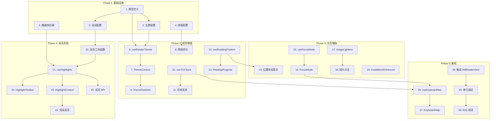

# Tasks Document: MD Reader Upgrade

## Phase 1: 基础设施 (Day 1)

- [x] 1. 创建阅读器类型定义
  - File: `src/features/md-collections/types/reader.ts`
  - 定义 ThemeId, ReaderTheme, HighlightColor, TextHighlight 等类型
  - 定义 Context 值类型和 Hook 返回类型
  - Purpose: 为整个功能建立类型安全基础
  - _Leverage: `src/features/md-collections/types/index.ts`_
  - _Requirements: REQ-1, REQ-10_
  - _Prompt: Implement the task for spec md-reader-upgrade, first run spec-workflow-guide to get the workflow guide then implement the task: Role: TypeScript Developer specializing in React type systems | Task: Create comprehensive TypeScript types for reader theme, highlight, and state management following REQ-1 and REQ-10, referencing existing types in src/features/md-collections/types/index.ts | Restrictions: Do not modify existing types, use strict TypeScript mode, follow project naming conventions (PascalCase for types) | \_Leverage: existing MdCollection type patterns | Success: All types compile without errors, exported from module index, full coverage for theme and highlight features | Instructions: Before starting, edit tasks.md to change [ ] to [-] for this task. After completing, use log-implementation tool to record what was implemented, then change [-] to [x]._

- [x] 2. 创建主题配置
  - File: `src/features/md-collections/lib/reader/theme-config.ts`
  - 定义 4 种主题的完整配置（light, dark, sepia, paper）
  - 包含颜色、CSS 变量映射
  - Purpose: 集中管理主题配置，便于维护和扩展
  - _Leverage: Tailwind CSS 颜色系统_
  - _Requirements: REQ-1_
  - _Prompt: Implement the task for spec md-reader-upgrade, first run spec-workflow-guide to get the workflow guide then implement the task: Role: Frontend Developer with CSS theming expertise | Task: Create theme configuration with 4 themes (light, dark, sepia, paper) following REQ-1 specifications | Restrictions: Use CSS variable naming convention (--reader-\*), colors must meet WCAG AA contrast ratio, export as const for type inference | \_Leverage: Tailwind color palette | Success: All 4 themes defined with complete color sets, CSS variable names follow convention, TypeScript infers literal types | Instructions: Before starting, edit tasks.md to change [ ] to [-] for this task. After completing, use log-implementation tool to record what was implemented, then change [-] to [x]._

- [x] 3. 创建高亮颜色配置
  - File: `src/features/md-collections/lib/reader/highlight-config.ts`
  - 定义 5 种高亮颜色配置（yellow, green, blue, pink, purple）
  - 包含背景色、标签文字
  - Purpose: 集中管理高亮颜色，便于维护
  - _Leverage: Tailwind CSS 颜色系统_
  - _Requirements: REQ-10_
  - _Prompt: Implement the task for spec md-reader-upgrade, first run spec-workflow-guide to get the workflow guide then implement the task: Role: Frontend Developer | Task: Create highlight color configuration with 5 colors following REQ-10 specifications | Restrictions: Colors must be readable on all themes, use Tailwind color naming where possible | \_Leverage: Tailwind color palette | Success: All 5 colors defined with bg and label, colors work across all reader themes | Instructions: Before starting, edit tasks.md to change [ ] to [-] for this task. After completing, use log-implementation tool to record what was implemented, then change [-] to [x]._

- [x] 4. 创建排版配置
  - File: `src/features/md-collections/lib/reader/typography.ts`
  - 定义行高、段间距、最大宽度等排版参数
  - 定义字体大小预设（small, medium, large）
  - Purpose: 集中管理排版参数，支持响应式调整
  - _Leverage: 现有 md-renderer.tsx 样式_
  - _Requirements: REQ-2_
  - _Prompt: Implement the task for spec md-reader-upgrade, first run spec-workflow-guide to get the workflow guide then implement the task: Role: Typography Specialist | Task: Create typography configuration with optimal reading parameters following REQ-2 specifications (line-height 1.8, paragraph spacing 1.5em, max-width 70ch) | Restrictions: Parameters must work for both Chinese and English content, font sizes must scale proportionally | \_Leverage: existing md-renderer.tsx styles | Success: All typography parameters defined, font size presets work correctly, exported as TypeScript constants | Instructions: Before starting, edit tasks.md to change [ ] to [-] for this task. After completing, use log-implementation tool to record what was implemented, then change [-] to [x]._

- [x] 5. 创建高亮数据库迁移
  - File: `supabase/migrations/YYYYMMDD_add_md_collection_highlights.sql`
  - 创建 md_collection_highlights 表
  - 添加索引和 RLS 策略
  - Purpose: 持久化存储用户高亮数据
  - _Leverage: 现有 md_collections 表结构和 RLS 模式_
  - _Requirements: REQ-10_
  - _Prompt: Implement the task for spec md-reader-upgrade, first run spec-workflow-guide to get the workflow guide then implement the task: Role: Database Engineer with Supabase expertise | Task: Create database migration for md_collection_highlights table following REQ-10 data model | Restrictions: Must enable RLS, follow existing migration naming convention, add proper indexes for query performance | \_Leverage: existing md_collections table structure and RLS patterns | Success: Migration runs without errors, RLS policies work correctly, table indexed for collection_id and user_id queries | Instructions: Before starting, edit tasks.md to change [ ] to [-] for this task. After completing, use log-implementation tool to record what was implemented, then change [-] to [x]._

---

## Phase 2: 视觉增强 (Day 2-3)

- [x] 6. 实现 useReaderTheme Hook
  - File: `src/features/md-collections/hooks/reader/use-reader-theme.ts`
  - 管理主题状态（localStorage 持久化）
  - 提供 setTheme 方法
  - 监听系统暗色模式偏好
  - Purpose: 封装主题状态管理逻辑
  - _Leverage: `use-md-view-preference.ts` 存储模式_
  - _Requirements: REQ-1_
  - _Prompt: Implement the task for spec md-reader-upgrade, first run spec-workflow-guide to get the workflow guide then implement the task: Role: React Hooks Specialist | Task: Create useReaderTheme hook with localStorage persistence and system preference detection following REQ-1 | Restrictions: Handle SSR hydration mismatch, debounce localStorage writes, handle localStorage unavailable gracefully | \_Leverage: use-md-view-preference.ts storage pattern | Success: Theme persists across page reloads, system preference detected on first load, no hydration errors | Instructions: Before starting, edit tasks.md to change [ ] to [-] for this task. After completing, use log-implementation tool to record what was implemented, then change [-] to [x]._

- [x] 7. 实现 ReaderThemeContext
  - File: `src/features/md-collections/components/reader/reader-theme-provider.tsx`
  - 创建 Context 和 Provider 组件
  - 应用 CSS Variables 到容器
  - Purpose: 为子组件提供主题状态访问
  - _Leverage: React Context API_
  - _Requirements: REQ-1_
  - _Prompt: Implement the task for spec md-reader-upgrade, first run spec-workflow-guide to get the workflow guide then implement the task: Role: React Developer | Task: Create ReaderThemeContext and Provider that applies CSS variables to container following REQ-1 | Restrictions: Use data-theme attribute for CSS targeting, avoid unnecessary re-renders, provide useReaderTheme hook export | \_Leverage: React Context best practices | Success: CSS variables applied correctly on theme change, context value memoized, provider works with SSR | Instructions: Before starting, edit tasks.md to change [ ] to [-] for this task. After completing, use log-implementation tool to record what was implemented, then change [-] to [x]._

- [x] 8. 实现 ThemeSwitcher 组件
  - File: `src/features/md-collections/components/reader/theme-switcher.tsx`
  - 显示主题选择器 UI
  - 使用 Popover 展示选项
  - Purpose: 提供用户可交互的主题切换界面
  - _Leverage: `src/components/ui/popover.tsx`, `src/components/ui/button.tsx`_
  - _Requirements: REQ-1_
  - _Prompt: Implement the task for spec md-reader-upgrade, first run spec-workflow-guide to get the workflow guide then implement the task: Role: UI Developer | Task: Create ThemeSwitcher component with Popover UI following REQ-1 | Restrictions: Use existing UI components (Popover, Button), show color preview for each theme, support keyboard navigation | \_Leverage: src/components/ui/popover.tsx, src/components/ui/button.tsx | Success: Theme switcher shows 4 options with previews, clicking applies theme immediately, accessible with keyboard | Instructions: Before starting, edit tasks.md to change [ ] to [-] for this task. After completing, use log-implementation tool to record what was implemented, then change [-] to [x]._

- [x] 9. 应用排版优化到 MdRenderer
  - File: `src/features/md-collections/components/md-renderer.tsx` (修改)
  - 应用新的排版 CSS 变量
  - 添加字体加载（LXGW WenKai 或回退）
  - Purpose: 提升阅读舒适度
  - _Leverage: typography.ts 配置_
  - _Requirements: REQ-2_
  - _Prompt: Implement the task for spec md-reader-upgrade, first run spec-workflow-guide to get the workflow guide then implement the task: Role: CSS Typography Specialist | Task: Apply typography optimizations to MdRenderer following REQ-2 (line-height 1.8, paragraph spacing 1.5em, max-width 70ch) | Restrictions: Do not break existing code block styling, ensure Chinese font fallback works, use CSS variables for flexibility | \_Leverage: typography.ts configuration | Success: Typography parameters applied, Chinese text renders with reading font, no layout regressions | Instructions: Before starting, edit tasks.md to change [ ] to [-] for this task. After completing, use log-implementation tool to record what was implemented, then change [-] to [x]._

- [x] 10. 实现 useTOCSync Hook
  - File: `src/features/md-collections/hooks/reader/use-toc-sync.ts`
  - 使用 IntersectionObserver 监听标题可见性
  - 返回当前活动章节 ID
  - 提供 scrollToHeading 方法
  - Purpose: 实现目录与内容的同步
  - _Leverage: IntersectionObserver API_
  - _Requirements: REQ-3_
  - _Prompt: Implement the task for spec md-reader-upgrade, first run spec-workflow-guide to get the workflow guide then implement the task: Role: React Hooks Specialist with DOM expertise | Task: Create useTOCSync hook with IntersectionObserver following REQ-3 | Restrictions: Handle multiple visible headings (pick topmost), debounce state updates, cleanup observers on unmount | \_Leverage: IntersectionObserver API | Success: Active heading updates on scroll, scrollToHeading works smoothly, no memory leaks | Instructions: Before starting, edit tasks.md to change [ ] to [-] for this task. After completing, use log-implementation tool to record what was implemented, then change [-] to [x]._

- [x] 11. 更新目录组件支持同步高亮
  - File: `src/features/md-collections/components/md-reader-view.tsx` (修改)
  - 集成 useTOCSync Hook
  - 添加当前章节高亮样式
  - 目录自动滚动到可见区域
  - Purpose: 提供实时阅读位置反馈
  - _Leverage: 现有目录渲染逻辑_
  - _Requirements: REQ-3_
  - _Prompt: Implement the task for spec md-reader-upgrade, first run spec-workflow-guide to get the workflow guide then implement the task: Role: React Developer | Task: Update TOC component to highlight active section and auto-scroll following REQ-3 | Restrictions: Highlight transition ≤ 200ms, scroll behavior smooth, do not modify existing TOC parsing logic | \_Leverage: existing TOC rendering in md-reader-view.tsx | Success: Active section highlighted, TOC auto-scrolls to show active item, smooth transitions | Instructions: Before starting, edit tasks.md to change [ ] to [-] for this task. After completing, use log-implementation tool to record what was implemented, then change [-] to [x]._

- [x] 12. 实现 useReadingPosition Hook
  - File: `src/features/md-collections/hooks/reader/use-reading-position.ts`
  - 监听滚动计算进度百分比
  - 计算剩余阅读时间
  - localStorage 存储/恢复位置
  - Purpose: 管理阅读进度和位置记忆
  - _Leverage: localStorage API_
  - _Requirements: REQ-4, REQ-5_
  - _Prompt: Implement the task for spec md-reader-upgrade, first run spec-workflow-guide to get the workflow guide then implement the task: Role: React Hooks Specialist | Task: Create useReadingPosition hook with progress calculation and localStorage persistence following REQ-4 and REQ-5 | Restrictions: Debounce scroll handler (100ms), position data expires after 30 days, handle content length changes | \_Leverage: localStorage API | Success: Progress percentage accurate, remaining time calculated, position restored on page load | Instructions: Before starting, edit tasks.md to change [ ] to [-] for this task. After completing, use log-implementation tool to record what was implemented, then change [-] to [x]._

- [x] 13. 实现 ReadingProgress 组件
  - File: `src/features/md-collections/components/reader/reading-progress.tsx`
  - 显示进度百分比和剩余时间
  - 格式：`50% · 约 3 分钟` 或 `即将读完`
  - Purpose: 向用户展示阅读进度
  - _Leverage: useReadingPosition Hook_
  - _Requirements: REQ-4_
  - _Prompt: Implement the task for spec md-reader-upgrade, first run spec-workflow-guide to get the workflow guide then implement the task: Role: UI Developer | Task: Create ReadingProgress component displaying progress and remaining time following REQ-4 format specifications | Restrictions: Format as "50% · 约 3 分钟", show "即将读完" when < 1 min, show "阅读完成" at ≥ 95% | \_Leverage: useReadingPosition hook | Success: Progress displays correctly, remaining time accurate, completion state triggers callback | Instructions: Before starting, edit tasks.md to change [ ] to [-] for this task. After completing, use log-implementation tool to record what was implemented, then change [-] to [x]._

---

## Phase 3: 交互增强 (Day 4-5)

- [x] 14. 实现位置恢复提示 UI
  - File: `src/features/md-collections/components/reader/position-restore-prompt.tsx`
  - 显示"继续上次阅读？"提示
  - 提供"继续"和"从头开始"按钮
  - Purpose: 让用户选择是否恢复阅读位置
  - _Leverage: `src/components/ui/alert-dialog.tsx`_
  - _Requirements: REQ-5_
  - _Prompt: Implement the task for spec md-reader-upgrade, first run spec-workflow-guide to get the workflow guide then implement the task: Role: UI Developer | Task: Create PositionRestorePrompt component following REQ-5 | Restrictions: Use existing AlertDialog component, show saved progress percentage, auto-dismiss after user choice | \_Leverage: src/components/ui/alert-dialog.tsx | Success: Prompt shows when saved position exists, "继续" scrolls to position, "从头开始" clears saved position | Instructions: Before starting, edit tasks.md to change [ ] to [-] for this task. After completing, use log-implementation tool to record what was implemented, then change [-] to [x]._

- [x] 15. 实现 useFocusMode Hook
  - File: `src/features/md-collections/hooks/reader/use-focus-mode.ts`
  - 管理专注模式状态
  - 工具栏 3 秒自动隐藏逻辑
  - 鼠标/滚动时显示工具栏
  - Purpose: 封装专注模式状态逻辑
  - _Leverage: setTimeout/clearTimeout_
  - _Requirements: REQ-6_
  - _Prompt: Implement the task for spec md-reader-upgrade, first run spec-workflow-guide to get the workflow guide then implement the task: Role: React Hooks Specialist | Task: Create useFocusMode hook with auto-hide toolbar logic following REQ-6 | Restrictions: Toolbar auto-hides after 3 seconds of inactivity, mouse move or scroll shows toolbar, cleanup timeouts on unmount | \_Leverage: setTimeout/clearTimeout | Success: Focus mode toggles correctly, toolbar auto-hides, activity detection works | Instructions: Before starting, edit tasks.md to change [ ] to [-] for this task. After completing, use log-implementation tool to record what was implemented, then change [-] to [x]._

- [x] 16. 实现 FocusModeContext 和 FocusMode 组件
  - File: `src/features/md-collections/components/reader/focus-mode.tsx`
  - 创建 Context 和 Provider
  - 实现工具栏淡出动画
  - 内容居中布局
  - Purpose: 提供沉浸式阅读体验
  - _Leverage: useFocusMode Hook_
  - _Requirements: REQ-6_
  - _Prompt: Implement the task for spec md-reader-upgrade, first run spec-workflow-guide to get the workflow guide then implement the task: Role: React Developer with CSS animation expertise | Task: Create FocusMode component with toolbar fade animation following REQ-6 | Restrictions: Toolbar fade-out 500ms ease-out, sidebar hidden, content centered with margin auto | \_Leverage: useFocusMode hook | Success: Focus mode hides sidebar and auto-hides toolbar, content centered, animations smooth | Instructions: Before starting, edit tasks.md to change [ ] to [-] for this task. After completing, use log-implementation tool to record what was implemented, then change [-] to [x]._

- [x] 17. 实现 ImageLightbox 组件
  - File: `src/features/md-collections/components/reader/image-lightbox.tsx`
  - 集成 yet-another-react-lightbox
  - 支持键盘导航（← → 切换，Esc 关闭）
  - Purpose: 提供图片放大查看功能
  - _Leverage: `yet-another-react-lightbox` 库_
  - _Requirements: REQ-7_
  - _Prompt: Implement the task for spec md-reader-upgrade, first run spec-workflow-guide to get the workflow guide then implement the task: Role: React Developer | Task: Create ImageLightbox component using yet-another-react-lightbox following REQ-7 | Restrictions: Dynamic import to avoid SSR issues, support keyboard navigation, handle image load errors gracefully | \_Leverage: yet-another-react-lightbox library | Success: Images open in lightbox on click, keyboard navigation works, Esc closes lightbox | Instructions: Before starting, edit tasks.md to change [ ] to [-] for this task. After completing, use log-implementation tool to record what was implemented, then change [-] to [x]._

- [x] 18. 更新 MdRenderer 图片点击处理
  - File: `src/features/md-collections/components/md-renderer.tsx` (修改)
  - 收集文档中所有图片
  - 图片点击触发 Lightbox
  - Purpose: 连接图片与 Lightbox
  - _Leverage: ImageLightbox 组件_
  - _Requirements: REQ-7_
  - _Prompt: Implement the task for spec md-reader-upgrade, first run spec-workflow-guide to get the workflow guide then implement the task: Role: React Developer | Task: Update MdRenderer to collect images and trigger lightbox on click following REQ-7 | Restrictions: Do not modify existing image lazy loading, collect images during render, maintain image alt text | \_Leverage: ImageLightbox component | Success: Clicking image opens lightbox, multiple images navigable, image index correct | Instructions: Before starting, edit tasks.md to change [ ] to [-] for this task. After completing, use log-implementation tool to record what was implemented, then change [-] to [x]._

- [x] 19. 实现 CodeBlockEnhanced 组件
  - File: `src/features/md-collections/components/reader/code-block-enhanced.tsx`
  - 长代码块默认折叠（> 20 行）
  - 展开/折叠动画
  - 复制成功动画（按钮变 ✓）
  - Purpose: 提升代码块交互体验
  - _Leverage: 现有 CodeBlock 组件_
  - _Requirements: REQ-8_
  - _Prompt: Implement the task for spec md-reader-upgrade, first run spec-workflow-guide to get the workflow guide then implement the task: Role: UI Developer with animation expertise | Task: Create CodeBlockEnhanced component with collapse and copy animation following REQ-8 | Restrictions: Collapse threshold 20 lines, show first 10 lines when collapsed, copy animation 2 seconds | \_Leverage: existing CodeBlock component | Success: Long code blocks collapsed by default, expand/collapse animates smoothly, copy shows checkmark | Instructions: Before starting, edit tasks.md to change [ ] to [-] for this task. After completing, use log-implementation tool to record what was implemented, then change [-] to [x]._

---

## Phase 4: 高亮系统 (Day 6-7)

- [x] 20. 创建高亮工具函数
  - File: `src/features/md-collections/lib/reader/highlight-utils.ts`
  - 计算选区 offset（相对于内容容器）
  - 从 offset 恢复 Range
  - anchor_text 模糊匹配算法
  - Purpose: 提供高亮定位的工具函数
  - _Leverage: Selection API, Range API_
  - _Requirements: REQ-10_
  - _Prompt: Implement the task for spec md-reader-upgrade, first run spec-workflow-guide to get the workflow guide then implement the task: Role: JavaScript DOM Specialist | Task: Create highlight utility functions for offset calculation and range restoration following REQ-10 | Restrictions: Handle text nodes and element nodes, support cross-paragraph selection, anchor text for fuzzy matching | \_Leverage: Selection API, Range API | Success: Offset calculation accurate, range restoration works, fuzzy matching handles content changes | Instructions: Before starting, edit tasks.md to change [ ] to [-] for this task. After completing, use log-implementation tool to record what was implemented, then change [-] to [x]._

- [x] 21. 实现 useHighlights Hook
  - File: `src/features/md-collections/hooks/reader/use-highlights.ts`
  - 加载/创建/更新/删除高亮（Supabase）
  - 监听文字选择事件
  - 乐观更新 + 回滚
  - Purpose: 管理高亮数据和选区状态
  - _Leverage: Supabase Client, SWR_
  - _Requirements: REQ-10_
  - _Prompt: Implement the task for spec md-reader-upgrade, first run spec-workflow-guide to get the workflow guide then implement the task: Role: React Hooks Specialist with Supabase expertise | Task: Create useHighlights hook with CRUD operations and optimistic updates following REQ-10 | Restrictions: Use SWR for caching, implement optimistic updates with rollback, handle selection events with debounce | \_Leverage: Supabase client, SWR patterns from use-md-collections-swr.ts | Success: Highlights load on mount, CRUD operations work, optimistic updates feel instant | Instructions: Before starting, edit tasks.md to change [ ] to [-] for this task. After completing, use log-implementation tool to record what was implemented, then change [-] to [x]._

- [x] 22. 实现 HighlightToolbar 组件
  - File: `src/features/md-collections/components/reader/highlight-toolbar.tsx`
  - 浮动在选区上方
  - 5 种颜色圆点可选
  - 编辑模式支持更换颜色/删除
  - Purpose: 提供高亮创建和编辑界面
  - _Leverage: `src/components/ui/popover.tsx`_
  - _Requirements: REQ-10_
  - _Prompt: Implement the task for spec md-reader-upgrade, first run spec-workflow-guide to get the workflow guide then implement the task: Role: UI Developer | Task: Create HighlightToolbar floating component with color picker following REQ-10 | Restrictions: Position above selection (8px gap), fade-in 150ms, color dots 20px with hover scale 1.1, support edit mode | \_Leverage: Popover positioning logic | Success: Toolbar appears above selection, colors clickable, edit mode shows delete option | Instructions: Before starting, edit tasks.md to change [ ] to [-] for this task. After completing, use log-implementation tool to record what was implemented, then change [-] to [x]._

- [x] 23. 实现 HighlightContext
  - File: `src/features/md-collections/components/reader/highlight-provider.tsx`
  - 创建 Context 和 Provider
  - 整合 useHighlights Hook
  - 管理工具栏显示状态
  - Purpose: 为子组件提供高亮状态访问
  - _Leverage: React Context API_
  - _Requirements: REQ-10_
  - _Prompt: Implement the task for spec md-reader-upgrade, first run spec-workflow-guide to get the workflow guide then implement the task: Role: React Developer | Task: Create HighlightContext and Provider integrating useHighlights hook following REQ-10 | Restrictions: Memoize context value, provide toolbar visibility control, handle selection clear on toolbar close | \_Leverage: React Context best practices | Success: Context provides highlights and CRUD methods, toolbar visibility managed, no unnecessary re-renders | Instructions: Before starting, edit tasks.md to change [ ] to [-] for this task. After completing, use log-implementation tool to record what was implemented, then change [-] to [x]._

- [x] 24. 更新 MdRenderer 渲染高亮标记
  - File: `src/features/md-collections/components/md-renderer.tsx` (修改)
  - 在渲染后应用高亮（<mark> 标签）
  - 支持高亮点击编辑
  - Purpose: 在内容中显示高亮标记
  - _Leverage: highlight-utils.ts, HighlightContext_
  - _Requirements: REQ-10_
  - _Prompt: Implement the task for spec md-reader-upgrade, first run spec-workflow-guide to get the workflow guide then implement the task: Role: React Developer with DOM manipulation expertise | Task: Update MdRenderer to render highlights as <mark> tags following REQ-10 | Restrictions: Apply highlights after markdown render, use data attributes for highlight id, handle click for edit mode | \_Leverage: highlight-utils.ts for range restoration | Success: Highlights render with correct colors, clicking highlight shows edit toolbar, no content modification | Instructions: Before starting, edit tasks.md to change [ ] to [-] for this task. After completing, use log-implementation tool to record what was implemented, then change [-] to [x]._

- [x] 25. 创建高亮 API 端点
  - File: `src/app/api/md-collections/[id]/highlights/route.ts`
  - GET: 获取文档高亮列表
  - POST: 创建高亮
  - PATCH: 更新高亮颜色
  - DELETE: 删除高亮
  - Purpose: 提供高亮数据的 REST API
  - _Leverage: 现有 API 模式_
  - _Requirements: REQ-10_
  - _Prompt: Implement the task for spec md-reader-upgrade, first run spec-workflow-guide to get the workflow guide then implement the task: Role: Backend Developer with Next.js API expertise | Task: Create highlights API endpoints following REQ-10 data model | Restrictions: Validate user ownership, use Zod for request validation, return consistent error responses | \_Leverage: existing API patterns in src/app/api/md-collections/ | Success: All CRUD operations work, RLS enforced, proper error handling | Instructions: Before starting, edit tasks.md to change [ ] to [-] for this task. After completing, use log-implementation tool to record what was implemented, then change [-] to [x]._

---

## Phase 5: 键盘导航 + 集成测试 (Day 8)

- [x] 26. 实现 useKeyboardNav Hook
  - File: `src/features/md-collections/hooks/reader/use-keyboard-nav.ts`
  - 监听键盘事件
  - 注册快捷键映射
  - 桌面端启用，移动端禁用
  - Purpose: 管理键盘快捷键
  - _Leverage: useEffect, keydown 事件_
  - _Requirements: REQ-9_
  - _Prompt: Implement the task for spec md-reader-upgrade, first run spec-workflow-guide to get the workflow guide then implement the task: Role: React Hooks Specialist | Task: Create useKeyboardNav hook with configurable shortcuts following REQ-9 | Restrictions: Disable on mobile, ignore when input focused, support modifier keys, cleanup on unmount | \_Leverage: keydown event | Success: Shortcuts work as specified, no conflicts with browser shortcuts, disabled on mobile | Instructions: Before starting, edit tasks.md to change [ ] to [-] for this task. After completing, use log-implementation tool to record what was implemented, then change [-] to [x]._

- [x] 27. 实现 KeyboardNavHelp 组件
  - File: `src/features/md-collections/components/reader/keyboard-nav-help.tsx`
  - 显示快捷键帮助对话框
  - 按 ? 触发显示
  - Purpose: 向用户展示可用快捷键
  - _Leverage: `src/components/ui/dialog.tsx`_
  - _Requirements: REQ-9_
  - _Prompt: Implement the task for spec md-reader-upgrade, first run spec-workflow-guide to get the workflow guide then implement the task: Role: UI Developer | Task: Create KeyboardNavHelp dialog component following REQ-9 shortcut list | Restrictions: Use existing Dialog component, display all shortcuts in a table, accessible keyboard navigation | \_Leverage: src/components/ui/dialog.tsx | Success: Dialog shows on ? key, lists all shortcuts, closes on Esc | Instructions: Before starting, edit tasks.md to change [ ] to [-] for this task. After completing, use log-implementation tool to record what was implemented, then change [-] to [x]._

- [x] 28. 集成所有功能到 MdReaderView
  - File: `src/features/md-collections/components/md-reader-view.tsx` (修改)
  - 集成所有 Provider（Theme, Focus, Highlight）
  - 添加工具栏按钮（主题、专注、快捷键帮助）
  - 连接键盘导航
  - Purpose: 将所有功能整合到阅读器
  - _Leverage: 所有新增组件和 Hooks_
  - _Requirements: 全部_
  - _Prompt: Implement the task for spec md-reader-upgrade, first run spec-workflow-guide to get the workflow guide then implement the task: Role: React Integration Developer | Task: Integrate all new features into MdReaderView following all requirements | Restrictions: Maintain existing functionality, proper provider nesting order, no performance regressions | \_Leverage: all new components and hooks | Success: All features work together, no regressions, clean provider structure | Instructions: Before starting, edit tasks.md to change [ ] to [-] for this task. After completing, use log-implementation tool to record what was implemented, then change [-] to [x]._

- [x] 29. 编写单元测试
  - Files: `src/features/md-collections/**/__tests__/*.test.ts`
  - 测试 highlight-utils 工具函数
  - 测试各 Hook 的核心逻辑
  - 测试组件渲染
  - Purpose: 确保代码质量和可靠性
  - _Leverage: Jest, React Testing Library_
  - _Requirements: 全部_
  - _Prompt: Implement the task for spec md-reader-upgrade, first run spec-workflow-guide to get the workflow guide then implement the task: Role: QA Engineer with React testing expertise | Task: Write unit tests for highlight utilities, hooks, and components | Restrictions: Test behavior not implementation, mock external dependencies, aim for 80% coverage | \_Leverage: Jest, React Testing Library | Success: All utility functions tested, hooks tested with renderHook, components tested for key interactions | Instructions: Before starting, edit tasks.md to change [ ] to [-] for this task. After completing, use log-implementation tool to record what was implemented, then change [-] to [x]._

- [x] 30. 编写 E2E 测试
  - File: `e2e/md-reader-upgrade.spec.ts`
  - 测试主题切换流程
  - 测试高亮创建/编辑/删除流程
  - 测试阅读位置恢复流程
  - Purpose: 验证用户完整使用流程
  - _Leverage: Playwright_
  - _Requirements: 全部_
  - _Prompt: Implement the task for spec md-reader-upgrade, first run spec-workflow-guide to get the workflow guide then implement the task: Role: QA Automation Engineer with Playwright expertise | Task: Write E2E tests for theme switching, highlighting, and position restore | Restrictions: Test real user workflows, use data-testid for selectors, handle async operations properly | \_Leverage: Playwright | Success: All critical user journeys covered, tests run reliably, flaky tests fixed | Instructions: Before starting, edit tasks.md to change [ ] to [-] for this task. After completing, use log-implementation tool to record what was implemented, then change [-] to [x]._

---

## 任务依赖图

---

## 预估总工时

| Phase                | 任务数 | 预估工时 |
| -------------------- | ------ | -------- |
| Phase 1: 基础设施    | 5      | 1 天     |
| Phase 2: 视觉增强    | 8      | 2 天     |
| Phase 3: 交互增强    | 6      | 2 天     |
| Phase 4: 高亮系统    | 6      | 2 天     |
| Phase 5: 集成 + 测试 | 5      | 1 天     |
| **总计**             | **30** | **8 天** |
