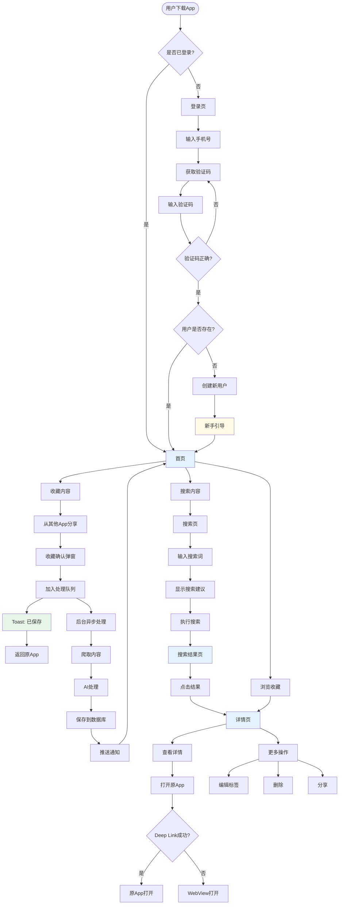
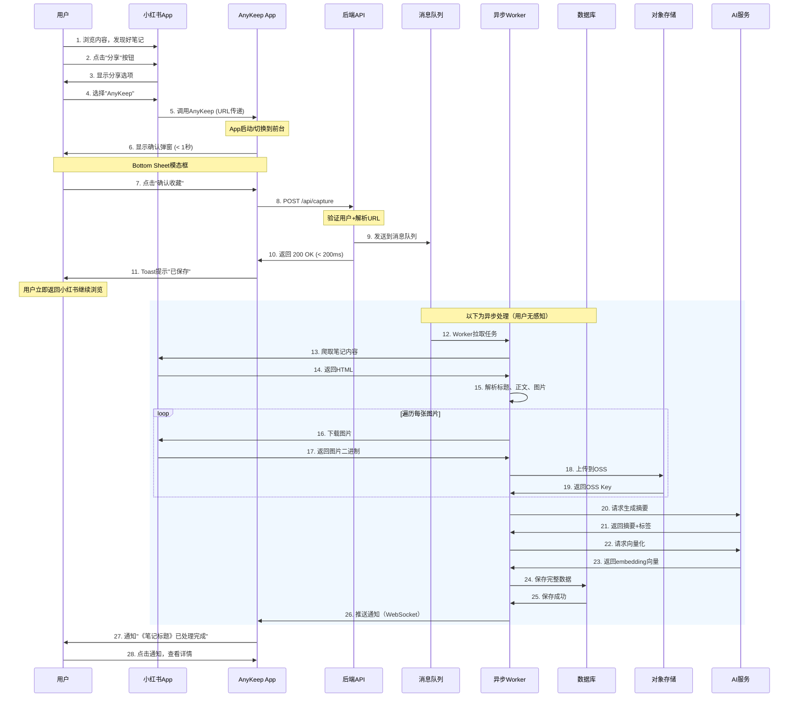
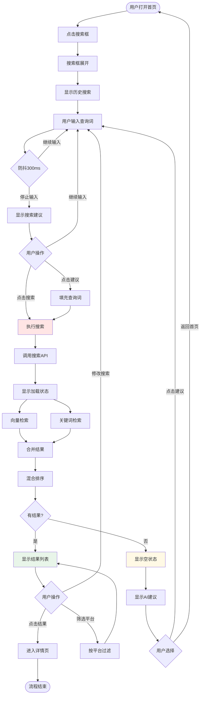
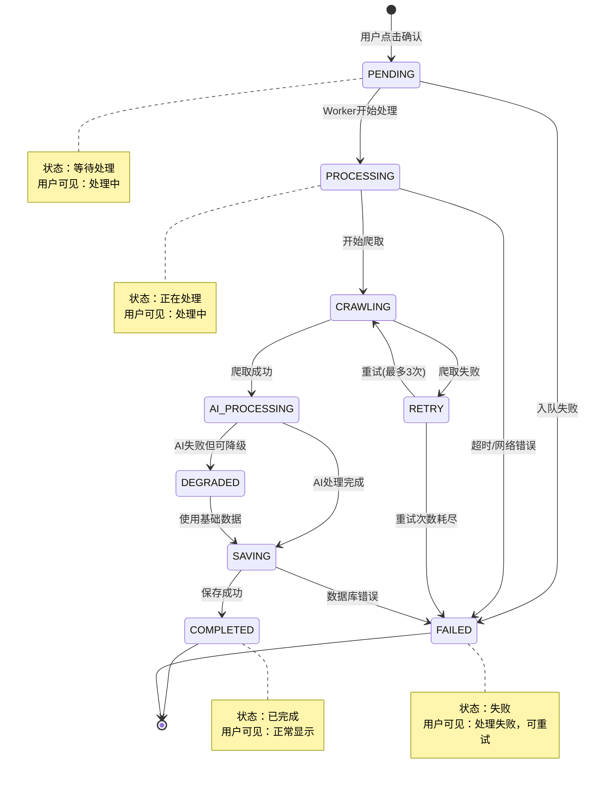
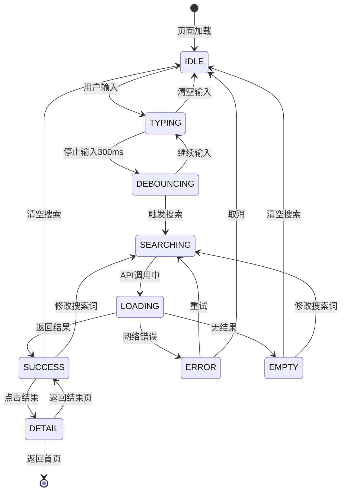
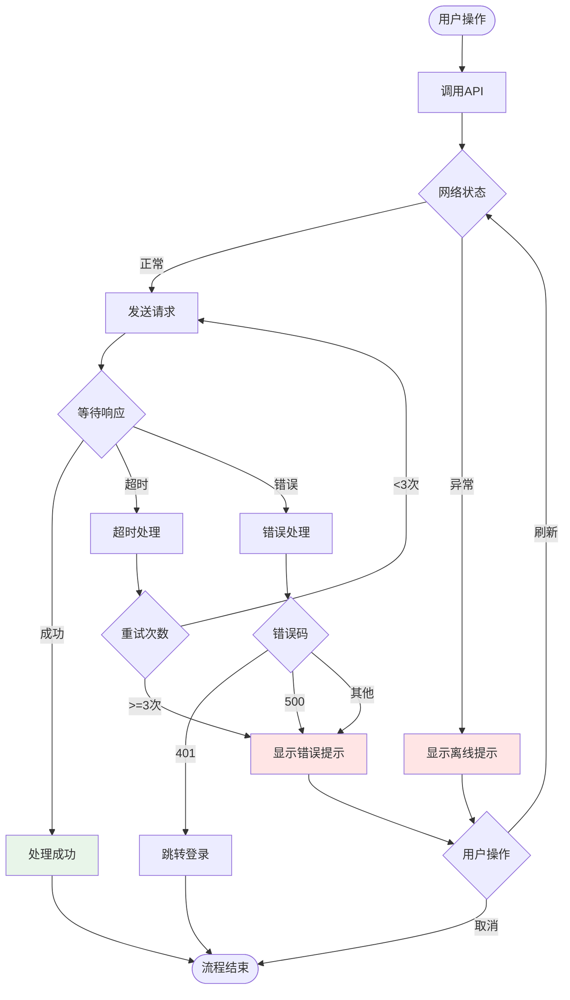

# AnyKeep 用户流程与交互原型

**版本号：** V1.0
**创建日期：** 2025-11-19
**Figma原型：** [待创建链接]
**目标：** 定义完整的用户交互流程和页面跳转逻辑

---

## 📑 目录

1. [核心用户旅程](#1-核心用户旅程)
2. [完整流程图](#2-完整流程图)
3. [页面跳转逻辑](#3-页面跳转逻辑)
4. [状态流转图](#4-状态流转图)
5. [异常流程处理](#5-异常流程处理)
6. [交互细节说明](#6-交互细节说明)
7. [Figma原型设计指南](#7-figma原型设计指南)

---

## 1. 核心用户旅程

### 1.1 用户旅程地图 (User Journey Map)

```
新用户首次使用 AnyKeep 的完整旅程
═══════════════════════════════════════════════════════════

阶段1: 发现与下载
├─ 触发点：看到朋友分享的内容/社交媒体推荐
├─ 行为：搜索并下载AnyKeep
├─ 情绪：😐 好奇但存疑
└─ 痛点：不确定是否真的有用

阶段2: 注册与onboarding
├─ 触发点：打开App
├─ 行为：手机号登录 → 观看引导动画
├─ 情绪：🤔 理解产品价值
└─ 痛点：希望快速上手

阶段3: 首次收藏（Aha Moment）
├─ 触发点：在小红书/B站看到好内容
├─ 行为：分享到AnyKeep → 2秒收到确认 → 30秒处理完成
├─ 情绪：😊 惊喜！真的很快
└─ 价值：体验到"无摩擦收藏"

阶段4: 首次搜索（核心价值验证）
├─ 触发点：一周后想找之前收藏的内容
├─ 行为：搜索"咖啡" → 3个结果 → 点击详情 → 跳转到原App
├─ 情绪：😍 太方便了！真的找到了
└─ 价值：体验到"搜索即得"

阶段5: 持续使用与习惯养成
├─ 触发点：每天都会收藏新内容
├─ 行为：收藏 → 搜索 → 收藏 → 搜索（循环）
├─ 情绪：😌 离不开了
└─ 价值：成为"外部记忆"

阶段6: 付费转化
├─ 触发点：收藏量接近500条/想用AI搜索
├─ 行为：查看Pro会员介绍 → 订阅
├─ 情绪：💪 值得投资
└─ 价值：解锁完整功能
```

---

## 2. 完整流程图

### 2.1 核心流程总览



---

### 2.2 收藏流程详细图



---

### 2.3 搜索流程详细图



---

## 3. 页面跳转逻辑

### 3.1 页面层级结构

```
App结构
├─ TabBar (底部导航)
│  ├─ [首页] HomePage
│  ├─ [搜索] SearchPage
│  └─ [我的] ProfilePage
│
├─ Modal Pages (模态页面)
│  ├─ CaptureModal (收藏确认)
│  ├─ LoginModal (登录)
│  └─ FilterModal (搜索过滤)
│
└─ Detail Pages (详情页)
   ├─ DetailPage (内容详情)
   ├─ SettingsPage (设置)
   ├─ TagManagePage (标签管理)
   └─ AboutPage (关于)
```

### 3.2 页面跳转规则表

| 起始页                    | 目标页     | 跳转方式  | 转场动画            | 返回逻辑               |
| :------------------------ | :--------- | :-------- | :------------------ | :--------------------- |
| **首页** → **详情页**     | 点击卡片   | push      | 卡片放大 → 页面推入 | 返回首页，恢复滚动位置 |
| **首页** → **搜索页**     | 点击搜索框 | 展开      | 搜索框展开          | 折叠回首页             |
| **搜索结果** → **详情页** | 点击结果   | push      | 页面推入            | 返回搜索结果           |
| **任意页** → **收藏确认** | 系统分享   | Modal     | 底部上滑            | 点击确认/取消关闭      |
| **首页** → **我的**       | 点击TabBar | 切换      | 淡入淡出            | TabBar切换             |
| **我的** → **设置**       | 点击设置项 | push      | 页面推入            | 返回我的               |
| **详情页** → **原App**    | 点击打开   | Deep Link | 应用切换            | 不返回（用户自主切换） |

### 3.3 页面跳转代码示例 (UniApp)

```javascript
// 跳转到详情页
function gotoDetail(bookmarkId) {
  uni.navigateTo({
    url: `/pages/detail/index?id=${bookmarkId}`,
    animationType: "slide-in-right",
    animationDuration: 300,
  });
}

// 显示收藏确认Modal
function showCaptureModal(url) {
  uni.showModal({
    title: "确认收藏",
    content: `是否收藏这个内容？\n${url}`,
    confirmText: "确认",
    cancelText: "取消",
    success: (res) => {
      if (res.confirm) {
        captureContent(url);
      }
    },
  });
}

// 打开原App (Deep Link)
function openOriginalApp(deepLink, universalLink) {
  // 尝试Deep Link
  plus.runtime.openURL(deepLink, (error) => {
    // 失败时使用Universal Link
    plus.runtime.openURL(universalLink);
  });
}
```

---

## 4. 状态流转图

### 4.1 收藏内容状态机



### 4.2 搜索状态流转



---

## 5. 异常流程处理

### 5.1 网络异常处理



### 5.2 异常场景处理表

| 异常场景          | 用户感知                             | 系统行为             | 恢复方案                 |
| :---------------- | :----------------------------------- | :------------------- | :----------------------- |
| **网络断开**      | Toast："网络连接失败"                | 停止API调用          | 显示重试按钮             |
| **爬取失败**      | 通知："内容处理失败，已加入重试队列" | 自动重试3次          | 最终失败后允许手动重试   |
| **AI服务不可用**  | 无感知（降级处理）                   | 使用基础摘要模板     | 后台标记，待AI恢复后补充 |
| **图片加载失败**  | 占位图显示                           | 记录失败URL          | 点击重新加载             |
| **Deep Link失败** | Toast："无法打开原App"               | 降级到Universal Link | 提示安装App              |
| **登录失效**      | 自动跳转登录页                       | 清除本地token        | 重新登录                 |
| **存储空间不足**  | 弹窗："存储空间不足"                 | 停止下载图片         | 引导清理或升级           |

### 5.3 错误提示文案规范

```
错误类型              标题                  内容                      操作按钮
─────────────────────────────────────────────────────────────────────
网络错误              网络连接失败           请检查网络设置后重试       [重试] [取消]
服务器错误            服务暂时不可用         我们正在修复，请稍后重试   [知道了]
内容爬取失败          内容处理失败           该链接暂时无法访问         [重试] [取消]
图片加载失败          图片加载失败           点击重新加载               [重新加载]
Deep Link失败         无法打开原App          请先安装对应的App          [去安装] [取消]
登录失效              登录已过期             请重新登录                 [重新登录]
存储空间不足          空间不足               请升级Pro或清理收藏        [升级Pro] [清理]
权限不足              权限不足               请在设置中开启相关权限     [去设置] [取消]
```

---

## 6. 交互细节说明

### 6.1 手势交互规范

#### 6.1.1 卡片交互

```
┌────────────────────────┐
│  [卡片内容]            │
│                        │
└────────────────────────┘
   ↓                ↓
  点击            长按
   ↓                ↓
进入详情        显示菜单
```

**点击卡片：**

```
1. 卡片轻微缩放（scale: 0.98）
2. 300ms后跳转到详情页
3. 转场动画：卡片放大 → 页面推入
```

**长按卡片：**

```
1. 卡片震动反馈（50ms）
2. 弹出操作菜单
3. 菜单选项：
   ├─ 📝 编辑标签
   ├─ 🗑️ 删除
   ├─ 📤 分享
   └─ 🔗 复制链接
```

#### 6.1.2 搜索框交互

```
搜索框状态变化
────────────────
默认状态（未聚焦）
┌──────────────────────────────┐
│ 🔍 搜索你的收藏...           │ ← 灰色提示文字
└──────────────────────────────┘

点击后（聚焦）
┌──────────────────────────────┐
│ 🔍 |                    [×] │ ← 蓝色边框，光标闪烁
├──────────────────────────────┤
│ 🕐 历史搜索                   │ ← 展开历史和建议
│ ...                          │
└──────────────────────────────┘

输入中（实时建议）
┌──────────────────────────────┐
│ 🔍 咖啡|                [×] │ ← 输入的文字
├──────────────────────────────┤
│ 💭 咖啡                      │ ← AI建议
│    咖啡拉花                   │
│    咖啡店推荐                 │
└──────────────────────────────┘
```

**交互时序：**

1. 点击搜索框 → 展开动画（200ms）
2. 键盘弹起 → 搜索框上移到键盘上方
3. 输入字符 → 防抖300ms → 显示建议
4. 点击建议 → 填充搜索词 → 自动执行搜索
5. 点击[×] → 清空输入 → 收起键盘

#### 6.1.3 下拉刷新

```
下拉刷新状态
────────────
1. 用户下拉（0-60px）
   └─ 显示下拉箭头 ↓

2. 继续下拉（>60px）
   └─ 箭头旋转180° ↑
   └─ 提示"释放刷新"

3. 释放触摸
   └─ 显示加载动画 ⟳
   └─ 调用刷新API

4. 刷新完成
   └─ 收起动画
   └─ Toast "刷新成功"
```

---

### 6.2 反馈机制

#### 6.2.1 成功反馈

| 操作         | 反馈类型     | 视觉效果          | 音效     |
| :----------- | :----------- | :---------------- | :------- |
| **收藏成功** | Toast + 动画 | 绿色勾 + "已保存" | ✓ 提示音 |
| **搜索成功** | 即时显示     | 结果列表渐入      | 无       |
| **删除成功** | Toast        | "已删除"          | 无       |
| **分享成功** | Toast        | "分享成功"        | 无       |

#### 6.2.2 加载反馈

```
加载类型                    反馈样式
─────────────────────────────────────
列表加载                    Shimmer骨架屏
搜索加载                    搜索框内旋转图标
详情页加载                  整页Shimmer
图片加载                    占位图 + 进度条
下拉刷新                    顶部加载指示器
加载更多                    底部加载指示器
```

#### 6.2.3 错误反馈

```
错误严重程度       反馈方式              示例
────────────────────────────────────────────
轻度错误            Toast提示              图片加载失败
中度错误            Modal弹窗              网络连接失败
严重错误            全屏错误页            数据库损坏
```

---

### 6.3 页面过渡动画

#### 6.3.1 页面切换动画库

```css
/* 页面推入（常规跳转） */
.slide-in-right {
  from {
    transform: translateX(100%);
  }
  to {
    transform: translateX(0);
  }
}

/* 页面推出（返回） */
.slide-out-right {
  from {
    transform: translateX(0);
  }
  to {
    transform: translateX(100%);
  }
}

/* Modal上滑 */
.slide-up {
  from {
    transform: translateY(100%);
  }
  to {
    transform: translateY(0);
  }
}

/* Modal下滑（关闭） */
.slide-down {
  from {
    transform: translateY(0);
  }
  to {
    transform: translateY(100%);
  }
}

/* 淡入淡出（TabBar切换） */
.fade-in {
  from {
    opacity: 0;
  }
  to {
    opacity: 1;
  }
}

/* 缩放进入（详情页） */
.scale-in {
  from {
    transform: scale(0.9);
    opacity: 0;
  }
  to {
    transform: scale(1);
    opacity: 1;
  }
}
```

---

## 7. Figma原型设计指南

### 7.1 Figma文件结构

```
AnyKeep-Design.fig
├─ 📄 Cover (封面页)
│  └─ 项目介绍、更新日志
│
├─ 🎨 Design System (设计系统)
│  ├─ Colors (色彩)
│  ├─ Typography (字体)
│  ├─ Icons (图标)
│  └─ Spacing (间距)
│
├─ 🧩 Components (组件库)
│  ├─ Buttons (按钮)
│  ├─ Inputs (输入框)
│  ├─ Cards (卡片)
│  ├─ Tags (标签)
│  ├─ Modals (弹窗)
│  └─ Loading (加载状态)
│
├─ 📱 Pages (页面设计)
│  ├─ 01-Login (登录)
│  ├─ 02-Onboarding (引导)
│  ├─ 03-Home (首页)
│  ├─ 04-Search (搜索)
│  ├─ 05-Detail (详情)
│  └─ 06-Profile (我的)
│
└─ 🔄 Prototype (交互原型)
   ├─ 收藏流程
   ├─ 搜索流程
   └─ 详情查看流程
```

### 7.2 原型设计重点

#### 7.2.1 必须展示的交互

- [ ] **首页滚动**
  - [ ] 下拉刷新
  - [ ] 无限加载
  - [ ] 快速滚动到顶部

- [ ] **搜索交互**
  - [ ] 搜索框展开/收起
  - [ ] 实时搜索建议
  - [ ] 搜索结果加载
  - [ ] 空状态

- [ ] **卡片交互**
  - [ ] 点击进入详情
  - [ ] 长按显示菜单
  - [ ] 收藏成功动画

- [ ] **详情页交互**
  - [ ] 图片轮播
  - [ ] 时间戳点击（B站）
  - [ ] 打开原App

- [ ] **Modal交互**
  - [ ] 底部上滑
  - [ ] 点击背景关闭
  - [ ] 确认/取消操作

#### 7.2.2 原型连线规范

```
连线类型        使用场景                      动画
────────────────────────────────────────────────
On Click        点击按钮/卡片                 Instant
On Drag         下拉刷新/左滑删除             Smart Animate
After Delay     自动跳过引导页                Dissolve
Mouse Enter     悬停显示Tooltip              Dissolve
Mouse Leave     隐藏Tooltip                  Dissolve
```

### 7.3 设计交付检查清单

#### 设计稿

- [ ] 所有页面设计完成（至少6个主页面）
- [ ] 包含浅色模式和暗黑模式
- [ ] 所有状态都有设计（默认、聚焦、禁用、错误）
- [ ] 空状态、加载状态、错误状态都有设计

#### 组件库

- [ ] 所有组件都创建为Component
- [ ] 组件有清晰的命名（如：Button/Primary/Large）
- [ ] 组件有变体（Variants）管理状态
- [ ] 组件有Auto Layout自适应

#### 原型

- [ ] 核心流程都可点击（收藏、搜索、详情）
- [ ] 关键交互有动画
- [ ] 错误分支有展示
- [ ] 可在手机上预览（Figma Mirror）

#### 标注

- [ ] 关键尺寸有标注（间距、字号、圆角）
- [ ] 色彩使用Design Tokens
- [ ] 图标有导出（SVG/PNG @3x）
- [ ] 切图命名规范

---

## 8. 原型测试脚本

### 8.1 可用性测试任务

**任务1：完成首次收藏**

```
场景：你在小红书看到一篇"成都旅游攻略"，想保存下来。
步骤：
1. 在小红书App点击分享
2. 选择AnyKeep
3. 确认收藏
4. 等待处理完成

观察点：
- 用户能否快速找到AnyKeep分享选项？
- 确认弹窗是否清晰易懂？
- Toast提示是否及时？
- 处理完成通知是否明显？

成功标准：
- 全部步骤在30秒内完成
- 用户没有困惑表现
```

**任务2：搜索并找到内容**

```
场景：一周后，你想找回之前收藏的"成都旅游攻略"。
步骤：
1. 打开AnyKeep
2. 点击搜索框
3. 输入"成都旅游"
4. 点击搜索结果
5. 查看详情并打开原App

观察点：
- 搜索框是否明显？
- 搜索建议是否有帮助？
- 搜索结果是否准确？
- 详情页信息是否完整？

成功标准：
- 在前5个结果中找到目标内容
- 用户表示满意
```

**任务3：查看视频时间戳**

```
场景：你收藏了一个Python教程视频，想直接跳到"函数定义"部分。
步骤：
1. 搜索"Python"
2. 点击视频卡片
3. 查看时间戳列表
4. 点击"20:10 函数定义"

观察点：
- 用户能否理解时间戳的作用？
- 时间戳描述是否清晰？
- 点击后是否知道会发生什么？

成功标准：
- 用户快速找到目标时间戳
- 成功唤起B站App
```

---

## 附录：原型链接（待填充）

| 原型名称   | Figma链接 | 版本 | 更新日期   |
| :--------- | :-------- | :--- | :--------- |
| 完整原型   | [链接]    | V1.0 | 2025-11-19 |
| 收藏流程   | [链接]    | V1.0 | 2025-11-19 |
| 搜索流程   | [链接]    | V1.0 | 2025-11-19 |
| 移动端预览 | [二维码]  | V1.0 | 2025-11-19 |

---

**文档结束** | 准备创建Figma原型 🎯

**下一步行动：**

1. ✅ 在Figma创建项目
2. ✅ 导入设计系统
3. ✅ 绘制关键页面
4. ✅ 创建交互连线
5. ✅ 移动端测试
6. ✅ 用户测试
