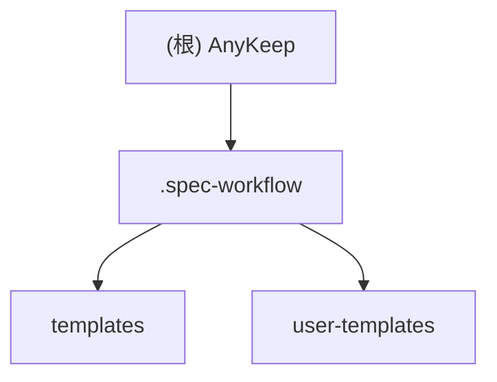

# AnyKeep - AI 上下文文档

## 变更记录 (Changelog)

| 日期 | 版本 | 变更内容 |
|------|------|----------|
| 2025-11-21 | 1.0.0 | 初始化 AI 上下文文档，项目处于规划阶段 |

---

## 项目愿景

AnyKeep 是一款**跨平台智能内容聚合工具**，帮助用户统一管理微信公众号、B站、小红书等平台的收藏内容。通过 AI 技术实现智能摘要、自动标签和语义搜索功能。

**MVP 核心价值**：
- 一键收藏：通过系统分享菜单快速保存内容
- AI 智能处理：自动生成摘要和标签
- 语义搜索：基于向量检索的智能搜索
- 跨设备同步：实时数据同步

**当前状态**：规划/设计阶段（尚未开始编码）

---

## 架构总览

```
规划中的技术架构：

+------------------+     +------------------+     +------------------+
|    Mobile App    |     |    Web App       |     |   Share Sheet    |
|   (Capacitor)    |     |   (Next.js)      |     |   (系统分享)      |
+--------+---------+     +--------+---------+     +--------+---------+
         |                        |                        |
         +------------------------+------------------------+
                                  |
                    +-------------v-------------+
                    |      Next.js API Routes   |
                    |    (Server Components)    |
                    +-------------+-------------+
                                  |
         +------------------------+------------------------+
         |                        |                        |
+--------v--------+    +----------v----------+    +--------v--------+
|  Supabase Auth  |    | Supabase Database   |    | Edge Functions  |
|   (认证服务)     |    |   (PostgreSQL +     |    |  (爬虫/AI处理)   |
|                 |    |    pgvector)        |    |                 |
+-----------------+    +---------------------+    +-----------------+
```

---

## 模块结构图



---

## 模块索引

| 模块路径 | 职责 | 状态 |
|----------|------|------|
| [.spec-workflow](./.spec-workflow/CLAUDE.md) | 规范工作流模板系统，提供需求/设计/任务文档模板 | 已配置 |

---

## 规划中的项目结构

```
anykeep/                    # 项目根目录
├── app/                    # Next.js App Router（待创建）
│   ├── (auth)/            # 认证相关页面
│   ├── (main)/            # 主应用页面
│   ├── api/               # API Routes
│   └── layout.tsx
├── components/            # React 组件（待创建）
│   ├── ui/               # Shadcn UI 组件
│   ├── bookmark/         # 收藏相关组件
│   └── layout/           # 布局组件
├── lib/                  # 工具函数（待创建）
│   └── supabase/         # Supabase 客户端
├── types/                # TypeScript 类型（待创建）
├── supabase/             # Supabase 配置（待创建）
│   └── functions/        # Edge Functions
├── .spec-workflow/       # 规范工作流模板（已存在）
├── anykeep1121.md        # 产品需求文档（已存在）
└── CLAUDE.md             # AI 上下文文档
```

---

## 技术栈概览

### 前端
- **框架**: Next.js 14+ (App Router)
- **样式**: Tailwind CSS
- **组件库**: Shadcn UI
- **类型系统**: TypeScript

### 后端 (Supabase)
- **数据库**: PostgreSQL + pgvector
- **认证**: Supabase Auth
- **存储**: Supabase Storage
- **函数**: Edge Functions (Deno)

### 移动端
- **打包工具**: Capacitor

---

## 运行与开发

> 注意：项目尚未初始化，以下为规划中的命令

### 计划中的开发命令

```bash
# 项目初始化（待执行）
npx create-next-app@latest anykeep --typescript --tailwind --eslint --app

# 安装依赖（待执行）
npm install @supabase/supabase-js @supabase/auth-helpers-nextjs

# Shadcn UI 初始化（待执行）
npx shadcn-ui@latest init

# Supabase CLI（待执行）
supabase init
supabase start

# Capacitor 初始化（待执行）
npm install @capacitor/core @capacitor/cli
npx cap init
```

---

## 数据模型概览

### 核心表结构（规划中）

| 表名 | 用途 | 关键字段 |
|------|------|----------|
| `profiles` | 用户扩展信息 | id, phone, nickname, membership_type |
| `bookmarks` | 收藏记录 | id, user_id, title, url, platform, embedding |
| `folders` | 文件夹管理 | id, user_id, name, parent_id |
| `platform_authorizations` | 平台授权 | id, user_id, platform, access_token |

---

## 测试策略

### 规划中的测试方案

- **单元测试**: Jest + React Testing Library
- **组件测试**: Storybook（可选）
- **集成测试**: Supabase 本地测试环境
- **E2E 测试**: Cypress 或 Playwright

---

## 编码规范

### 命名约定
- **文件**: kebab-case (如 `bookmark-card.tsx`)
- **组件**: PascalCase (如 `BookmarkCard`)
- **函数**: camelCase (如 `handleSubmit`)
- **常量**: UPPER_SNAKE_CASE (如 `MAX_STORAGE_QUOTA`)

### 代码组织原则
1. 单一职责：每个文件专注一个功能
2. 模块化：组件和工具函数可复用
3. 类型安全：充分利用 TypeScript
4. 可测试性：业务逻辑与 UI 分离

---

## AI 使用指引

### 核心文档
- **产品需求**: `anykeep1121.md` - 包含完整的 MVP 需求、数据模型、API 设计
- **模板系统**: `.spec-workflow/templates/` - 规范文档模板

### 开发建议
1. 按照 `anykeep1121.md` 中的开发优先级执行
2. 使用 Supabase CLI 管理数据库迁移
3. 遵循 Shadcn UI 组件规范
4. Edge Functions 使用 Deno/TypeScript

### 关键注意点
- RLS (Row Level Security) 策略必须正确配置
- 向量搜索需要启用 pgvector 扩展
- 移动端打包使用 Capacitor 套壳方案

---

## 相关文件

| 文件路径 | 说明 |
|----------|------|
| `anykeep1121.md` | 完整产品需求文档（1262行） |
| `.spec-workflow/templates/` | 规范工作流模板 |
| `.spec-workflow/user-templates/` | 用户自定义模板 |

---

# 开发指南 (Development Guidelines)

## Project Context

**Project**: AnyKeep - 跨平台智能内容聚合工具
**Tech Stack**: Next.js 14+ / Supabase / TypeScript / Tailwind CSS / Shadcn UI
**Key Patterns**: Server Components / Edge Functions / RLS
**Architecture**: JAMstack + BaaS (Backend as a Service)

## Philosophy

### Core Beliefs

- **Incremental progress over big bangs** - Small changes that compile and pass tests
- **Learning from existing code** - Study and plan before implementing
- **Pragmatic over dogmatic** - Adapt to project reality
- **Clear intent over clever code** - Be boring and obvious

### Simplicity Means

- Single responsibility per function/class
- Avoid premature abstractions
- No clever tricks - choose the boring solution
- If you need to explain it, it's too complex

### Permission Management / 权限管理
Except for file deletion and database operations, all other operations do not require user confirmation.

## Process

### 1. Planning & Staging

Break complex work into 3-5 stages. Document in `IMPLEMENTATION_PLAN.md`:

```markdown
## Stage N: [Name]
**Goal**: [Specific deliverable]
**Success Criteria**: [Testable outcomes]
**Tests**: [Specific test cases]
**Status**: [Not Started|In Progress|Complete]
```
- Update status as you progress
- Remove file when all stages are done

### 2. Implementation Flow

1. **Understand** - Study existing patterns in codebase
2. **Test** - Write test first (red)
3. **Implement** - Minimal code to pass (green)
4. **Refactor** - Clean up with tests passing
5. **Commit** - With clear message linking to plan

### 3. When Stuck (After 3 Attempts)

**CRITICAL**: Maximum 3 attempts per issue, then STOP.

1. **Document what failed**:
   - What you tried
   - Specific error messages
   - Why you think it failed

2. **Research alternatives**:
   - Find 2-3 similar implementations
   - Note different approaches used

3. **Question fundamentals**:
   - Is this the right abstraction level?
   - Can this be split into smaller problems?
   - Is there a simpler approach entirely?

4. **Try different angle**:
   - Different library/framework feature?
   - Different architectural pattern?
   - Remove abstraction instead of adding?

## Technical Standards

### Architecture Principles

- **Composition over inheritance** - Use dependency injection
- **Interfaces over singletons** - Enable testing and flexibility
- **Explicit over implicit** - Clear data flow and dependencies
- **Test-driven when possible** - Never disable tests, fix them

### Code Quality

- **Every commit must**:
  - Compile successfully
  - Pass all existing tests
  - Include tests for new functionality
  - Follow project formatting/linting

- **Before committing**:
  - Run formatters/linters
  - Self-review changes
  - Ensure commit message explains "why"

### Error Handling

- Fail fast with descriptive messages
- Include context for debugging
- Handle errors at appropriate level
- Never silently swallow exceptions

## Decision Framework

When multiple valid approaches exist, choose based on:

1. **Testability** - Can I easily test this?
2. **Readability** - Will someone understand this in 6 months?
3. **Consistency** - Does this match project patterns?
4. **Simplicity** - Is this the simplest solution that works?
5. **Reversibility** - How hard to change later?

## Project Integration

### Learning the Codebase

- Find 3 similar features/components
- Identify common patterns and conventions
- Use same libraries/utilities when possible
- Follow existing test patterns

### Tooling

- Use project's existing build system
- Use project's test framework
- Use project's formatter/linter settings
- Don't introduce new tools without strong justification

## Quality Gates

### Definition of Done

- [ ] Tests written and passing
- [ ] Code follows project conventions
- [ ] No linter/formatter warnings
- [ ] Commit messages are clear
- [ ] Implementation matches plan
- [ ] No TODOs without issue numbers

### Test Guidelines

- Test behavior, not implementation
- One assertion per test when possible
- Clear test names describing scenario
- Use existing test utilities/helpers
- Tests should be deterministic

## Important Reminders

**NEVER**:
- Use `--no-verify` to bypass commit hooks
- Disable tests instead of fixing them
- Commit code that doesn't compile
- Make assumptions - verify with existing code

**ALWAYS**:
- Commit working code incrementally
- Update plan documentation as you go
- Learn from existing implementations
- Stop after 3 failed attempts and reassess
- Always use Context7 when code generation, setup/configuration steps, or
library/API documentation is needed. This means automatically using the Context7 MCP
tools to resolve library IDs and get library docs without requiring explicit requests.
