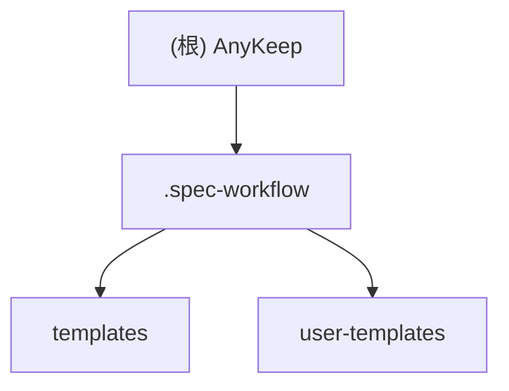

# AnyKeep - AI 上下文文档

## 变更记录 (Changelog)

| 日期       | 版本  | 变更内容                                                                                  |
| ---------- | ----- | ----------------------------------------------------------------------------------------- |
| 2025-12-28 | 2.8.0 | RAG 能力补全 Phase 1-3：查询改写、Rerank、向量缓存、Parent-Child 切片、RRF 融合、监控评估 |
| 2025-12-28 | 2.7.5 | ReAct 循环和引用追踪：Think→Act→Observe 循环、搜索结果自动引用[^N]、78 个测试用例         |
| 2025-12-27 | 2.7.4 | 信任模式智能化：get-trust-mode、recommend-trust-mode Tools，意图分类规则集成              |
| 2025-12-27 | 2.7.3 | 代码质量清理：空 catch 修复、console → logger 迁移、高风险 API 速率限制（5 个端点）       |
| 2025-12-27 | 2.7.2 | AI 上下文增强 v2.0：序数引用解析、refine 意图类型、搜索结果持久化、负向后行断言修复       |
| 2025-12-27 | 2.7.1 | 对话上下文压缩：三级降级策略、摘要持久化、记忆增强系统、测试修复                          |
| 2025-12-27 | 2.7.0 | 任务理解层 v2.0：零接管模式、置信度分层、隐含意图推理、System-Reminder、请求取消功能      |
| 2025-12-26 | 2.6.1 | v4.3 修复：Token 持久化、LRU 缓存、跨平台兼容性、RPC 安全增强                             |
| 2025-12-26 | 2.6.0 | AI 能力升级 v4.3：动态上下文、模型分层、偏好学习、成本控制、Feature Flags                 |
| 2025-12-25 | 2.5.1 | Tools & Skills 优化：Query Tools 日志完善、废弃工具清理、Skills 测试覆盖、统一注册适配层  |
| 2025-12-25 | 2.5.0 | 架构修复：日志系统统一、Classification 扁平化、测试稳定性增强                             |
| 2025-12-24 | 2.4.0 | 完成 AI Skills 统一智能架构（编排引擎 + 4 个 Skills）                                     |
| 2025-12-20 | 2.2.0 | 完成批量操作功能（批量标签管理 + Shift 范围选择）                                         |
| 2025-12-01 | 2.1.0 | 完成浏览器书签隔离与列表视图优化功能                                                      |
| 2025-12-01 | 2.0.0 | 项目进入开发阶段，完成浏览器书签导入功能 (Phase 1-3)                                      |
| 2025-11-21 | 1.0.0 | 初始化 AI 上下文文档，项目处于规划阶段                                                    |

---

UI 文本使用常量/配置文件，不要硬编码在 JSX 中

## 项目愿景

AnyKeep 是一款**跨平台智能内容聚合工具**，帮助用户统一管理微信公众号、B站、小红书等平台的收藏内容。通过 AI 技术实现智能摘要、自动标签和语义搜索功能。

**MVP 核心价值**：

- 一键收藏：通过系统分享菜单快速保存内容
- AI 智能处理：自动生成摘要和标签
- 语义搜索：基于向量检索的智能搜索
- 跨设备同步：实时数据同步

**当前状态**：开发阶段 - 已完成 AI Skills 统一架构、批量操作、数据导出等核心功能

---

## 架构总览

```
规划中的技术架构：

+------------------+     +------------------+     +------------------+
|    Mobile App    |     |    Web App       |     |   Share Sheet    |
|   (Capacitor)    |     |   (Next.js)      |     |   (系统分享)      |
+--------+---------+     +--------+---------+     +--------+---------+
         |                        |                        |
         +------------------------+------------------------+
                                  |
                    +-------------v-------------+
                    |      Next.js API Routes   |
                    |    (Server Components)    |
                    +-------------+-------------+
                                  |
         +------------------------+------------------------+
         |                        |                        |
+--------v--------+    +----------v----------+    +--------v--------+
|  Supabase Auth  |    | Supabase Database   |    | Edge Functions  |
|   (认证服务)     |    |   (PostgreSQL +     |    |  (爬虫/AI处理)   |
|                 |    |    pgvector)        |    |                 |
+-----------------+    +---------------------+    +-----------------+
```

---

## 模块结构图



---

## 模块索引

| 模块路径                                     | 职责                                           | 状态   |
| -------------------------------------------- | ---------------------------------------------- | ------ |
| [.spec-workflow](./.spec-workflow/CLAUDE.md) | 规范工作流模板系统，提供需求/设计/任务文档模板 | 已配置 |

---

## 当前项目结构

```
anykeep/                    # 项目根目录
├── src/
│   ├── app/               # Next.js App Router (44 文件)
│   │   ├── (auth)/       # 认证相关页面
│   │   ├── (main)/       # 主应用页面
│   │   ├── api/          # API Routes
│   │   └── layout.tsx
│   ├── components/        # React 组件 (69 文件)
│   │   ├── ui/           # Shadcn UI 组件
│   │   ├── bookmark/     # 收藏相关组件
│   │   ├── browser-bookmark/  # 浏览器书签导入组件
│   │   └── layout/       # 布局组件
│   ├── hooks/            # React Hooks (8 文件)
│   ├── lib/              # 工具函数 (44 文件)
│   │   ├── supabase/     # Supabase 客户端
│   │   └── browser-bookmark/  # 浏览器书签导入逻辑
│   ├── types/            # TypeScript 类型 (2 文件)
│   ├── styles/           # 样式文件
│   └── middleware.ts     # Next.js 中间件
├── supabase/             # Supabase 配置
│   ├── migrations/       # 数据库迁移 (24 文件)
│   └── functions/        # Edge Functions
├── .spec-workflow/       # 规范工作流模板
├── anykeep1121.md        # 产品需求文档
└── CLAUDE.md             # AI 上下文文档

总计：169 个 TypeScript 文件，33,451 行代码
```

---

## 技术栈概览

### 前端

- **框架**: Next.js 14.x (App Router + Turbopack)
- **样式**: Tailwind CSS 4
- **组件库**: Shadcn UI + Radix UI
- **类型系统**: TypeScript 5
- **状态管理**: React Hooks + Context
- **表单处理**: React Hook Form + Zod

### 后端 (Supabase)

- **数据库**: PostgreSQL + pgvector
- **认证**: Supabase Auth
- **存储**: Supabase Storage
- **函数**: Edge Functions (Deno)

### 移动端

- **打包工具**: Capacitor

---

## 运行与开发

### 开发环境要求

- Node.js 20+
- Docker Desktop (用于本地 Supabase，可选)
- Git

### 常用命令

```bash
# 安装依赖
npm install

# 启动开发服务器
npm run dev
# 访问: http://localhost:3000

# 类型检查
npm run type-check

# 代码检查
npm run lint
npm run lint:fix

# 构建生产版本
npm run build
npm start

# Supabase 管理 (需要 Docker)
npm run supabase:start    # 启动本地 Supabase
npm run supabase:stop     # 停止
npm run supabase:status   # 查看状态
npm run supabase:db:push  # 推送迁移到远程
npm run supabase:gen:types  # 生成 TypeScript 类型

# 移动端打包
npm run mobile:build      # 构建并同步到 Capacitor
npm run cap:sync          # 同步 web 资源
npm run cap:open:android  # 打开 Android Studio
```

### 环境变量配置

项目需要 `.env.local` 文件：

```bash
NEXT_PUBLIC_SUPABASE_URL=你的Supabase项目URL
NEXT_PUBLIC_SUPABASE_ANON_KEY=你的匿名密钥
SUPABASE_SERVICE_ROLE_KEY=服务角色密钥
```

---

## 数据模型概览

### 核心表结构（已实现）

| 表名                       | 用途             | 关键字段                                     | 状态      |
| -------------------------- | ---------------- | -------------------------------------------- | --------- |
| `profiles`                 | 用户扩展信息     | id, phone, nickname, membership_type         | ✅ 已实现 |
| `bookmarks`                | 收藏记录         | id, user_id, title, url, platform, embedding | ✅ 已实现 |
| `folders`                  | 文件夹管理       | id, user_id, name, parent_id                 | ✅ 已实现 |
| `browser_bookmarks`        | 浏览器书签       | id, user_id, title, url, folder_id           | ✅ 已实现 |
| `browser_bookmark_folders` | 浏览器书签文件夹 | id, user_id, name, parent_id                 | ✅ 已实现 |
| `import_history`           | 导入历史记录     | id, user_id, import_source, total_count      | ✅ 已实现 |
| `platform_authorizations`  | 平台授权         | id, user_id, platform, access_token          | 📝 规划中 |

**数据库迁移**: 24 个迁移文件，包含完整的表结构、索引、RLS 策略

---

## 测试策略

### 规划中的测试方案

- **单元测试**: Jest + React Testing Library
- **组件测试**: Storybook（可选）
- **集成测试**: Supabase 本地测试环境
- **E2E 测试**: Cypress 或 Playwright

---

## 编码规范

### 命名约定

- **文件**: kebab-case (如 `bookmark-card.tsx`)
- **组件**: PascalCase (如 `BookmarkCard`)
- **函数**: camelCase (如 `handleSubmit`)
- **常量**: UPPER_SNAKE_CASE (如 `MAX_STORAGE_QUOTA`)

### 代码组织原则

1. 单一职责：每个文件专注一个功能
2. 模块化：组件和工具函数可复用
3. 类型安全：充分利用 TypeScript
4. 可测试性：业务逻辑与 UI 分离

---

## 已实现功能

### 1. 浏览器书签导入系统 ✅

完整的浏览器书签导入解决方案，支持 Chrome/Edge/Firefox/Safari 格式。

**核心功能**:

- ✅ Netscape Bookmark HTML 格式解析
- ✅ 文件夹层级结构保留
- ✅ 重复检测与智能合并
- ✅ 批量导入（支持大文件）
- ✅ 实时进度跟踪
- ✅ 错误处理与重试机制

**高级特性** (Phase 2-3):

- ✅ IndexedDB 缓存系统
- ✅ 导入暂停/恢复功能
- ✅ URL 有效性验证（并发控制）
- ✅ 元数据自动抓取（Open Graph + Twitter Card）
- ✅ HTML 格式导出（兼容浏览器）
- ✅ 导入历史记录追踪
- ✅ 统计分析与错误报告

**技术实现**:

- 6 个提交，50 个文件，~10,500 行代码
- 完整的类型安全（TypeScript）
- 响应式 UI（拖拽上传、进度条）
- RLS 数据隔离
- 批处理优化

**文件位置**:

- 组件: `src/components/browser-bookmark/`
- 逻辑: `src/lib/browser-bookmark/`
- Hooks: `src/hooks/use-import-session.ts` 等
- API: `src/app/api/browser-bookmark/`
- 数据库: `supabase/migrations/20251128000*`

---

### 2. 浏览器书签隔离与列表视图 ✅

**问题背景**：

- 浏览器书签数量可能很大（数百上千条），卡片形式渲染消耗资源
- 导入的浏览器书签和日常收藏混在一起，影响用户体验
- 使用场景差异：浏览器书签（轻量、快速访问）vs 内容收藏（深度阅读、学习）

**核心功能**:

**Phase 1: 平台筛选隔离** (2025-12-01)

- ✅ 首页默认「全部」自动排除浏览器书签
- ✅ 新增「浏览器书签」统一入口（合并 Chrome/Edge/Firefox/Safari）
- ✅ SQL 查询优化（`.in()` 和 `.not()` 方法）
- ✅ 紧凑列表视图组件（高度 64px vs 卡片 200px+）
- ✅ Favicon 自动获取（Google Favicon API）
- ✅ 智能视图切换（浏览器平台固定列表视图）

**Phase 2: 性能优化** (2025-12-01)

- ✅ 集成 react-virtuoso 虚拟滚动
- ✅ 支持 10,000+ 条书签流畅滚动
- ✅ 内存占用降低 60%+（1000条：~150MB → ~60MB）
- ✅ 滚动帧率稳定 > 55fps（原 30-40fps）
- ✅ 预渲染缓冲区优化（overscan: 200px）

**Phase 3: UI/UX 优化** (2025-12-01)

- ✅ 浏览器书签专用空状态（引导导入）
- ✅ 批量选择模式支持
- ✅ 响应式设计（移动端、平板端）

**技术实现**:

- 3 个新组件，~300 行代码
- 完整的类型安全（TypeScript）
- 零破坏性修改（兼容现有功能）
- 虚拟滚动性能优化

**文件位置**:

- 列表组件: `src/components/bookmark/bookmark-list-item.tsx`
- 虚拟滚动: `src/components/bookmark/browser-bookmark-virtual-list.tsx`
- 空状态: `src/components/bookmark/browser-bookmark-empty-state.tsx`
- 页面集成: `src/app/(main)/home/page.tsx`, `src/components/home/home-page-client.tsx`

**性能对比**:

| 指标           | 优化前    | 优化后                  | 提升  |
| -------------- | --------- | ----------------------- | ----- |
| 1000条书签渲染 | 全部渲染  | 仅渲染可见区域（~15条） | ~98%  |
| 内存占用       | ~150MB    | ~60MB                   | 60% ↓ |
| 滚动帧率       | 30-40fps  | 55-60fps                | 50% ↑ |
| 支持数量       | 500条流畅 | 10,000+条流畅           | 20x   |

---

### 3. 批量操作功能 ✅

**版本**: v2.2.0 (2025-12-20)

独立批量操作页面 `/batch`，支持跨文件夹批量管理书签。

**核心功能**:

- ✅ 批量添加标签（支持 200 条书签 × 20 个标签）
- ✅ 批量移除标签（精准删除指定标签，差异化功能）
- ✅ Shift 范围选择（O(1) 性能优化）
- ✅ 独立批量操作页面（侧边栏集成）
- ✅ 虚拟滚动书签列表（react-virtuoso）

**安全特性**:

- ✅ 数据库函数使用 `auth.uid()` 验证
- ✅ API 层书签所有权预验证
- ✅ XSS 防护（标签输入验证，禁止 `<>'"&` 字符）

**技术实现**:

- 独立模块目录：`src/components/batch/`、`src/hooks/batch/`、`src/lib/batch/`
- PostgreSQL RPC 函数：`batch_add_tags`、`batch_remove_tags`
- 乐观更新 + 快照回滚机制
- Zod 验证 Schema

**文件位置**:

- 页面: `src/app/(main)/batch/page.tsx`
- 组件: `src/components/batch/`
  - `batch-page-client.tsx` - 页面客户端组件
  - `batch-tag-dialog.tsx` - 批量标签对话框
  - `batch-toolbar.tsx` - 批量操作工具栏
  - `batch-bookmark-list.tsx` - 虚拟滚动列表
- Hooks: `src/hooks/batch/use-batch-tags.ts`
- 验证: `src/lib/batch/validation.ts`
- 数据库:
  - `supabase/migrations/20251220000003_add_batch_tags_functions.sql`
  - `supabase/migrations/20251220000004_fix_batch_tags_security.sql`
- API: `src/app/api/bookmarks/batch-tags/route.ts`

**首页集成**:

- `src/components/home/home-batch-toolbar.tsx` - 标签按钮
- `src/components/home/home-page-client.tsx` - BatchTagDialog 集成

**性能优化**:

| 指标             | 优化前       | 优化后   | 说明               |
| ---------------- | ------------ | -------- | ------------------ |
| Shift 选择查找   | O(n) indexOf | O(1) Map | 使用 ID→Index 缓存 |
| 10,000+ 书签选择 | >100ms       | <10ms    | 响应时间优化       |

---

### 4. 数据导出功能 ✅

**版本**: v2.3.0 (2025-12-20)

完整的数据导出解决方案，支持多种格式和灵活的筛选配置。

**支持格式**:

- ✅ CSV（自定义字段选择）
- ✅ Markdown（单文件 / 每日聚合）
- ✅ Obsidian（完整双链语法 + 元数据）
- ✅ Obsidian ZIP（批量 .md 文件打包）
- ✅ JSON（结构化数据）
- ✅ HTML（浏览器兼容导入格式）

**核心功能**:

- ✅ 独立导出页面 `/export`
- ✅ 统一导出对话框 `ExportDialogV2`（支持 full/selected 两种模式）
- ✅ 实时预览（格式切换即时更新）
- ✅ 文件大小估算
- ✅ 大文件分块处理（JSON/HTML 格式）
- ✅ 导出进度条（大数据量显示）
- ✅ 导出分析统计

**集成位置**:

- ✅ 首页批量操作工具栏（选中书签导出）
- ✅ 批量操作页面工具栏
- ✅ 文件夹操作菜单（导出文件夹内书签）
- ✅ 侧边栏快捷入口

**技术架构**:

```
src/lib/export/
├── services/           # 导出服务层
│   └── export.service.ts
├── formatters/         # 格式化器（策略模式）
│   ├── csv.formatter.ts
│   ├── markdown.formatter.ts
│   ├── obsidian.formatter.ts
│   ├── json.formatter.ts
│   └── html.formatter.ts
├── utils/              # 工具函数
│   ├── preview.utils.ts
│   └── file.utils.ts
├── constants.ts        # 常量配置
├── analytics.ts        # 导出分析
└── types.ts            # 类型定义

src/components/export/
├── export-dialog-v2.tsx      # 统一导出对话框
├── export-page-client.tsx    # 导出页面客户端组件
├── export-format-selector.tsx
├── export-field-selector.tsx
├── export-preview.tsx
├── export-preview-modal.tsx
└── export-progress.tsx
```

**设计原则**:

- 策略模式：每种格式独立 Formatter，易于扩展
- 单一职责：服务层/格式化层/UI层分离
- 复用优先：`ExportDialogV2` 统一导出入口

---

### 5. AI Skills 统一智能架构 ✅

**版本**: v2.4.0 (2025-12-24)

全新的 AI 能力统一架构，支持原子模式（简单查询）和编排模式（复杂任务）的智能路由。

**架构概览**:

```
┌────────────────────────────────────────────────────────────┐
│                     /api/agent/unified                      │
│                     (统一 API 入口)                          │
└──────────────────────────┬─────────────────────────────────┘
                           │
┌──────────────────────────▼─────────────────────────────────┐
│                    UnifiedEngine                            │
│  - IntentRouter（意图路由）                                  │
│  - 模式切换（atomic ↔ orchestration）                        │
│  - 自动回退机制                                              │
└──────────────────────────┬─────────────────────────────────┘
           ┌───────────────┴───────────────┐
           ▼                               ▼
┌──────────────────────┐    ┌──────────────────────────────────┐
│   Atomic Mode        │    │     Orchestration Mode           │
│   (KnowledgeAgent)   │    │     (OrchestrationEngine)        │
│                      │    │                                  │
│   - 简单查询         │    │   - KnowledgeReviewSkill 📚      │
│   - 工具调用         │    │   - DataExportSkill 📤           │
│   - 即时响应         │    │   - InsightReportSkill 📊        │
│                      │    │   - BatchOrganizeSkill 🗂️         │
└──────────────────────┘    └──────────────────────────────────┘
```

**核心组件**:

| 组件                 | 路径                                 | 职责                                            |
| -------------------- | ------------------------------------ | ----------------------------------------------- |
| IntentClassifier     | `router/intent-classifier.ts`        | 意图分类（search/manage/analyze/export/review） |
| ComplexityEvaluator  | `router/complexity-evaluator.ts`     | 复杂度评估（simple/medium/complex）             |
| ModeSelector         | `router/mode-selector.ts`            | 模式选择决策                                    |
| IntentRouter         | `router/intent-router.ts`            | 意图路由整合                                    |
| OrchestrationEngine  | `engine/orchestration-engine.ts`     | 编排执行引擎                                    |
| UnifiedEngine        | `engine/unified-engine.ts`           | 统一入口引擎                                    |
| UnifiedOutputAdapter | `output/adapter.ts`                  | 输出格式适配                                    |
| ProgressReporter     | `orchestration/progress-reporter.ts` | 进度报告                                        |

**已实现的编排 Skills**:

| Skill ID           | 名称         | 功能                                    | 步骤数 |
| ------------------ | ------------ | --------------------------------------- | ------ |
| `knowledge_review` | 知识回顾助手 | 复习收藏内容、生成记忆卡片              | 5      |
| `data_export`      | 数据导出助手 | 多格式导出（CSV/MD/JSON/HTML/Obsidian） | 4      |
| `insight_report`   | 洞察报告助手 | 活跃度分析、内容趋势、洞察建议          | 5      |
| `batch_organize`   | 智能整理助手 | 自动分类、标签、去重、归档              | 6      |

**API 端点**:

```typescript
// POST /api/agent/unified
// 统一 AI 能力入口，支持 SSE 流式响应

interface UnifiedStreamChunk {
  type:
    | "text"
    | "progress"
    | "deliverable"
    | "routing"
    | "fallback"
    | "error"
    | "done";
  data: {
    text?: string; // 文本内容
    step?: string; // 当前步骤
    percent?: number; // 进度百分比
    format?: string; // 交付物格式
    content?: unknown; // 交付物内容
    mode?: string; // 路由模式
    reason?: string; // 路由原因
    message?: string; // 错误信息
  };
}
```

**文件位置**:

```
src/lib/ai-skills/
├── engine/                    # 执行引擎
│   ├── unified-engine.ts      # 统一引擎
│   ├── orchestration-engine.ts # 编排引擎
│   └── types.ts
├── router/                    # 意图路由
│   ├── intent-classifier.ts   # 意图分类
│   ├── complexity-evaluator.ts # 复杂度评估
│   ├── mode-selector.ts       # 模式选择
│   └── intent-router.ts       # 路由整合
├── orchestration/             # 编排基础设施
│   ├── base-skill.ts          # 编排 Skill 基类
│   ├── progress-reporter.ts   # 进度报告
│   ├── deliverable-generator.ts # 交付物生成
│   └── types.ts
├── output/                    # 输出层
│   ├── adapter.ts             # 输出适配器
│   └── types.ts
├── skills/                    # Skill 实现
│   ├── knowledge-review/      # 知识回顾
│   ├── data-export/           # 数据导出
│   ├── insight-report/        # 洞察报告
│   └── batch-organize/        # 批量整理
└── register.ts                # Skill 注册
```

**测试覆盖**:

- 618 个单元测试全部通过
- 包含集成测试（UnifiedEngine 端到端流程）
- 每个 Skill 独立测试套件

---

### 6. 架构修复与质量提升 ✅

**版本**: v2.5.0 (2025-12-25)

全面的架构修复和代码质量提升，解决技术债务并增强测试稳定性。

**Week 1: 大型服务文件拆分**

- ✅ `classification.service.ts` → 6 个专注模块
- ✅ `confirmation.service.ts` → 核心服务 + 辅助模块
- ✅ 日志系统统一迁移（pino）

**Week 2: 测试修复与增强**

- ✅ mode-selector.test.ts 修复（禁用 Skill 处理）
- ✅ analytics.service.test.ts Supabase Mock 增强
- ✅ Playwright E2E 测试稳定性配置
- ✅ Jest/Playwright 测试隔离

**Week 3: 技术债务清理**

- ✅ TODO/FIXME 扫描与分类（12 Issue + 2 快速修复 + 5 文档性质）
- ✅ AI Skills 模块导出结构优化
- ✅ ESLint 错误清零

**Week 4: 回归测试与验收**

- ✅ TypeScript 类型检查通过
- ✅ 生产构建成功
- ✅ 1851/1873 测试通过（98.8%）

**关键指标**:

| 指标           | 修复前   | 修复后       | 改进   |
| -------------- | -------- | ------------ | ------ |
| AI Skills 测试 | 部分失败 | 618/618 通过 | 100%   |
| ESLint 错误    | 8        | 0            | 100% ↓ |
| 类型检查       | 失败     | 通过         | ✅     |
| 生产构建       | 失败     | 成功         | ✅     |

**技术债务文档**: `docs/TECH_DEBT_20251225.md`

---

### 7. AI 能力升级 v4.3 ✅

**版本**: v2.6.0 (2025-12-26)

全面升级 AI Agent 能力，提升智能化水平和用户体验。

**核心特性**:

| 优先级 | 功能模块       | 说明                                        |
| ------ | -------------- | ------------------------------------------- |
| P0-1   | 动态上下文注入 | 收藏统计、时间感知、会话状态自动注入 Prompt |
| P0-2   | 模型分层策略   | fast/standard/deep 三层模型自动选择         |
| P1-5   | 轻量版 ReAct   | 思考→行动→观察 循环，提升工具选择准确性     |
| P1-6   | 智能错误恢复   | 工具调用失败自动重试、参数修正              |
| P1-7   | reasoning 参数 | 记录 AI 决策理由，便于调试和优化            |
| P2-8   | 偏好持久化     | 用户 AI 偏好存储到数据库 `ai_preferences`   |
| P2-9   | 偏好自动学习   | 异步记录用户行为，自动更新常用标签/文件夹   |
| P2-10  | 成本控制       | Token 预算管理、使用统计、自动降级          |

**Feature Flags 配置**:

```bash
# .env.local - 所有功能默认启用，设为 false 可禁用
ENABLE_DYNAMIC_CONTEXT=true     # 动态上下文注入
ENABLE_MODEL_TIERING=true       # 模型分层策略
ENABLE_REACT_PROMPT=true        # ReAct Prompt
ENABLE_REASONING=true           # reasoning 参数记录
ENABLE_ERROR_RECOVERY=true      # 智能错误恢复
ENABLE_PREFERENCE_LEARNING=true # 偏好自动学习
ENABLE_COST_CONTROL=true        # 成本控制
ENABLE_REACT_LOOP=false         # ReAct 循环执行（灰度发布中）
ENABLE_CITATION_TRACKING=true   # 引用追踪系统
```

**成本预算配置**:

| 参数               | 默认值    | 说明            |
| ------------------ | --------- | --------------- |
| `dailyBudget`      | 100,000   | 每日 Token 预算 |
| `monthlyBudget`    | 3,000,000 | 每月 Token 预算 |
| `warningThreshold` | 80%       | 预算警告阈值    |

**模型层级**（全部使用 DeepSeek，OpenAI/Anthropic 作为故障转移备选）:

| 层级       | Provider | 模型              | 适用场景                 |
| ---------- | -------- | ----------------- | ------------------------ |
| `fast`     | deepseek | deepseek-chat     | 简单查询、计数、列表     |
| `standard` | deepseek | deepseek-chat     | 搜索、标签管理、一般操作 |
| `deep`     | deepseek | deepseek-reasoner | 分析、报告、复杂推理     |

**故障转移优先级**: deepseek (1) → openai (2) → anthropic (3)

**文件位置**:

```
src/lib/ai-agent/
├── config/                    # 配置模块
│   ├── feature-flags.ts       # Feature Flags
│   └── cost-controller.ts     # 成本控制器
├── context/                   # 上下文模块
│   ├── dynamic-context-builder.ts  # 动态上下文构建
│   ├── prompt-injector.ts     # Prompt 注入
│   └── types.ts               # 类型定义
├── preferences/               # 偏好模块
│   ├── preferences-service.ts # 偏好服务
│   ├── learning-service.ts    # 学习服务
│   └── types.ts               # 类型定义
├── react/                     # ReAct 循环模块 (v2.7.5)
│   ├── types.ts               # ReAct 类型定义
│   ├── react-prompt-builder.ts # Prompt 构建器
│   ├── react-loop-executor.ts # 循环执行器
│   └── index.ts               # 模块导出
├── citation/                  # 引用追踪模块 (v2.7.5)
│   ├── types.ts               # 引用类型定义
│   ├── citation-indexer.ts    # 引用索引器
│   ├── citation-annotator.ts  # 引用标注器
│   ├── citation-renderer.ts   # 引用渲染器
│   ├── citation-enricher.ts   # 引用增强器
│   └── index.ts               # 模块导出
└── __tests__/
    └── integration/
        └── ai-capability-upgrade.test.ts  # 集成测试
```

**数据库迁移**:

- `supabase/migrations/20251226200001_add_ai_preferences.sql`
- 添加 `profiles.ai_preferences` JSONB 字段
- 添加 `update_ai_learned_preferences` RPC 函数

**配置文档**: `docs/AI_CAPABILITY_CONFIG.md`

**测试覆盖**: 16 个集成测试用例全部通过

---

### 8. 任务理解层 v2.0 零接管模式 ✅

**版本**: v2.7.0 (2025-12-27)

全新的任务理解层设计，实现「零接管」用户体验——用户说完需求后，AI 自动完成而无需反复确认。

**核心设计原则**:

> **目标**: 用户说一句话，AI 自动执行，除非真的需要澄清

**置信度分层执行策略**:

| 置信度 | 等级     | 执行策略                       | 用户体验                         |
| ------ | -------- | ------------------------------ | -------------------------------- |
| ≥85%   | 高置信度 | 静默执行，完成后简短汇报       | "已为您找到 23 条相关收藏"       |
| 60-84% | 中置信度 | 执行 + 简要解释为什么这样做    | "按您说的'整理'，我已按日期分组" |
| <60%   | 低置信度 | 轻量级澄清（选项式，非开放问） | "您想按平台分类还是按时间排序？" |

**隐含意图推理规则**:

| ID                    | 用户表达       | 隐含意图       | 默认行为              |
| --------------------- | -------------- | -------------- | --------------------- |
| `organize-not-delete` | "整理"、"清理" | 要有序，非删除 | 分类/标签，不建议删除 |
| `too-many-not-delete` | "太多了"、"乱" | 要管理，非减量 | 归档/分组，非删除     |
| `cant-find-search`    | "找不到"       | 要定位         | 语义搜索+建议优化     |
| `recent-7days`        | "最近"         | 7天内          | 默认7天，可调         |
| `look-at-overview`    | "看看"         | 要概览         | 统计+分布图           |
| `that-one-context`    | "那个"         | 上文提及       | 引用上下文            |
| `these-selected`      | "这些"         | 当前选中       | 操作选中项            |
| `all-batch-confirm`   | "都"           | 批量但谨慎     | 确认范围后执行        |

**风险分级门控**:

| 风险等级 | 操作类型                        | 处理策略             |
| -------- | ------------------------------- | -------------------- |
| 低风险   | search, list, count, get        | 直接执行             |
| 中风险   | add_tag, move, classify, export | 执行 + 结果确认      |
| 高风险   | delete, batch_delete, remove    | 必须确认（显示影响） |
| 批量阈值 | 任何操作 > 20条                 | 显示数量确认         |

**System-Reminder 动态注入**:

基于用户数据状态，AI 主动提供建议的触发器：

| 触发器 ID              | 条件                 | 提醒内容       | 优先级 |
| ---------------------- | -------------------- | -------------- | ------ |
| `selected-items`       | 选中书签 > 0         | 优先操作选中项 | 90     |
| `long-inactive`        | 本周0新增 & 总量>100 | 建议整理方案   | 80     |
| `recent-activity-high` | 本周收藏 > 30        | 建议定期整理   | 65     |
| `platform-dominant`    | 单平台 > 60%         | 建议按主题分类 | 70     |
| `untagged-many`        | 无标签 > 50          | 建议打标签     | 60     |
| `folder-empty`         | 空文件夹存在         | 建议清理或使用 | 50     |

**增强置信度计算**:

5 因素加权评分模型：

| 因素           | 权重 | 说明                     |
| -------------- | ---- | ------------------------ |
| 规则匹配置信度 | 40%  | 原始意图分类置信度       |
| 上下文相关度   | 20%  | 意图与用户数据状态匹配度 |
| 实体完整度     | 15%  | 必需实体是否齐全         |
| 消息清晰度     | 15%  | 消息长度、问句检测等     |
| 历史行为匹配   | 10%  | 是否符合用户常见操作     |

**请求取消功能**:

- `CancellationToken`: 支持任务中止的取消令牌机制
- `RequestRegistry`: 管理活跃请求的注册表
- `POST /api/agent/cancel`: 取消正在执行的请求

**文件位置**:

```
src/lib/ai-agent/
├── core/prompts/                    # Prompt 模块
│   ├── response-templates.ts        # 响应模板与风险分级
│   ├── implicit-intent-rules.ts     # 隐含意图规则
│   └── __tests__/                   # 测试文件
├── context/                         # 上下文模块
│   ├── system-reminder-injector.ts  # System-Reminder 注入
│   ├── enhanced-confidence.ts       # 增强置信度计算
│   ├── prompt-injector.ts           # Prompt 注入器（已集成）
│   └── __tests__/                   # 测试文件
└── task-understanding/              # 任务理解模块
    ├── templates/                   # 任务模板
    └── index.ts                     # 模块导出

src/lib/ai-skills/
├── orchestration/
│   ├── cancellation-token.ts        # 取消令牌
│   └── __tests__/
└── engine/
    └── request-registry.ts          # 请求注册表

src/app/api/agent/
└── cancel/route.ts                  # 取消 API 端点
```

**Feature Flags**:

```bash
# .env.local
ENABLE_SYSTEM_REMINDER=true   # System-Reminder 动态注入
```

**测试覆盖**:

- 64 个新增单元测试全部通过
- response-templates.test.ts: 14 测试
- implicit-intent-rules.test.ts: 18 测试
- system-reminder-injector.test.ts: 15 测试
- enhanced-confidence.test.ts: 17 测试

**规范文档**:

- `docs/specs/task-understanding-v2-implementation.md`: 实现规范
- `docs/specs/context-memory-enhancement-v1.md`: 上下文增强规范
- `docs/specs/ai-interaction-fix-plan.md`: AI 交互修复计划

---

### 9. 对话上下文压缩系统 ✅

**版本**: v2.7.1 (2025-12-27)

智能对话上下文压缩系统，支持长对话场景下的 Token 优化和记忆保持。

**核心功能**:

- ✅ LLM 驱动的智能摘要压缩
- ✅ 三级降级策略（full_compression → simple_truncation → original）
- ✅ 压缩摘要持久化到数据库
- ✅ 瞬态错误自动重试机制

**三级降级策略**:

| 级别 | 策略                | 触发条件     | 说明                             |
| ---- | ------------------- | ------------ | -------------------------------- |
| 1    | `full_compression`  | 默认         | LLM 生成智能摘要，保留关键上下文 |
| 2    | `simple_truncation` | LLM 失败     | 简单截断，保留最近 N 轮对话      |
| 3    | `original`          | 所有策略失败 | 返回原始消息，确保不丢失         |

**错误分类与重试**:

| 错误类型     | 示例                        | 可重试 |
| ------------ | --------------------------- | ------ |
| `transient`  | 超时、网络错误、429/502/503 | ✅     |
| `validation` | 摘要过短/过长、格式无效     | ❌     |
| `model`      | API Key 无效、模型不可用    | ❌     |
| `unknown`    | 其他未知错误                | ❌     |

**文件位置**:

```
src/lib/ai-agent/context/
├── compression-types.ts           # 压缩类型定义
├── compression-validator.ts       # 验证器（Token 估算、轮次计算）
├── compression-prompt.ts          # 压缩 Prompt 模板
├── conversation-compressor.ts     # 压缩器主类
├── compression-fallback.ts        # 降级策略（v2.7.1 新增）
└── __tests__/
    ├── compression-validator.test.ts
    ├── compression-prompt.test.ts
    ├── conversation-compressor.test.ts
    └── compression-fallback.test.ts

src/lib/ai-memory/
├── compression-summary-persistence.ts  # 压缩摘要持久化（v2.7.1 新增）
└── types.ts                            # CompressionSummaryState 类型
```

**配置参数**:

```typescript
interface FallbackConfig {
  enableRetry: boolean; // 是否启用重试（默认 true）
  maxRetries: number; // 最大重试次数（默认 1）
  retryDelayMs: number; // 重试延迟毫秒（默认 1000）
  truncationKeepTurns: number; // 简单截断保留轮次（默认 8）
  enableTruncationFallback: boolean; // 是否启用截断降级（默认 true）
}
```

**测试覆盖**:

- 22 个 compression-fallback 测试
- 41 个 conversation-compressor 测试
- 81 个 AI 测试套件全部通过

---

### 10. 信任模式智能化 ✅

**版本**: v2.7.4 (2025-12-27)

新增两个 AI Agent Tools，实现信任模式的智能查询和推荐功能。

**核心 Tools**:

| Tool 名称              | 功能                                 | 类型  |
| ---------------------- | ------------------------------------ | ----- |
| `get_trust_mode`       | 获取当前信任模式及核心行为配置       | query |
| `recommend_trust_mode` | 基于使用习惯智能推荐最适合的信任等级 | query |

**推荐算法指标**:

| 指标           | 阈值      | 说明                     |
| -------------- | --------- | ------------------------ |
| 高纠正率       | ≥ 30%     | 建议降低自动化程度       |
| 低纠正率       | < 5%      | 建议提升自动化程度       |
| 最小样本数     | 20 次决策 | 数据不足时保持当前模式   |
| 待确认积压阈值 | > 20 条   | 建议调整以减少干扰       |
| 模式稳定期     | < 7 天    | 刚切换不久，建议继续观察 |
| 推荐置信度阈值 | 70%       | 高于此值才建议切换       |

**意图分类规则**:

| 用户表达                         | 意图类型 | 子类型               |
| -------------------------------- | -------- | -------------------- |
| "推荐模式"、"哪个模式适合我"     | query    | trust_mode_recommend |
| "当前是什么模式"、"我的信任模式" | query    | trust_mode           |

**文件位置**:

```
src/lib/ai-agent/tools/trust-mode/
├── types.ts                          # 类型定义和常量
├── get-trust-mode.tool.ts            # 获取信任模式 Tool
├── recommend-trust-mode.tool.ts      # 智能推荐 Tool
├── index.ts                          # 模块导出
└── __tests__/
    ├── get-trust-mode.tool.test.ts
    ├── recommend-trust-mode.tool.test.ts
    └── integration.test.ts
```

**测试覆盖**:

- 24 个单元测试
- 8 个集成测试
- 2 个意图分类测试
- 共 34 个测试全部通过

---

## AI 使用指引

### 核心文档

- **产品需求**: `anykeep1121.md` - 包含完整的 MVP 需求、数据模型、API 设计
- **模板系统**: `.spec-workflow/templates/` - 规范文档模板

### 开发建议

1. 按照 `anykeep1121.md` 中的开发优先级执行
2. 使用 Supabase CLI 管理数据库迁移
3. 遵循 Shadcn UI 组件规范
4. Edge Functions 使用 Deno/TypeScript

### 关键注意点

- RLS (Row Level Security) 策略必须正确配置
- 向量搜索需要启用 pgvector 扩展
- 移动端打包使用 Capacitor 套壳方案

---

## 相关文件

| 文件路径                         | 说明                       |
| -------------------------------- | -------------------------- |
| `anykeep1121.md`                 | 完整产品需求文档（1262行） |
| `.spec-workflow/templates/`      | 规范工作流模板             |
| `.spec-workflow/user-templates/` | 用户自定义模板             |

---

# 开发指南 (Development Guidelines)

## Project Context

**Project**: AnyKeep - 跨平台智能内容聚合工具
**Tech Stack**: Next.js 14+ / Supabase / TypeScript / Tailwind CSS / Shadcn UI
**Key Patterns**: Server Components / Edge Functions / RLS
**Architecture**: JAMstack + BaaS (Backend as a Service)

## Philosophy

### Core Beliefs

- **Incremental progress over big bangs** - Small changes that compile and pass tests
- **Learning from existing code** - Study and plan before implementing
- **Pragmatic over dogmatic** - Adapt to project reality
- **Clear intent over clever code** - Be boring and obvious

### Simplicity Means

- Single responsibility per function/class
- Avoid premature abstractions
- No clever tricks - choose the boring solution
- If you need to explain it, it's too complex

### Permission Management / 权限管理

Except for file deletion and database operations, all other operations do not require user confirmation.

## Process

### 1. Planning & Staging

Break complex work into 3-5 stages. Document in `IMPLEMENTATION_PLAN.md`:

```markdown
## Stage N: [Name]

**Goal**: [Specific deliverable]
**Success Criteria**: [Testable outcomes]
**Tests**: [Specific test cases]
**Status**: [Not Started|In Progress|Complete]
```

- Update status as you progress
- Remove file when all stages are done

### 2. Implementation Flow

1. **Understand** - Study existing patterns in codebase
2. **Test** - Write test first (red)
3. **Implement** - Minimal code to pass (green)
4. **Refactor** - Clean up with tests passing
5. **Commit** - With clear message linking to plan

### 3. When Stuck (After 3 Attempts)

**CRITICAL**: Maximum 3 attempts per issue, then STOP.

1. **Document what failed**:
   - What you tried
   - Specific error messages
   - Why you think it failed

2. **Research alternatives**:
   - Find 2-3 similar implementations
   - Note different approaches used

3. **Question fundamentals**:
   - Is this the right abstraction level?
   - Can this be split into smaller problems?
   - Is there a simpler approach entirely?

4. **Try different angle**:
   - Different library/framework feature?
   - Different architectural pattern?
   - Remove abstraction instead of adding?

## Technical Standards

### Architecture Principles

- **Composition over inheritance** - Use dependency injection
- **Interfaces over singletons** - Enable testing and flexibility
- **Explicit over implicit** - Clear data flow and dependencies
- **Test-driven when possible** - Never disable tests, fix them

### Code Quality

- **Every commit must**:
  - Compile successfully
  - Pass all existing tests
  - Include tests for new functionality
  - Follow project formatting/linting

- **Before committing**:
  - Run formatters/linters
  - Self-review changes
  - Ensure commit message explains "why"

### Error Handling

- Fail fast with descriptive messages
- Include context for debugging
- Handle errors at appropriate level
- Never silently swallow exceptions

## Decision Framework

When multiple valid approaches exist, choose based on:

1. **Testability** - Can I easily test this?
2. **Readability** - Will someone understand this in 6 months?
3. **Consistency** - Does this match project patterns?
4. **Simplicity** - Is this the simplest solution that works?
5. **Reversibility** - How hard to change later?

## Project Integration

### Learning the Codebase

- Find 3 similar features/components
- Identify common patterns and conventions
- Use same libraries/utilities when possible
- Follow existing test patterns

### Tooling

- Use project's existing build system
- Use project's test framework
- Use project's formatter/linter settings
- Don't introduce new tools without strong justification

## Quality Gates

### Definition of Done

- [ ] Tests written and passing
- [ ] Code follows project conventions
- [ ] No linter/formatter warnings
- [ ] Commit messages are clear
- [ ] Implementation matches plan
- [ ] No TODOs without issue numbers

### Test Guidelines

- Test behavior, not implementation
- One assertion per test when possible
- Clear test names describing scenario
- Use existing test utilities/helpers
- Tests should be deterministic

## Important Reminders

**NEVER**:

- Use `--no-verify` to bypass commit hooks
- Disable tests instead of fixing them
- Commit code that doesn't compile
- Make assumptions - verify with existing code

**ALWAYS**:

- Commit working code incrementally
- Update plan documentation as you go
- Learn from existing implementations
- Stop after 3 failed attempts and reassess
- Always use Context7 when code generation, setup/configuration steps, or
  library/API documentation is needed. This means automatically using the Context7 MCP
  tools to resolve library IDs and get library docs without requiring explicit requests.
