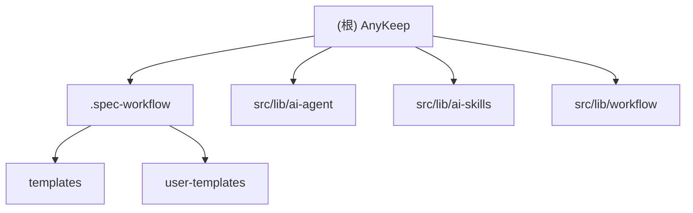

# AnyKeep - AI 上下文文档

## 变更记录 (Changelog)

| 日期       | 版本  | 变更内容                                                                                                                                                      |
| ---------- | ----- | ------------------------------------------------------------------------------------------------------------------------------------------------------------- |
| 2026-01-25 | 2.9.2 | 文档更新：生成 AI 模块架构图，创建 ai-agent/ai-skills/workflow 模块文档                                                                                       |
| 2026-01-12 | 2.9.1 | 文档更新：AI 架构图补充 Workflow 模式（三模态执行架构）、��增 workflow-system.md 架构文档                                                                     |
| 2026-01-11 | 2.9.0 | AI 架构优化 Phase 3：Feature Flags 治理机制、E2E 验收测试、类型冲突检测、能力成熟度仪表盘                                                                     |
| 2026-01-08 | 2.8.2 | Skills v1.1.0：新增 6 个 Skills（inbox_triage/folder_recommend/search_optimize/knowledge_graph_explore/folder_health_check/snapshot_compare），108 个单元测试 |
| 2025-12-29 | 2.8.1 | 文档校正：修正项目统计（2004文件/159迁移），补全21个Skills列表，添加TTS/Brain-Sync/主题合成器描述                                                             |
| 2025-12-28 | 2.8.0 | RAG 能力补全 Phase 1-3：查询改写、Rerank、向量缓存、Parent-Child 切片、RRF 融合、监控评估                                                                     |
| 2025-12-28 | 2.7.5 | ReAct 循环和引用追踪：Think→Act→Observe 循环、搜索结果自动引用[^N]、78 个测试用例                                                                             |
| 2025-12-27 | 2.7.4 | 信任模式智能化：get-trust-mode、recommend-trust-mode Tools，意图分类规则集成                                                                                  |
| 2025-12-27 | 2.7.3 | 代码质量清理：空 catch 修复、console → logger 迁移、高风险 API 速率限制（5 个端点）                                                                           |
| 2025-12-27 | 2.7.2 | AI 上下文增强 v2.0：序数引用解析、refine 意图类型、搜索结果持久化、负向后行断言修复                                                                           |
| 2025-12-27 | 2.7.1 | 对话上下文压缩：三级降级策略、摘要持久化、记忆增强系统、测试修复                                                                                              |
| 2025-12-27 | 2.7.0 | 任务理解层 v2.0：零接管模式、置信度分层、隐含意图推理、System-Reminder、请求取消功能                                                                          |
| 2025-12-26 | 2.6.1 | v4.3 修复：Token 持久化、LRU 缓存、跨平台兼容性、RPC 安全增强                                                                                                 |
| 2025-12-26 | 2.6.0 | AI 能力升级 v4.3：动态上下文、模型分层、偏好学习、成本控制、Feature Flags                                                                                     |
| 2025-12-25 | 2.5.1 | Tools & Skills 优化：Query Tools 日志完善、废弃工具清理、Skills 测试覆盖、统一注册适配层                                                                      |
| 2025-12-25 | 2.5.0 | 架构修��：日志系统统一、Classification 扁平化、测试稳定性增强                                                                                                 |
| 2025-12-24 | 2.4.0 | 完成 AI Skills 统一智能架构（编排引擎 + 4 个 Skills）                                                                                                         |
| 2025-12-20 | 2.2.0 | 完成批量操作功能（批量标签管理 + Shift 范围选择）                                                                                                             |
| 2025-12-01 | 2.1.0 | 完成浏览器书签隔离与列表视图优化功能                                                                                                                          |
| 2025-12-01 | 2.0.0 | 项目进入开发阶段，完成浏览器书签导入功能 (Phase 1-3)                                                                                                          |
| 2025-11-21 | 1.0.0 | 初始化 AI 上下文文档，项目处于规划阶段                                                                                                                        |

---

UI 文本使用常量/配置文件，不要硬编码在 JSX 中

## 项目愿景

AnyKeep 是一款**跨平台智能内容聚合工具**，帮助用户统一管理微信公众号、B站、小红书等平台的收藏内容。通过 AI 技��实现智能摘要、自动标签和语义搜索功能。

**MVP 核心价值**：

- 一键收藏：通过系统分享菜单快速保存内容
- AI 智能处理：自动生成摘要和标签
- 语义搜索：基于向量检索的智能搜索
- 跨设备同步：实时数据同步

**当前状态**：开发阶段 - 已完成 AI Skills 统一架构、批量操作、数据导出等核心功能

---

## 架构总览

```
规划中的技术架构：

+------------------+     +------------------+     +------------------+
|    Mobile App    |     |    Web App       |     |   Share Sheet    |
|   (Capacitor)    |     |   (Next.js)      |     |   (系统分享)      |
+--------+---------+     +--------+---------+     +--------+---------+
         |                        |                        |
         +------------------------+------------------------+
                                  |
                    +-------------v-------------+
                    |      Next.js API Routes   |
                    |    (Server Components)    |
                    +-------------+-------------+
                                  |
         +------------------------+------------------------+
         |                        |                        |
+--------v--------+    +----------v----------+    +--------v--------+
|  Supabase Auth  |    | Supabase Database   |    | Edge Functions  |
|   (认证服务)     |    |   (PostgreSQL +     |    |  (爬虫/AI处理)   |
|                 |    |    pgvector)        |    |                 |
+-----------------+    +---------------------+    +-----------------+
```

---

## 模块结构图



---

## 模块索引

| 模块路径                                           | 职责                                           | 状态    |
| -------------------------------------------------- | ---------------------------------------------- | ------- |
| [.spec-workflow](./.spec-workflow/CLAUDE.md)       | 规范工作流模板系统，提供需求/设计/任务文档模板 | 已配置  |
| [src/lib/ai-agent](./src/lib/ai-agent/CLAUDE.md)   | AI Agent 核心：Context、Tools、Feature Flags   | 🟢 活跃 |
| [src/lib/ai-skills](./src/lib/ai-skills/CLAUDE.md) | AI Skills 系统：编排引擎、Router、Skill 实现   | 🟢 活跃 |
| [src/lib/workflow](./src/lib/workflow/CLAUDE.md)   | Workflow 系统：自动化流程、触发器、状态管理    | 🟢 活跃 |

---

## 当前项目结构

```
anykeep/                    # 项目根目录
├── src/
│   ├── app/               # Next.js App Router (58+ 文件)
│   │   ├── (auth)/       # 认证相关页面
│   │   ├── (main)/       # 主应用页面
│   │   ├── api/          # API Routes
│   │   └── layout.tsx
│   ├── components/        # React 组件 (150+ 文件)
│   │   ├── ui/           # Shadcn UI 组件
│   │   ├── ai/           # AI 交互组件
│   │   ├── bookmark/     # 收藏相关组件
│   │   ├── browser-bookmark/  # 浏览器书签导入组件
│   │   ├── synthesis/    # 主题合成组件
│   │   ├── tts/          # TTS 语音播放组件
│   │   └── layout/       # 布局组件
│   ├── hooks/            # React Hooks (30+ 文件)
│   ├── lib/              # 工具函数与核心逻辑
│   │   ├── ai-agent/     # AI Agent 核心
│   │   ├── ai-skills/    # AI Skills 系统 (30 Skills)
│   │   ├── classification/ # 智能分类系统
│   │   ├── embedding/    # 向量嵌入服务
│   │   ├── tts/          # TTS 语音服务
│   │   ├── supabase/     # Supabase 客户端
│   │   └── browser-bookmark/  # 浏览器书签导入逻辑
│   ├── types/            # TypeScript 类型
│   ├── styles/           # 样式文件
│   └── middleware.ts     # Next.js 中间件
├── supabase/             # Supabase 配置
│   ├── migrations/       # 数据库迁移 (159 文件)
│   └── functions/        # Edge Functions
├── .spec-workflow/       # 规范工作流模板
├── anykeep1121.md        # 产品需求文档
└── CLAUDE.md             # AI 上下文文档

总计：2,004 个 TypeScript 文件
```

---

## 技术栈概览

### 前端

- **框架**: Next.js 14.x (App Router + Turbopack)
- **样式**: Tailwind CSS 4
- **组件库**: Shadcn UI + Radix UI
- **类型系统**: TypeScript 5
- **状态管理**: React Hooks + Context
- **表单处理**: React Hook Form + Zod

### 后端 (Supabase)

- **数据库**: PostgreSQL + pgvector
- **认证**: Supabase Auth
- **存储**: Supabase Storage
- **函数**: Edge Functions (Deno)

### 移动端

- **打包工具**: Capacitor

---

## 运行与开发

### 开发环境要求

- Node.js 20+
- Docker Desktop (用于本地 Supabase，可选)
- Git

### 常用命令

```bash
# 安装依赖
npm install

# 启动开发服务器
npm run dev
# 访问: http://localhost:3000

# 类型检查
npm run type-check

# 代码检查
npm run lint
npm run lint:fix

# 构建生产版本
npm run build
npm start

# Supabase 管理 (需要 Docker)
npm run supabase:start    # 启动本地 Supabase
npm run supabase:stop     # 停止
npm run supabase:status   # 查看状态
npm run supabase:db:push  # 推送迁移到远程
npm run supabase:gen:types  # 生成 TypeScript 类型

# 移动端打包
npm run mobile:build      # 构建并同步到 Capacitor
npm run cap:sync          # 同步 web 资源
npm run cap:open:android  # 打开 Android Studio
```

### 环境变量配置

项目需要 `.env.local` 文件：

```bash
NEXT_PUBLIC_SUPABASE_URL=你的Supabase项目URL
NEXT_PUBLIC_SUPABASE_ANON_KEY=你的匿名密钥
SUPABASE_SERVICE_ROLE_KEY=服务角色密钥
```

---

## 数据模型概览

### 核心表结构（已实现）

| 表名                       | 用途             | 关键字段                                     | 状态      |
| -------------------------- | ---------------- | -------------------------------------------- | --------- |
| `profiles`                 | 用户扩展信息     | id, phone, nickname, membership_type         | ✅ 已实现 |
| `bookmarks`                | 收藏记录         | id, user_id, title, url, platform, embedding | ✅ 已实现 |
| `folders`                  | 文件夹管理       | id, user_id, name, parent_id                 | ✅ 已实现 |
| `browser_bookmarks`        | 浏览器书签       | id, user_id, title, url, folder_id           | ✅ 已实现 |
| `browser_bookmark_folders` | 浏览器书签文件夹 | id, user_id, name, parent_id                 | ✅ 已实现 |
| `import_history`           | 导入历史记录     | id, user_id, import_source, total_count      | ✅ 已实现 |
| `platform_authorizations`  | 平台授权         | id, user_id, platform, access_token          | 📝 规划中 |

**数据库迁移**: 159 个迁移文件，包含完整的表结构、索引、RLS 策略

---

## 测试策略

### 规划中的测试方案

- **单元测试**: Jest + React Testing Library
- **组件测试**: Storybook（可选）
- **集成测试**: Supabase 本地测试环境
- **E2E 测试**: Cypress 或 Playwright

---

## 编码规范

### 命名约定

- **文件**: kebab-case (如 `bookmark-card.tsx`)
- **组件**: PascalCase (如 `BookmarkCard`)
- **函数**: camelCase (如 `handleSubmit`)
- **常量**: UPPER_SNAKE_CASE (如 `MAX_STORAGE_QUOTA`)

### 代码组织原则

1. 单一职责：每个文件专注一个功能
2. 模块化：组件和工具函数可复���
3. 类型安全：充分利用 TypeScript
4. 可测试性：业务逻辑与 UI 分离

---

## 已实现功能

### 1. 浏览器书签导入系统 ✅

(详细内容见原文档)

### 2. 浏览器书签隔离与列表视图 ✅

(详细内容见原文档)

### 3. 批量操作功能 ✅

(详细内容见原文档)

### 4. 数据导出功能 ✅

(详细内容见原文档)

### 5. AI Skills 统一智能架构 ✅

(详细内容见原文档)

### 6. 架构修复与质量提升 ✅

(详细内容见原文档)

### 7. AI 能力升级 v4.3 ✅

(详细内容见原文档)

### 8. 任务理解层 v2.0 零接管模式 ✅

(详细内容见原文档)

### 9. 对话上下文压缩系统 ✅

(详细内容见原文档)

### 10. 信任模式智能化 ✅

(详细内容见原文档)

### 11. TTS 语音朗读功能 ✅

(详细内容见原文档)

### 12. Brain-Sync 主动复习 ✅

(详细内容见原文档)

### 13. 主题合成器 ✅

(详细内容见原文档)

---

## AI 使用指引

### 核心文档

- **产品需求**: `anykeep1121.md` - 包含完整的 MVP 需求、数据模型、API 设计
- **模板系统**: `.spec-workflow/templates/` - 规范文档模板

### 开发建议

1. 按照 `anykeep1121.md` 中的开发优先级执行
2. 使用 Supabase CLI 管理数据库迁移
3. 遵循 Shadcn UI 组件规范
4. Edge Functions 使用 Deno/TypeScript

### 关键注意点

- RLS (Row Level Security) 策略必须正确配置
- 向量搜索需要启用 pgvector 扩展
- 移动端打包使用 Capacitor 套壳方案

---

## 相关文件

| 文件路径                         | 说明                       |
| -------------------------------- | -------------------------- |
| `anykeep1121.md`                 | 完整产品需求文档（1262行） |
| `.spec-workflow/templates/`      | 规范工作流模板             |
| `.spec-workflow/user-templates/` | 用户自定义模板             |

---

# 开发指南 (Development Guidelines)

(详细内容见原文档)
