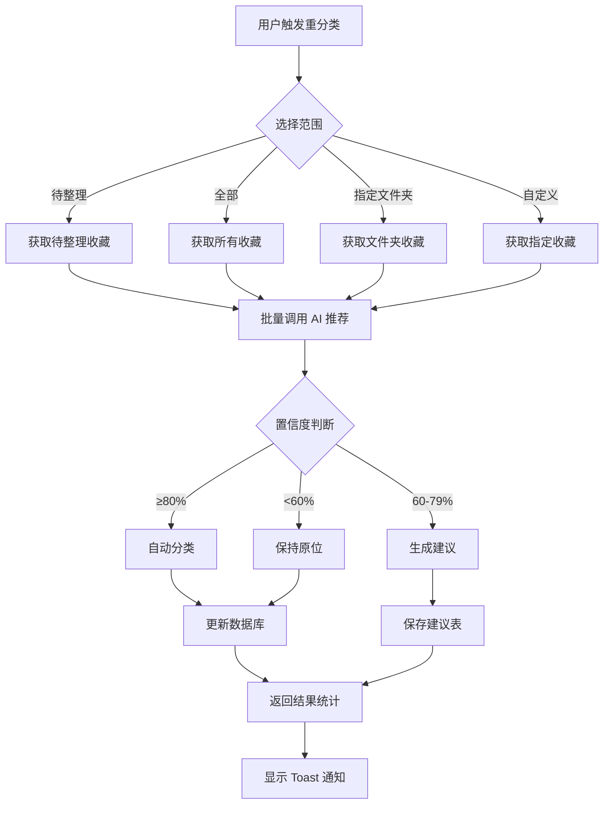

# Phase 4: AI 增强功能 - 设计与实现计划

**版本**: v1.0
**日期**: 2025-11-27
**状态**: 待审核

---

## 📋 目录

1. [功能概述](#功能概述)
2. [Task 4.1: AI 摘要优化](#task-41-ai-摘要优化)
3. [Task 4.2: 智能重分类](#task-42-智能重分类)
4. [技术架构](#技术架构)
5. [数据库设计](#数据库设计)
6. [API 设计](#api-设计)
7. [UI/UX 设计](#uiux-设计)
8. [实施计划](#实施计划)
9. [风险评估](#风险评估)

---

## 功能概述

### 为什么需要这两个功能？

**当前痛点**：

1. **摘要质量不稳定**：当前摘要生成基于单次 AI 调用，质量受内容质量影响大
2. **历史数据无法优化**：早期收藏的分类可能不准确，用户无法批量优化
3. **文件夹结构演化**：用户的文件夹体系会随时间变化，旧收藏需要重新归类

**用户价值**：

- 提升摘要质量，帮助用户快速理解内容
- 批量优化历史收藏的分类，保持知识库整洁
- 降低手动整理的工作量

---

## Task 4.1: AI 摘要优化

### 目标

提升 AI 生成摘要的质量和准确性，增加多模型支持和质量评分机制。

### 当前实现分析

**现有流程**（[ai-generator.ts:51](src/lib/utils/ai-generator.ts#L51)）：

```typescript
// 单次 DeepSeek API 调用
callDeepSeekAPI(title, description, content)
  → 返回 { summary, tags }
  → 直接保存到数据库
```

**存在的问题**：

1. ❌ 无质量评估机制
2. ❌ 摘要长度不适配（固定 50-300 字）
3. ❌ 无法针对不同平台优化（微信/B站/小红书内容特点不同）
4. ❌ 失败后无重试或降级策略
5. ❌ 无用户反馈循环

### 解决方案

#### 1. 多级摘要生成策略

```typescript
interface SummaryGenerationConfig {
  platform: Platform;
  contentType: "article" | "video" | "note";
  contentLength: number;
  userPreference?: {
    style: "concise" | "detailed" | "bullet"; // 用户偏好
    focusOn: "key_points" | "full_context"; // 关注点
  };
}

// 分平台优化提示词
const PLATFORM_PROMPTS = {
  WECHAT_OFFICIAL_ACCOUNT: {
    system: "你是微信公众号内容分析专家，擅长提取文章核心观点和论据",
    template: "请提取文章的核心论点、3个关键论据和实际应用价值",
  },
  BILIBILI: {
    system: "你是视频内容分析专家，擅长总结视频要点和时间轴",
    template: "请总结视频的主题、关键章节和核心知识点",
  },
  XIAOHONGSHU: {
    system: "你是生活分享内容分析专家，擅长提取实用技巧和体验",
    template: "请提炼实用建议、使用体验和注意事项",
  },
};
```

#### 2. 质量评分与自动重试

```typescript
interface SummaryQualityScore {
  relevance: number; // 相关性 (0-100)
  completeness: number; // 完整性 (0-100)
  clarity: number; // 清晰度 (0-100)
  overall: number; // 综合评分 (0-100)
}

async function generateSummaryWithQuality(
  content: AIGenerateRequest,
  config: SummaryGenerationConfig,
): Promise<{ summary: string; tags: string[]; quality: SummaryQualityScore }> {
  const maxRetries = 3;
  let bestResult = null;
  let bestScore = 0;

  for (let i = 0; i < maxRetries; i++) {
    const result = await callDeepSeekAPI(content, config);
    const score = await evaluateSummaryQuality(result, content);

    if (score.overall >= 80 || i === maxRetries - 1) {
      return { ...result, quality: score };
    }

    if (score.overall > bestScore) {
      bestResult = result;
      bestScore = score.overall;
    }
  }

  return { ...bestResult, quality: { overall: bestScore } };
}
```

#### 3. 用户反馈机制

**在收藏详情页增加摘要评分**：

```typescript
// 新增数据库字段
ALTER TABLE bookmarks ADD COLUMN summary_rating SMALLINT; -- 1-5 星
ALTER TABLE bookmarks ADD COLUMN summary_feedback TEXT;   -- 用户反馈

// 收集反馈用于优化提示词
CREATE TABLE ai_summary_feedback (
  id BIGSERIAL PRIMARY KEY,
  bookmark_id BIGINT REFERENCES bookmarks(id),
  user_id UUID REFERENCES auth.users(id),
  rating SMALLINT CHECK (rating BETWEEN 1 AND 5),
  feedback_type VARCHAR(50), -- 'too_long' | 'missing_key_points' | 'inaccurate'
  feedback_text TEXT,
  original_summary TEXT,
  created_at TIMESTAMPTZ DEFAULT NOW()
);
```

#### 4. 摘要重新生成

```typescript
// API: POST /api/bookmarks/:id/regenerate-summary
// 支持单个收藏重新生成摘要
async function regenerateSummary(
  bookmarkId: number,
  options?: {
    force?: boolean; // 是否强制重新生成（即使已有高质量摘要）
    style?: "concise" | "detailed";
  },
) {
  // 1. 获取原始内容
  const bookmark = await getBookmarkWithContent(bookmarkId);

  // 2. 使用新的生成策略
  const config = buildConfigFromBookmark(bookmark, options);
  const result = await generateSummaryWithQuality(bookmark, config);

  // 3. 保存新摘要（保留旧版本用于对比）
  await updateSummary(bookmarkId, {
    ai_summary: result.summary,
    ai_tags: result.tags,
    summary_quality_score: result.quality.overall,
    summary_regenerated_at: new Date(),
  });

  return result;
}
```

### 验收标准

- [ ] 摘要质量评分 ≥ 80 分的比例达到 85%
- [ ] 不同平台使用定制化提示词
- [ ] 支持用户反馈摘要质量（1-5 星）
- [ ] 支持单个收藏重新生成摘要
- [ ] 摘要生成失败时有降级策略（使用简单提取）

---

## Task 4.2: 智能重分类

### 目标

为用户提供批量重新分类工具，基于当前文件夹结构优化历史收藏的归属。

### 使用场景

**场景 1：文件夹结构优化后**

> 用户初期只有 3 个文件夹，后来细化为 10 个文件夹。需要将旧收藏重新分配到新文件夹。

**场景 2："待整理"文件夹积累**

> 用户的"待整理"文件夹积累了 100+ 条收藏，需要批量归类。

**场景 3：定期维护**

> 每月/每季度对全部收藏进行智能重分类，保持知识库整洁。

### 设计方案

#### 1. 重分类触发方式

```typescript
// 方式 1: 手动触发（文件夹管理页面）
interface ReclassifyRequest {
  scope: "inbox" | "all" | "folder" | "custom";
  folderId?: number; // scope=folder 时指定
  bookmarkIds?: number[]; // scope=custom 时指定
  minConfidence?: number; // 最低置信度阈值（默认 60）
  autoApply?: boolean; // 是否自动应用高置信度建议（≥80%）
}

// 方式 2: 自动触发（系统任务）
interface ReclassifySchedule {
  enabled: boolean;
  frequency: "weekly" | "monthly";
  inboxThreshold: number; // 待整理文件夹数量阈值
  lastRunAt: Date;
}
```

#### 2. 批量重分类流程



#### 3. 数据库设计

**复用现有表**（已存在）：

```sql
-- classification_suggestions 表
-- 用于存储中置信度建议（60-79%）
```

**新增审计表**：

```sql
-- 重分类历史记录
CREATE TABLE reclassify_history (
  id BIGSERIAL PRIMARY KEY,
  user_id UUID NOT NULL REFERENCES auth.users(id),
  batch_id UUID NOT NULL,              -- 批次 ID
  scope VARCHAR(20) NOT NULL,          -- 'inbox' | 'all' | 'folder' | 'custom'
  total_bookmarks INTEGER NOT NULL,    -- 总处理数量
  auto_classified INTEGER DEFAULT 0,   -- 自动分类数量（≥80%）
  suggestions_created INTEGER DEFAULT 0, -- 建议数量（60-79%）
  unchanged INTEGER DEFAULT 0,         -- 未改变数量（<60%）
  status VARCHAR(20) DEFAULT 'processing', -- 'processing' | 'completed' | 'failed'
  started_at TIMESTAMPTZ DEFAULT NOW(),
  completed_at TIMESTAMPTZ,
  created_at TIMESTAMPTZ DEFAULT NOW()
);

CREATE INDEX idx_reclassify_history_user ON reclassify_history(user_id, created_at DESC);
CREATE INDEX idx_reclassify_history_batch ON reclassify_history(batch_id);
```

#### 4. API 设计

**启动重分类**：

```typescript
// POST /api/reclassify
interface ReclassifyStartResponse {
  batchId: string;
  estimatedTime: number; // 预估耗时（秒）
  totalBookmarks: number;
  message: string;
}

// 后台任务处理（避免超时）
// 使用 Supabase Edge Function 或队列系统
```

**查询进度**：

```typescript
// GET /api/reclassify/:batchId/status
interface ReclassifyStatusResponse {
  batchId: string;
  status: "processing" | "completed" | "failed";
  progress: {
    total: number;
    processed: number;
    percentage: number;
  };
  results: {
    autoClassified: number;
    suggestionsCreated: number;
    unchanged: number;
  };
}
```

**获取建议列表**：

```typescript
// GET /api/reclassify/suggestions
interface ReclassifySuggestionsResponse {
  suggestions: Array<{
    id: number;
    bookmark: {
      id: number;
      title: string;
      currentFolder: string;
    };
    suggestedFolder: string;
    confidence: number;
    reason: string;
  }>;
  total: number;
}
```

**批量处理建议**：

```typescript
// POST /api/reclassify/suggestions/batch
interface BatchProcessRequest {
  action: "accept_all" | "reject_all" | "accept_selected" | "reject_selected";
  suggestionIds?: number[]; // action=accept_selected/reject_selected 时提供
  minConfidence?: number; // action=accept_all 时的最低置信度
}
```

#### 5. UI 设计

**文件夹管理页面新增"智能整理"按钮**：

```tsx
<Button onClick={openReclassifyDialog}>
  <Sparkles className="mr-2 h-4 w-4" />
  智能整理
</Button>
```

**重分类对话框**：

```tsx
<Dialog>
  <DialogContent>
    <DialogHeader>
      <DialogTitle>智能重分类</DialogTitle>
      <DialogDescription>
        使用 AI 重新分析收藏内容，自动归类到合适的文件夹
      </DialogDescription>
    </DialogHeader>

    {/* 1. 选择范围 */}
    <RadioGroup value={scope} onValueChange={setScope}>
      <RadioGroupItem value="inbox">
        仅"待整理"文件夹 ({inboxCount} 条)
      </RadioGroupItem>
      <RadioGroupItem value="all">全部收藏 ({totalCount} 条)</RadioGroupItem>
      <RadioGroupItem value="folder">指定文件夹</RadioGroupItem>
    </RadioGroup>

    {/* 2. 高级选项 */}
    <Collapsible>
      <CollapsibleTrigger>高级选项</CollapsibleTrigger>
      <CollapsibleContent>
        <Label>最低置信度</Label>
        <Slider
          value={[minConfidence]}
          onValueChange={setMinConfidence}
          min={50}
          max={90}
        />

        <Checkbox checked={autoApply} onCheckedChange={setAutoApply}>
          自动应用高置信度建议（≥80%）
        </Checkbox>
      </CollapsibleContent>
    </Collapsible>

    {/* 3. 预估信息 */}
    <Alert>
      <Info className="h-4 w-4" />
      <AlertDescription>
        预计处理 {estimatedCount} 条收藏，耗时约 {estimatedTime} 秒
      </AlertDescription>
    </Alert>

    <DialogFooter>
      <Button variant="outline" onClick={onCancel}>
        取消
      </Button>
      <Button onClick={startReclassify}>开始整理</Button>
    </DialogFooter>
  </DialogContent>
</Dialog>
```

**进度显示**：

```tsx
<Progress value={progress.percentage} className="w-full" />
<p className="text-sm text-muted-foreground">
  已处理 {progress.processed} / {progress.total} 条
</p>
```

**结果展示**：

```tsx
<Card>
  <CardHeader>
    <CardTitle>重分类完成</CardTitle>
  </CardHeader>
  <CardContent>
    <div className="space-y-2">
      <div className="flex justify-between">
        <span>自动分类</span>
        <span className="font-medium text-green-600">
          {results.autoClassified} 条
        </span>
      </div>
      <div className="flex justify-between">
        <span>待确认建议</span>
        <span className="font-medium text-blue-600">
          {results.suggestionsCreated} 条
        </span>
      </div>
      <div className="flex justify-between">
        <span>保持不变</span>
        <span className="font-medium text-gray-500">
          {results.unchanged} 条
        </span>
      </div>
    </div>

    {results.suggestionsCreated > 0 && (
      <Button variant="link" onClick={viewSuggestions}>
        查看待确认建议 →
      </Button>
    )}
  </CardContent>
</Card>
```

**建议审核页面**：

```tsx
<div className="space-y-4">
  {/* 批量操作 */}
  <div className="flex gap-2">
    <Button onClick={acceptAll}>全部接受（≥75% 置信度）</Button>
    <Button variant="outline" onClick={rejectAll}>
      全部拒绝
    </Button>
  </div>

  {/* 建议列表 */}
  {suggestions.map((suggestion) => (
    <Card key={suggestion.id}>
      <CardContent className="flex items-center justify-between py-4">
        <div className="flex-1">
          <h4 className="font-medium">{suggestion.bookmark.title}</h4>
          <p className="text-sm text-muted-foreground">
            {suggestion.currentFolder} → {suggestion.suggestedFolder}
          </p>
          <Badge variant="outline">{suggestion.confidence}%</Badge>
        </div>
        <div className="flex gap-2">
          <Button size="sm" onClick={() => accept(suggestion.id)}>
            接受
          </Button>
          <Button
            size="sm"
            variant="outline"
            onClick={() => reject(suggestion.id)}
          >
            拒绝
          </Button>
        </div>
      </CardContent>
    </Card>
  ))}
</div>
```

#### 6. 性能优化

**批量处理策略**：

```typescript
// 分批处理，避免一次处理过多导致超时
const BATCH_SIZE = 50;

async function reclassifyInBatches(bookmarkIds: number[], batchId: string) {
  for (let i = 0; i < bookmarkIds.length; i += BATCH_SIZE) {
    const batch = bookmarkIds.slice(i, i + BATCH_SIZE);

    // 并发处理批次内的收藏
    await Promise.allSettled(
      batch.map((id) => reclassifySingleBookmark(id, batchId)),
    );

    // 更新进度
    await updateProgress(batchId, i + batch.length);
  }
}
```

**智能缓存**：

```typescript
// 相同内容的收藏只调用一次 AI
const contentHashCache = new Map<string, FolderRecommendation>();

function getCacheKey(bookmark: Bookmark): string {
  return `${bookmark.title}-${bookmark.ai_summary?.substring(0, 100)}`;
}
```

### 验收标准

- [ ] 支持 4 种重分类范围（待整理/全部/指定文件夹/自定义）
- [ ] 批量处理性能：每秒处理 ≥ 5 条收藏
- [ ] 显示实时进度（百分比 + 数量）
- [ ] 自动应用高置信度建议（≥80%）
- [ ] 生成中置信度建议列表（60-79%）
- [ ] 支持批量审核建议（全部接受/拒绝）
- [ ] 保存重分类历史记录

---

## 技术架构

### 系统架构图

```
┌─────────────────────────────────────────────────────────────┐
│                      前端 (Next.js)                          │
│  ┌─────────────────┐  ┌──────────────────┐  ┌─────────────┐│
│  │ 摘要质量评分    │  │ 重分类对话框      │  │ 建议审核页  ││
│  │ 反馈收集        │  │ 进度显示          │  │ 批量操作    ││
│  └─────────────────┘  └──────────────────┘  └─────────────┘│
└─────────────────────────────────────────────────────────────┘
                              ↓
┌─────────────────────────────────────────────────────────────┐
│                    API 层 (Next.js API Routes)               │
│  ┌─────────────────────────────────────────────────────────┐│
│  │ POST /api/bookmarks/:id/regenerate-summary              ││
│  │ POST /api/reclassify                                    ││
│  │ GET  /api/reclassify/:batchId/status                    ││
│  │ GET  /api/reclassify/suggestions                        ││
│  │ POST /api/reclassify/suggestions/batch                  ││
│  └─────────────────────────────────────────────────────────┘│
└─────────────────────────────────────────────────────────────┘
                              ↓
┌─────────────────────────────────────────────────────────────┐
│                   业务逻辑层 (Utils)                         │
│  ┌─────────────────┐  ┌──────────────────┐  ┌─────────────┐│
│  │ AI 生成器增强   │  │ 批量重分类处理    │  │ 质量评估    ││
│  │ - 多级策略      │  │ - 分批处理        │  │ - 评分算法  ││
│  │ - 质量评分      │  │ - 进度追踪        │  │ - 反馈收集  ││
│  │ - 平台优化      │  │ - 缓存优化        │  │             ││
│  └─────────────────┘  └──────────────────┘  └─────────────┘│
└─────────────────────────────────────────────────────────────┘
                              ↓
┌─────────────────────────────────────────────────────────────┐
│               数据库层 (Supabase PostgreSQL)                 │
│  ┌─────────────────────────────────────────────────────────┐│
│  │ bookmarks (新增字段)                                     ││
│  │ - summary_rating, summary_feedback                      ││
│  │ - summary_quality_score, summary_regenerated_at         ││
│  │                                                          ││
│  │ ai_summary_feedback (新表)                              ││
│  │ reclassify_history (新表)                               ││
│  │ classification_suggestions (复用)                       ││
│  └─────────────────────────────────────────────────────────┘│
└─────────────────────────────────────────────────────────────┘
                              ↓
┌─────────────────────────────────────────────────────────────┐
│                  外部服务 (DeepSeek API)                     │
└─────────────────────────────────────────────────────────────┘
```

---

## 数据库设计

### 新增/修改表结构

#### 1. bookmarks 表修改

```sql
-- 摘要质量相关
ALTER TABLE bookmarks ADD COLUMN summary_rating SMALLINT;
COMMENT ON COLUMN bookmarks.summary_rating IS '摘要评分（1-5星）';

ALTER TABLE bookmarks ADD COLUMN summary_feedback TEXT;
COMMENT ON COLUMN bookmarks.summary_feedback IS '摘要反馈文本';

ALTER TABLE bookmarks ADD COLUMN summary_quality_score INTEGER;
COMMENT ON COLUMN bookmarks.summary_quality_score IS 'AI 质量评分（0-100）';

ALTER TABLE bookmarks ADD COLUMN summary_regenerated_at TIMESTAMPTZ;
COMMENT ON COLUMN bookmarks.summary_regenerated_at IS '摘要重新生成时间';
```

#### 2. ai_summary_feedback 表（新建）

```sql
CREATE TABLE ai_summary_feedback (
  id BIGSERIAL PRIMARY KEY,
  bookmark_id BIGINT NOT NULL REFERENCES bookmarks(id) ON DELETE CASCADE,
  user_id UUID NOT NULL REFERENCES auth.users(id) ON DELETE CASCADE,
  rating SMALLINT NOT NULL CHECK (rating BETWEEN 1 AND 5),
  feedback_type VARCHAR(50), -- 'too_long' | 'missing_key_points' | 'inaccurate' | 'good'
  feedback_text TEXT,
  original_summary TEXT NOT NULL,
  created_at TIMESTAMPTZ DEFAULT NOW()
);

CREATE INDEX idx_ai_summary_feedback_bookmark ON ai_summary_feedback(bookmark_id);
CREATE INDEX idx_ai_summary_feedback_user ON ai_summary_feedback(user_id);
CREATE INDEX idx_ai_summary_feedback_rating ON ai_summary_feedback(rating, created_at DESC);

COMMENT ON TABLE ai_summary_feedback IS 'AI 摘要用户反馈表，用于优化提示词';
```

#### 3. reclassify_history 表（新建）

```sql
CREATE TABLE reclassify_history (
  id BIGSERIAL PRIMARY KEY,
  user_id UUID NOT NULL REFERENCES auth.users(id) ON DELETE CASCADE,
  batch_id UUID NOT NULL,
  scope VARCHAR(20) NOT NULL CHECK (scope IN ('inbox', 'all', 'folder', 'custom')),
  scope_folder_id BIGINT REFERENCES folders(id) ON DELETE SET NULL,
  total_bookmarks INTEGER NOT NULL,
  auto_classified INTEGER DEFAULT 0,
  suggestions_created INTEGER DEFAULT 0,
  unchanged INTEGER DEFAULT 0,
  status VARCHAR(20) DEFAULT 'processing' CHECK (status IN ('processing', 'completed', 'failed')),
  error_message TEXT,
  started_at TIMESTAMPTZ DEFAULT NOW(),
  completed_at TIMESTAMPTZ,
  created_at TIMESTAMPTZ DEFAULT NOW()
);

CREATE INDEX idx_reclassify_history_user ON reclassify_history(user_id, created_at DESC);
CREATE INDEX idx_reclassify_history_batch ON reclassify_history(batch_id);
CREATE INDEX idx_reclassify_history_status ON reclassify_history(status, created_at);

COMMENT ON TABLE reclassify_history IS '智能重分类历史记录';
```

### RLS 策略

```sql
-- ai_summary_feedback
ALTER TABLE ai_summary_feedback ENABLE ROW LEVEL SECURITY;

CREATE POLICY "Users can view own feedback"
  ON ai_summary_feedback FOR SELECT
  USING (auth.uid() = user_id);

CREATE POLICY "Users can insert own feedback"
  ON ai_summary_feedback FOR INSERT
  WITH CHECK (auth.uid() = user_id);

-- reclassify_history
ALTER TABLE reclassify_history ENABLE ROW LEVEL SECURITY;

CREATE POLICY "Users can view own history"
  ON reclassify_history FOR SELECT
  USING (auth.uid() = user_id);

CREATE POLICY "Users can insert own history"
  ON reclassify_history FOR INSERT
  WITH CHECK (auth.uid() = user_id);

CREATE POLICY "Users can update own history"
  ON reclassify_history FOR UPDATE
  USING (auth.uid() = user_id);
```

---

## API 设计

### Task 4.1 相关 API

#### 1. 重新生成摘要

```typescript
POST /api/bookmarks/:id/regenerate-summary

Request Body:
{
  force?: boolean           // 强制重新生成（默认 false）
  style?: 'concise' | 'detailed' | 'bullet'
  focusOn?: 'key_points' | 'full_context'
}

Response:
{
  success: true,
  data: {
    summary: string
    tags: string[]
    quality: {
      relevance: number
      completeness: number
      clarity: number
      overall: number
    }
    oldSummary: string      // 用于对比
  }
}
```

#### 2. 提交摘要反馈

```typescript
POST /api/bookmarks/:id/summary-feedback

Request Body:
{
  rating: 1 | 2 | 3 | 4 | 5
  feedbackType?: 'too_long' | 'missing_key_points' | 'inaccurate' | 'good'
  feedbackText?: string
}

Response:
{
  success: true,
  message: '感谢反馈！'
}
```

### Task 4.2 相关 API

#### 1. 启动重分类

```typescript
POST /api/reclassify

Request Body:
{
  scope: 'inbox' | 'all' | 'folder' | 'custom'
  folderId?: number
  bookmarkIds?: number[]
  minConfidence?: number    // 默认 60
  autoApply?: boolean       // 默认 true
}

Response:
{
  success: true,
  data: {
    batchId: string
    estimatedTime: number
    totalBookmarks: number
  }
}
```

#### 2. 查询重分类进度

```typescript
GET /api/reclassify/:batchId/status

Response:
{
  success: true,
  data: {
    batchId: string
    status: 'processing' | 'completed' | 'failed'
    progress: {
      total: number
      processed: number
      percentage: number
    }
    results: {
      autoClassified: number
      suggestionsCreated: number
      unchanged: number
    }
    startedAt: string
    completedAt?: string
  }
}
```

#### 3. 获取待确认建议

```typescript
GET /api/reclassify/suggestions
  ?page=1
  &limit=20
  &minConfidence=60

Response:
{
  success: true,
  data: {
    suggestions: Array<{
      id: number
      bookmark: {
        id: number
        title: string
        currentFolder: { id: number, name: string }
      }
      suggestedFolder: { id: number, name: string }
      confidence: number
      reason: string
      createdAt: string
    }>
    pagination: {
      total: number
      page: number
      limit: number
      pages: number
    }
  }
}
```

#### 4. 批量处理建议

```typescript
POST /api/reclassify/suggestions/batch

Request Body:
{
  action: 'accept_all' | 'reject_all' | 'accept_selected' | 'reject_selected'
  suggestionIds?: number[]
  minConfidence?: number
}

Response:
{
  success: true,
  data: {
    processed: number
    accepted: number
    rejected: number
  }
}
```

---

## UI/UX 设计

### 页面布局

#### 1. 收藏详情页 - 摘要评分区域

```
┌────────────────────────────────────────────────────┐
│  [收藏详情]                                        │
│  ┌────────────────────────────────────────────┐   │
│  │  AI 摘要                                   │   │
│  │  这是一篇关于...的文章，主要讲述了...      │   │
│  │  ─────────────────────────────────────────│   │
│  │  📊 质量评分: 85 分                        │   │
│  │  ⭐⭐⭐⭐⭐ 这个摘要对你有帮助吗？      │   │
│  │  [重新生成]  [提供反馈]                   │   │
│  └────────────────────────────────────────────┘   │
└────────────────────────────────────────────────────┘
```

#### 2. 文件夹管理页 - 智能整理入口

```
┌────────────────────────────────────────────────────┐
│  [文件夹管理]                    [✨ 智能整理]    │
│  ┌────────────────────────────────────────────┐   │
│  │  📂 待整理  (156 条)                       │   │
│  │  📂 技术文章  (89 条)                      │   │
│  │  📂 生活技巧  (67 条)                      │   │
│  └────────────────────────────────────────────┘   │
└────────────────────────────────────────────────────┘
```

#### 3. 智能整理对话框

```
┌────────────────────────────────────────────────────┐
│  智能重分类                              [X]       │
│  使用 AI 重新分析收藏，自动归类到合适的文件夹     │
│                                                    │
│  选择整理范围:                                     │
│  ○ 仅"待整理"文件夹 (156 条)                      │
│  ● 全部收藏 (312 条)                              │
│  ○ 指定文件夹 [选择...]                           │
│                                                    │
│  ▼ 高级选项                                        │
│    最低置信度: [█████████─] 70%                   │
│    □ 自动应用高置信度建议 (≥80%)                  │
│                                                    │
│  ℹ️ 预计处理 312 条收藏，耗时约 2 分钟            │
│                                                    │
│  [取消]                        [开始整理]         │
└────────────────────────────────────────────────────┘
```

#### 4. 处理进度显示

```
┌────────────────────────────────────────────────────┐
│  正在智能整理...                                   │
│  [████████████████────────────] 67%               │
│  已处理 209 / 312 条                               │
│                                                    │
│  📊 实时统计:                                      │
│  ✓ 自动分类: 142 条                                │
│  ? 待确认: 38 条                                   │
│  - 保持不变: 29 条                                 │
└────────────────────────────────────────────────────┘
```

#### 5. 待确认建议页面

```
┌────────────────────────────────────────────────────┐
│  待确认建议 (38 条)                                │
│  [全部接受 ≥75%]  [全部拒绝]                      │
│                                                    │
│  ┌────────────────────────────────────────────┐   │
│  │ ⭐ 如何使用 Next.js 构建现代 Web 应用       │   │
│  │ 技术笔记 → 前端开发                        │   │
│  │ [82%] 内容涉及 Next.js 框架和实践经验      │   │
│  │                           [接受]  [拒绝]   │   │
│  └────────────────────────────────────────────┘   │
│  ┌────────────────────────────────────────────┐   │
│  │ 📱 iPhone 15 Pro 深度评测                  │   │
│  │ 待整理 → 数码产品                          │   │
│  │ [76%] 关于 iPhone 15 Pro 的详细测评       │   │
│  │                           [接受]  [拒绝]   │   │
│  └────────────────────────────────────────────┘   │
│                                        [1/2 页]   │
└────────────────────────────────────────────────────┘
```

### 交互流程

**流程 1：摘要评分与反馈**

```
用户点击摘要评分 → 弹出评分对话框 → 选择星级 + 可选反馈文本 → 提交 → Toast 确认
```

**流程 2：重新生成摘要**

```
点击"重新生成" → 确认对话框 → 显示加载状态 → 对比新旧摘要 → 用户选择保留新/旧
```

**流程 3：智能重分类**

```
打开智能整理对话框 → 选择范围和选项 → 点击开始 → 显示进度条 → 完成后展示统计
→ （如有建议）跳转到待确认页面
```

---

## 实施计划

### 开发阶段划分

#### 阶段 1: Task 4.1 - AI 摘要优化 (预计 3 天)

**Day 1: 基础架构**

- [ ] 数据库迁移（bookmarks 表新增字段）
- [ ] 创建 ai_summary_feedback 表
- [ ] 实现多平台提示词配置
- [ ] 实现质量评分算法

**Day 2: 核心功能**

- [ ] 实现多级摘要生成策略
- [ ] 实现重新生成摘要 API
- [ ] 实现摘要反馈 API
- [ ] 测试质量评分准确性

**Day 3: UI 集成**

- [ ] 收藏详情页增加评分组件
- [ ] 实现"重新生成"功能
- [ ] 实现反馈收集对话框
- [ ] E2E 测试

#### 阶段 2: Task 4.2 - 智能重分类 (预计 4 天)

**Day 1: 数据库与后端**

- [ ] 创建 reclassify_history 表
- [ ] 实现批量重分类核心逻辑
- [ ] 实现分批处理机制
- [ ] 实现进度追踪

**Day 2: API 开发**

- [ ] POST /api/reclassify API
- [ ] GET /api/reclassify/:batchId/status API
- [ ] GET /api/reclassify/suggestions API
- [ ] POST /api/reclassify/suggestions/batch API

**Day 3: UI 开发**

- [ ] 智能整理对话框
- [ ] 进度显示组件
- [ ] 结果统计展示
- [ ] 待确认建议页面

**Day 4: 集成测试**

- [ ] 性能测试（大批量处理）
- [ ] 并发测试
- [ ] 边界情况测试
- [ ] 用户体验优化

### 依赖关系

```
Task 4.1 → 独立开发，无依赖
Task 4.2 → 依赖现有的 recommendFolder() 函数
```

### 里程碑

- **M1**: Task 4.1 完成（Day 3）
- **M2**: Task 4.2 核心功能完成（Day 6）
- **M3**: 全面测试与优化（Day 7）
- **M4**: Phase 4 完成发布（Day 7）

---

## 风险评估

### 技术风险

| 风险项                        | 严重程度 | 缓解措施                                           |
| ----------------------------- | -------- | -------------------------------------------------- |
| **DeepSeek API 调用频率限制** | 🔴 高    | 实现速率限制、批量处理时分批调用、缓存相似内容结果 |
| **批量处理性能问题**          | 🟡 中    | 分批处理、异步队列、进度追踪、可中断设计           |
| **质量评分算法不准确**        | 🟡 中    | 收集用户反馈持续优化、多维度评分、阈值可调         |
| **大批量重分类超时**          | 🟡 中    | 使用后台任务、Edge Function、或队列系统            |

### 产品风险

| 风险项                     | 严重程度 | 缓解措施                                     |
| -------------------------- | -------- | -------------------------------------------- |
| **用户不信任 AI 重分类**   | 🟡 中    | 提供详细理由、置信度显示、撤销功能、预览模式 |
| **重分类破坏用户组织习惯** | 🟡 中    | 默认仅推荐不自动应用、提供回滚功能、保存历史 |
| **摘要质量主观差异大**     | 🟡 中    | 提供多种风格选项、用户反馈循环、人工介入     |

### 成本风险

| 风险项                | 严重程度 | 缓解措施                                       |
| --------------------- | -------- | ---------------------------------------------- |
| **AI API 调用成本高** | 🟡 中    | 智能缓存、批量折扣、免费额度管理、用户付费功能 |
| **存储成本增加**      | 🟢 低    | 反馈数据定期清理、历史数据归档                 |

---

## 附录

### A. 质量评分算法示例

```typescript
function evaluateSummaryQuality(
  summary: string,
  tags: string[],
  originalContent: { title: string; description?: string; content?: string },
): SummaryQualityScore {
  const scores = {
    relevance: 0, // 相关性
    completeness: 0, // 完整性
    clarity: 0, // 清晰度
    overall: 0,
  };

  // 1. 相关性评分（基于关键词重叠）
  const contentKeywords = extractKeywords(originalContent);
  const summaryKeywords = extractKeywords({ title: "", description: summary });
  const overlap = calculateOverlap(contentKeywords, summaryKeywords);
  scores.relevance = Math.min(overlap * 100, 100);

  // 2. 完整性评分（长度适当性）
  const contentLength = (originalContent.content || "").length;
  const summaryLength = summary.length;
  const expectedLength = getSummaryLimit(contentLength).max;
  const lengthRatio = summaryLength / expectedLength;
  scores.completeness = lengthRatio >= 0.7 && lengthRatio <= 1.2 ? 90 : 70;

  // 3. 清晰度评分（结构和可读性）
  const hasClearStructure = /[。！？]/.test(summary); // 有标点断句
  const noRepetition = !hasRepetitiveContent(summary);
  const properLength = summaryLength >= 50 && summaryLength <= 500;
  scores.clarity =
    (hasClearStructure ? 40 : 0) +
    (noRepetition ? 30 : 0) +
    (properLength ? 30 : 0);

  // 4. 综合评分
  scores.overall = Math.round(
    scores.relevance * 0.4 + scores.completeness * 0.3 + scores.clarity * 0.3,
  );

  return scores;
}
```

### B. 提示词模板示例

```typescript
const PLATFORM_SPECIFIC_PROMPTS = {
  WECHAT_OFFICIAL_ACCOUNT: {
    system: `你是微信公众号内容分析专家。你的任务是：
1. 提取文章的核心论点（一句话总结主旨）
2. 提炼 3 个关键论据或观点
3. 总结实际应用价值或启发`,

    template: (content) => `请分析这篇微信公众号文章：

标题：${content.title}
${content.description ? `简介：${content.description}` : ""}
${content.content ? `正文：${content.content.substring(0, 2000)}` : ""}

请按以下格式返回 JSON：
{
  "summary": "用 150-200 字总结：核心论点是什么？3 个关键论据分别是？有什么实际价值？",
  "tags": ["主题标签", "领域标签", "应用场景标签", "目标读者标签"]
}`,
  },

  BILIBILI: {
    system: `你是视频内容分析专家。你的任务是：
1. 总结视频主题和核心内容
2. 提取关键章节或时间点
3. 归纳核心知识点`,

    template: (content) => `请分析这个 B 站视频：

标题：${content.title}
${content.description ? `简介：${content.description}` : ""}

请按以下格式返回 JSON：
{
  "summary": "用 100-150 字总结：视频讲了什么主题？有哪些关键章节？核心知识点是什么？",
  "tags": ["内容类型", "技术领域", "难度等级", "适用人群"]
}`,
  },

  XIAOHONGSHU: {
    system: `你是生活分享内容分析专家。你的任务是：
1. 提炼实用建议和技巧
2. 总结使用体验或效果
3. 归纳注意事项`,

    template: (content) => `请分析这篇小红书笔记：

标题：${content.title}
${content.description ? `内容：${content.description}` : ""}
${content.content ? `详情：${content.content.substring(0, 1000)}` : ""}

请按以下格式返回 JSON：
{
  "summary": "用 80-120 字总结：有什么实用建议？效果如何？有什么注意事项？",
  "tags": ["场景标签", "产品类型", "体验关键词", "适用人群"]
}`,
  },
};
```

---

**文档版本**: v1.0
**最后更新**: 2025-11-27
**待审核**: 等待用户确认后开始实施
