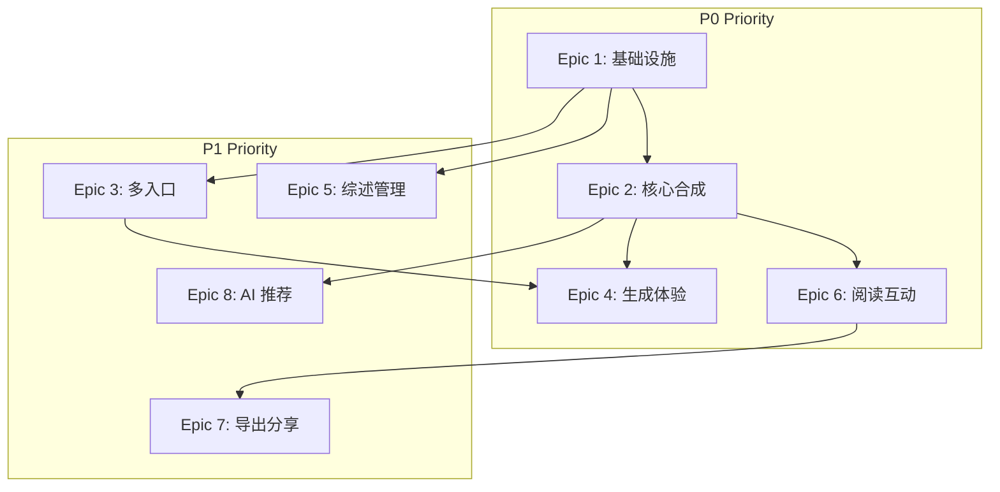

# Epics & Stories - Thematic Synthesizer (主题合成器)

> **产品愿景**: 将 AnyKeep 从"信息仓库"推向"智慧大脑"，通过对抗性合成 Prompt 策略，帮助用户解决"看不过来"和"连不起来"的痛点。

---

## Requirements Inventory

### Functional Requirements Summary

| 能力领域       | FR 数量 | FR 范围   | 优先级 |
| -------------- | ------- | --------- | ------ |
| 综述生成能力   | 8       | FR1-FR8   | P0     |
| 综述入口与触发 | 6       | FR9-FR14  | P0-P1  |
| 生成过程体验   | 6       | FR15-FR20 | P0     |
| 综述管理能力   | 5       | FR21-FR25 | P1     |
| 综述阅读与互动 | 6       | FR26-FR31 | P0-P1  |
| 导出与分享     | 4       | FR32-FR35 | P1     |
| 通知与提醒     | 3       | FR36-FR38 | P2     |
| **总计**       | **38**  | FR1-FR38  | -      |

### Non-Functional Requirements

| 类别     | 关键指标                                      |
| -------- | --------------------------------------------- |
| 性能     | 列表页 <500ms, 详情页 <1s, 标准模式生成 <150s |
| 安全     | TLS 1.3, RLS 策略, 数据隔离                   |
| 可扩展   | 单次最大 100 篇, 支持 10,000 并发用户         |
| 可访问性 | WCAG 2.1 AA, 键盘导航, 屏幕阅读器             |
| 可靠性   | 99.5% 可用性, 断点续传, 自动重试              |

### Technical Requirements (from Architecture)

- 数据库: `synthesis_reports` 表 + RLS + 索引
- AI Skill: `ThematicSynthesisSkill` 五步流程
- API: 7 个端点 (REST + SSE)
- 状态管理: React Context + Custom Hooks
- 流式输出: Server-Sent Events

---

## Epic Overview

| Epic ID  | Epic 名称    | 用户价值                     | 优先级 | Story 数量 |
| -------- | ------------ | ---------------------------- | ------ | ---------- |
| E1       | 基础设施搭建 | 为功能实现奠定技术基础       | P0     | 5          |
| E2       | 核心合成能力 | 用户能够生成四维结构化综述   | P0     | 7          |
| E3       | 多入口触发   | 用户能从多个场景快捷触发综述 | P0     | 5          |
| E4       | 生成体验优化 | 用户在等待时获得良好体验     | P0     | 5          |
| E5       | 综述管理     | 用户能够管理已生成的综述     | P1     | 5          |
| E6       | 阅读与互动   | 用户能够深度阅读和标注综述   | P0     | 6          |
| E7       | 导出与分享   | 用户能够导出和分享综述成果   | P1     | 4          |
| E8       | AI 智能推荐  | 系统主动发现整合机会         | P1     | 4          |
| **总计** | -            | -                            | -      | **41**     |

---

## Epic 1: 基础设施搭建

**Epic 描述**: 建立主题合成器功能所需的数据库、类型定义、API 框架等技术基础设施。

**用户价值**: 为后续所有功能开发提供稳定可靠的技术基础。

**验收标准**:

- 数据库迁移成功执行
- TypeScript 类型完整定义
- API 路由框架就绪
- ThematicSynthesisSkill 骨架代码完成

### Story 1.1: 数据库表结构创建

**作为** 开发者
**我想要** 创建 `synthesis_reports` 数据库表
**以便** 存储综述报告数据

**验收标准**:

```gherkin
Given 数据库迁移文件已创建
When 执行 supabase db push
Then synthesis_reports 表创建成功
And 包含所有必需字段 (id, user_id, title, source_type, overview, consensus, divergence, blind_spots, full_markdown, embedding, status)
And RLS 策略正确配置
And 必要索引已创建
```

**技术说明**:

- 使用迁移文件: `20251229000001_create_synthesis_reports.sql`
- JSONB 字段: consensus, divergence, blind_spots
- 向量字段: embedding vector(1536)

**相关 FR**: 无 (基础设施)

---

### Story 1.2: TypeScript 类型定义

**作为** 开发者
**我想要** 定义完整的 TypeScript 类型
**以便** 确保类型安全和开发效率

**验收标准**:

```gherkin
Given 类型定义文件 src/lib/synthesis/types.ts 已创建
When 其他模块引用这些类型
Then 类型检查通过
And 包含: SynthesisReport, ConsensusPoint, DivergencePoint, BlindSpot, SynthesisSSEEvent
And 所有字段与数据库结构一致
```

**技术说明**:

```typescript
// 核心类型示例
interface SynthesisReport {
  id: string;
  userId: string;
  title: string;
  sourceType: "folder" | "tag" | "selection" | "ai_recommend";
  depthMode: "quick" | "standard" | "academic";
  overview: string;
  consensus: ConsensusPoint[];
  divergence: DivergencePoint[];
  blindSpots: BlindSpot[];
  status: "pending" | "generating" | "completed" | "failed";
  // ...
}
```

**相关 FR**: 无 (基础设施)

---

### Story 1.3: API 路由框架搭建

**作为** 开发者
**我想要** 创建 API 路由结构
**以便** 支持综述相关的所有接口调用

**验收标准**:

```gherkin
Given API 路由目录 src/app/api/synthesis/ 已创建
When 发送请求到各端点
Then 返回正确的 HTTP 状态码
And 路由结构包含:
  - GET/POST /api/synthesis
  - GET/DELETE /api/synthesis/[id]
  - POST /api/synthesis/generate (SSE)
  - GET /api/synthesis/[id]/export
  - GET /api/synthesis/recommend
```

**技术说明**:

- 使用 Next.js App Router 约定
- SSE 端点返回 `text/event-stream`

**相关 FR**: 无 (基础设施)

---

### Story 1.4: ThematicSynthesisSkill 骨架

**作为** 开发者
**我想要** 创建 ThematicSynthesisSkill 基础结构
**以便** 后续实现五步合成流程

**验收标准**:

```gherkin
Given Skill 文件 src/lib/ai-skills/skills/thematic-synthesis/ 已创建
When 导入 ThematicSynthesisSkill
Then 可以实例化 Skill 对象
And 包含五个步骤占位: prepare, analyze, synthesize, conflict, blindspot
And 继承自 BaseOrchestrationSkill
And 在 register.ts 中注册
```

**技术说明**:

- 复用现有 OrchestrationSkill 架构
- 实现 ProgressReporter 接口

**相关 FR**: 无 (基础设施)

---

### Story 1.5: Synthesis Context Provider

**作为** 开发者
**我想要** 创建 React Context Provider
**以便** 管理综述模块的全局状态

**验收标准**:

```gherkin
Given SynthesisContext 和 SynthesisProvider 已创建
When 组件使用 useSynthesis hook
Then 可以访问列表、筛选、生成状态
And 状态更新正确触发重渲染
And 类型安全
```

**技术说明**:

```typescript
const SynthesisContext = createContext<SynthesisContextValue | null>(null);
export function useSynthesisList() {
  /* ... */
}
export function useSynthesisDetail(id: string) {
  /* ... */
}
export function useSynthesisGenerate() {
  /* ... */
}
```

**相关 FR**: 无 (基础设施)

---

## Epic 2: 核心合成能力

**Epic 描述**: 实现主题综述的核心生成能力，包括四维结构化输出（概述、共识、分歧、盲区）。

**用户价值**: 用户能够将多源收藏内容转化为结构化的知识综述。

**验收标准**:

- 用户选择书签后可生成综述
- 输出包含完整四维结构
- AI 能够识别观点冲突
- 知识盲区建议有价值

### Story 2.1: 来源收集与预处理 (prepare 步骤)

**作为** 用户
**我想要** 系统能收集我选择的书签内容
**以便** 作为综述的输入来源

**验收标准**:

```gherkin
Given 用户选择了文件夹/标签/书签列表
When 系统开始综述生成
Then 收集所有相关书签的内容
And 去除重复和无效内容
And 进行 Token 估算和截断处理
And 返回结构化的 BookmarkSource 列表
```

**技术说明**:

- 支持四种来源类型: folder, tag, selection, ai_recommend
- Token 限制: 单源 8000, 总计 100000
- 调用现有书签 API 获取内容

**相关 FR**: FR1, FR2, FR3, FR20

---

### Story 2.2: 内容分析与主题提取 (analyze 步骤)

**作为** 系统
**我想要** 分析收集的内容并提取核心主题
**以便** 为后续合成提供结构化信息

**验收标准**:

```gherkin
Given 书签内容已收集完成
When 执行 analyze 步骤
Then 识别出 3-5 个核心主题
And 建立内容与主题的关联
And 计算各来源的相关性权重
And 输出用于后续步骤的分析结果
```

**技术说明**:

- 使用 LLM 进行主题聚类
- 输出格式: `{themes: [{name, keywords, sources}]}`

**相关 FR**: FR5 (部分)

---

### Story 2.3: 概述与共识生成 (synthesize 步骤)

**作为** 用户
**我想要** 获得主题概述和核心共识
**以便** 快速理解收藏内容的整体图景

**验收标准**:

```gherkin
Given 内容分析已完成
When 执行 synthesize 步骤
Then 生成 overview 字段 (根据深度模式: 快读 3-5 句, 标准 300-500 字, 学术 800-1200 字)
And 生成 consensus 数组 (3-8 个共识点)
And 每个共识点标注来源引用
And 置信度评分合理
```

**技术说明**:

- Prompt 模板: `synthesis.prompts.ts`
- 输出流式传输到前端
- JSON 结构化输出

**相关 FR**: FR5 (概述/共识部分)

---

### Story 2.4: 观点分歧检测 (conflict 步骤)

**作为** 用户
**我想要** 了解不同来源之间的观点冲突
**以便** 进行批判性思考和进一步研究

**验收标准**:

```gherkin
Given 共识点已生成
When 执行 conflict 步骤
Then 识别并输出观点分歧 (divergence 数组)
And 每个分歧包含: 主题、观点 A、观点 B、各自来源、客观分析
And AI 不做价值判断，仅呈现事实
And 分歧点按重要性排序
```

**技术说明**:

- 对抗性合成 Prompt 策略
- 输出格式: `DivergencePoint[]`
- 强制检测冲突，即使表面一致

**相关 FR**: FR6

---

### Story 2.5: 知识盲区发现 (blindspot 步骤)

**作为** 用户
**我想要** 知道我的收藏中缺少哪些相关知识
**以便** 规划后续学习方向

**验收标准**:

```gherkin
Given 内容分析和分歧检测完成
When 执行 blindspot 步骤
Then 输出 2-5 个知识盲区建议
And 每个盲区包含: 主题、建议、搜索关键词
And 盲区与已有内容相关但未覆盖
And 建议具有可操作性
```

**技术说明**:

- 基于语义分析识别缺失领域
- 可选: 关联推荐书签

**相关 FR**: FR7

---

### Story 2.6: 深度模式支持

**作为** 用户
**我想要** 选择不同的综述深度
**以便** 根据时间和需求获得适当详细程度的输出

**验收标准**:

```gherkin
Given 用户在生成页面
When 选择深度模式
Then 可选择: 快读 / 标准 / 学术
And 快读模式: 生成时间 <90s, 输出简洁 (3-5 句概述)
And 标准模式: 生成时间 <150s, 输出平衡 (500-800 字)
And 学术模式: 生成时间 <300s, 输出详尽 (1500+ 字)
And 显示预估时间和成本
```

**技术说明**:

- 模型选择: quick→fast, standard→standard, academic→deep
- 成本显示: 快读 ~¥0.02, 标准 ~¥0.05, 学术 ~¥0.15

**相关 FR**: FR4

---

### Story 2.7: 生成失败恢复

**作为** 用户
**我想要** 在生成失败时保留部分结果
**以便** 不完全丢失已生成的内容

**验收标准**:

```gherkin
Given 综述生成进行中
When 发生错误或超时
Then 已完成的部分保存到数据库
And 状态标记为 'failed'
And 用户可查看部分结果
And 提供重试或从断点继续的选项
```

**技术说明**:

- 每个步骤完成后持久化
- 错误信息存储到 error_message 字段
- 支持从最后完成步骤继续

**相关 FR**: FR8

---

## Epic 3: 多入口触发

**Epic 描述**: 在多个用户交互场景中提供综述生成的入口，降低使用门槛。

**用户价值**: 用户可以从最自然的操作路径快速触发综述生成。

**验收标准**:

- 文件夹右键菜单可触发
- 标签右键菜单可触发
- 批量选中后可触发
- 所有入口跳转到生成页面

### Story 3.1: 文件夹右键菜单入口

**作为** 用户
**我想要** 在文件夹上右键选择"生成综述"
**以便** 快速对文件夹内容进行综合分析

**验收标准**:

```gherkin
Given 用户在首页查看文件夹列表
When 右键点击某个文件夹
Then 菜单中显示"生成综述"选项
And 点击后跳转到 /synthesis/new?source=folder&id={folderId}
And 生成页面自动加载文件夹内的书签
```

**技术说明**:

- 组件: `folder-synthesis-trigger.tsx`
- 集成到现有文件夹 ContextMenu

**相关 FR**: FR9

---

### Story 3.2: 标签右键菜单入口

**作为** 用户
**我想要** 在标签上右键选择"生成综述"
**以便** 按主题标签整合相关内容

**验收标准**:

```gherkin
Given 用户查看标签列表或标签详情
When 右键点击某个标签
Then 菜单中显示"生成综述"选项
And 点击后跳转到 /synthesis/new?source=tag&id={tagId}
And 生成页面自动加载标签关联的书签
```

**技术说明**:

- 组件: `tag-synthesis-trigger.tsx`
- 复用现有标签 ContextMenu 模式

**相关 FR**: FR10

---

### Story 3.3: 批量选择工具栏入口

**作为** 用户
**我想要** 批量选中书签后生成综述
**以便** 灵活选择要整合的内容

**验收标准**:

```gherkin
Given 用户在书签列表进入批量选择模式
When 选中 2 个以上书签
Then 工具栏显示"生成综述"按钮
And 点击后跳转到 /synthesis/new?source=selection&ids={id1,id2,...}
And 生成页面显示选中的书签列表
And 支持在跳转前调整选择
```

**技术说明**:

- 组件: `selection-synthesis-trigger.tsx`
- 集成到现有 BatchToolbar
- URL 参数传递选中 ID 列表

**相关 FR**: FR11

---

### Story 3.4: Agent 对话入口

**作为** 用户
**我想要** 通过自然语言让 AI 帮我生成综述
**以便** 在需求不明确时获得 AI 辅助

**验收标准**:

```gherkin
Given 用户在 AI Agent 对话窗口
When 输入类似"帮我综合分析关于 XX 的收藏"
Then AI 识别综述意图
And 询问或自动确定来源范围
And 开始生成并在对话中显示进度
And 完成后提供查看详情链接
```

**技术说明**:

- 意图关键词: 综述, 合成, 综合分析, 汇总观点
- 通过 UnifiedEngine 路由到 ThematicSynthesisSkill
- 支持流式输出到对话界面

**相关 FR**: FR12

---

### Story 3.5: 生成引导页

**作为** 用户
**我想要** 在生成前确认来源和配置
**以便** 确保生成符合预期

**验收标准**:

```gherkin
Given 用户通过任意入口进入 /synthesis/new
When 页面加载完成
Then 显示来源书签列表 (可预览)
And 显示深度模式选择器
And 显示预估时间和成本
And 提供"开始生成"和"取消"按钮
And 支持调整来源 (移除某些书签)
```

**技术说明**:

- 页面: `src/app/(main)/synthesis/new/page.tsx`
- 组件: SynthesisSourceSelector, SynthesisDepthSelector, SynthesisGenerateButton

**相关 FR**: FR19, FR20

---

## Epic 4: 生成体验优化

**Epic 描述**: 优化综述生成过程中的用户体验，减少等待焦虑。

**用户价值**: 用户在生成过程中保持信心，了解进度，可以提前看到部分结果。

**验收标准**:

- 显示清晰的进度信息
- 流式展示生成内容
- 支持取消操作
- 大内容量时给出优化建议

### Story 4.1: 实时进度显示

**作为** 用户
**我想要** 看到综述生成的实时进度
**以便** 了解还需要等待多久

**验收标准**:

```gherkin
Given 综述生成已开始
When 生成进行中
Then 显示当前步骤名称 (准备/分析/合成/冲突检测/盲区发现)
And 显示百分比进度条
And 显示预估剩余时间
And 进度更新平滑无跳跃
```

**技术说明**:

- SSE 事件: `{ type: 'progress', data: { step, percent, message } }`
- 组件: `synthesis-progress.tsx`
- 使用 CSS 动画实现平滑过渡

**相关 FR**: FR15

---

### Story 4.2: 流式内容预览

**作为** 用户
**我想要** 在生成过程中看到已完成的部分
**以便** 提前了解结果并减少焦虑

**验收标准**:

```gherkin
Given 综述生成进行中
When 某个维度 (概述/共识/分歧/盲区) 生成完成
Then 立即在预览区域显示该部分内容
And 内容以流式方式逐字/逐段呈现
And 已完成的部分可以滚动查看
And 正在生成的部分有明显指示
```

**技术说明**:

- SSE 事件: overview, consensus, divergence, blindspot
- 组件: `synthesis-stream-preview.tsx`
- 使用 React state 累积流式内容

**相关 FR**: FR16

---

### Story 4.3: 生成任务取消

**作为** 用户
**我想要** 能够取消正在进行的生成
**以便** 在不需要时节省时间和成本

**验收标准**:

```gherkin
Given 综述生成进行中
When 用户点击"取消"按钮
Then 生成任务立即停止
And 已生成的部分保存 (状态为 'cancelled')
And 返回到综述列表或生成引导页
And 显示取消成功提示
```

**技术说明**:

- 使用 AbortController 取消 SSE 连接
- 服务端检测连接断开后清理资源
- 部分结果持久化

**相关 FR**: FR17

---

### Story 4.4: 大内容量优化建议

**作为** 用户
**我想要** 在内容量过大时获得优化建议
**以便** 选择更高效的生成方式

**验收标准**:

```gherkin
Given 用户选择的书签超过 50 篇
When 开始生成前或生成超时
Then 显示优化建议弹窗
And 建议选项:
  - 缩小范围 (选择近 3 个月)
  - 使用快读模式
  - 继续等待 (显示预估时间)
And 用户可选择建议或忽略
```

**技术说明**:

- 阈值: 50 篇显示建议, 100 篇强制建议
- 智能筛选: 按时间、相关性排序后截取

**相关 FR**: FR18

---

### Story 4.5: 成本与时间预估

**作为** 用户
**我想要** 在生成前看到预估成本和时间
**以便** 做出知情决策

**验收标准**:

```gherkin
Given 用户在生成引导页
When 选择来源和深度模式后
Then 显示预估生成时间 (如 "约 2-3 分钟")
And 显示预估 Token 消耗
And 显示预估成本 (如 "约 ¥0.05")
And 数值随配置变化实时更新
```

**技术说明**:

- Token 估算: 基于内容长度和深度模式
- 成本计算: DeepSeek 定价模型
- 组件集成到 SynthesisGenerateButton

**相关 FR**: FR19

---

## Epic 5: 综述管理

**Epic 描述**: 提供综述报告的列表查看、筛选、搜索、删除等管理功能。

**用户价值**: 用户能够高效管理历史综述，快速找到需要的报告。

**验收标准**:

- 综述列表页展示所有报告
- 支持多维度筛选
- 支持搜索
- 支持删除

### Story 5.1: 综述列表页

**作为** 用户
**我想要** 查看我生成的所有综述报告
**以便** 管理和回顾历史综述

**验收标准**:

```gherkin
Given 用户访问 /synthesis
When 页面加载完成
Then 显示综述报告列表 (卡片形式)
And 每个卡片显示: 标题、来源类型、深度模式、书签数、创建时间、状态
And 按创建时间倒序排列
And 支持分页加载
And 列表页加载时间 <500ms
```

**技术说明**:

- 页面: `src/app/(main)/synthesis/page.tsx`
- 组件: SynthesisListPage, SynthesisReportCard
- API: GET /api/synthesis

**相关 FR**: FR21

---

### Story 5.2: 来源类型筛选

**作为** 用户
**我想要** 按来源类型筛选综述
**以便** 快速找到特定类型的报告

**验收标准**:

```gherkin
Given 用户在综述列表页
When 选择来源类型筛选器
Then 可选择: 全部 / 文件夹 / 标签 / 手动选择 / AI 推荐
And 列表实时更新显示匹配的综述
And 筛选状态反映在 URL (支持分享)
```

**技术说明**:

- 组件: SynthesisListFilters
- URL 参数: `?sourceType=folder`
- API 支持: `GET /api/synthesis?sourceType=folder`

**相关 FR**: FR22

---

### Story 5.3: 时间排序

**作为** 用户
**我想要** 按时间排序综述列表
**以便** 找到最近或最早的报告

**验收标准**:

```gherkin
Given 用户在综述列表页
When 点击排序选择器
Then 可选择: 最新优先 / 最早优先
And 列表按选择排序
And 默认为最新优先
```

**技术说明**:

- API 参数: `?sort=createdAt&order=desc`

**相关 FR**: FR23

---

### Story 5.4: 综述搜索

**作为** 用户
**我想要** 搜索综述报告
**以便** 通过关键词快速定位

**验收标准**:

```gherkin
Given 用户在综述列表页
When 在搜索框输入关键词
Then 搜索标题和内容
And 实时显示匹配结果
And 支持高亮匹配文字
And 无匹配时显示空状态
```

**技术说明**:

- 前端: 使用 useDeferredValue 优化
- 后端: PostgreSQL 全文搜索或 LIKE

**相关 FR**: FR24

---

### Story 5.5: 删除综述

**作为** 用户
**我想要** 删除不需要的综述报告
**以便** 保持列表整洁

**验收标准**:

```gherkin
Given 用户在综述列表或详情页
When 点击删除按钮
Then 显示确认对话框
And 确认后软删除报告
And 从列表中移除
And 7 天内可恢复
And 显示删除成功提示
```

**技术说明**:

- API: DELETE /api/synthesis/[id]
- 软删除: deleted_at 字段
- 二次确认使用 AlertDialog

**相关 FR**: FR25

---

## Epic 6: 阅读与互动

**Epic 描述**: 提供综述报告的详细阅读页面，支持标注、备注、来源跳转等互动功能。

**用户价值**: 用户能够深度阅读综述，标注重点，与原始来源建立连接。

**验收标准**:

- 详情页展示完整四维输出
- 支持高亮标注
- 支持来源跳转
- 移动端适配

### Story 6.1: 综述详情页

**作为** 用户
**我想要** 在专属页面阅读完整综述
**以便** 获得良好的阅读体验

**验收标准**:

```gherkin
Given 用户点击某个综述卡片
When 进入 /synthesis/[id] 页面
Then 显示完整四维输出:
  - 概述区块 (顶部)
  - 核心共识区块 (卡片列表)
  - 观点分歧区块 (对比布局)
  - 知识盲区区块 (建议列表)
And 页面加载时间 <1s
And 显示元信息 (来源类型、深度、书签数、生成时间)
```

**技术说明**:

- 页面: `src/app/(main)/synthesis/[id]/page.tsx`
- 组件: SynthesisDetailPage, SynthesisOverview, SynthesisConsensus, SynthesisDivergence, SynthesisBlindSpots

**相关 FR**: FR26

---

### Story 6.2: 高亮标注功能

**作为** 用户
**我想要** 在综述中标注重点内容
**以便** 后续快速回顾关键信息

**验收标准**:

```gherkin
Given 用户在综述详情页
When 选中一段文字
Then 显示高亮工具栏
And 点击高亮按钮后文字变为高亮状态
And 高亮颜色可选 (黄色默认)
And 高亮持久化到数据库
And 支持移除高亮
And 高亮操作响应时间 <200ms
```

**技术说明**:

- 表: synthesis_highlights
- 使用 window.getSelection() API
- 存储位置信息: {start, end, section}

**相关 FR**: FR27

---

### Story 6.3: 标注备注功能

**作为** 用户
**我想要** 为标注添加个人备注
**以便** 记录自己的想法

**验收标准**:

```gherkin
Given 用户已标注某段文字
When 点击标注
Then 显示备注输入框
And 可输入个人备注
And 备注自动保存
And 标注列表中显示备注摘要
```

**技术说明**:

- 字段: synthesis_highlights.note
- 自动保存使用 debounce

**相关 FR**: FR28

---

### Story 6.4: 标注列表与定位

**作为** 用户
**我想要** 查看所有标注并快速定位
**以便** 回顾重点内容

**验收标准**:

```gherkin
Given 用户在综述详情页
When 点击"标注列表"按钮
Then 显示侧边栏或弹窗
And 列出所有标注 (文字摘要 + 备注)
And 点击标注项滚动到对应位置
And 高亮闪烁指示位置
```

**技术说明**:

- 组件: SynthesisHighlightList
- 使用 scrollIntoView API

**相关 FR**: FR29

---

### Story 6.5: 来源跳转

**作为** 用户
**我想要** 点击共识/分歧中的来源跳转到原始书签
**以便** 查看完整原文

**验收标准**:

```gherkin
Given 用户在综述详情页查看共识或分歧
When 点击来源引用 (如 "[来源 1]")
Then 在新标签页打开原始书签 URL
Or 显示书签详情弹窗
And 来源链接有明显的可点击样式
```

**技术说明**:

- 组件: SourceLink
- 来源数据包含: id, title, url
- 支持内部跳转 (书签详情) 和外部跳转 (原始 URL)

**相关 FR**: FR30

---

### Story 6.6: 四维输出折叠展开

**作为** 用户
**我想要** 折叠/展开四维输出的各个部分
**以便** 专注阅读感兴趣的内容

**验收标准**:

```gherkin
Given 用户在综述详情页
When 点击某个区块的折叠按钮
Then 该区块内容收起，仅显示标题
And 再次点击展开
And 记住用户的展开状态 (本地存储)
And 移动端默认部分折叠
```

**技术说明**:

- 使用 Collapsible 组件
- localStorage 存储展开状态
- 响应式: 移动端默认折叠除概述外的区块

**相关 FR**: FR31

---

## Epic 7: 导出与分享

**Epic 描述**: 支持将综述报告导出为多种格式，并提供分享功能。

**用户价值**: 用户能够将综述成果迁移到其他工具或与他人分享。

**验收标准**:

- 支持 Markdown 导出
- 支持 Obsidian 格式导出
- 支持生成分享链接
- 支持一键分享关键洞察

### Story 7.1: Markdown 导出

**作为** 用户
**我想要** 将综述导出为 Markdown 文件
**以便** 在其他工具中使用

**验收标准**:

```gherkin
Given 用户在综述详情页
When 点击"导出" -> "Markdown"
Then 下载 .md 文件
And 文件包含完整四维内容
And 格式清晰可读
And 来源引用以脚注形式呈现
```

**技术说明**:

- API: GET /api/synthesis/[id]/export?format=markdown
- 复用现有导出系统的 MarkdownFormatter

**相关 FR**: FR32

---

### Story 7.2: Obsidian 格式导出

**作为** 用户
**我想要** 将综述导出为 Obsidian 格式
**以便** 集成到我的 Obsidian 知识库

**验收标准**:

```gherkin
Given 用户在综述详情页
When 点击"导出" -> "Obsidian"
Then 下载 .md 文件
And 包含 Obsidian 双链语法 [[书签标题]]
And 包含 YAML frontmatter 元数据
And 标签以 #tag 格式呈现
```

**技术说明**:

- 复用现有 ObsidianFormatter
- 添加综述特定的元数据

**相关 FR**: FR33

---

### Story 7.3: 分享链接生成

**作为** 用户
**我想要** 生成综述的分享链接
**以便** 与他人分享我的整理成果

**验收标准**:

```gherkin
Given 用户在综述详情页
When 点击"分享"按钮
Then 生成唯一分享链接
And 可设置过期时间 (1天/7天/30天/永久)
And 可设置是否需要登录查看
And 链接复制到剪贴板
And 显示分享成功提示
```

**技术说明**:

- 表: synthesis_shares (report_id, token, expires_at, require_auth)
- 路由: /synthesis/share/[token]
- 默认: 7 天过期, 无需登录

**相关 FR**: FR34

---

### Story 7.4: 关键洞察一键分享

**作为** 用户
**我想要** 一键分享综述的关键洞察
**以便** 在社交媒体快速分享

**验收标准**:

```gherkin
Given 用户在综述详情页
When 点击"分享洞察"按钮
Then 生成摘要卡片 (图片或文字)
And 包含: 标题、核心共识 x3、观点分歧 x1
And 可复制文字版本
And 可下载图片版本 (PNG)
```

**技术说明**:

- 使用 html-to-image 生成卡片图片
- 文字版本适配微信/微博字数限制

**相关 FR**: FR35

---

## Epic 8: AI 智能推荐

**Epic 描述**: 系统主动检测用户收藏中的主题聚集，推荐生成综述。

**用户价值**: 发现用户可能忽略的知识整合机会，提升使用价值。

**验收标准**:

- 自动检测主题聚集
- 非侵入式推荐提示
- 支持开关控制
- 推荐有实际价值

### Story 8.1: 主题聚集检测

**作为** 系统
**我想要** 检测用户收藏中的主题聚集
**以便** 发现综述生成机会

**验收标准**:

```gherkin
Given 用户持续添加新收藏
When 同一主题的收藏达到阈值 (如 30 篇)
Then 系统记录该聚集
And 标记为待推荐
And 不立即打扰用户
```

**技术说明**:

- 后台任务定期扫描
- 基于向量相似度聚类
- 阈值可配置

**相关 FR**: FR13 (部分)

---

### Story 8.2: 非侵入式推荐提示

**作为** 用户
**我想要** 以非打扰的方式收到综述推荐
**以便** 在合适的时候接受建议

**验收标准**:

```gherkin
Given 系统检测到主题聚集
When 用户打开 AnyKeep 首页
Then 右下角显示轻提示气泡
And 显示: "发现「XX 主题」下有 N 篇相似内容，要生成综述吗？"
And 提供: "试试看" / "稍后" / "不再提示" 按钮
And 气泡 5 秒后自动收起
And 每次最多显示 1 条推荐
```

**技术说明**:

- 组件: SynthesisRecommendationToast
- 频率限制: 每天最多 3 次
- 记录用户响应行为

**相关 FR**: FR13

---

### Story 8.3: 推荐功能开关

**作为** 用户
**我想要** 控制是否接收 AI 推荐
**以便** 根据个人偏好调整

**验收标准**:

```gherkin
Given 用户在设置页面
When 找到"AI 主动推荐"开关
Then 可以开启或关闭该功能
And 关闭后不再收到任何推荐提示
And 设置持久化
And 默认状态: 关闭 (首次使用引导后可开启)
```

**技术说明**:

- 存储: profiles.ai_preferences.synthesis_recommend_enabled
- 默认关闭，首次体验引导后可选开启

**相关 FR**: FR14

---

### Story 8.4: 推荐候选 API

**作为** 开发者
**我想要** 提供获取推荐候选的 API
**以便** 支持多种推荐展示场景

**验收标准**:

```gherkin
Given API 端点 GET /api/synthesis/recommend
When 请求该端点
Then 返回当前用户的推荐候选列表
And 每个候选包含: 主题名、书签数、代表书签、推荐原因
And 结果按推荐强度排序
And 支持分页
```

**技术说明**:

```typescript
interface SynthesisRecommendation {
  id: string;
  topic: string;
  bookmarkCount: number;
  sampleBookmarks: Array<{ id; title }>;
  reason: string;
  confidence: number;
}
```

**相关 FR**: FR13 (API 支持)

---

## Story Dependencies



---

## Implementation Priority

### Sprint 1 (Week 1-2): 基础设施 + 核心能力

| Story            | 优先级 | 依赖 |
| ---------------- | ------ | ---- |
| 1.1 数据库表创建 | P0     | 无   |
| 1.2 类型定义     | P0     | 1.1  |
| 1.3 API 框架     | P0     | 1.2  |
| 1.4 Skill 骨架   | P0     | 1.2  |
| 2.1 来源收集     | P0     | 1.4  |
| 2.2 内容分析     | P0     | 2.1  |
| 2.3 概述共识     | P0     | 2.2  |
| 2.4 分歧检测     | P0     | 2.3  |
| 2.5 盲区发现     | P0     | 2.4  |

### Sprint 2 (Week 3-4): 生成体验 + 阅读互动

| Story                | 优先级 | 依赖 |
| -------------------- | ------ | ---- |
| 1.5 Context Provider | P0     | 1.3  |
| 4.1 进度显示         | P0     | 2.5  |
| 4.2 流式预览         | P0     | 4.1  |
| 6.1 详情页           | P0     | 2.5  |
| 6.2 高亮标注         | P0     | 6.1  |
| 6.5 来源跳转         | P0     | 6.1  |
| 6.6 折叠展开         | P0     | 6.1  |

### Sprint 3 (Week 5-6): 入口集成 + 管理功能

| Story                  | 优先级 | 依赖 |
| ---------------------- | ------ | ---- |
| 3.1 文件夹入口         | P0     | 4.2  |
| 3.2 标签入口           | P0     | 4.2  |
| 3.3 批量入口           | P0     | 4.2  |
| 3.5 生成引导页         | P0     | 3.1  |
| 5.1 列表页             | P1     | 1.5  |
| 5.2-5.5 筛选/搜索/删除 | P1     | 5.1  |

### Sprint 4 (Week 7-8): 高级功能 + 优化

| Story            | 优先级 | 依赖 |
| ---------------- | ------ | ---- |
| 2.6 深度模式     | P1     | 2.5  |
| 2.7 失败恢复     | P1     | 2.5  |
| 3.4 Agent 入口   | P1     | 2.5  |
| 4.3 取消功能     | P1     | 4.2  |
| 4.4 优化建议     | P1     | 4.2  |
| 7.1-7.4 导出分享 | P1     | 6.1  |
| 8.1-8.4 AI 推荐  | P1     | 2.5  |

---

## Risk Assessment

| 风险                 | 影响 | 概率 | 缓解措施                |
| -------------------- | ---- | ---- | ----------------------- |
| LLM 冲突检测准确性低 | 高   | 中   | 多 Prompt 变体 A/B 测试 |
| 长内容 Token 超限    | 高   | 高   | 智能截断 + 分批处理     |
| 流式输出中断         | 中   | 低   | 断点续传 + 状态持久化   |
| 用户不阅读综述       | 高   | 中   | 48h 推送提醒 + 摘要预览 |
| AI 推荐被关闭        | 中   | 中   | 默认关闭 + 首次引导     |

---

## Success Metrics

| 指标           | 目标  | 测量方式                      |
| -------------- | ----- | ----------------------------- |
| 首次使用完成率 | > 70% | 首次触发并阅读完成的用户比例  |
| 48h 阅读完成率 | > 50% | 生成后 48h 内阅读完成率       |
| 标注互动率     | > 30% | 阅读后有标注行为的用户比例    |
| 重复使用率     | > 50% | 30天内使用 2 次以上的用户比例 |
| 观点分歧价值感 | > 80% | 用户反馈分歧部分有价值的比例  |

---

> **文档完成时间**: 2025-12-29
> **PRD 版本**: v1.0 (主题合成器)
> **关联文档**: prd.md, architecture.md, ux-design-specification.md
