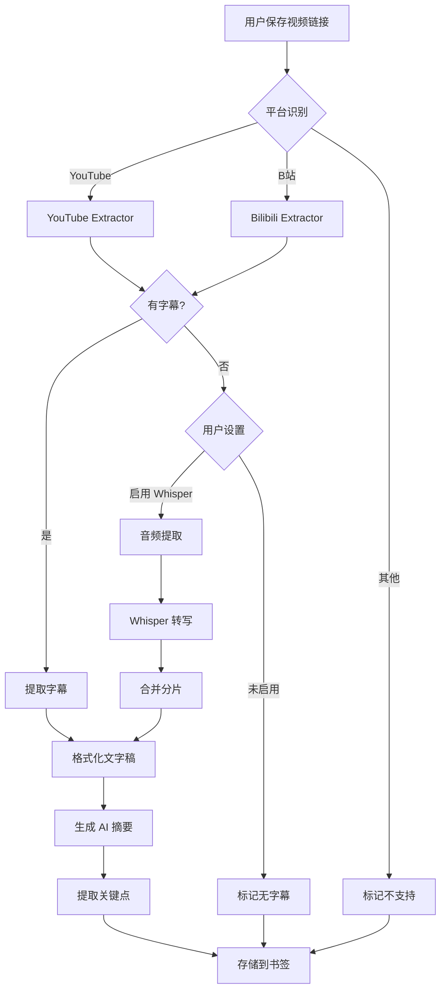

# 视频转文字稿 Skill - 可行性研究报告

> **版本**: 1.0.0
> **日期**: 2025-12-27
> **作者**: BMad Master
> **状态**: 研究阶段

---

## 一、项目概述

### 1.1 核心愿景

将视频当文章读——用户保存 B站、YouTube 等视频链接时，自动抓取字幕并生成文字稿（Transcript），使视频内容可搜索、可摘要、可学习。

### 1.2 目标用户场景

| 场景     | 描述                             | 优先级 |
| -------- | -------------------------------- | ------ |
| 学习笔记 | 保存教程视频，快速查阅文字版内容 | P0     |
| 内容回顾 | 不用重看视频，直接阅读文字稿     | P0     |
| 语义搜索 | 基于文字稿内容进行全文检索       | P1     |
| AI 摘要  | 自动生成视频内容摘要和关键点     | P1     |

---

## 二、技术可行性分析

### 2.1 核心技术栈选型

| 平台           | 推荐方案                        | 备选方案              | 技术难度    | 成本 |
| -------------- | ------------------------------- | --------------------- | ----------- | ---- |
| **YouTube**    | youtube-transcript-api (Python) | yt-dlp-wrap (Node.js) | ⭐⭐ 低     | 免费 |
| **B站**        | bilibili-api-python             | B站 API 收集          | ⭐⭐ 低     | 免费 |
| **无字幕视频** | OpenAI Whisper API              | 自托管 Whisper        | ⭐⭐⭐⭐ 高 | 付费 |

### 2.2 YouTube 字幕提取

#### 技术方案

```python
# youtube-transcript-api (Python)
# 无需 API Key，直接获取字幕
from youtube_transcript_api import YouTubeTranscriptApi

# 获取字幕（支持多语言回退）
transcript = YouTubeTranscriptApi.get_transcript(
    'VIDEO_ID',
    languages=['zh-Hans', 'zh', 'en']
)

# 返回格式
# [
#   {'text': '大家好', 'start': 0.0, 'duration': 2.5},
#   {'text': '今天讲...', 'start': 2.5, 'duration': 3.0},
#   ...
# ]
```

#### Node.js 集成方案

```typescript
// 方案 A: 调用 Python 脚本
import { spawn } from "child_process";

async function getYouTubeTranscript(
  videoId: string,
): Promise<TranscriptItem[]> {
  return new Promise((resolve, reject) => {
    const python = spawn("python", [
      "-c",
      `
from youtube_transcript_api import YouTubeTranscriptApi
import json
transcript = YouTubeTranscriptApi.get_transcript('${videoId}', languages=['zh-Hans', 'zh', 'en'])
print(json.dumps(transcript))
      `,
    ]);

    let output = "";
    python.stdout.on("data", (data) => {
      output += data;
    });
    python.on("close", (code) => {
      if (code === 0) resolve(JSON.parse(output));
      else reject(new Error(`Python exited with code ${code}`));
    });
  });
}

// 方案 B: 使用 yt-dlp-wrap (纯 Node.js)
import YTDlpWrap from "yt-dlp-wrap";

const ytDlpWrap = new YTDlpWrap();
const subtitles = await ytDlpWrap.execPromise([
  videoUrl,
  "--write-subs",
  "--write-auto-subs",
  "--sub-lang",
  "en,zh",
  "--skip-download",
  "--print-json",
]);
```

#### 优势与限制

**优势**：

- ✅ 无需 API Key
- ✅ 支持 96+ 语言
- ✅ 自动生成字幕可用
- ✅ 带时间戳

**限制**：

- ⚠️ 需要视频有字幕（手动或自动生成）
- ⚠️ 可能被 Rate Limit（建议添加重试机制）
- ⚠️ 年龄限制视频可能无法访问

---

### 2.3 B站字幕提取

#### API 端点

```typescript
// B站字幕获取流程
// 1. 解析 BV 号或 AV 号
const bvid = "BV1xx411c7XW";

// 2. 获取视频信息（含 cid）
const infoUrl = `https://api.bilibili.com/x/web-interface/view?bvid=${bvid}`;
const { cid } = await fetch(infoUrl)
  .then((r) => r.json())
  .then((d) => d.data);

// 3. 获取字幕列表
const playerUrl = `https://api.bilibili.com/x/player/v2?bvid=${bvid}&cid=${cid}`;
const playerInfo = await fetch(playerUrl).then((r) => r.json());
const subtitles = playerInfo.data.subtitle.subtitles;

// 4. 下载字幕内容（JSON 格式）
if (subtitles.length > 0) {
  const subtitleUrl = `https:${subtitles[0].subtitle_url}`;
  const subtitleContent = await fetch(subtitleUrl).then((r) => r.json());
  // subtitleContent.body 包含字幕数组
}
```

#### 字幕 JSON 结构

```json
{
  "font_size": 0.4,
  "font_color": "#FFFFFF",
  "background_alpha": 0.5,
  "background_color": "#9C27B0",
  "body": [
    {
      "from": 0.0,
      "to": 2.5,
      "location": 2,
      "content": "大家好"
    }
  ]
}
```

#### 优势与限制

**优势**：

- ✅ 官方 API 稳定
- ✅ JSON 格式易解析
- ✅ 带精确时间戳

**限制**：

- ⚠️ **仅部分视频有字幕**（UP主上传的 CC 字幕）
- ⚠️ 大部分视频无字幕（需要 Whisper 兜底）
- ⚠️ 需要登录 Cookie 获取会员内容
- ⚠️ 番剧、直播等特殊内容受限

---

### 2.4 无字幕视频处理 (Whisper)

#### OpenAI Whisper API

```typescript
import OpenAI from "openai";
import fs from "fs";

const openai = new OpenAI();

// 音频文件转文字稿（支持 mp3/mp4/wav/webm，最大 25MB）
const transcription = await openai.audio.transcriptions.create({
  file: fs.createReadStream("audio.mp3"),
  model: "whisper-1",
  language: "zh", // 指定语言可提高准确率
  response_format: "verbose_json", // 带时间戳
  timestamp_granularities: ["word", "segment"],
});

// 返回格式（verbose_json）
// {
//   "task": "transcribe",
//   "language": "chinese",
//   "duration": 120.5,
//   "segments": [
//     {
//       "id": 0,
//       "start": 0.0,
//       "end": 2.5,
//       "text": "大家好"
//     }
//   ]
// }
```

#### 处理流程

```
┌─────────────┐     ┌─────────────┐     ┌─────────────┐     ┌─────────────┐
│   视频 URL   │ ──▶ │  提取音频    │ ──▶ │  分片处理   │ ──▶ │  Whisper   │
│             │     │  (FFmpeg)   │     │  (<25MB)    │     │    API     │
└─────────────┘     └─────────────┘     └─────────────┘     └─────────────┘
                                                                   │
                    ┌─────────────┐     ┌─────────────┐           │
                    │  存储结果    │ ◀── │  合并分片    │ ◀─────────┘
                    │             │     │             │
                    └─────────────┘     └─────────────┘
```

#### 成本估算

| 视频时长 | 音频大小（估算） | API 成本 |
| -------- | ---------------- | -------- |
| 10 分钟  | ~10MB            | ~$0.06   |
| 30 分钟  | ~30MB            | ~$0.18   |
| 1 小时   | ~60MB            | ~$0.36   |
| 2 小时   | ~120MB           | ~$0.72   |

> **计费方式**: $0.006/分钟（约 ¥0.04/分钟）

#### 优势与限制

**优势**：

- ✅ 任何视频都能处理
- ✅ 准确率高（支持 96+ 语言）
- ✅ 支持多种输出格式（text/srt/vtt/json）

**限制**：

- ⚠️ 需要先提取音频
- ⚠️ 文件大小限制（25MB），需分片
- ⚠️ 有成本，需要配额控制
- ⚠️ 处理时间较长

---

## 三、架构设计

### 3.1 目录结构

```
src/lib/ai-skills/skills/video-transcript/
├── video-transcript.skill.ts      # 主 Skill 类
├── index.ts                       # 导出
├── types.ts                       # 类型定义
├── schema.ts                      # Zod Schema
├── extractors/                    # 字幕提取器
│   ├── index.ts
│   ├── base.extractor.ts          # 提取器基类
│   ├── youtube.extractor.ts       # YouTube 字幕提取
│   ├── bilibili.extractor.ts      # B站字幕提取
│   └── whisper.extractor.ts       # Whisper 语音识别
├── formatters/                    # 格式化输出
│   ├── index.ts
│   ├── transcript.formatter.ts    # 文字稿格式化
│   ├── summary.formatter.ts       # 摘要格式化
│   └── timestamp.formatter.ts     # 时间戳格式化
├── utils/                         # 工具函数
│   ├── video-id-parser.ts         # 视频 ID 解析
│   ├── audio-extractor.ts         # 音频提取（FFmpeg）
│   └── chunk-splitter.ts          # 大文件分片
└── __tests__/
    ├── video-transcript.skill.test.ts
    ├── youtube.extractor.test.ts
    ├── bilibili.extractor.test.ts
    └── whisper.extractor.test.ts
```

### 3.2 Skill 执行流程



### 3.3 核心类型定义

```typescript
// types.ts

/** 支持的视频平台 */
export type VideoPlatform = "youtube" | "bilibili" | "other";

/** 字幕来源 */
export type TranscriptSource =
  | "manual" // 手动上传的字幕
  | "auto" // 平台自动生成
  | "whisper" // Whisper 语音识别
  | null; // 无字幕

/** 单条字幕 */
export interface TranscriptSegment {
  start: number; // 开始时间（秒）
  end: number; // 结束时间（秒）
  text: string; // 字幕文本
}

/** 完整文字稿 */
export interface Transcript {
  videoId: string;
  platform: VideoPlatform;
  language: string;
  source: TranscriptSource;
  duration: number; // 视频时长（秒）
  segments: TranscriptSegment[];
  fullText: string; // 合并后的完整文本
  generatedAt: string;
}

/** 视频元数据 */
export interface VideoMetadata {
  title: string;
  author: string;
  duration: number;
  thumbnailUrl?: string;
  publishedAt?: string;
  viewCount?: number;
  hasTranscript: boolean;
  transcriptSource: TranscriptSource;
  language?: string;
  chapters?: VideoChapter[];
}

/** 视频章节 */
export interface VideoChapter {
  title: string;
  start: number;
  end: number;
}

/** Skill 输入 */
export interface VideoTranscriptInput {
  url: string;
  language?: string; // 优先语言
  enableWhisper?: boolean; // 是否启用 Whisper 兜底
  generateSummary?: boolean; // 是否生成摘要
  extractKeyPoints?: boolean; // 是否提取关键点
}

/** Skill 输出 */
export interface VideoTranscriptOutput {
  transcript: Transcript | null;
  metadata: VideoMetadata;
  summary?: string;
  keyPoints?: string[];
  processingTime: number;
  cost?: number; // Whisper 成本（如有）
}
```

### 3.4 数据库扩展

```sql
-- 视频元数据扩展字段（添加到 bookmarks 表）
ALTER TABLE bookmarks ADD COLUMN IF NOT EXISTS video_metadata JSONB;
-- 结构: {
--   duration_seconds: number,
--   has_transcript: boolean,
--   transcript_source: 'manual' | 'auto' | 'whisper' | null,
--   language: string,
--   chapters: VideoChapter[],
--   author: string,
--   view_count: number
-- }

-- 文字稿存储
ALTER TABLE bookmarks ADD COLUMN IF NOT EXISTS transcript TEXT;
-- 完整文字稿文本，用于全文搜索

ALTER TABLE bookmarks ADD COLUMN IF NOT EXISTS transcript_segments JSONB;
-- 带时间戳的分段数据: TranscriptSegment[]

-- 文字稿摘要（独立于 ai_summary，专门针对视频内容）
ALTER TABLE bookmarks ADD COLUMN IF NOT EXISTS transcript_summary TEXT;

-- 索引优化
CREATE INDEX IF NOT EXISTS idx_bookmarks_has_transcript
  ON bookmarks((video_metadata->>'has_transcript'))
  WHERE platform IN ('youtube', 'bilibili');

-- 全文搜索索引（可选，需要 pg_trgm 扩展）
CREATE INDEX IF NOT EXISTS idx_bookmarks_transcript_search
  ON bookmarks USING gin(to_tsvector('simple', transcript))
  WHERE transcript IS NOT NULL;
```

---

## 四、实施计划

### 4.1 分阶段实施

| 阶段        | 功能                 | 复杂度   | 预估工期 | 依赖      |
| ----------- | -------------------- | -------- | -------- | --------- |
| **Phase 1** | YouTube 官方字幕提取 | ⭐⭐     | 3-5 天   | 无        |
| **Phase 2** | B站 CC 字幕提取      | ⭐⭐     | 2-3 天   | Phase 1   |
| **Phase 3** | AI 摘要 + 关键点提取 | ⭐⭐⭐   | 3-5 天   | Phase 1/2 |
| **Phase 4** | Whisper 语音识别     | ⭐⭐⭐⭐ | 5-7 天   | Phase 1-3 |
| **Phase 5** | UI 集成 + 用户设置   | ⭐⭐⭐   | 3-5 天   | Phase 1-4 |

### 4.2 Phase 1: YouTube 字幕提取

**目标**: 保存 YouTube 视频时自动提取字幕

**任务清单**:

1. [ ] 实现 `YouTubeExtractor` 类
2. [ ] 视频 ID 解析（支持多种 URL 格式）
3. [ ] 字幕语言选择逻辑（优先中文，回退英文）
4. [ ] 错误处理（无字幕、视频不可用等）
5. [ ] 单元测试覆盖
6. [ ] 集成到书签保存流程

**验收标准**:

- 支持 YouTube 标准链接和短链接
- 自动选择最佳语言字幕
- 保存文字稿到数据库
- 测试覆盖率 > 80%

### 4.3 Phase 2: B站字幕提取

**目标**: 保存 B站视频时提取 CC 字幕

**任务清单**:

1. [ ] 实现 `BilibiliExtractor` 类
2. [ ] BV/AV 号解析
3. [ ] 获取 cid 和字幕列表
4. [ ] 下载并解析字幕 JSON
5. [ ] 处理无字幕情况
6. [ ] 单元测试覆盖

**验收标准**:

- 支持 BV 号和 AV 号
- 正确处理多 P 视频
- 优雅处理无字幕视频
- 测试覆盖率 > 80%

### 4.4 Phase 3: AI 摘要生成

**目标**: 基于文字稿生成视频摘要和关键点

**任务清单**:

1. [ ] 实现摘要生成 Prompt
2. [ ] 关键点提取逻辑
3. [ ] 长文本分块处理
4. [ ] 与现有 AI 摘要系统集成
5. [ ] 成本控制（Token 预算）

**验收标准**:

- 摘要长度适中（200-500 字）
- 关键点提取准确（5-10 条）
- 支持长视频（>1小时）

### 4.5 Phase 4: Whisper 语音识别

**目标**: 为无字幕视频提供语音转文字

**任务清单**:

1. [ ] 音频提取模块（FFmpeg）
2. [ ] 大文件分片逻辑
3. [ ] Whisper API 调用封装
4. [ ] 分片结果合并
5. [ ] 成本统计和配额控制
6. [ ] 用户设置（启用/禁用）

**验收标准**:

- 支持任意时长视频
- 准确记录使用成本
- 用户可控制是否启用
- 失败时优雅降级

---

## 五、风险与对策

### 5.1 技术风险

| 风险             | 影响             | 概率 | 对策                       |
| ---------------- | ---------------- | ---- | -------------------------- |
| YouTube API 变动 | 字幕提取失败     | 中   | 使用稳定的开源库，监控异常 |
| B站 API 限流     | 批量处理受限     | 中   | 添加请求间隔，实现重试机制 |
| Whisper 成本超支 | 费用失控         | 中   | 设置用户配额，默认关闭     |
| 音频提取失败     | Whisper 无法工作 | 低   | 使用成熟的 FFmpeg 方案     |

### 5.2 业务风险

| 风险             | 影响         | 概率 | 对策                         |
| ---------------- | ------------ | ---- | ---------------------------- |
| 大部分视频无字幕 | 功能价值降低 | 高   | 提供 Whisper 兜底选项        |
| 版权问题         | 法律风险     | 低   | 仅供个人学习使用，不公开分享 |
| 用户期望过高     | 体验落差     | 中   | 明确告知字幕可用性           |

---

## 六、扩展功能规划

### 6.1 近期可选功能

| 功能       | 描述                 | 优先级 |
| ---------- | -------------------- | ------ |
| 智能时间戳 | 点击文字跳转视频位置 | P1     |
| 双语对照   | 同时显示原文+翻译    | P2     |
| 章节导航   | 显示视频章节结构     | P2     |
| 导出 SRT   | 导出标准字幕文件     | P3     |

### 6.2 远期规划

| 功能     | 描述                   | 依赖     |
| -------- | ---------------------- | -------- |
| 知识卡片 | 从文字稿提取核心知识点 | Phase 3  |
| 相关推荐 | 基于内容向量匹配       | 向量搜索 |
| 播客支持 | 支持 Apple Podcast 等  | Whisper  |
| 会议记录 | 支持 Zoom/腾讯会议录音 | Whisper  |

---

## 七、参考资源

### 7.1 技术文档

- [youtube-transcript-api (GitHub)](https://github.com/jdepoix/youtube-transcript-api)
- [bilibili-api-python (PyPI)](https://pypi.org/project/bilibili-api-python/)
- [B站 API 收集整理](https://socialsisteryi.github.io/bilibili-API-collect/)
- [OpenAI Whisper API](https://platform.openai.com/docs/api-reference/audio)
- [yt-dlp-wrap (npm)](https://www.npmjs.com/package/yt-dlp-wrap)
- [ytdlp-nodejs (GitHub)](https://github.com/iqbal-rashed/ytdlp-nodejs)

### 7.2 类似项目参考

- [BibiGPT](https://www.bilibili.com/video/BV1fX4y1Q7Ux/) - B站视频 AI 总结
- [Chat with Wiki](https://www.waytoagi.com/question/26059) - AI 提取 B站字幕工具
- [Subgen](https://github.com/McCloudS/subgen) - Whisper 自动字幕生成

---

## 八、附录

### 8.1 快速验证脚本

```bash
# 1. 安装依赖
pip install youtube-transcript-api

# 2. 测试 YouTube 字幕获取
python -c "
from youtube_transcript_api import YouTubeTranscriptApi

video_id = 'dQw4w9WgXcQ'  # 替换为实际视频 ID

try:
    transcript = YouTubeTranscriptApi.get_transcript(
        video_id,
        languages=['zh-Hans', 'zh', 'en']
    )
    print(f'获取到 {len(transcript)} 条字幕')
    for t in transcript[:5]:
        print(f\"[{t['start']:.1f}s] {t['text']}\")
except Exception as e:
    print(f'获取失败: {e}')
"
```

### 8.2 URL 解析正则

```typescript
// YouTube URL 格式
const YOUTUBE_PATTERNS = [
  /(?:youtube\.com\/watch\?v=|youtu\.be\/|youtube\.com\/embed\/)([a-zA-Z0-9_-]{11})/,
  /youtube\.com\/shorts\/([a-zA-Z0-9_-]{11})/,
];

// B站 URL 格式
const BILIBILI_PATTERNS = [
  /bilibili\.com\/video\/(BV[a-zA-Z0-9]+)/,
  /bilibili\.com\/video\/av(\d+)/,
  /b23\.tv\/([a-zA-Z0-9]+)/, // 短链接
];

function parseVideoId(
  url: string,
): { platform: VideoPlatform; id: string } | null {
  for (const pattern of YOUTUBE_PATTERNS) {
    const match = url.match(pattern);
    if (match) return { platform: "youtube", id: match[1] };
  }
  for (const pattern of BILIBILI_PATTERNS) {
    const match = url.match(pattern);
    if (match) return { platform: "bilibili", id: match[1] };
  }
  return null;
}
```

---

> **下一步**: 确认实施计划后，可运行 `/BMad:bmm:workflows:create-next-story` 创建详细的 User Story。
