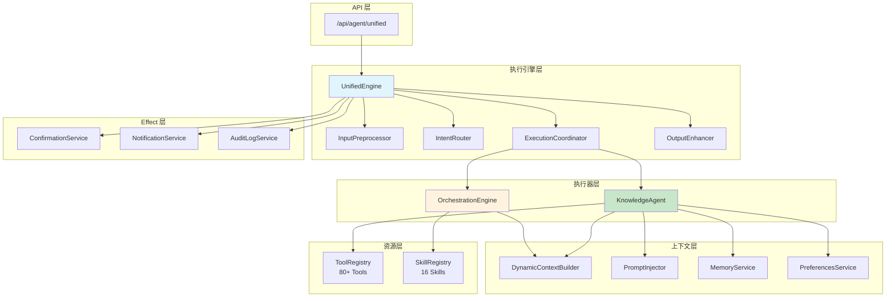

# AnyKeep AI 架构文档

> 本文档描述 AnyKeep 的 AI 系统架构，帮助开发者快速理解和上手。

## 目录

- [架构概览](#架构概览)
- [核心模块](#核心模块)
- [执行流程](#执行流程)
- [模块依赖图](#模块依赖图)
- [关键组件详解](#关键组件详解)
- [数据流图](#数据流图)
- [配置系统](#配置系统)
- [调试指南](#调试指南)

---

## 架构概览

AnyKeep 采用**双模式执行架构**，根据任务复杂度自动选择执行模式：

```
┌─────────────────────────────────────────────────────────────┐
│                    用户请求入口                              │
│                POST /api/agent/unified                       │
└──────────────────────────┬──────────────────────────────────┘
                           │
┌──────────────────────────▼──────────────────────────────────┐
│                   UnifiedEngine (统一引擎)                   │
│  ┌─────────────┐  ┌─────────────┐  ┌─────────────────────┐  │
│  │输入预处理   │─▶│ 意图路由    │─▶│ 执行协调            │  │
│  │Preprocessor │  │ IntentRouter│  │ ExecutionCoordinator│  │
│  └─────────────┘  └──────┬──────┘  └─────────────────────┘  │
└──────────────────────────┼──────────────────────────────────┘
                           │
           ┌───────────────┴───────────────┐
           ▼                               ▼
┌──────────────────────┐      ┌──────────────────────────────┐
│   原子模式 (Atomic)   │      │   编排模式 (Orchestration)   │
│   KnowledgeAgent     │      │   OrchestrationEngine        │
│                      │      │                              │
│   适用场景：          │      │   适用场景：                  │
│   - 简单查询          │      │   - 复杂任务                  │
│   - 数量统计          │      │   - 多步骤工作流              │
│   - 快速操作          │      │   - 需要交付物                │
│                      │      │                              │
│   工具：80+ Tools     │      │   技能：16 Skills            │
└──────────┬───────────┘      └──────────────┬───────────────┘
           │                                  │
           └──────────────┬───────────────────┘
                          ▼
┌─────────────────────────────────────────────────────────────┐
│                    统一输出层                                │
│                 UnifiedOutputAdapter                         │
│                 SSE 流式响应                                 │
└─────────────────────────────────────────────────────────────┘
```

### 设计原则

| 原则           | 说明                                        |
| -------------- | ------------------------------------------- |
| **分层设计**   | 6 层清晰分离：输入→路由→执行→增强→效果→输出 |
| **关注点分离** | 每个模块职责单一，便于测试和维护            |
| **自适应执行** | 根据意图和复杂度自动选择执行模式            |
| **用户优先**   | 零接管模式，减少不必要的确认打扰            |

---

## 核心模块

### 目录结构

```
src/lib/
├── ai-agent/                 # AI 代理核心
│   ├── core/                 # 核心引擎 (KnowledgeAgent)
│   ├── tools/                # 80+ Tools 定义
│   ├── context/              # 上下文管理
│   ├── memory/               # 记忆系统
│   ├── preferences/          # 偏好学习
│   ├── config/               # 配置系统
│   ├── error-recovery/       # 错误恢复
│   └── task-understanding/   # 任务理解层
│
├── ai-skills/                # AI Skills 系统
│   ├── engine/               # 执行引擎 (UnifiedEngine)
│   ├── router/               # 意图路由
│   ├── orchestration/        # 编排基础设施
│   ├── skills/               # 16 个 Skills
│   ├── pipeline/             # 执行流水线
│   ├── output/               # 输出适配
│   └── effects/              # Effect 层
```

### 模块职责速查

| 模块                      | 路径                                          | 核心职责                     |
| ------------------------- | --------------------------------------------- | ---------------------------- |
| **UnifiedEngine**         | `ai-skills/engine/unified-engine.ts`          | 统一 AI 入口，协调所有子模块 |
| **KnowledgeAgent**        | `ai-agent/core/knowledge-agent.ts`            | 原子模式执行器，调用 Tools   |
| **OrchestrationEngine**   | `ai-skills/engine/orchestration-engine.ts`    | 编排模式执行器，运行 Skills  |
| **IntentRouter**          | `ai-skills/router/intent-router.ts`           | 意图分类 + 模式选择          |
| **DynamicContextBuilder** | `ai-agent/context/dynamic-context-builder.ts` | 构建动态上下文               |
| **ToolRegistry**          | `ai-agent/tools/tool-registry.ts`             | Tools 注册表                 |
| **SkillRegistry**         | `ai-skills/core/skill-registry.ts`            | Skills 注册表                |

---

## 执行流程

### 完整请求生命周期

```
1. POST /api/agent/unified
   │
   ├─ 认证检查 (Supabase Auth)
   ├─ 速率限制检查
   └─ 请求 ID 生成
   │
2. InputPreprocessor (输入预处理)
   │
   ├─ 输入验证 (长度、XSS)
   ├─ 上下文补充 (用户统计、偏好)
   └─ 指代词解析 ("这些"→选中的书签)
   │
3. IntentRouter (意图路由)
   │
   ├─ IntentClassifier → 7 种意图
   ├─ ComplexityEvaluator → simple/medium/complex
   └─ ModeSelector → atomic/orchestration
   │
4. 执行分支
   │
   ├─ [atomic] KnowledgeAgent
   │   ├─ 动态 Prompt 注入
   │   ├─ Tool 调用循环 (≤5轮)
   │   └─ 流式响应
   │
   └─ [orchestration] OrchestrationEngine
       ├─ Skill 查找和加载
       ├─ 多步骤执行 (6-10步)
       ├─ 进度报告
       └─ 交付物生成
   │
5. OutputEnhancer (输出增强)
   │
   ├─ 结果格式化
   └─ 后续建议注入
   │
6. Effect Layer
   │
   ├─ ConfirmationService (确认记录)
   ├─ NotificationService (通知)
   └─ AuditLogService (审计)
   │
7. UnifiedOutputAdapter
   │
   └─ SSE 流式响应
       ├─ text (文本)
       ├─ progress (进度)
       ├─ deliverable (交付物)
       └─ done (完成)
```

### 意图分类规则

| 意图类型   | 触发词示例               | 复杂度  | 执行模式      |
| ---------- | ------------------------ | ------- | ------------- |
| `query`    | "有多少", "列出", "查找" | simple  | atomic        |
| `action`   | "删除", "移动", "标签"   | medium  | atomic        |
| `organize` | "整理", "清理", "去重"   | complex | orchestration |
| `analyze`  | "分析", "统计", "报告"   | complex | orchestration |
| `learn`    | "复习", "学习路径"       | complex | orchestration |
| `create`   | "摘要", "笔记"           | medium  | atomic/orch   |
| `chitchat` | "你好", "帮助"           | simple  | atomic        |

---

## 模块依赖图



---

## 关键组件详解

### 1. IntentRouter (意图路由器)

**职责**：将用户消息分类并选择执行模式

**组成**：

```
IntentRouter
├── IntentClassifier      # 消息 → 7种意图
├── ComplexityEvaluator   # 意图 → 复杂度等级
└── ModeSelector          # 复杂度 → 执行模式
```

**输出**：

```typescript
interface RouteResult {
  intent: IntentType; // 'query' | 'action' | 'organize' | ...
  confidence: number; // 0-1
  complexity: Complexity; // 'simple' | 'medium' | 'complex'
  mode: ExecutionMode; // 'atomic' | 'orchestration'
  suggestedSkill?: string; // 推荐的 Skill ID
}
```

### 2. KnowledgeAgent (知识代理)

**职责**：原子模式执行器，使用 Tools 完成简单任务

**特性**：

- 最多 5 轮 Tool 调用
- 流式响应
- 支持 ReAct 思维链
- 智能错误恢复

**Tool 调用循环**：

```
while (rounds < 5 && !finished) {
  response = await generateText(prompt, tools)

  if (hasToolCall(response)) {
    result = await executeTool(toolCall)
    addToContext(result)
    rounds++
  } else {
    finished = true
  }
}
```

### 3. OrchestrationEngine (编排引擎)

**职责**：编排模式执行器，运行多步骤 Skills

**执行流程**：

```
1. 查找 Skill (skillRegistry.get(skillId))
2. 解析输入 (skill.parseInput())
3. 流式执行 (skill.executeStream())
   ├─ 进度报告
   ├─ 确认处理
   └─ 交付物生成
4. 输出适配
```

### 4. DynamicContextBuilder (动态上下文构建器)

**职责**：构建注入到 System Prompt 的动态上下文

**构建内容**：

```typescript
interface DynamicContext {
  // 时间上下文
  current_time: string; // "周五 14:30"

  // 统计上下文
  stats: {
    total: number; // 总书签数
    platforms: Platform[]; // 各平台分布
    folders: Folder[]; // 文件夹列表
  };

  // 偏好上下文
  preferences: {
    response_style: string;
    frequent_tags: string[];
    frequent_folders: string[];
  };
}
```

**缓存策略**：

- LRU 缓存，TTL 5 分钟
- 按用户 ID 隔离
- 缓存命中率约 80%

---

## 数据流图

### 场景：用户请求"帮我整理收藏，清理重复的"

```
┌─────────────────────────────────────────────────────────────┐
│ 1. 用户输入                                                  │
│    "帮我整理收藏，清理重复的"                                  │
└──────────────────────────┬──────────────────────────────────┘
                           │
┌──────────────────────────▼──────────────────────────────────┐
│ 2. IntentClassifier                                          │
│    ├─ 规则匹配: ["整理", "清理"] ✓                            │
│    ├─ 意图: organize:cleanup                                 │
│    └─ 置信度: 0.92                                           │
└──────────────────────────┬──────────────────────────────────┘
                           │
┌──────────────────────────▼──────────────────────────────────┐
│ 3. ComplexityEvaluator                                       │
│    ├─ 操作复杂性: medium                                     │
│    ├─ 涉及范围: 广 (全部收藏)                                 │
│    ├─ 需要交付物: yes                                        │
│    └─ 结果: complex                                          │
└──────────────────────────┬──────────────────────────────────┘
                           │
┌──────────────────────────▼──────────────────────────────────┐
│ 4. ModeSelector                                              │
│    └─ 模式: orchestration ✓                                  │
└──────────────────────────┬──────────────────────────────────┘
                           │
┌──────────────────────────▼──────────────────────────────────┐
│ 5. OrchestrationEngine                                       │
│    ├─ Skill: batch_organize                                  │
│    └─ 执行 6 个步骤:                                          │
│        ├─ Step 1: 获取数据 (10%)                             │
│        ├─ Step 2: 去重检测 (30%)                             │
│        ├─ Step 3: 分类分析 (50%)                             │
│        ├─ Step 4: 标签推荐 (70%)                             │
│        ├─ Step 5: 用户确认 (80%)                             │
│        │   └─ "找到 12 个重复，确认删除？"                    │
│        └─ Step 6: 执行并报告 (100%)                          │
└──────────────────────────┬──────────────────────────────────┘
                           │
┌──────────────────────────▼──────────────────────────────────┐
│ 6. SSE 输出流                                                │
│    ├─ {type: "progress", step: "去重检测", percent: 30}      │
│    ├─ {type: "text", text: "找到 12 个重复..."}              │
│    ├─ {type: "confirmation", ...}                            │
│    ├─ {type: "deliverable", format: "report", ...}           │
│    └─ {type: "done", success: true}                          │
└─────────────────────────────────────────────────────────────┘
```

---

## 配置系统

### Feature Flags

位置：`src/lib/ai-agent/config/feature-flags.ts`

```typescript
// 所有功能默认启用，设为 false 可禁用
ENABLE_DYNAMIC_CONTEXT = true; // 动态上下文注入
ENABLE_MODEL_TIERING = true; // 模型分层策略
ENABLE_REACT_PROMPT = true; // ReAct 思维链
ENABLE_REASONING = true; // reasoning 参数记录
ENABLE_ERROR_RECOVERY = true; // 智能错误恢复
ENABLE_PREFERENCE_LEARNING = true; // 偏好自动学习
ENABLE_COST_CONTROL = true; // 成本控制
ENABLE_SYSTEM_REMINDER = true; // System-Reminder 动态注入
```

### 成本控制

位置：`src/lib/ai-agent/config/cost-controller.ts`

```typescript
{
  dailyBudget: 100_000,       // 每日 Token 预算
  monthlyBudget: 3_000_000,   // 每月 Token 预算
  warningThreshold: 0.8,      // 80% 时告警

  modelTiering: {
    fast: "gpt-4o-mini",      // 简单查询
    standard: "gpt-4o",       // 一般操作
    deep: "gpt-4-turbo"       // 复杂分析
  }
}
```

### 风险控制

位置：`src/lib/ai-agent/core/prompts/response-templates.ts`

```typescript
// 操作风险分级
RISK_OPERATIONS = {
  LOW: ["list", "search", "count", "get", "read", "preview"],
  MEDIUM: ["add_tag", "move", "classify", "export"],
  HIGH: ["delete", "remove", "batch_delete", "clear"],
};

// 批量确认阈值
BATCH_CONFIRMATION_THRESHOLD = 50; // 超过 50 条需确认
```

---

## 调试指南

### 开启详细日志

```typescript
// 在 .env.local 中设置
LOG_LEVEL = debug;

// 或在代码中临时开启
import { logger } from "@/lib/logger";
logger.level = "debug";
```

### 追踪请求流程

每个请求都有 `traceId`，可用于追踪完整链路：

```bash
# 查找特定请求的所有日志
grep "traceId.*abc123" logs/*.log
```

### 常见问题排查

| 问题           | 排查步骤                                     |
| -------------- | -------------------------------------------- |
| 意图分类错误   | 检查 IntentClassifier 日志，查看规则匹配情况 |
| 模式选择不当   | 检查 ComplexityEvaluator 评估因素            |
| Tool 调用失败  | 检查 ToolRegistry 是否注册，参数是否正确     |
| Skill 执行超时 | 检查数据库查询性能，调整超时配置             |

### 本地测试 API

```bash
# 测试统一 API
curl -X POST http://localhost:3000/api/agent/unified \
  -H "Content-Type: application/json" \
  -d '{
    "message": "我有多少书签",
    "options": { "includeRoutingInfo": true }
  }'
```

---

## 版本历史

| 版本   | 日期       | 主要变更                                         |
| ------ | ---------- | ------------------------------------------------ |
| v2.7.0 | 2025-12-27 | 任务理解层 v2.0：零接管模式、置信度分层          |
| v2.6.0 | 2025-12-26 | AI 能力升级 v4.3：动态上下文、模型分层、成本控制 |
| v2.5.0 | 2025-12-25 | 架构修复：日志统一、测试稳定性增强               |
| v2.4.0 | 2025-12-24 | AI Skills 统一架构：编排引擎 + 4 个 Skills       |

---

## 相关文档

- [CLAUDE.md](../CLAUDE.md) - 项目上下文文档
- [skill-execution-pipeline-design.md](specs/skill-execution-pipeline-design.md) - 执行流水线设计
- [task-understanding-v2-implementation.md](specs/task-understanding-v2-implementation.md) - 任务理解层规范
