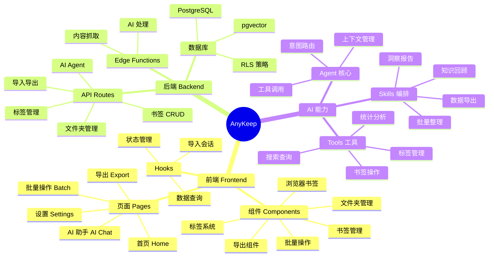
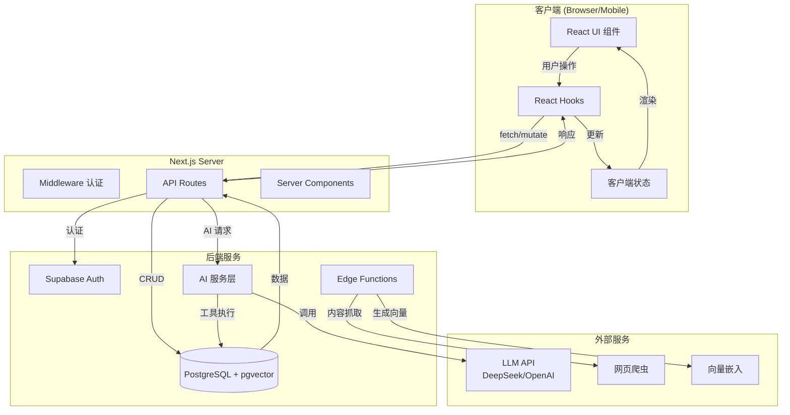
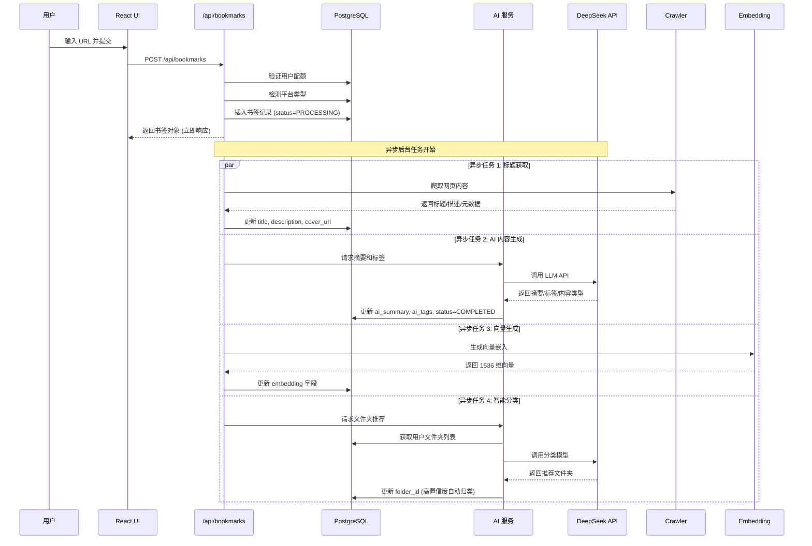
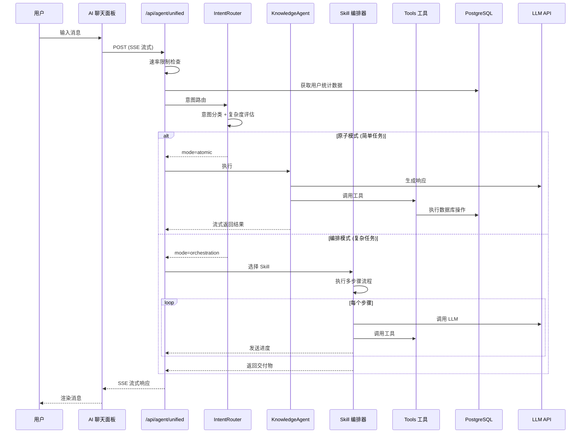
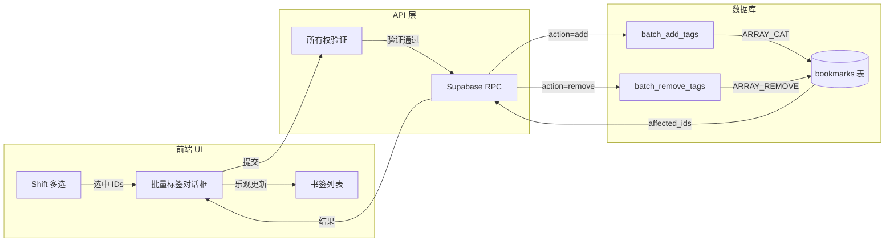
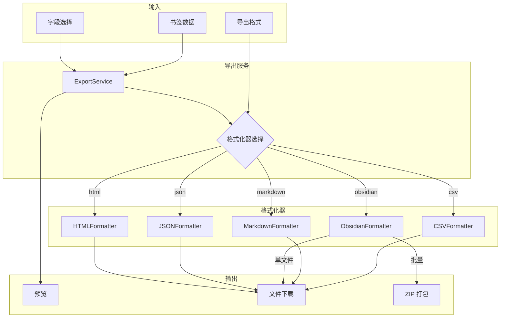
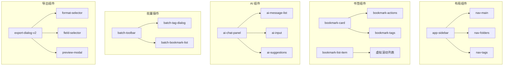
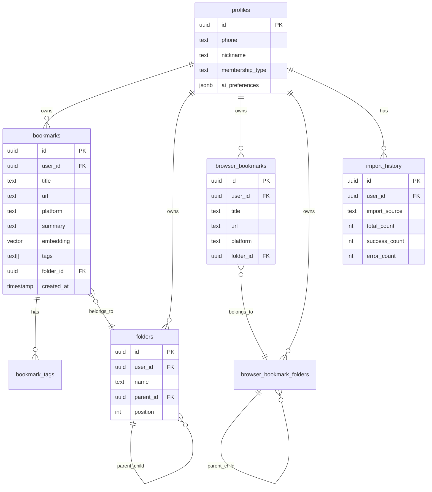
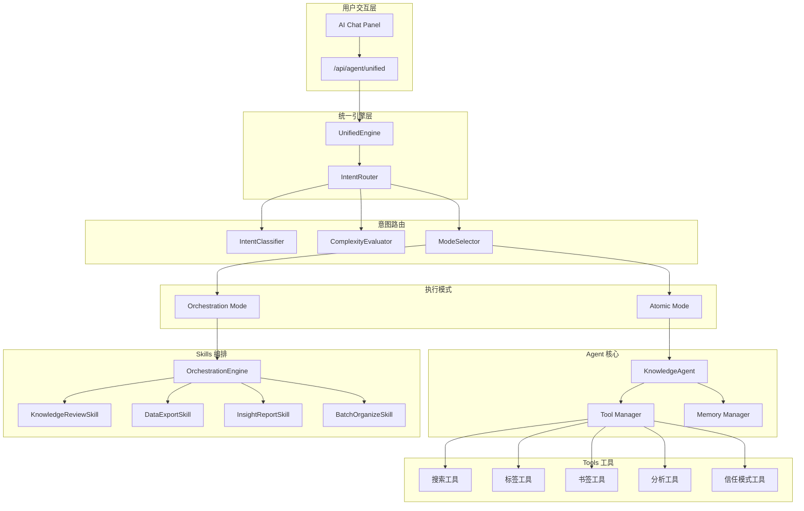
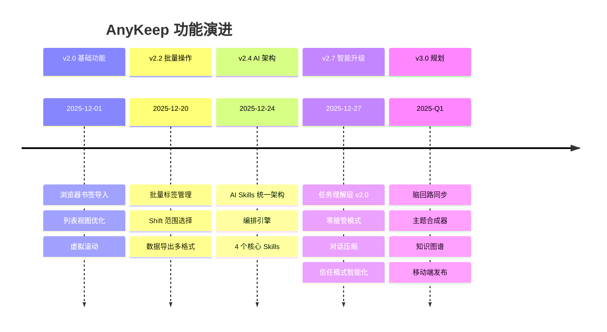

# AnyKeep 功能架构思维导图

> 更新日期：2025-12-29
> 基于项目实际代码结构绘制

---

## 📊 总览架构图 (Mermaid)



---

## 🔄 数据流图 (Data Flow Diagrams)

### 1. 用户请求全局数据流



### 2. 书签创建数据流（详细）



### 3. AI 对话数据流



### 4. 批量操作数据流



### 5. 数据导出数据流



---

## 📡 API 接口文档 (API Reference)

### 书签 API (`/api/bookmarks`)

#### GET /api/bookmarks

获取书签列表（支持分页和筛选）

| 参数             | 类型     | 必填 | 说明                                             |
| ---------------- | -------- | ---- | ------------------------------------------------ |
| `platform`       | string   | 否   | 平台筛选，如 `WECHAT`, `browser`                 |
| `excludeBrowser` | boolean  | 否   | 排除浏览器书签                                   |
| `folderId`       | number   | 否   | 文件夹 ID                                        |
| `folder`         | string   | 否   | 虚拟文件夹：`trash`, `invalid`, `high-value`     |
| `keyword`        | string   | 否   | 关键词搜索                                       |
| `cursor`         | number   | 否   | 分页游标                                         |
| `limit`          | number   | 否   | 每页数量，默认 20                                |
| `sort`           | string   | 否   | 排序：`created_desc`, `created_asc`, `title_asc` |
| `usageTags`      | string[] | 否   | 用途标签筛选                                     |
| `dateFrom`       | string   | 否   | 时间范围起始                                     |
| `dateTo`         | string   | 否   | 时间范围结束                                     |
| `isRead`         | boolean  | 否   | 阅读状态筛选                                     |
| `isStarred`      | boolean  | 否   | 星标筛选                                         |

**响应示例**:

```json
{
  "success": true,
  "data": {
    "bookmarks": [...],
    "pagination": {
      "total": 150,
      "limit": 20,
      "nextCursor": 123,
      "hasMore": true
    },
    "dataVersion": "1703836800000"
  }
}
```

---

#### POST /api/bookmarks

创建新书签

| 字段          | 类型     | 必填 | 说明                 |
| ------------- | -------- | ---- | -------------------- |
| `url`         | string   | ✅   | 书签 URL             |
| `title`       | string   | 否   | 标题（空则异步获取） |
| `description` | string   | 否   | 描述                 |
| `folderId`    | number   | 否   | 文件夹 ID            |
| `userTags`    | string[] | 否   | 用户标签             |
| `notes`       | string   | 否   | 笔记                 |

**响应**: 返回创建的书签对象，AI 内容异步生成

---

#### GET /api/bookmarks/[id]

获取单个书签详情

---

#### PUT /api/bookmarks/[id]

更新书签

| 字段          | 类型     | 说明       |
| ------------- | -------- | ---------- |
| `title`       | string   | 标题       |
| `description` | string   | 描述       |
| `folderId`    | number   | 文件夹 ID  |
| `userTags`    | string[] | 用户标签   |
| `notes`       | string   | 笔记       |
| `rating`      | number   | 评级 (1-5) |
| `isLocked`    | boolean  | 是否锁定   |

---

#### PATCH /api/bookmarks/[id]

切换状态

| 字段        | 类型    | 说明     |
| ----------- | ------- | -------- |
| `isRead`    | boolean | 已读状态 |
| `isStarred` | boolean | 星标状态 |

---

#### DELETE /api/bookmarks/[id]

删除书签（移入垃圾箱，30天后永久删除）

---

#### POST /api/bookmarks/batch-tags

批量标签操作

| 字段          | 类型              | 必填 | 说明                   |
| ------------- | ----------------- | ---- | ---------------------- |
| `action`      | `add` \| `remove` | ✅   | 操作类型               |
| `bookmarkIds` | number[]          | ✅   | 书签 ID 列表 (max 200) |
| `tags`        | string[]          | ✅   | 标签列表 (max 20)      |

**响应示例**:

```json
{
  "success": true,
  "data": {
    "action": "add",
    "affectedCount": 15,
    "affectedIds": [1, 2, 3, ...],
    "tags": ["学习", "技术"],
    "message": "已为 15 个书签添加 2 个标签"
  }
}
```

---

### 文件夹 API (`/api/folders`)

#### GET /api/folders

获取文件夹树形结构

**响应示例**:

```json
{
  "success": true,
  "data": [
    {
      "id": 1,
      "name": "技术",
      "parent_id": null,
      "children": [{ "id": 2, "name": "前端", "parent_id": 1, "children": [] }]
    }
  ]
}
```

---

#### POST /api/folders

创建新文件夹

| 字段       | 类型   | 必填 | 说明        |
| ---------- | ------ | ---- | ----------- |
| `name`     | string | ✅   | 文件夹名称  |
| `parentId` | number | 否   | 父文件夹 ID |

---

#### PUT /api/folders/[id]

更新文件夹

#### DELETE /api/folders/[id]

删除文件夹

---

### AI Agent API (`/api/agent`)

#### POST /api/agent/unified

统一 AI 智能入口（支持 SSE 流式响应）

| 字段                | 类型      | 必填 | 说明                   |
| ------------------- | --------- | ---- | ---------------------- |
| `message`           | string    | ✅   | 用户消息 (max 2000)    |
| `conversationId`    | UUID      | 否   | 会话 ID                |
| `messageHistory`    | Message[] | 否   | 消息历史 (max 50)      |
| `bookmarkIds`       | number[]  | 否   | 关联书签 ID (max 100)  |
| `folderId`          | number    | 否   | 关联文件夹 ID          |
| `explicitTool`      | object    | 否   | 显式工具选择           |
| `contextReferences` | object    | 否   | 上下文引用             |
| `attachmentContext` | string    | 否   | 附件上下文 (max 20000) |
| `options`           | object    | 否   | 执行选项               |

**explicitTool 结构**:

```typescript
{
  toolId: 'search' | 'stats' | 'organize' | 'tag' | 'dedupe' |
          'summarize' | 'extract' | 'review' | 'export',
  skipIntentClassification: boolean
}
```

**options 结构**:

```typescript
{
  enableUnified?: boolean,      // 启用统一引擎
  streaming?: boolean,          // 流式响应
  includeRoutingInfo?: boolean, // 包含路由信息
  forceMode?: 'atomic' | 'orchestration',
  forceSkill?: string,
  maxToolRounds?: number,       // 1-10
  temperature?: number          // 0-1
}
```

**SSE 响应类型**:

```typescript
type UnifiedStreamChunk = {
  type:
    | "init"
    | "text"
    | "progress"
    | "deliverable"
    | "routing"
    | "fallback"
    | "error"
    | "cancelled"
    | "done";
  data: {
    requestId?: string; // init
    text?: string; // text
    step?: string; // progress
    percent?: number; // progress
    format?: string; // deliverable
    content?: unknown; // deliverable
    mode?: string; // routing/done
    reason?: string; // routing/fallback
    message?: string; // error/cancelled
    success?: boolean; // done
    summary?: string; // done
  };
};
```

---

#### POST /api/agent/cancel

取消正在执行的请求

| 字段        | 类型   | 必填 | 说明    |
| ----------- | ------ | ---- | ------- |
| `requestId` | string | ✅   | 请求 ID |

---

### 浏览器书签 API (`/api/browser-bookmark`)

#### POST /api/browser-bookmark/validate

验证书签文件格式

#### POST /api/browser-bookmark/import (见 import 路由)

导入浏览器书签

#### GET /api/browser-bookmark/history

获取导入历史

#### POST /api/browser-bookmark/fetch-metadata

获取 URL 元数据

#### POST /api/browser-bookmark/export

导出浏览器书签

---

### 导出 API (`/api/export`)

#### POST /api/export

导出书签数据

| 字段          | 类型     | 必填 | 说明                                          |
| ------------- | -------- | ---- | --------------------------------------------- |
| `format`      | string   | ✅   | `csv`, `markdown`, `obsidian`, `json`, `html` |
| `bookmarkIds` | number[] | 否   | 指定书签 ID（空则导出全部）                   |
| `folderId`    | number   | 否   | 指定文件夹                                    |
| `fields`      | string[] | 否   | 导出字段                                      |
| `options`     | object   | 否   | 格式特定选项                                  |

---

### HTTP 状态码约定

| 状态码 | 说明               |
| ------ | ------------------ |
| `200`  | 成功               |
| `201`  | 创建成功           |
| `400`  | 请求参数无效       |
| `401`  | 未授权（需登录）   |
| `403`  | 禁止访问（无权限） |
| `404`  | 资源不存在         |
| `429`  | 请求过于频繁       |
| `500`  | 服务器内部错误     |

### 通用响应格式

**成功响应**:

```json
{
  "success": true,
  "data": { ... }
}
```

**错误响应**:

```json
{
  "success": false,
  "error": "错误信息",
  "details": [ ... ]  // 可选，验证错误详情
}
```

### 速率限制

| 端点                           | 限制     | 窗口  |
| ------------------------------ | -------- | ----- |
| `/api/agent/unified`           | 20 请求  | 60 秒 |
| `/api/bookmarks` (POST)        | 30 请求  | 60 秒 |
| `/api/browser-bookmark/import` | 5 请求   | 60 秒 |
| 其他 API                       | 100 请求 | 60 秒 |

---

## 🎯 按功能级别分类

### Level 1: 核心功能 (Core Features)

| 功能模块       | 说明               | 状态      | 路径                       |
| -------------- | ------------------ | --------- | -------------------------- |
| **书签管理**   | CRUD、搜索、筛选   | ✅ 已实现 | `src/components/bookmark/` |
| **文件夹管理** | 层级结构、拖拽排序 | ✅ 已实现 | `src/components/folder/`   |
| **标签系统**   | 多标签、批量标签   | ✅ 已实现 | `src/components/tags/`     |
| **用户认证**   | Supabase Auth      | ✅ 已实现 | `src/app/(auth)/`          |
| **AI 对话**    | 智能助手交互       | ✅ 已实现 | `src/components/ai/`       |

### Level 2: 扩展功能 (Extended Features)

| 功能模块           | 说明                       | 状态      | 路径                        |
| ------------------ | -------------------------- | --------- | --------------------------- |
| **浏览器书签导入** | Chrome/Edge/Firefox/Safari | ✅ 已实现 | `src/lib/browser-bookmark/` |
| **批量操作**       | 批量标签、Shift 选择       | ✅ 已实现 | `src/components/batch/`     |
| **数据导出**       | CSV/MD/JSON/HTML/Obsidian  | ✅ 已实现 | `src/lib/export/`           |
| **虚拟滚动**       | 万级数据流畅渲染           | ✅ 已实现 | `react-virtuoso` 集成       |
| **AI Skills 编排** | 复杂任务自动化             | ✅ 已实现 | `src/lib/ai-skills/`        |

### Level 3: 规划中功能 (Planned Features)

| 功能模块       | 说明                 | 状态      | 设计文档     |
| -------------- | -------------------- | --------- | ------------ |
| **脑回路同步** | 主动复习、Flashcards | 📝 设计中 | 本次对话设计 |
| **主题合成器** | 多源内容综述报告     | 📝 设计中 | 本次对话设计 |
| **知识图谱**   | 语义关联、跨时空连接 | 📋 规划中 | -            |
| **移动端**     | Capacitor 打包       | 📋 规划中 | -            |

---

## 🖥️ 前端架构 (Frontend)

### 页面结构 (`src/app/`)

```
src/app/
├── (auth)/                    # 认证相关页面
│   ├── login/                 # 登录页
│   ├── signup/                # 注册页
│   └── reset-password/        # 密码重置
├── (main)/                    # 主应用页面
│   ├── home/                  # 首页（书签列表）
│   ├── batch/                 # 批量操作页
│   ├── export/                # 导出页
│   ├── settings/              # 设置页
│   └── layout.tsx             # 主布局（侧边栏）
├── api/                       # API Routes (见后端部分)
└── layout.tsx                 # 根布局
```

### 组件架构 (`src/components/`)



### 组件目录详情

```
src/components/
├── ui/                        # Shadcn UI 基础组件
│   ├── button.tsx
│   ├── dialog.tsx
│   ├── dropdown-menu.tsx
│   ├── input.tsx
│   ├── sidebar.tsx
│   └── ...
├── bookmark/                  # 书签相关
│   ├── bookmark-card.tsx      # 卡片视图
│   ├── bookmark-list-item.tsx # 列表视图
│   ├── bookmark-actions.tsx   # 操作菜单
│   ├── bookmark-dialog.tsx    # 编辑对话框
│   └── browser-bookmark-*.tsx # 浏览器书签专用
├── folder/                    # 文件夹相关
│   ├── folder-tree.tsx
│   ├── folder-item.tsx
│   └── folder-dialog.tsx
├── tags/                      # 标签相关
│   ├── tag-input.tsx
│   ├── tag-list.tsx
│   └── tag-filter.tsx
├── batch/                     # 批量操作
│   ├── batch-page-client.tsx
│   ├── batch-toolbar.tsx
│   ├── batch-tag-dialog.tsx
│   └── batch-bookmark-list.tsx
├── export/                    # 导出功能
│   ├── export-dialog-v2.tsx
│   ├── export-format-selector.tsx
│   ├── export-field-selector.tsx
│   ├── export-preview.tsx
│   └── export-progress.tsx
├── ai/                        # AI 助手
│   ├── ai-chat-panel.tsx
│   ├── ai-message-list.tsx
│   ├── ai-input.tsx
│   └── ai-suggestions.tsx
├── browser-bookmark/          # 浏览器书签导入
│   ├── import-dialog.tsx
│   ├── import-progress.tsx
│   └── preview-tree.tsx
├── home/                      # 首页专用
│   ├── home-page-client.tsx
│   ├── home-batch-toolbar.tsx
│   └── home-filters.tsx
└── layout/                    # 布局组件
    ├── app-sidebar.tsx
    ├── nav-main.tsx
    ├── nav-folders.tsx
    └── nav-tags.tsx
```

### Hooks (`src/hooks/`)

| Hook               | 功能         | 文件                      |
| ------------------ | ------------ | ------------------------- |
| `useBookmarks`     | 书签数据查询 | `use-bookmarks.ts`        |
| `useFolders`       | 文件夹数据   | `use-folders.ts`          |
| `useTags`          | 标签数据     | `use-tags.ts`             |
| `useImportSession` | 导入会话管理 | `use-import-session.ts`   |
| `useBatchTags`     | 批量标签操作 | `batch/use-batch-tags.ts` |
| `useExport`        | 导出功能     | `use-export.ts`           |

---

## ⚙️ 后端架构 (Backend)

### API Routes (`src/app/api/`)

```
src/app/api/
├── bookmarks/                 # 书签 API
│   ├── route.ts               # GET/POST 书签列表
│   ├── [id]/route.ts          # 单个书签 CRUD
│   ├── batch-tags/route.ts    # 批量标签操作
│   └── search/route.ts        # 搜索 API
├── folders/                   # 文件夹 API
│   ├── route.ts
│   └── [id]/route.ts
├── tags/                      # 标签 API
│   └── route.ts
├── browser-bookmark/          # 浏览器书签导入
│   ├── import/route.ts
│   ├── validate/route.ts
│   └── metadata/route.ts
├── export/                    # 导出 API
│   └── route.ts
├── agent/                     # AI Agent API
│   ├── unified/route.ts       # 统一 AI 入口 (SSE)
│   ├── cancel/route.ts        # 取消请求
│   └── feedback/route.ts      # 反馈收集
└── auth/                      # 认证相关
    └── callback/route.ts
```

### 数据库架构 (Supabase)



### 核心数据表

| 表名                       | 用途             | 关键字段                              |
| -------------------------- | ---------------- | ------------------------------------- |
| `profiles`                 | 用户扩展信息     | `ai_preferences` (JSONB)              |
| `bookmarks`                | 收藏记录         | `embedding` (vector), `tags` (text[]) |
| `folders`                  | 文件夹           | `parent_id` (层级结构)                |
| `browser_bookmarks`        | 浏览器书签       | 独立存储，隔离展示                    |
| `browser_bookmark_folders` | 浏览器书签文件夹 | 保留原始层级                          |
| `import_history`           | 导入历史         | 统计和错误追踪                        |

### Edge Functions (`supabase/functions/`)

| 函数                 | 功能          | 触发方式   |
| -------------------- | ------------- | ---------- |
| `fetch-content`      | 抓取 URL 内容 | HTTP 调用  |
| `generate-summary`   | AI 生成摘要   | 书签创建后 |
| `generate-embedding` | 生成向量嵌入  | 书签创建后 |
| `scheduled-tasks`    | 定时任务      | Cron 触发  |

---

## 🤖 AI 能力架构 (详细)

### 整体架构图



### AI Agent 核心 (`src/lib/ai-agent/`)

```
src/lib/ai-agent/
├── core/                      # 核心模块
│   ├── knowledge-agent.ts     # Agent 主类
│   ├── tool-manager.ts        # 工具管理器
│   └── prompts/               # Prompt 模板
│       ├── response-templates.ts
│       └── implicit-intent-rules.ts
├── tools/                     # 原子工具
│   ├── search/                # 搜索工具
│   │   ├── search-bookmarks.tool.ts
│   │   └── semantic-search.tool.ts
│   ├── tags/                  # 标签工具
│   │   ├── add-tags.tool.ts
│   │   ├── remove-tags.tool.ts
│   │   └── list-tags.tool.ts
│   ├── bookmarks/             # 书签工具
│   │   ├── get-bookmark.tool.ts
│   │   ├── create-bookmark.tool.ts
│   │   └── delete-bookmark.tool.ts
│   ├── analytics/             # 分析工具
│   │   ├── count-bookmarks.tool.ts
│   │   └── get-statistics.tool.ts
│   ├── trust-mode/            # 信任模式
│   │   ├── get-trust-mode.tool.ts
│   │   └── recommend-trust-mode.tool.ts
│   └── index.ts               # 工具注册
├── router/                    # 意图路由
│   ├── intent-classifier.ts   # 意图分类
│   ├── complexity-evaluator.ts # 复杂度评估
│   ├── mode-selector.ts       # 模式选择
│   └── intent-router.ts       # 路由整合
├── context/                   # 上下文管理
│   ├── dynamic-context-builder.ts
│   ├── system-reminder-injector.ts
│   ├── enhanced-confidence.ts
│   ├── prompt-injector.ts
│   └── conversation-compressor.ts
├── memory/                    # 记忆系统
│   ├── episodic-memory.ts     # 情景记忆
│   └── working-memory.ts      # 工作记忆
├── react/                     # ReAct 循环
│   ├── react-prompt-builder.ts
│   └── react-loop-executor.ts
├── citation/                  # 引用追踪
│   ├── citation-indexer.ts
│   ├── citation-annotator.ts
│   └── citation-renderer.ts
├── preferences/               # 偏好学习
│   ├── preferences-service.ts
│   └── learning-service.ts
├── config/                    # 配置
│   ├── feature-flags.ts
│   └── cost-controller.ts
└── task-understanding/        # 任务理解
    └── analyzer/
        └── task-analyzer.ts
```

### AI Skills 编排 (`src/lib/ai-skills/`)

```
src/lib/ai-skills/
├── engine/                    # 执行引擎
│   ├── unified-engine.ts      # 统一引擎入口
│   ├── orchestration-engine.ts # 编排执行器
│   └── types.ts
├── router/                    # 意图路由
│   ├── intent-classifier.ts
│   ├── complexity-evaluator.ts
│   ├── mode-selector.ts
│   └── intent-router.ts
├── orchestration/             # 编排基础设施
│   ├── base-skill.ts          # Skill 基类
│   ├── progress-reporter.ts   # 进度报告
│   ├── deliverable-generator.ts # 交付物生成
│   └── cancellation-token.ts  # 取消令牌
├── output/                    # 输出适配
│   ├── adapter.ts
│   └── types.ts
├── skills/                    # Skill 实现
│   ├── knowledge-review/      # 知识回顾
│   │   ├── index.ts
│   │   └── knowledge-review.skill.ts
│   ├── data-export/           # 数据导出
│   │   ├── index.ts
│   │   └── data-export.skill.ts
│   ├── insight-report/        # 洞察报告
│   │   ├── index.ts
│   │   └── insight-report.skill.ts
│   └── batch-organize/        # 批量整理
│       ├── index.ts
│       └── batch-organize.skill.ts
└── register.ts                # Skill 注册表
```

### 已实现的 Skills

| Skill                  | 功能                 | 触发意图               | 步骤数 |
| ---------------------- | -------------------- | ---------------------- | ------ |
| `KnowledgeReviewSkill` | 知识回顾、记忆卡片   | "帮我复习"、"回顾最近" | 5      |
| `DataExportSkill`      | 多格式导出           | "导出"、"备份"         | 4      |
| `InsightReportSkill`   | 活跃度分析、趋势洞察 | "分析"、"统计报告"     | 5      |
| `BatchOrganizeSkill`   | 自动分类、去重、归档 | "整理"、"清理"         | 6      |

### 已实现的 Tools

| 分类         | Tool                        | 功能             |
| ------------ | --------------------------- | ---------------- |
| **搜索**     | `search_bookmarks`          | 关键词搜索书签   |
|              | `semantic_search`           | 语义向量搜索     |
| **标签**     | `add_tags`                  | 添加标签         |
|              | `remove_tags`               | 移除标签         |
|              | `list_tags`                 | 列出所有标签     |
|              | `batch_add_tags`            | 批量添加标签     |
|              | `batch_remove_tags`         | 批量移除标签     |
| **书签**     | `get_bookmark`              | 获取单个书签     |
|              | `create_bookmark`           | 创建书签         |
|              | `update_bookmark`           | 更新书签         |
|              | `delete_bookmark`           | 删除书签         |
|              | `move_bookmark`             | 移动到文件夹     |
| **分析**     | `count_bookmarks`           | 统计书签数量     |
|              | `get_statistics`            | 获取详细统计     |
|              | `get_platform_distribution` | 平台分布         |
| **信任模式** | `get_trust_mode`            | 获取当前信任模式 |
|              | `recommend_trust_mode`      | 智能推荐信任等级 |

### 意图分类体系

```typescript
// 9 种核心意图类型
type IntentType =
  | "search" // 搜索查询
  | "manage" // 管理操作（增删改）
  | "analyze" // 分析统计
  | "export" // 导出备份
  | "review" // 知识回顾
  | "organize" // 整理归档
  | "query" // 信息查询
  | "chat" // 闲聊对话
  | "unknown"; // 未识别

// 复杂度分级
type Complexity = "simple" | "medium" | "complex";

// 执行模式
type ExecutionMode = "atomic" | "orchestration";
```

### Feature Flags 配置

```bash
# .env.local
ENABLE_DYNAMIC_CONTEXT=true     # 动态上下文注入
ENABLE_MODEL_TIERING=true       # 模型分层策略
ENABLE_REACT_PROMPT=true        # ReAct Prompt
ENABLE_REASONING=true           # reasoning 参数记录
ENABLE_ERROR_RECOVERY=true      # 智能错误恢复
ENABLE_PREFERENCE_LEARNING=true # 偏好自动学习
ENABLE_COST_CONTROL=true        # 成本控制
ENABLE_REACT_LOOP=false         # ReAct 循环执行（灰度）
ENABLE_CITATION_TRACKING=true   # 引用追踪系统
ENABLE_SYSTEM_REMINDER=true     # System-Reminder 注入
```

---

## 📈 功能演进路线



---

## 🔗 相关文档

| 文档       | 路径                                        | 说明            |
| ---------- | ------------------------------------------- | --------------- |
| 产品需求   | `anykeep1121.md`                            | 完整 MVP 需求   |
| AI 上下文  | `CLAUDE.md`                                 | AI 开发指引     |
| AI 配置    | `docs/AI_CAPABILITY_CONFIG.md`              | AI 能力配置说明 |
| 技术债务   | `docs/TECH_DEBT_20251225.md`                | 技术债务追踪    |
| 差异化策略 | `docs/AnyKeep 差异化竞争策略 v1.0.md`       | 竞品分析        |
| CTO 提案   | `docs/CTO_AI_INTELLIGENCE_PROPOSAL_1228.md` | AI 智能升级建议 |

---

_本文档基于 AnyKeep 项目实际代码结构自动生成，如有变更请同步更新。_
