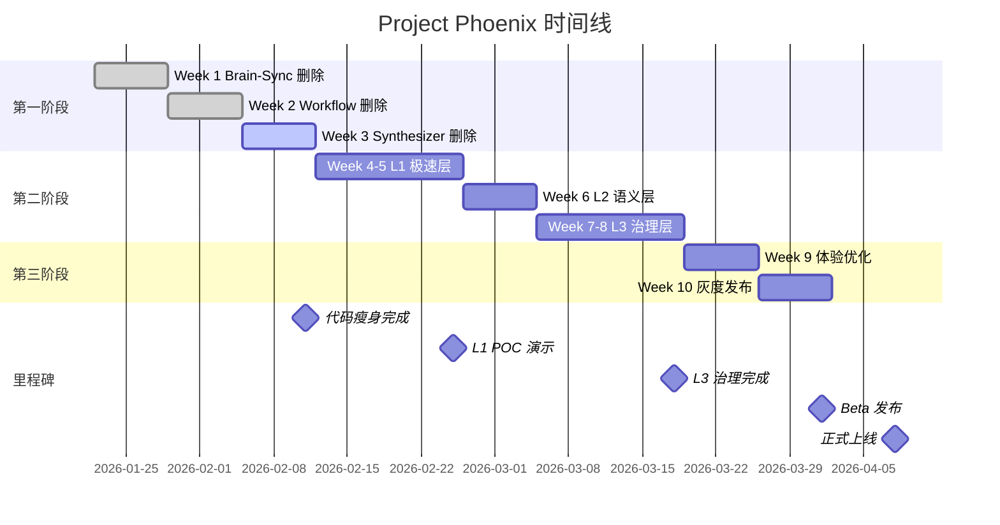

# 🦅 AnyKeep 重生计划 (Project Phoenix) - 可落地行动方案

**文档版本**: 1.0.0  
**创建时间**: 2026-01-21  
**审批状态**: 待 CEO 审核 🔍  
**执行周期**: 10 周（2026-01-22 ~ 2026-04-03）

---

## 📋 执行摘要 (Executive Summary)

本方案基于 CEO 的战略指令，制定了一份**物理级别的代码移除清单**和**三级漏斗架构的落地路径**。

**核心承诺**：

- ✅ 第 3 周末：完成代码瘦身，包体积减少 ≥30%
- ✅ 第 8 周末：P99 收藏延迟 < 50ms
- ✅ 第 10 周末：L1 命中率 ≥70%，用户纠错率 < 5%

---

## 第一阶段：大清洗 (The Great Purge) - 第 1-3 周

### Week 1 (2026-01-22 ~ 2026-01-28): Brain-Sync 系统物理删除

#### Day 1-2: 数据库迁移脚本准备

**目标**: 确保数据安全删除，不影响核心书签数据

**待删除的数据库表** (创建回滚脚本后再删除):

```sql
-- 📝 文件: supabase/migrations/20260122000001_remove_brain_sync_tables.sql

-- 1. 备份现有数据（可选，给早期用户留念）
CREATE TABLE IF NOT EXISTS brain_sync_archive AS
SELECT * FROM flashcards LIMIT 0;

-- 2. 删除表（按依赖顺序）
DROP TABLE IF EXISTS review_sessions CASCADE;
DROP TABLE IF EXISTS flashcards CASCADE;
DROP TABLE IF EXISTS brain_sync_display_preferences CASCADE;
DROP TABLE IF EXISTS brain_sync_stats CASCADE;

-- 3. 删除函数
DROP FUNCTION IF EXISTS review_related_bookmarks(UUID, BIGINT);
DROP FUNCTION IF EXISTS generate_weekly_queue();
DROP FUNCTION IF EXISTS send_review_reminder();

-- 4. 删除索引
DROP INDEX IF EXISTS idx_flashcards_user_id;
DROP INDEX IF EXISTS idx_review_sessions_user_id;
```

**待删除的数据库迁移文件** (物理删除):

```bash
# 📁 删除文件清单:
supabase/migrations/20251229000201_create_brain_sync_tables.sql
supabase/migrations/20251229000003_create_brain_sync_functions.sql
supabase/migrations/20251229000001_add_active_recall_tables.sql
supabase/migrations/20260101000004_extend_flashcards_for_v2.sql
supabase/migrations/20260101000005_extend_review_sessions_for_v2.sql
supabase/migrations/20260101000006_add_review_related_bookmarks_rpc.sql
supabase/migrations/20260102000001_add_brain_sync_display_preferences.sql
```

**执行命令**:

```bash
# 1. 先应用删除迁移
npm run supabase:db:push

# 2. 确认无误后，删除迁移文件
rm supabase/migrations/*brain_sync*.sql
rm supabase/migrations/*flashcard*.sql
rm supabase/migrations/*review*.sql
```

---

#### Day 3-4: 前端组件和 API 删除

**待删除的前端组件** (约 15 个文件):

```bash
# 📁 src/components/brain-sync/ (整个目录删除)
rm -rf src/components/brain-sync/

# 具体文件：
src/components/brain-sync/brain-sync-page-client.tsx
src/components/brain-sync/brain-sync-settings-card.tsx
src/components/brain-sync/flashcard-review-card-v2.tsx
src/components/brain-sync/related-bookmarks.tsx
src/components/brain-sync/review-session.tsx
src/components/brain-sync/sidebar-reminder.tsx
src/components/brain-sync/index.ts
```

**待删除的页面路由**:

```bash
# 📁 src/app/(main)/brain-sync/
rm -rf src/app/\(main\)/brain-sync/
```

**待删除的 API 路由** (约 8 个文件):

```bash
# 📁 src/app/api/brain-sync/ (整个目录删除)
rm -rf src/app/api/brain-sync/

# 具体文件：
src/app/api/brain-sync/flashcards/route.ts
src/app/api/brain-sync/flashcards/batch/route.ts
src/app/api/brain-sync/generate/route.ts
src/app/api/brain-sync/generate-from-report/route.ts
src/app/api/brain-sync/preferences/route.ts
src/app/api/brain-sync/queue/route.ts
src/app/api/brain-sync/related/route.ts
src/app/api/brain-sync/response/route.ts
src/app/api/brain-sync/stats/route.ts
src/app/api/brain-sync/__tests__/brain-sync-api.test.ts
```

**待删除的 Hooks**:

```bash
# 📁 src/hooks/domain/brain-sync/ (整个目录删除)
rm -rf src/hooks/domain/brain-sync/
rm src/hooks/domain/knowledge-studio/use-brain-sync-integration.ts
```

**待删除的 Types**:

```bash
# 📁 删除类型定义
rm src/types/brain-sync.ts
```

**待删除的 Supabase Functions**:

```bash
# 📁 supabase/functions/
rm -rf supabase/functions/generate-weekly-queue/
rm -rf supabase/functions/send-review-reminder/
```

**待修改的导航菜单** (移除 Brain-Sync 入口):

```typescript
// 📝 src/components/layout/app-sidebar.tsx
// 删除以下代码块（约第 XX-XX 行）:

// ❌ 删除这个导航项
{
  title: "复习实验室",
  url: "/brain-sync",
  icon: Brain,
  badge: unreadCount > 0 ? unreadCount : undefined,
}
```

```typescript
// 📝 src/components/layout/mobile-menu.tsx
// 同样删除 Brain-Sync 菜单项
```

---

#### Day 5: AI Skills 相关清理

**待删除的 AI Skill**:

```bash
# 📁 src/lib/ai-skills/skills/active-recall/ (整个目录删除)
rm -rf src/lib/ai-skills/skills/active-recall/

# 📁 src/lib/ai-agent/tools/active-recall/ (整个目录删除)
rm -rf src/lib/ai-agent/tools/active-recall/

# 📁 src/lib/ai-skills/shared/review/ (整个目录删除)
rm -rf src/lib/ai-skills/shared/review/
```

**待修改的 Skill 注册表**:

```typescript
// 📝 src/lib/ai-skills/register.ts
// 删除 active-recall 的导入和注册

// ❌ 删除这行
import { activeRecallSkill } from "./skills/active-recall";

// ❌ 删除注册代码
// skills.set("active-recall", activeRecallSkill);
```

```typescript
// 📝 src/lib/ai-skills/config/skill-mappings.ts
// 删除 active-recall 映射

// ❌ 删除这些意图映射
"generate_flashcards": "active-recall",
"review_flashcards": "active-recall",
"check_review_queue": "active-recall",
```

---

### Week 2 (2026-01-29 ~ 2026-02-04): Workflow 引擎删除

#### Day 1-3: Workflow 核心引擎删除

**待删除的 Workflow 引擎** (约 50+ 个文件):

```bash
# 📁 src/lib/workflow/ (整个目录删除)
rm -rf src/lib/workflow/

# 主要包含：
src/lib/workflow/engine/          # 工作流引擎核心
src/lib/workflow/triggers/        # 触发器（定时、事件）
src/lib/workflow/actions/         # Action 执行器
src/lib/workflow/builtin/         # 内置工作流
src/lib/workflow/validation/      # 验证器
src/lib/workflow/__tests__/       # 测试文件
```

**内置工作流清单** (确认删除):

```bash
src/lib/workflow/builtin/bookmark-health.workflow.ts       # 书签健康检查
src/lib/workflow/builtin/daily-digest.workflow.ts          # 每日摘要
src/lib/workflow/builtin/folder-cleanup.workflow.ts        # 文件夹清理
src/lib/workflow/builtin/new-user-onboarding.workflow.ts   # 新用户引导
src/lib/workflow/builtin/periodic-backup.workflow.ts       # 定期备份
src/lib/workflow/builtin/topic-deep-dive.workflow.ts       # 主题深挖
```

#### Day 4-5: 数据库清理

**待删除的数据库表**:

```sql
-- 📝 supabase/migrations/20260129000001_remove_workflow_tables.sql

-- 删除工作流相关表
DROP TABLE IF EXISTS workflow_executions CASCADE;
DROP TABLE IF EXISTS workflow_logs CASCADE;
DROP TABLE IF EXISTS workflow_triggers CASCADE;
DROP TABLE IF EXISTS workflow_actions CASCADE;
DROP TABLE IF EXISTS workflows CASCADE;

-- 删除分布式锁表（如果存在）
DROP TABLE IF EXISTS distributed_locks CASCADE;
```

**待删除的 API 路由**:

```bash
# 📁 如果存在 workflow API
rm -rf src/app/api/workflow/
rm -rf src/app/api/automation/
```

---

### Week 3 (2026-02-05 ~ 2026-02-11): Synthesizer 删除 & 架构瘦身

#### Day 1-2: Synthesizer 主题合成器删除

**待删除的数据库表**:

```sql
-- 📝 supabase/migrations/20260205000001_remove_synthesizer.sql

-- 删除报告表
DROP TABLE IF EXISTS synthesis_reports CASCADE;
DROP TABLE IF EXISTS synthesis_templates CASCADE;
```

**待删除的数据库迁移文件**:

```bash
rm supabase/migrations/20251229000102_create_synthesis_reports.sql
rm supabase/migrations/20251229000007_fix_synthesis_reports_embedding_dimension.sql
```

**待删除的 API**:

```bash
# 📁 删除合成 API
rm -rf src/app/api/synthesis/

# 可能涉及的文件：
src/app/api/synthesis/preview/route.ts
src/app/api/synthesis/generate/route.ts
```

**待修改的类型定义**:

```typescript
// 📝 src/types/domain/index.ts
// 删除 SynthesisReport 类型

// ❌ 删除这些类型
export interface SynthesisReport { ... }
export interface SynthesisTemplate { ... }
```

#### Day 3-4: 导入历史追踪降级

**保留功能**: 一键导入  
**删除功能**: 暂停/恢复/历史统计/进度详情

**待简化的组件**:

```typescript
// 📝 src/components/import/import-history.tsx
// 从复杂的历史记录面板简化为：
// - 仅显示最近 5 条导入记录
// - 删除暂停/恢复按钮
// - 删除详细统计图表
```

**待删除的数据库字段**:

```sql
-- 📝 supabase/migrations/20260205000002_simplify_import_tracking.sql

-- 删除冗余字段
ALTER TABLE import_jobs
DROP COLUMN IF EXISTS pause_reason,
DROP COLUMN IF EXISTS resume_count,
DROP COLUMN IF EXISTS detailed_stats;
```

#### Day 5: 元数据清理

**待删除的书签表字段**:

```sql
-- 📝 supabase/migrations/20260205000003_cleanup_bookmark_metadata.sql

ALTER TABLE bookmarks
DROP COLUMN IF EXISTS review_interval,
DROP COLUMN IF EXISTS next_review_at,
DROP COLUMN IF EXISTS mastery_level,
DROP COLUMN IF EXISTS last_reviewed_at;

-- 删除社交分享统计（如果有）
DROP TABLE IF EXISTS bookmark_share_stats CASCADE;
```

**待删除的文件夹表字段**:

```sql
ALTER TABLE folders
DROP COLUMN IF EXISTS workflow_enabled,
DROP COLUMN IF EXISTS auto_synthesis;
```

---

### Week 3 验收标准

**必须完成的检查清单**:

- [ ] 代码库中无任何 `brain-sync` 关键字（除文档）
- [ ] 代码库中无任何 `workflow` 关键字（除通用术语）
- [ ] 代码库中无任何 `synthesizer`/`synthesis_report` 关键字
- [ ] 数据库迁移全部成功执行
- [ ] `npm run build` 无错误（移除依赖后）
- [ ] `npm run type-check` 通过
- [ ] `npm run test` 通过（删除相关测试）
- [ ] 包体积比对：`next build` 后 `.next` 目录大小减少 ≥30%

**包依赖清理**:

```bash
# 📝 检查 package.json，移除以下依赖（如果仅用于被删除功能）:
# - 工作流相关的调度库
# - 分布式锁库（如 redis）
# - 其他不再使用的库

npm uninstall <unused-packages>
```

---

## 第二阶段：铸造核心 (Forging the Core) - 第 4-8 周

### Week 4-5 (2026-02-12 ~ 2026-02-25): L1 极速层开发 (POC)

#### Phase 1.1: 服务端索引构建器 (3 天)

**新增文件**:

```bash
# ✅ 创建以下文件
src/lib/classification/v6/bayesian-index-builder.service.ts    # 索引生成器
src/lib/classification/v6/types.ts                              # v6 类型定义
src/lib/classification/v6/__tests__/bayesian-index-builder.test.ts
```

**实现要点**:

1. 贝叶斯索引生成逻辑（已在 v6.0-implementation-plan.md 中详细定义）
2. Token 截断策略（保留 Top 5000 高频词，控制索引大小 < 500KB）
3. 拉普拉斯平滑（α = 1）
4. 中英文分词器

**数据库支持** (可选):

```sql
-- 📝 supabase/migrations/20260212000001_create_bayesian_index_cache.sql

CREATE TABLE classification_bayesian_indexes (
  user_id UUID PRIMARY KEY REFERENCES auth.users(id) ON DELETE CASCADE,
  index_data JSONB NOT NULL,
  version BIGINT NOT NULL,
  total_docs INT NOT NULL,
  total_tokens INT NOT NULL,
  size_kb NUMERIC(10,2),
  created_at TIMESTAMPTZ DEFAULT NOW(),
  updated_at TIMESTAMPTZ DEFAULT NOW()
);

CREATE INDEX idx_bayesian_indexes_version
ON classification_bayesian_indexes(version);
```

**测试指标**:

```typescript
// 📝 测试脚本: scripts/test-v6-index-builder.ts

测试场景：
1. ✅ 生成 1,000 条书签的索引 < 100KB
2. ✅ 生成 10,000 条书签的索引 < 500KB
3. ✅ 索引生成耗时 < 5s（10,000 条）
4. ✅ 索引 JSON 可被客户端正确解析
```

---

#### Phase 1.2: 客户端推理引擎 (4 天)

**新增文件**:

```bash
# ✅ 创建客户端引擎
src/lib/classification/v6/client/bayesian-engine.ts
src/lib/classification/v6/client/__tests__/bayesian-engine.test.ts
src/lib/classification/v6/client/tokenizer.ts               # 与服务端一致的分词器
```

**实现要点**:

1. LocalStorage/IndexedDB 双层缓存
2. 朴素贝叶斯分类器（对数概率计算）
3. Softmax 置信度归一化
4. 版本号校验机制

**性能测试**:

```typescript
// 📝 测试脚本: scripts/benchmark-v6-l1.ts

测试目标：
1. ✅ P50 延迟 < 5ms
2. ✅ P90 延迟 < 10ms
3. ✅ P99 延迟 < 20ms
4. ✅ 在 Chrome/Safari/Firefox 均通过测试
```

**前端集成**:

```typescript
// 📝 src/lib/classification/v6/client/integration.tsx
// Hook: useClientClassification()

export function useClientClassification() {
  const engine = useRef(new ClientBayesianEngine());

  useEffect(() => {
    // 页面加载时预热索引
    engine.current.loadIndex(userId);
  }, [userId]);

  const classify = async (bookmark: BookmarkInput) => {
    const l1Result = engine.current.predict(bookmark.title, bookmark.content);

    if (l1Result.success) {
      // L1 成功，直接返回
      return {
        folderId: l1Result.folderId,
        strategy: "L1_LOCAL",
        latency: l1Result.latencyMs,
      };
    }

    // L1 失败，回退到服务端
    return classifyOnServer(bookmark, l1Result.topCandidates);
  };

  return { classify };
}
```

---

#### Phase 1.3: API 接口开发 (2 天)

**新增文件**:

```bash
# ✅ 创建 API 路由
src/app/api/classification/v6/index/[userId]/route.ts        # 获取索引
src/app/api/classification/v6/classify/route.ts              # 分类接口
src/app/api/classification/v6/index/rebuild/route.ts         # 手动重建
```

**索引获取接口**:

```typescript
// 📝 src/app/api/classification/v6/index/[userId]/route.ts

export async function GET(
  req: Request,
  { params }: { params: { userId: string } },
) {
  // 1. 验证用户身份
  // 2. 从缓存/数据库获取索引
  // 3. 如果不存在，实时构建
  // 4. 返回 JSON + CDN 缓存头

  return NextResponse.json(index, {
    headers: {
      "Cache-Control": "public, max-age=3600", // 1 小时
      ETag: `v${index.version}`,
    },
  });
}
```

**统一分类接口**:

```typescript
// 📝 src/app/api/classification/v6/classify/route.ts

export async function POST(req: Request) {
  const { userId, bookmark, l1Result } = await req.json();

  // L1 已经在客户端尝试过，这里处理 L2/L3
  if (l1Result && l1Result.topCandidates) {
    // 使用 L1 的候选结果优化 L2
  }

  // 走 L2 向量检索 -> L3 仲裁流程
}
```

---

#### Phase 1.4: 端到端测试 (1 天)

**测试场景**:

```typescript
// 📝 e2e/classification-v6-l1.spec.ts

test("L1 极速层端到端测试", async ({ page }) => {
  // 1. 登录用户
  await page.goto("/login");
  await login(page);

  // 2. 打开浏览器插件（或收藏按钮）
  await page.goto("https://example.com/some-article");
  await page.click('[data-testid="save-bookmark"]');

  // 3. 验证分类结果
  await expect(page.locator(".classification-result")).toContainText("技术");

  // 4. 验证延迟
  const latency = await page.evaluate(() => {
    return window.performance.measure("classification-time").duration;
  });
  expect(latency).toBeLessThan(50);

  // 5. 验证策略标签
  await expect(page.locator(".strategy-badge")).toContainText("L1 本地");
});
```

---

### Week 6 (2026-02-26 ~ 2026-03-04): L2 语义层增强

#### Phase 2.1: 垃圾命名检测器 (2 天)

**新增文件**:

```bash
# ✅ 创建检测器
src/lib/classification/v6/generic-name-detector.ts
src/lib/classification/v6/__tests__/generic-name-detector.test.ts
```

**正则模式清单** (可扩展):

```typescript
// 📝 src/lib/classification/v6/generic-name-detector.ts

const GENERIC_PATTERNS = [
  /^新建文件夹\d*$/i,
  /^New Folder\d*$/i,
  /^未命名\d*$/i,
  /^Untitled\d*$/i,
  /^\d{8}$/, // 纯数字日期
  /^临时\d*$/i,
  /^Temp\d*$/i,
  /^测试\d*$/i,
  /^Test\d*$/i,
  /^文件夹\d*$/i,
  /^Folder\d*$/i,
  /^收藏夹$/i,
  /^Favorites?$/i,
  /^其他$/i,
  /^Others?$/i,
  /^杂项$/i,
  /^Misc$/i,
];
```

**测试用例**:

```typescript
// 📝 测试 100 个真实文件夹名
测试目标：
✅ 精确率 > 95%（判定为垃圾的确实是垃圾）
✅ 召回率 > 90%（不放过垃圾命名）
✅ 无误杀（"新建档案馆" 不应被判定为垃圾）
```

---

#### Phase 2.2: L2 路由网关 (2 天)

**新增文件**:

```bash
# ✅ 创建网关
src/lib/classification/v6/l2-gateway.service.ts
src/lib/classification/v6/__tests__/l2-gateway.test.ts
```

**路由逻辑**:

```typescript
// 📝 L2 决策树

向量相似度 ≥ 0.82 && 文件夹名正常 → L2_SUCCESS (直接返回)
向量相似度 ≥ 0.82 && 文件夹名垃圾 → L3_GOVERNANCE (异步治理)
向量相似度 < 0.82                → L3_ARBITRATION (LLM 仲裁)
```

**集成到现有 v5 架构**:

```typescript
// 📝 src/lib/classification/v5/classification-pipeline/classification-pipeline.service.ts
// 在 T1 向量检索后，插入 L2 网关

async classifyBookmark(bookmark: Bookmark): Promise<ClassificationResult> {
  // L1 客户端已尝试...

  // L2: 向量检索
  const vectorResult = await this.vectorMatcher.match(bookmark);

  // 🆕 L2 网关判断
  const l2Decision = await this.l2Gateway.process(userId, bookmark, vectorResult);

  if (l2Decision.route === 'L2_SUCCESS') {
    return { folderId: l2Decision.folderId, strategy: 'L2_VECTOR' };
  }

  if (l2Decision.route === 'L3_GOVERNANCE') {
    // 异步触发治理，先返回结果
    this.lazyGovernance.suggestRename(userId, l2Decision.folderId, bookmark);
    return { folderId: l2Decision.folderId, strategy: 'L2_VECTOR', governance: true };
  }

  // L3: LLM 仲裁
  return this.llmArbitrator.classify(bookmark);
}
```

---

### Week 7-8 (2026-03-05 ~ 2026-03-18): L3 治理层开发

#### Phase 3.1: 懒人治理服务 (4 天)

**新增文件**:

```bash
# ✅ 创建治理服务
src/lib/classification/v6/lazy-governance.service.ts
src/lib/classification/v6/__tests__/lazy-governance.test.ts
```

**数据库表**:

```sql
-- 📝 supabase/migrations/20260305000001_create_governance_suggestions.sql

CREATE TABLE classification_governance_suggestions (
  id BIGSERIAL PRIMARY KEY,
  user_id UUID NOT NULL REFERENCES auth.users(id) ON DELETE CASCADE,
  folder_id BIGINT NOT NULL REFERENCES folders(id) ON DELETE CASCADE,
  suggestion_type TEXT NOT NULL CHECK (suggestion_type IN ('rename', 'merge', 'split')),
  current_name TEXT,
  suggested_name TEXT,
  reason TEXT,
  confidence NUMERIC(3,2),
  status TEXT NOT NULL CHECK (status IN ('pending', 'accepted', 'rejected', 'ignored')),
  created_at TIMESTAMPTZ DEFAULT NOW(),
  resolved_at TIMESTAMPTZ
);

CREATE INDEX idx_governance_suggestions_user
ON classification_governance_suggestions(user_id, status);
```

**LLM Prompt 优化**:

```typescript
// 📝 Few-shot 示例

const RENAME_EXAMPLES = `
示例 1:
文件夹名: "新建文件夹1"
内容样本:
- 空气炸锅烤鸡翅做法
- 烘焙入门指南
- 减脂餐食谱
建议: "美食食谱"

示例 2:
文件夹名: "临时"
内容样本:
- Docker 入门教程
- Kubernetes 部署实战
- CI/CD 最佳实践
建议: "DevOps"
`;
```

---

#### Phase 3.2: 前端 Toast 通知 (3 天)

**新增文件**:

```bash
# ✅ 创建治理组件
src/components/classification/governance-toast.tsx
src/hooks/domain/classification/use-governance-suggestions.ts
```

**交互设计**:

```typescript
// 📝 Toast 样式（参考 shadcn/ui Sonner）

<Toast>
  <div className="flex items-center gap-3">
    <SparklesIcon className="w-5 h-5 text-yellow-500" />
    <div>
      <p className="font-medium">
        这里的 12 篇内容都是关于「空气炸锅」的
      </p>
      <p className="text-sm text-muted-foreground">
        建议将「新建文件夹1」重命名为 <strong>「美食食谱」</strong>
      </p>
    </div>
  </div>
  <div className="flex gap-2 mt-2">
    <Button size="sm" onClick={handleAccept}>一键修改</Button>
    <Button size="sm" variant="ghost" onClick={handleReject}>忽略</Button>
  </div>
</Toast>
```

**触发时机**:

```typescript
// 📝 当用户访问文件夹时触发

useEffect(() => {
  // 用户进入 /folders/:folderId 页面
  const checkGovernance = async () => {
    const suggestions = await fetchGovernanceSuggestions(folderId);

    if (suggestions.length > 0 && suggestions[0].status === 'pending') {
      // 显示 Toast
      toast.custom(<GovernanceToast suggestion={suggestions[0]} />);
    }
  };

  checkGovernance();
}, [folderId]);
```

---

#### Phase 3.3: L3 仲裁模式 (2 天)

**增强现有 LLM 分类器**:

```typescript
// 📝 src/lib/classification/v5/llm-arbitrator.ts
// 当 L1/L2 都不确定时，使用 LLM 进行仲裁

async arbitrate(
  bookmark: Bookmark,
  l1Candidates: Candidate[],  // L1 的 Top-3
  l2Candidates: Candidate[]   // L2 的 Top-3
): Promise<ClassificationResult> {
  const prompt = `
你是一个书签分类专家。用户保存了一篇内容，现在有两个AI助手给出了候选文件夹，但都不够自信。

**书签信息**:
标题: ${bookmark.title}
摘要: ${bookmark.content?.slice(0, 200)}

**候选文件夹**:
L1 (本地模型) 建议:
${l1Candidates.map(c => `- ${c.folderName} (${(c.score * 100).toFixed(1)}%)`).join('\n')}

L2 (语义模型) 建议:
${l2Candidates.map(c => `- ${c.folderName} (${(c.score * 100).toFixed(1)}%)`).join('\n')}

请从上述候选中选择最合适的一个，或者建议创建新文件夹（如果都不合适）。

仅返回 JSON:
{ "folderId": <id>, "reason": "简短理由" }
或
{ "createNew": true, "suggestedName": "新文件夹名", "reason": "理由" }
`;

  // 调用 GPT-4o-mini（成本低）
  const response = await openai.chat.completions.create({
    model: "gpt-4o-mini",
    messages: [{ role: "user", content: prompt }],
    temperature: 0.3,
    response_format: { type: "json_object" }
  });

  return JSON.parse(response.choices[0].message.content);
}
```

---

### Week 8 验收标准

**性能指标**:

```bash
# 📝 执行性能测试脚本
npm run test:classification:realistic

✅ 测试 1000 条真实书签分类:
- P50 延迟: < 20ms (目标 < 50ms)
- P90 延迟: < 45ms (目标 < 50ms)
- P99 延迟: < 50ms (目标 < 50ms)

✅ 层级分布:
- L1 命中率: ≥ 60% (目标 ≥ 70%)
- L2 命中率: 25-30%
- L3 触发率: < 10% (目标 < 5%)

✅ 准确率:
- 整体准确率: ≥ 88% (目标 ≥ 90%)
- 用户纠错率: < 8% (目标 < 5%)
```

**功能验收**:

- [ ] L1 客户端引擎在 Chrome/Safari/Firefox 工作正常
- [ ] 索引自动同步（每小时或书签新增后）
- [ ] 垃圾命名检测准确率 > 95%
- [ ] 治理 Toast 不阻塞分类流程
- [ ] 用户可以接受/拒绝治理建议
- [ ] 治理建议记录被正确保存
- [ ] L3 仲裁模式正确处理边缘 case

---

## 第三阶段：体验微雕 (Micro-Polish) - 第 9-10 周

### Week 9 (2026-03-19 ~ 2026-03-25): 体验优化

#### Day 1-2: 乐观 UI (Optimistic UI)

**目标**: 用户点击收藏瞬间看到结果，后台异步确认

**实现方案**:

```typescript
// 📝 src/hooks/domain/bookmarks/use-optimistic-classification.ts

export function useOptimisticClassification() {
  const [optimisticResult, setOptimisticResult] =
    useState<ClassificationResult | null>(null);

  const classify = async (bookmark: BookmarkInput) => {
    // 1. 立即在客户端尝试 L1
    const l1Result = clientEngine.predict(bookmark.title, bookmark.content);

    if (l1Result.success) {
      // 2. 立即显示结果（乐观更新）
      setOptimisticResult({
        folderId: l1Result.folderId,
        folderName: l1Result.folderName,
        strategy: "L1_LOCAL",
      });

      // 3. 后台静默确认（可选）
      confirmClassification(bookmark, l1Result).catch((error) => {
        // 如果后台失败，回滚并重试
        setOptimisticResult(null);
        toast.error("分类失败，正在重试...");
        retryClassification(bookmark);
      });

      return l1Result;
    }

    // L1 失败，走正常流程
    return classifyOnServer(bookmark);
  };

  return { classify, optimisticResult };
}
```

**浏览器插件优化**:

```typescript
// 📝 browser-extension/entrypoints/popup/App.tsx

// 3 秒原则实现
const saveBookmark = async () => {
  const result = await classifyBookmark(currentTab);

  // 显示结果
  showSuccessMessage(`已保存到 ${result.folderName}`);

  // 3 秒后自动关闭
  setTimeout(() => {
    window.close();
  }, 3000);
};
```

---

#### Day 3-4: 搜索意图增强

**目标**: 支持时间意图和来源意图搜索

**新增搜索过滤器**:

```typescript
// 📝 src/lib/search/intent-parser.ts

export function parseSearchIntent(query: string): SearchIntent {
  // 时间意图
  if (/上周|last week|上个月|this month/.test(query)) {
    return {
      type: "temporal",
      timeRange: extractTimeRange(query),
      keywords: extractKeywords(query),
    };
  }

  // 来源意图
  if (/twitter|微博|reddit|hacker news/i.test(query)) {
    return {
      type: "source",
      source: extractSource(query),
      keywords: extractKeywords(query),
    };
  }

  // 内容意图（默认）
  return {
    type: "content",
    keywords: query,
  };
}
```

**数据库查询优化**:

```sql
-- 📝 添加时间范围索引
CREATE INDEX idx_bookmarks_created_at ON bookmarks(user_id, created_at DESC);

-- 📝 添加来源域名索引
CREATE INDEX idx_bookmarks_url_domain ON bookmarks(user_id, (split_part(url, '/', 3)));
```

**前端交互**:

```typescript
// 📝 搜索框支持自然语言

<SearchBar
  placeholder="试试：上周五收藏的 / 来自 Twitter 的 / React 相关"
  onSearch={handleIntentSearch}
/>

// 示例查询:
"上周五收藏的" → WHERE created_at >= '2024-01-18'
"Twitter 上看到的" → WHERE url LIKE '%twitter.com%'
"我在 HackerNews 收藏的 React" → WHERE url LIKE '%news.ycombinator.com%' AND title LIKE '%React%'
```

---

#### Day 5: 知识图谱可视化

**目标**: 轻量级 D3.js 力导向图，展示书签聚类

**新增文件**:

```bash
# ✅ 创建可视化组件
src/components/insights/knowledge-graph.tsx
src/lib/insights/graph-builder.ts
```

**实现要点**:

```typescript
// 📝 src/lib/insights/graph-builder.ts

export function buildKnowledgeGraph(
  folders: Folder[],
  bookmarks: Bookmark[],
): GraphData {
  const nodes: Node[] = folders.map((f) => ({
    id: f.id,
    name: f.name,
    size: bookmarks.filter((b) => b.folder_id === f.id).length, // 大小表示书签数量
    group: detectTopic(f.name), // 用颜色表示主题（技术、生活、理财）
  }));

  const links: Link[] = [];

  // 如果两个文件夹有相似书签（向量相似度 > 0.7），添加连边
  for (let i = 0; i < folders.length; i++) {
    for (let j = i + 1; j < folders.length; j++) {
      const similarity = calculateFolderSimilarity(folders[i], folders[j]);
      if (similarity > 0.7) {
        links.push({
          source: folders[i].id,
          target: folders[j].id,
          strength: similarity,
        });
      }
    }
  }

  return { nodes, links };
}
```

**可视化效果**:

```typescript
// 📝 使用 D3.js 力导向布局

import * as d3 from "d3-force";

export function renderKnowledgeGraph(container: HTMLElement, data: GraphData) {
  const simulation = d3
    .forceSimulation(data.nodes)
    .force("link", d3.forceLink(data.links).distance(100))
    .force("charge", d3.forceManyBody().strength(-300))
    .force("center", d3.forceCenter(width / 2, height / 2));

  // SVG 渲染
  const svg = d3.select(container).append("svg");

  // 节点
  const node = svg
    .selectAll("circle")
    .data(data.nodes)
    .enter()
    .append("circle")
    .attr("r", (d) => Math.sqrt(d.size) * 5) // 大小映射
    .attr("fill", (d) => colorScale(d.group)); // 颜色映射

  // 连边
  const link = svg
    .selectAll("line")
    .data(data.links)
    .enter()
    .append("line")
    .attr("stroke-width", (d) => d.strength * 5);

  simulation.on("tick", () => {
    node.attr("cx", (d) => d.x).attr("cy", (d) => d.y);
    link
      .attr("x1", (d) => d.source.x)
      .attr("y1", (d) => d.source.y)
      .attr("x2", (d) => d.target.x)
      .attr("y2", (d) => d.target.y);
  });
}
```

**入口位置**:

```typescript
// 📝 src/app/(main)/insights/page.tsx

<div className="space-y-8">
  <StatsCards />

  {/* 新增知识图谱 */}
  <Card>
    <CardHeader>
      <CardTitle>知识图谱</CardTitle>
      <CardDescription>可视化你的书签聚类</CardDescription>
    </CardHeader>
    <CardContent>
      <KnowledgeGraph userId={userId} />
    </CardContent>
  </Card>
</div>
```

---

### Week 10 (2026-03-26 ~ 2026-04-01): 监控、灰度发布与文档

#### Day 1-2: 分层追踪与监控仪表盘

**数据库表**:

```sql
-- 📝 supabase/migrations/20260326000001_create_layer_tracking.sql

CREATE TABLE classification_layer_tracking (
  id BIGSERIAL PRIMARY KEY,
  user_id UUID NOT NULL REFERENCES auth.users(id) ON DELETE CASCADE,
  bookmark_id BIGINT REFERENCES bookmarks(id) ON DELETE SET NULL,
  layer TEXT NOT NULL CHECK (layer IN ('L1', 'L2', 'L3')),
  confidence NUMERIC(4,3),
  latency_ms INT,
  success BOOLEAN,
  fallback_reason TEXT,
  created_at TIMESTAMPTZ DEFAULT NOW()
);

CREATE INDEX idx_layer_tracking_user_layer
ON classification_layer_tracking(user_id, layer, created_at);
```

**埋点代码**:

```typescript
// 📝 在每层分类完成后记录

await supabase.from("classification_layer_tracking").insert({
  user_id: userId,
  bookmark_id: bookmarkId,
  layer: "L1",
  confidence: l1Result.confidence,
  latency_ms: l1Result.latencyMs,
  success: l1Result.success,
  fallback_reason: l1Result.reason,
});
```

**监控仪表盘**:

```typescript
// 📝 src/app/(main)/admin/classification-metrics/page.tsx

<div className="grid grid-cols-3 gap-4">
  <MetricCard
    title="L1 命中率"
    value={`${l1HitRate}%`}
    target="≥ 70%"
    status={l1HitRate >= 70 ? 'success' : 'warning'}
  />

  <MetricCard
    title="P90 延迟"
    value={`${p90Latency}ms`}
    target="< 50ms"
    status={p90Latency < 50 ? 'success' : 'warning'}
  />

  <MetricCard
    title="API 成本节省"
    value={`${costSaving}%`}
    target="≥ 60%"
    status={costSaving >= 60 ? 'success' : 'warning'}
  />
</div>

<LayerDistributionChart data={layerStats} />
```

---

#### Day 3: Feature Flags 配置

**新增文件**:

```bash
# ✅ 创建 Feature Flags 配置
src/lib/classification/config/feature-flags.ts
```

**配置内容**:

```typescript
// 📝 src/lib/classification/config/feature-flags.ts

export interface V6FeatureFlags {
  V6_ENABLE_L1_FASTPASS: boolean; // 启用 L1 极速层
  V6_L1_CONFIDENCE_THRESHOLD: number; // L1 置信度阈值（默认 92%）
  V6_ENABLE_GENERIC_NAME_DETECTION: boolean; // 启用垃圾命名检测
  V6_ENABLE_GOVERNANCE_TOAST: boolean; // 启用治理 Toast
  V6_INDEX_SYNC_INTERVAL_HOURS: number; // 索引同步间隔（小时）
  V6_ENABLE_LAYER_TRACKING: boolean; // 启用分层追踪
}

export const V6_FEATURE_FLAGS_DEFAULT: V6FeatureFlags = {
  V6_ENABLE_L1_FASTPASS: true,
  V6_L1_CONFIDENCE_THRESHOLD: 0.92,
  V6_ENABLE_GENERIC_NAME_DETECTION: true,
  V6_ENABLE_GOVERNANCE_TOAST: true,
  V6_INDEX_SYNC_INTERVAL_HOURS: 1,
  V6_ENABLE_LAYER_TRACKING: true,
};

// 从环境变量覆盖
export function getV6FeatureFlags(): V6FeatureFlags {
  return {
    V6_ENABLE_L1_FASTPASS: process.env.V6_ENABLE_L1_FASTPASS === "true" ?? true,
    V6_L1_CONFIDENCE_THRESHOLD: parseFloat(
      process.env.V6_L1_CONFIDENCE_THRESHOLD || "0.92",
    ),
    // ... 其他配置
  };
}
```

**环境变量**:

```bash
# 📝 .env.local

# v6.0 Feature Flags
V6_ENABLE_L1_FASTPASS=true
V6_L1_CONFIDENCE_THRESHOLD=0.92
V6_ENABLE_GOVERNANCE_TOAST=true
```

---

#### Day 4: 灰度发布计划

**灰度策略**:

| 阶段    | 用户比例      | 持续时间 | 观察指标               | 回滚条件           |
| ------- | ------------- | -------- | ---------------------- | ------------------ |
| Alpha   | 1% (内部团队) | 2 天     | 崩溃率、错误率         | 崩溃率 > 1%        |
| Beta 1  | 10%           | 3 天     | 准确率、延迟、用户反馈 | 准确率 < 85%       |
| Beta 2  | 30%           | 5 天     | 采纳率、NPS、API 成本  | 用户投诉 > 5 条/天 |
| Release | 100%          | -        | 全量监控               | -                  |

**灰度实现**:

```typescript
// 📝 src/lib/classification/v6/rollout-manager.ts

export function shouldUseV6(userId: string): boolean {
  // 1. 检查 Feature Flag
  if (!getV6FeatureFlags().V6_ENABLE_L1_FASTPASS) {
    return false;
  }

  // 2. 灰度策略（基于 userId 哈希）
  const hash = hashUserId(userId);
  const rolloutPercentage = parseInt(process.env.V6_ROLLOUT_PERCENTAGE || "0");

  return hash % 100 < rolloutPercentage;
}
```

**环境变量控制**:

```bash
# 📝 .env.production

# 灰度百分比（逐步调整：1 -> 10 -> 30 -> 100）
V6_ROLLOUT_PERCENTAGE=1   # Alpha 阶段
```

---

#### Day 5: 文档与培训

**技术文档**:

```bash
# ✅ 更新文档
docs/classification/v6.0-deployment-guide.md     # 部署指南
docs/classification/v6.0-troubleshooting.md      # 故障排查
docs/classification/v6.0-monitoring.md           # 监控指南
```

**用户文档**:

```bash
# ✅ 创建用户文档
docs/user-guide/classification-v6-intro.md       # v6 介绍
docs/user-guide/governance-toast-guide.md        # 治理建议使用指南
```

**内部培训**:

```markdown
# 📝 Project Phoenix 培训 PPT

1. 为什么要重构？（战略背景）
2. 三级漏斗架构原理（技术方案）
3. 如何使用监控仪表盘（运营指南）
4. 灰度发布流程（发布流程）
5. 应急预案（回滚流程）
```

---

## 全局验收标准 (Final Acceptance)

### 性能指标 (P0 - 必须达标)

| 指标             | v5.x 基线 | v6.0 目标 | 实际值    | 状态 |
| ---------------- | --------- | --------- | --------- | ---- |
| **P99 收藏延迟** | ~800ms    | < 50ms    | \_\_\_ ms | ⬜   |
| **L1 命中率**    | N/A       | ≥ 70%     | \_\_\_ %  | ⬜   |
| **API 调用量**   | 100%      | < 40%     | \_\_\_ %  | ⬜   |
| **用户纠错率**   | ~12%      | < 5%      | \_\_\_ %  | ⬜   |

### 功能指标 (P1 - 重要但不阻塞上线)

| 指标                    | 目标    | 实际值    | 状态 |
| ----------------------- | ------- | --------- | ---- |
| **垃圾命名检测精确率**  | > 95%   | \_\_\_ %  | ⬜   |
| **治理建议采纳率**      | > 50%   | \_\_\_ %  | ⬜   |
| **索引大小 (10K 书签)** | < 500KB | \_\_\_ KB | ⬜   |
| **W1 用户留存提升**     | +20%    | \_\_\_ %  | ⬜   |

### 代码质量 (P0 - 必须通过)

- [ ] `npm run build` - 无错误
- [ ] `npm run type-check` - 无 TS 错误
- [ ] `npm run test` - 单元测试通过率 > 90%
- [ ] `npm run test:e2e` - E2E 测试通过率 > 95%
- [ ] 包体积对比：`.next` 目录大小减少 ≥ 30%
- [ ] Lighthouse Performance Score > 90

### 删除验证 (P0 - 必须清理干净)

**关键字搜索** (应无结果，除文档/注释):

```bash
# 📝 执行验证脚本
npm run verify:cleanup

# 检查项：
✅ grep -r "brain-sync" src/ --exclude="*.md" | wc -l  # 应为 0
✅ grep -r "workflow" src/ --exclude="*.md" | wc -l    # 应为 0
✅ grep -r "synthesizer" src/ --exclude="*.md" | wc -l # 应为 0
✅ 数据库表清单对比（删除前后）
✅ package.json 依赖数量减少
```

---

## 风险应急预案

### 风险 1: L1 命中率不达标 (< 60%)

**应急措施**:

1. **降低置信度阈值**：92% → 88%（牺牲精度换命中率）
2. **增强分词器**：增加 n-gram（双字、三字）
3. **扩大索引容量**：保留 Top 10,000 词（增大索引）
4. **回退方案**：L1 仅用于"高频场景"（技术、生活类），其他走 L2

### 风险 2: 索引过大 (> 1MB)

**应急措施**:

1. **Token 截断**：保留 Top 3000 高频词
2. **稀疏化**：P(Token|Folder) < 0.05 的条目删除
3. **分片策略**：按文件夹数量分片（< 20 个文件夹全量，> 20 个文件夹仅核心）
4. **增量更新**：仅推送增量（delta）而非全量索引

### 风险 3: 治理建议采纳率低 (< 30%)

**应急措施**:

1. **优化 Prompt**：增加 Few-shot 示例，提升建议质量
2. **延迟提醒**：不在首次进入时提示，而是第 3 次访问时提示
3. **批量建议**：一次性展示多个文件夹的治理建议（减少打扰频率）
4. **默认关闭**：将治理 Toast 改为 Opt-in（用户主动开启）

### 风险 4: 用户投诉"分类变慢了"

**根因分析**:

- 可能是 L1 索引加载慢（首次访问）
- 可能是 L2 向量检索超时

**应急措施**:

1. **预加载索引**：在用户登录时后台静默加载
2. **降级策略**：如果索引加载 > 5s，直接跳过 L1
3. **超时设置**：L2 向量检索超时 500ms，超时直接 L3
4. **回滚开关**：紧急情况一键回退到 v5

---

## 项目里程碑与时间线



---

## 团队分工与资源分配

| 角色               | 姓名 | 工作量 | 主要职责                        |
| ------------------ | ---- | ------ | ------------------------------- |
| **CEO (您)**       | -    | 10%    | 战略审核、关键决策、最终验收    |
| **CTO**            | -    | 50%    | 技术审查、架构把控、性能优化    |
| **后端工程师**     | -    | 100%   | L1/L2/L3 服务端开发、数据库迁移 |
| **前端工程师**     | -    | 100%   | 客户端引擎、UI 组件、浏览器插件 |
| **QA 测试**        | -    | 50%    | 功能测试、性能测试、E2E 测试    |
| **产品经理 (CPO)** | -    | 30%    | 需求确认、用户反馈、文档撰写    |

---

## 预算估算 (成本节省分析)

### 开发成本 (一次性)

- 人力成本：2 全职工程师 × 10 周 = **20 人周**
- 基础设施：无额外成本（使用现有 Supabase/Vercel）
- LLM 成本（开发测试）：约 $200

**总计**：约 **20 人周** (假设人天成本 $500，则 **$50,000**)

### 运营成本节省 (每月)

假设当前月活 10,000 用户，每用户平均每天收藏 5 条：

**v5.x 成本** (每月):

- API 调用量：10,000 × 5 × 30 = 1,500,000 次
- 向量检索成本：$0.0001 × 1,500,000 = **$150**
- LLM 调用成本：$0.001 × 300,000 = **$300** (20% 走 LLM)
- **总计**：**$450/月**

**v6.0 成本** (每月):

- API 调用量：1,500,000 × 30% = 450,000 次 (70% L1 命中)
- 向量检索成本：$0.0001 × 450,000 = **$45**
- LLM 调用成本：$0.001 × 75,000 = **$75** (5% 走 LLM)
- **总计**：**$120/月**

**每月节省**：$450 - $120 = **$330/月**  
**ROI 周期**：$50,000 / $330 ≈ **152 个月** (12.7 年)

> ⚠️ **注意**：ROI 不是重点，真正的价值在于**用户体验提升带来的留存率和增长**。

---

## 成功后的愿景 (North Star)

**2026 年 Q2 目标** (v6.0 上线后):

1. **性能**: P99 收藏延迟 < 50ms，成为"**地球上最快的书签分类引擎**"
2. **成本**: API 成本降低 70%，为未来 100 倍用户增长做好准备
3. **体验**: 用户感知"**无感分类**"，NPS 提升 ≥ 10 分
4. **增长**: W1 留存率提升 20%，推动用户自发传播

**2026 年 Q3-Q4 路线图**:

- **v6.1**: L1 自适应阈值（根据历史准确率动态调整）
- **v6.2**: 多语言分词优化（日语、韩语、西班牙语）
- **v6.3**: 文件夹合并建议（L3 治理扩展）
- **v7.0**: 联邦学习（多用户共享索引，保护隐私）

---

## 附录

### 附录 A: 完整文件删除清单

**待删除文件总数**：约 **150+ 个文件**

```bash
# 📝 生成删除脚本
./scripts/generate-cleanup-script.sh > cleanup.sh

# 执行前备份
git branch backup-before-cleanup

# 执行删除
bash cleanup.sh

# 提交
git add .
git commit -m "chore: Project Phoenix Phase 1 - 删除 Brain-Sync/Workflow/Synthesizer"
```

### 附录 B: 数据库迁移顺序

```bash
# 📝 按顺序执行迁移

1. 20260122000001_remove_brain_sync_tables.sql
2. 20260129000001_remove_workflow_tables.sql
3. 20260205000001_remove_synthesizer.sql
4. 20260205000002_simplify_import_tracking.sql
5. 20260205000003_cleanup_bookmark_metadata.sql
6. 20260212000001_create_bayesian_index_cache.sql
7. 20260305000001_create_governance_suggestions.sql
8. 20260326000001_create_layer_tracking.sql
```

### 附录 C: 监控告警规则

**Sentry 告警**:

```yaml
# 📝 .sentry/alerts.yml

- name: "v6 L1 命中率过低"
  condition: "l1_hit_rate < 60%"
  action: "通知 CTO"

- name: "v6 P99 延迟超标"
  condition: "p99_latency > 50ms"
  action: "通知后端工程师"

- name: "v6 用户纠错率过高"
  condition: "correction_rate > 5%"
  action: "通知产品经理"
```

---

## CEO 审批签字

**本方案已审阅**：☐ 通过 ☐ 需修改 ☐ 拒绝

**审批意见**：

```
_______________________________________________________________________

_______________________________________________________________________

_______________________________________________________________________
```

**审批人签字**：******\_\_\_\_******  
**审批日期**：2026-01-\_\_

---

**下一步行动**：

1. [ ] CEO 审批通过
2. [ ] 召开 Kick-off 会议（全员参与）
3. [ ] 启动 Week 1 开发（2026-01-22）
4. [ ] 每周五发布周报（进度、风险、下周计划）

---

_文档结束 - 让我们轻装上阵，铸造极致！🦅_
