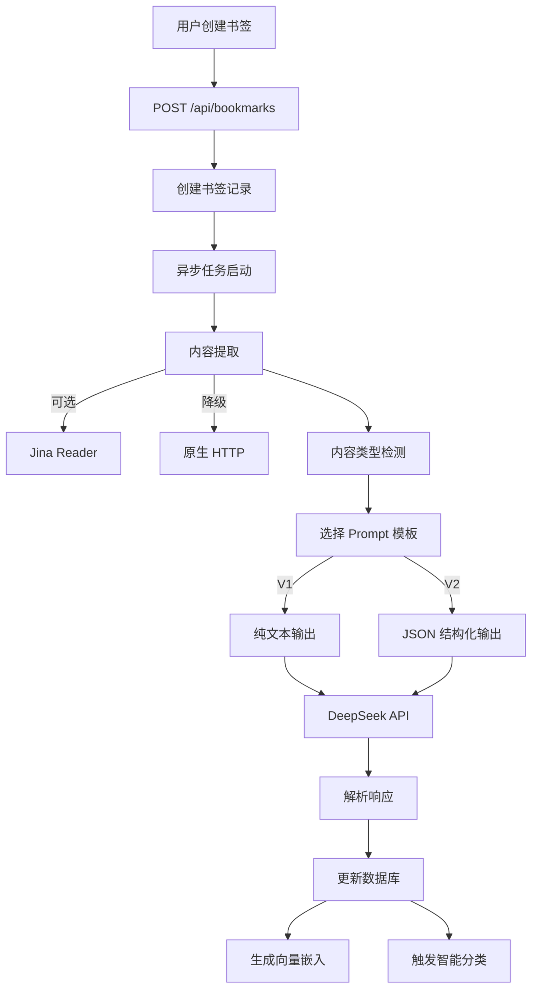

# AI 摘要功能设计与版本评估报告

**评估日期**：2025-12-08
**评估范围**：AnyKeep 项目 AI 摘要功能完整架构

---

## 一、功能架构概览

### 1.1 核心组件

| 组件               | 文件路径                                               | 职责                                        |
| :----------------- | :----------------------------------------------------- | :------------------------------------------ |
| **AI 生成器**      | `src/lib/utils/ai-generator.ts`                        | 调用 DeepSeek API，生成摘要和标签           |
| **内容类型检测**   | `src/lib/classification/content-type-detector.ts`      | 识别内容类型（Article/Tutorial/Video/Tool） |
| **Prompt 模板 V1** | `src/lib/classification/prompts/summary-prompts.ts`    | 纯文本输出格式的 Prompt                     |
| **Prompt 模板 V2** | `src/lib/classification/prompts/summary-prompts-v2.ts` | JSON 结构化输出的 Prompt                    |
| **配置中心**       | `src/lib/classification/config/ai-summary-config.ts`   | 特性开关、环境变量管理                      |
| **类型定义**       | `src/lib/classification/types/ai-summary.ts`           | 结构化摘要类型、解析工具                    |
| **前端渲染**       | `src/components/bookmark/summary-renderer.tsx`         | 支持新旧格式的摘要展示                      |

### 1.2 数据流

---

## 二、版本演进历史

### V1.0（初始版本）

- **特性**：基础摘要生成，固定 Prompt
- **输出格式**：纯文本摘要 + 标签数组
- **局限性**：
  - 内容截断仅 2000 字符
  - Token 限制 500
  - 无内容类型区分

### V2.0（内容类型自适应）

- **特性**：
  - ✅ 内容类型检测（Article/Tutorial/Video/Tool）
  - ✅ 类型专用 Prompt 模板
  - ✅ 类型专用 API 参数（temperature、max_tokens）
  - ✅ 内容截断提升至 5000 字符
  - ✅ 动态摘要长度（根据内容长度调整）
- **输出格式**：仍为纯文本，但结构更清晰（主旨 + 编号要点）

### V2.1（JSON 结构化输出）

- **特性**：
  - ✅ 支持 JSON 结构化输出（`tldr`, `key_points`, `keywords`, `sentiment`, `reading_time`, `action_items`）
  - ✅ 完整的回滚机制（环境变量 `AI_SUMMARY_JSON_OUTPUT`）
  - ✅ 前端自动检测并渲染新旧格式
  - ✅ JSON 解析容错（HTML 实体解码、括号平衡修复）
- **状态**：**默认关闭**（`useJsonOutput: false`），处于测试阶段

### V2.2（内容提取增强 - 规划中）

- **特性**：
  - 🔄 Jina Reader 集成（智能内容清洗）
  - 🔄 模型路由（长文本自动切换模型）
- **状态**：配置已预留，但功能未完全实现

---

## 三、当前版本评估

### 3.1 版本号判定

**当前版本：V2.1（测试阶段）**

**判定依据**：

1. ✅ 代码注释明确标注 `V2.1 优化`
2. ✅ JSON 结构化输出已实现，但默认关闭
3. ✅ 配置系统完善，支持环境变量回滚
4. ✅ 前端渲染组件已支持新旧格式兼容

### 3.2 功能成熟度评估

| 功能模块            |   成熟度   | 说明                             |
| :------------------ | :--------: | :------------------------------- |
| **内容类型检测**    | ⭐⭐⭐⭐⭐ | 稳定，支持 4 种类型              |
| **Prompt 工程**     | ⭐⭐⭐⭐⭐ | V1/V2 两套模板，结构清晰         |
| **JSON 结构化输出** |  ⭐⭐⭐⭐  | 已实现，但默认关闭（需灰度测试） |
| **异步处理**        | ⭐⭐⭐⭐⭐ | 完全不阻塞主流程                 |
| **错误处理**        |  ⭐⭐⭐⭐  | 有回退方案，但缺少重试机制       |
| **前端渲染**        | ⭐⭐⭐⭐⭐ | 支持新旧格式自动识别             |
| **Jina Reader**     |    ⭐⭐    | 配置已预留，但未完全集成         |
| **模型路由**        |     ⭐     | 仅配置预留，未实现               |

### 3.3 技术亮点

1. **双版本 Prompt 系统**：
   - V1（纯文本）：向后兼容，稳定可靠
   - V2（JSON）：结构化数据，便于前端渲染和后续分析

2. **完善的配置系统**：
   - 环境变量优先级 > 默认配置
   - 支持秒级回滚（无需发版）
   - 特性开关清晰（`useJsonOutput`, `useJinaReader`, `useModelRouting`）

3. **智能内容提取**：
   - Jina Reader 作为首选（智能清洗）
   - 原生 HTTP 作为降级方案
   - 超时控制（10 秒）

4. **前端兼容性**：
   - `getDisplaySummary()` 自动识别新旧格式
   - `SummaryRenderer` 支持结构化渲染
   - 卡片翻转交互（桌面 hover、移动点击）

---

## 四、待优化方向

### 4.1 短期（1-2 周）

1. **JSON 输出灰度测试**：
   - 对 10% 用户开启 `AI_SUMMARY_JSON_OUTPUT=true`
   - 监控解析成功率、用户反馈
   - 逐步扩量至 100%

2. **摘要质量验证**：
   - 检测 TL;DR 长度异常（< 20 字或 > 100 字）
   - 检测关键点数量异常（< 2 个或 > 6 个）
   - 自动标记低质量摘要

3. **错误重试机制**：
   - API 调用失败时自动重试（最多 2 次）
   - 记录失败原因，便于排查

### 4.2 中期（1 个月）

1. **Jina Reader 完全集成**：
   - 完成 Jina Reader API 调用逻辑
   - 处理提取失败的回退流程
   - 性能监控（提取耗时、成功率）

2. **个性化摘要**：
   - 基于用户历史收藏调整 Prompt
   - 学习用户偏好（技术细节 vs 核心观点）

3. **摘要质量评估**：
   - 基于用户行为（点击率、停留时间）评估质量
   - 低质量摘要自动重生成

### 4.3 长期（3 个月+）

1. **模型路由**：
   - 长文本（> 30k tokens）自动切换到长文本模型
   - 成本优化（短文本用轻量模型）

2. **多模态摘要**：
   - 支持图片内容提取（OCR + 视觉理解）
   - 视频封面分析

3. **摘要缓存**：
   - 相同 URL 的摘要缓存（避免重复生成）
   - 缓存失效策略（内容更新检测）

---

## 五、版本建议

### 建议版本号：**V2.1-Beta**

**理由**：

1. ✅ JSON 结构化输出已实现，但默认关闭
2. ✅ 需要灰度测试验证稳定性
3. ✅ 配置系统完善，支持快速回滚

### 发布计划

**Phase 1: 内部测试（当前）**

- JSON 输出默认关闭
- 内部员工手动开启测试

**Phase 2: 灰度发布（1 周后）**

- 对 10% 用户开启 JSON 输出
- 监控解析成功率、用户反馈
- 修复发现的问题

**Phase 3: 全量发布（2-3 周后）**

- 逐步扩量至 100%
- 将 `useJsonOutput` 默认值改为 `true`
- 标记为 **V2.1-Stable**

---

## 六、与智能分类 V4.0 的集成建议

AI 摘要功能是智能分类 V4.0 的重要输入源：

1. **摘要作为分类依据**：
   - V4.0 的 `Tier 2`（AI 确认层）可以使用摘要内容进行更精准的分类
   - 摘要中的 `keywords` 可直接用于标签匹配

2. **内容类型联动**：
   - AI 摘要检测的内容类型（Article/Tutorial/Video/Tool）可以作为分类的上下文
   - 不同类型的内容可能需要不同的分类策略

3. **质量反馈闭环**：
   - 如果智能分类准确率高，说明摘要质量好
   - 如果分类错误，可以反推摘要是否需要优化

---

## 七、总结

**当前状态**：AI 摘要功能处于 **V2.1-Beta** 阶段，核心功能已实现，但 JSON 结构化输出仍在测试中。

**优势**：

- ✅ 架构清晰，模块化设计
- ✅ 完善的配置系统和回滚机制
- ✅ 前端兼容性好，支持新旧格式

**待完善**：

- 🔄 JSON 输出需要灰度测试
- 🔄 Jina Reader 需要完全集成
- 🔄 缺少质量评估和自动优化机制

**建议**：优先完成 JSON 输出的灰度测试，验证稳定性后全量发布，再推进 Jina Reader 和模型路由功能。
