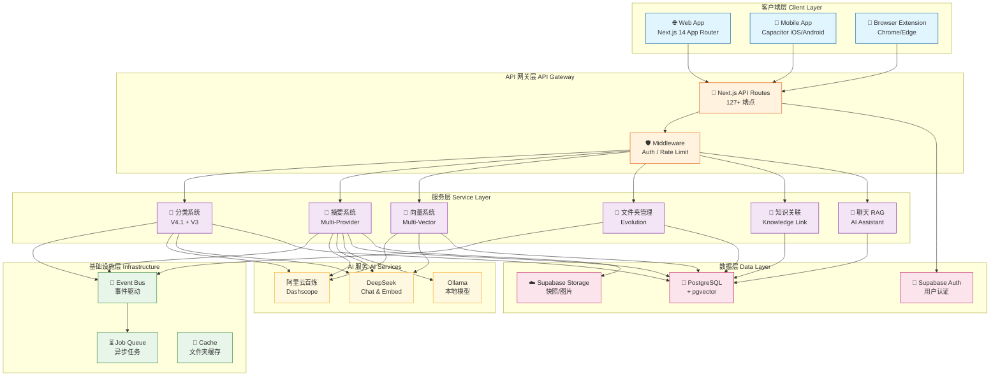
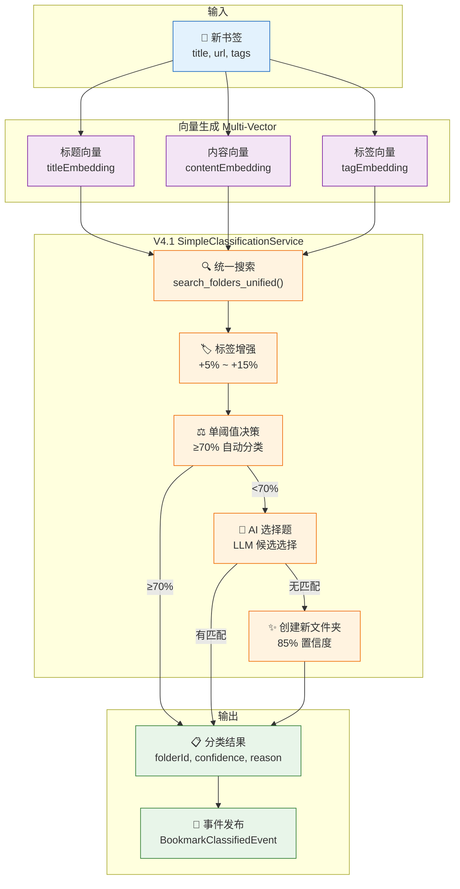
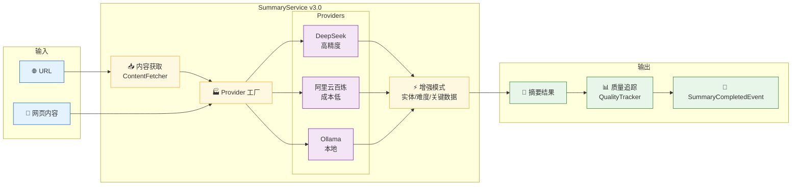
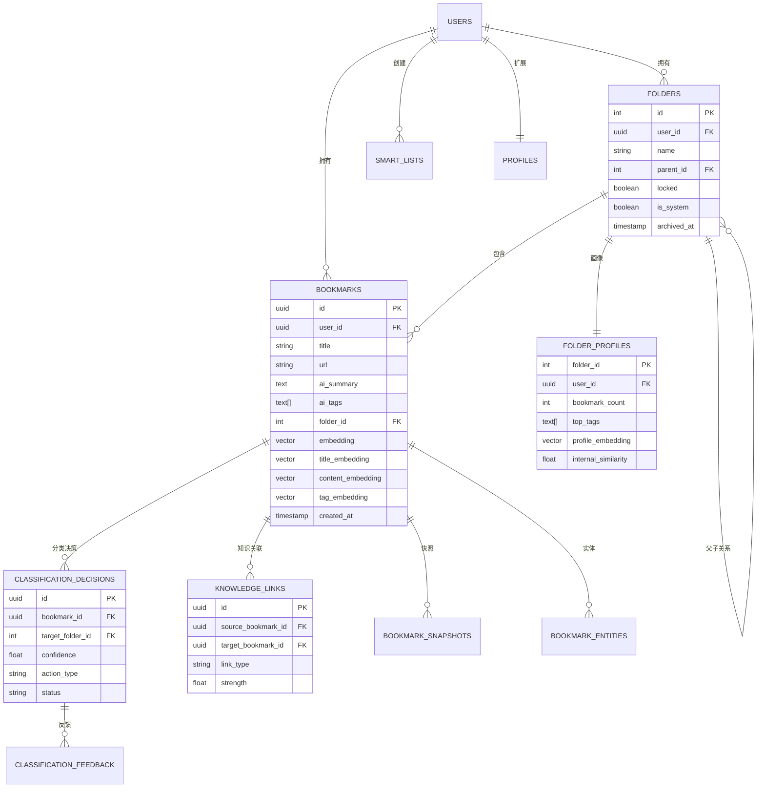
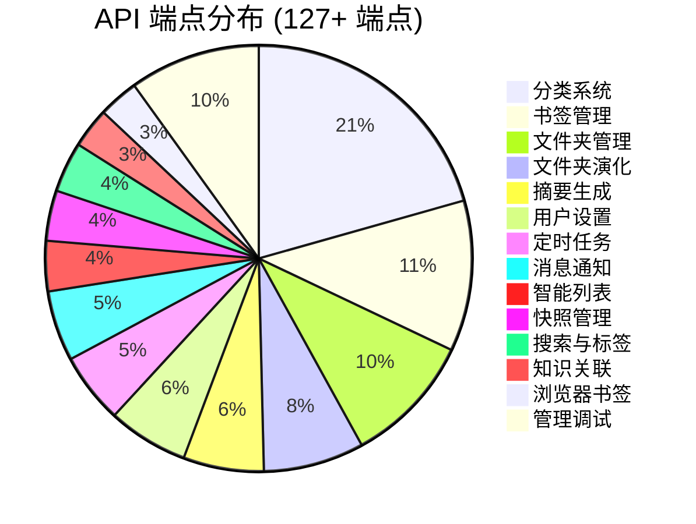
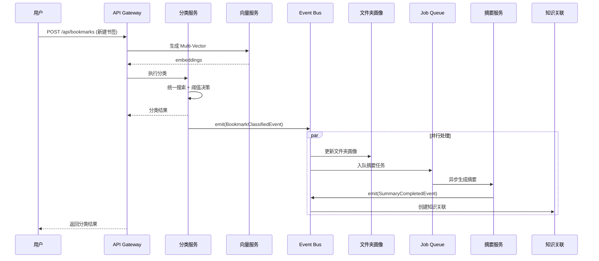
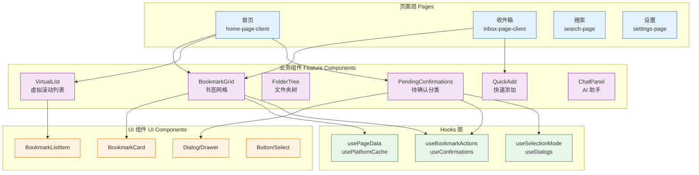
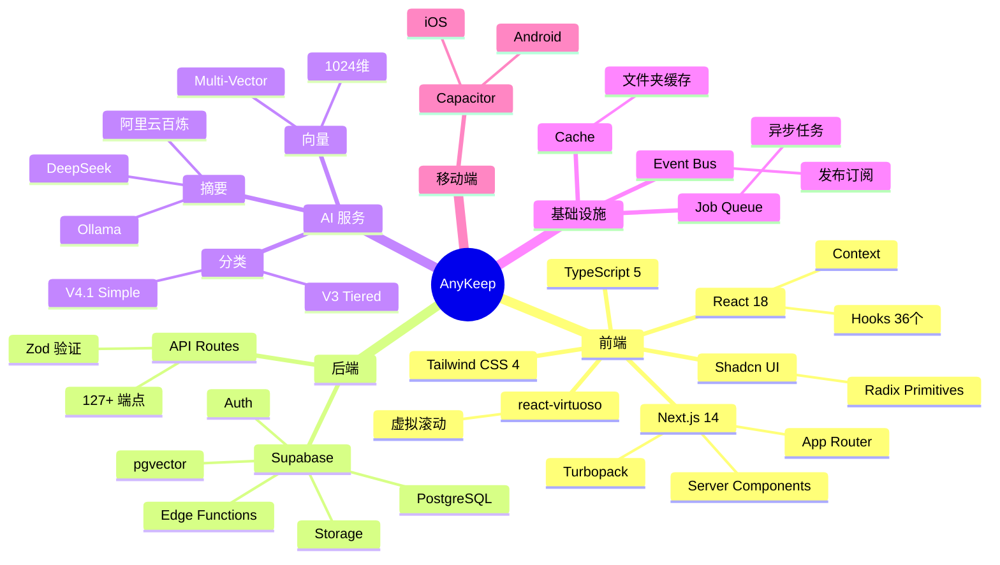

# AnyKeep 架构全景图

> 生成日期: 2025-12-15
> 版本: V4.2
> 分支: feature/classification-v4.2

---

## 一、整体系统架构

---

## 二、分类系统架构 (核心系统)

---

## 三、摘要系统架构

---

## 四、数据模型关系图

---

## 五、API 端点分布图

---

## 六、事件驱动数据流

---

## 七、组件层次结构

---

## 八、技术栈全景

---

## 九、核心统计数据

### 代码规模

| 指标             | 数值                       |
| ---------------- | -------------------------- |
| **总文件数**     | 798 个 TypeScript/TSX 文件 |
| **lib 目录文件** | 315 个服务和工具文件       |
| **组件数量**     | 196 个 React 组件          |
| **API 路由**     | 127+ 个 API 端点           |
| **数据库迁移**   | 93 个迁移文件              |
| **自定义 Hooks** | 36 个                      |

### 核心数据表统计

| 类别           | 表数量  | 主要表                                                              |
| -------------- | ------- | ------------------------------------------------------------------- |
| **用户与授权** | 3       | profiles, platform_authorizations, ab_test_assignments              |
| **书签与内容** | 3       | bookmarks, bookmark_snapshots, bookmark_entities                    |
| **文件夹管理** | 3       | folders, folder_profiles, folder_exclusions                         |
| **分类系统**   | 8       | classification_decisions, feedback, outcomes, metrics, configs...   |
| **AI 相关**    | 4       | ai_summary_data, ai_folder_settings, llm_usage_log, vision_analysis |
| **知识关联**   | 1       | knowledge_links                                                     |
| **标签系统**   | 2       | tag_relationships, hot_tags                                         |
| **其他**       | 6       | smart_lists, messages, import_history, job_queue...                 |
| **总计**       | **53+** | -                                                                   |

### 关键性能指标

| 优化点                | 优化前          | 优化后         | 提升  |
| --------------------- | --------------- | -------------- | ----- |
| **虚拟滚动** (1000条) | 全部渲染 ~150MB | 仅可见区 ~60MB | 60% ↓ |
| **滚动帧率**          | 30-40fps        | 55-60fps       | 50% ↑ |
| **支持书签量**        | 500条流畅       | 10,000+ 流畅   | 20x   |
| **向量索引**          | 线性扫描        | HNSW (m=16)    | 10x+  |
| **分类延迟** (V4.1)   | -               | ~200ms 平均    | -     |

---

## 十、API 端点完整列表

### 1. 书签管理 (`/api/bookmarks`)

| 端点                            | 方法           | 功能说明          |
| ------------------------------- | -------------- | ----------------- |
| `/api/bookmarks`                | GET/POST       | 列表查询/新建收藏 |
| `/api/bookmarks/[id]`           | GET/PUT/DELETE | 单个书签操作      |
| `/api/bookmarks/batch-import`   | POST           | 批量导入书签      |
| `/api/bookmarks/batch-delete`   | POST           | 批量删除          |
| `/api/bookmarks/batch-move`     | POST           | 批量移动到文件夹  |
| `/api/bookmarks/batch-restore`  | POST           | 批量恢复          |
| `/api/bookmarks/batch-status`   | GET            | 批量查询状态      |
| `/api/bookmarks/embeddings`     | POST           | 生成嵌入向量      |
| `/api/bookmarks/generate-tags`  | POST           | AI 生成标签       |
| `/api/bookmarks/metadata`       | POST           | 获取 URL 元数据   |
| `/api/bookmarks/suggestions`    | POST           | 获取分类建议      |
| `/api/bookmarks/validate`       | POST           | 验证书签有效性    |
| `/api/bookmarks/[id]/related`   | GET            | 获取相关书签      |
| `/api/bookmarks/[id]/restore`   | POST           | 恢复单个书签      |
| `/api/bookmarks/[id]/permanent` | DELETE         | 永久删除          |

### 2. 分类系统 (`/api/classification`)

**核心分类 (27 个端点)**

| 端点                                      | 功能                 |
| ----------------------------------------- | -------------------- |
| `/api/classification/classify`            | V4.1 主分类引擎      |
| `/api/classification/classify-quick`      | 快速分类（名称匹配） |
| `/api/classification/classify-deep`       | 深度分类（向量搜索） |
| `/api/classification/[bookmarkId]/reason` | 获取分类原因         |
| `/api/classification/feedback`            | 分类反馈学习         |
| `/api/classification/confirmations`       | 获取待确认分类       |
| `/api/classification/confirmations/[id]`  | 确认/修正单个        |
| `/api/classification/confirmations/batch` | 批量确认             |
| `/api/classification/history`             | 分类历史查询         |
| `/api/classification/trace`               | 分类过程追踪         |
| `/api/classification/debug`               | 调试分类逻辑         |

**文件夹画像与配置 (10 个端点)**

| 端点                                           | 功能             |
| ---------------------------------------------- | ---------------- |
| `/api/classification/folders/profiles`         | 文件夹画像列表   |
| `/api/classification/folders/profiles/[id]`    | 单个画像详情     |
| `/api/classification/folders/profiles/summary` | 画像统计汇总     |
| `/api/classification/folder-health`            | 文件夹健康度评估 |
| `/api/classification/folder-health/summary`    | 整体健康度       |
| `/api/classification/interest-profile`         | 用户兴趣画像     |
| `/api/classification/interest-profile/analyze` | 深度分析兴趣     |
| `/api/classification/interests`                | 用户兴趣列表     |
| `/api/classification/interests/custom`         | 自定义兴趣       |

### 3. 摘要生成 (`/api/summary`)

| 端点                           | 方法 | 功能                 |
| ------------------------------ | ---- | -------------------- |
| `/api/summary/generate`        | POST | 生成摘要             |
| `/api/summary/batch`           | POST | 批量生成摘要         |
| `/api/summary/[bookmarkId]`    | GET  | 获取摘要             |
| `/api/summary/regenerate`      | POST | 重新生成摘要         |
| `/api/summary/feedback`        | POST | 摘要反馈             |
| `/api/summary/health`          | GET  | 摘要系统健康检查     |
| `/api/summary/stats`           | GET  | 摘要统计信息         |
| `/api/summary/stats/providers` | GET  | 各 Provider 使用统计 |

### 4. 文件夹管理 (`/api/folders`)

| 端点                             | 功能               |
| -------------------------------- | ------------------ |
| `/api/folders`                   | 列表查询/创建      |
| `/api/folders/[id]`              | 获取/更新/删除     |
| `/api/folders/[id]/bookmarks`    | 文件夹内书签       |
| `/api/folders/[id]/archive`      | 存档/取消存档      |
| `/api/folders/[id]/lock`         | 锁定/解锁          |
| `/api/folders/[id]/merge`        | 合并到另一个文件夹 |
| `/api/folders/[id]/move-group`   | 移动文件夹组       |
| `/api/folders/batch-create`      | 批量创建           |
| `/api/folders/batch-lock-status` | 批量查询锁定状态   |
| `/api/folders/reorder`           | 重新排序           |
| `/api/folders/suggestions`       | 文件夹优化建议     |
| `/api/folders/connections`       | 文件夹关联         |
| `/api/folders/inbox`             | 待整理文件夹操作   |

### 5. 文件夹演化 (`/api/folder-evolution`)

| 端点                                      | 功能       |
| ----------------------------------------- | ---------- |
| `/api/folder-evolution/merge-suggestions` | 合并建议   |
| `/api/folder-evolution/split-suggestions` | 拆分建议   |
| `/api/folder-evolution/rename`            | 重命名操作 |
| `/api/folder-evolution/confirm-merge`     | 确认合并   |
| `/api/folder-evolution/confirm-split`     | 确认拆分   |
| `/api/folder-evolution/undo/[id]`         | 撤销操作   |
| `/api/folder-evolution/history`           | 演化历史   |
| `/api/folder-evolution/snapshot/[id]`     | 快照详情   |
| `/api/folder-evolution/reports`           | 演化报告   |

### 6. 其他 API

| 类别           | 端点数 | 主要端点                                                          |
| -------------- | ------ | ----------------------------------------------------------------- |
| **知识关联**   | 4      | `/api/knowledge-link/related/[id]`, `/api/knowledge-link/graph`   |
| **聊天 RAG**   | 2      | `/api/chat`                                                       |
| **智能列表**   | 5      | `/api/smart-lists`, `/api/smart-lists/preview`                    |
| **快照管理**   | 5      | `/api/snapshots`, `/api/snapshots/[id]/content`                   |
| **消息通知**   | 7      | `/api/messages`, `/api/confirmations`                             |
| **搜索标签**   | 5      | `/api/search`, `/api/tags/graph`                                  |
| **浏览器书签** | 4      | `/api/browser-bookmark/export`, `/api/browser-bookmark/history`   |
| **定时任务**   | 7      | `/api/cron/process-job-queue`, `/api/cron/update-folder-profiles` |
| **用户设置**   | 8      | `/api/user/settings`, `/api/user/trust-mode`                      |
| **管理调试**   | 13     | `/api/admin/*`, `/api/dev/*`, `/api/metrics`                      |

---

## 十一、核心服务层文件位置

| 功能       | 文件位置                                                           |
| ---------- | ------------------------------------------------------------------ |
| 分类主入口 | `src/app/api/classification/classify/route.ts`                     |
| 分类引擎   | `src/lib/classification/services/simple-classification.service.ts` |
| 摘要生成   | `src/lib/summary/services/summary.service.ts`                      |
| 嵌入向量   | `src/lib/embedding/multi-vector-embedding.service.ts`              |
| 文件夹操作 | `src/lib/folder-operations/folder-executor.service.ts`             |
| RAG 检索   | `src/lib/chat/rag-retrieval.service.ts`                            |
| 知识关联   | `src/lib/knowledge-link/services/link.service.ts`                  |
| 事件总线   | `src/lib/shared/event-bus/`                                        |
| 数据库类型 | `src/types/supabase.ts`                                            |

---

## 十二、总结

AnyKeep 是一个**复杂度很高的 AI 驱动内容管理系统**，包含：

- **127+ 个 API 端点** - 覆盖完整业务流程
- **315+ 个核心服务** - 模块化服务层架构
- **53+ 个数据库表** - 完整的数据模型
- **196 个 React 组件** - 丰富的 UI 层
- **多个 AI 引擎** - 分类、摘要、嵌入等
- **事件驱动架构** - 解耦的通信机制
- **性能优化** - 虚拟滚动、向量索引、缓存系统

**核心系统**：

1. **分类系统** - V4.1 SimpleClassificationService 是主引擎（比 V3 精简且高效）
2. **摘要系统** - 支持多个 Provider 和增强模式
3. **向量系统** - Multi-Vector 架构（标题、内容、标签三维向量）
4. **文件夹管理** - 原子操作、画像追踪、演化建议
5. **知识图谱** - 关联书签、语义连接、主题聚类

**技术亮点**：

- 使用 pgvector + HNSW 的高效向量检索
- Event Bus 解耦各模块
- JobQueue 异步处理长任务
- RLS 策略保障数据隐私
- A/B 测试框架用于模型优化
