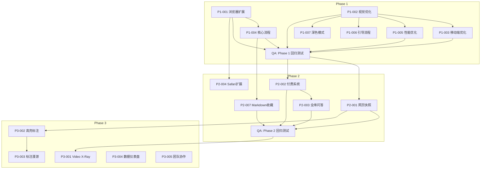

# AnyKeep 2025 开发任务清单

> **版本**: v2.0 (待审核)
> **制定日期**: 2025-12-15
> **更新日期**: 2025-12-15
> **规划周期**: 2025.01 - 2025.12
> **总工时估算**: ~45 周 (单人全职)

---

## 目录

1. [规划概述](#一规划概述)
2. [全局质量保障体系](#二全局质量保障体系)
3. [Phase 1: 首发版 (P0)](#三phase-1-首发版-p0)
4. [Phase 2: 增长版 (P1)](#四phase-2-增长版-p1)
5. [Phase 3: 成熟版 (P2)](#五phase-3-成熟版-p2)
6. [深化优化任务](#六深化优化任务)
7. [里程碑与验收标准](#七里程碑与验收标准)
8. [风险管理](#八风险管理)
9. [资源与成本估算](#九资源与成本估算)

---

## 一、规划概述

### 1.1 规划原则

```
┌─────────────────────────────────────────────────────────────┐
│                    开发规划核心原则                           │
├─────────────────────────────────────────────────────────────┤
│                                                              │
│  1️⃣ 最小可行产品优先 (MVP First)                             │
│     → 聚焦核心体验，快速上架验证                              │
│                                                              │
│  2️⃣ 增量交付 (Incremental Delivery)                         │
│     → 每周可见进展，避免大爆炸式发布                          │
│                                                              │
│  3️⃣ 全局稳定性优先 (Stability First)                        │
│     → 每个模块变更必须评估系统级影响                          │
│     → 完成一个模块前确保不引入新问题                          │
│                                                              │
│  4️⃣ 技术债务可控 (Managed Tech Debt)                        │
│     → 快速交付与代码质量的平衡                               │
│     → 每个阶段末进行技术债务清理                             │
│                                                              │
│  5️⃣ 回归测试保护 (Regression Protection)                    │
│     → 核心流程必须有自动化测试覆盖                           │
│     → 发布前执行完整回归测试                                 │
│                                                              │
└─────────────────────────────────────────────────────────────┘
```

### 1.2 时间线总览

```
2025.01          2025.03          2025.06          2025.12
   │                │                │                │
   ▼                ▼                ▼                ▼
┌──────────────┐ ┌──────────────┐ ┌─────────────────────────────┐
│   Phase 1    │ │   Phase 2    │ │         Phase 3             │
│   首发版     │ │   增长版     │ │         成熟版               │
│              │ │              │ │                             │
│ App Store    │ │ 付费系统     │ │ Video X-Ray / 高亮标注       │
│ 上架         │ │ 网页快照     │ │ 团队协作 / API 开放          │
└──────────────┘ └──────────────┘ └─────────────────────────────┘
     12周              12周                    24周
```

### 1.3 任务编号规则

| 前缀   | 含义           | 示例    |
| ------ | -------------- | ------- |
| `P1-`  | Phase 1 首发版 | P1-001  |
| `P2-`  | Phase 2 增长版 | P2-001  |
| `P3-`  | Phase 3 成熟版 | P3-001  |
| `OPT-` | 深化优化任务   | OPT-001 |
| `QA-`  | 质量保障任务   | QA-001  |

---

## 二、全局质量保障体系

### 2.1 系统影响分析框架

每个任务开发前必须完成以下分析：

```
┌─────────────────────────────────────────────────────────────┐
│                 系统影响分析检查清单                          │
├─────────────────────────────────────────────────────────────┤
│                                                              │
│  📊 数据层影响                                               │
│  ├── 是否修改数据库 Schema？                                 │
│  ├── 是否影响现有数据？需要迁移脚本吗？                       │
│  ├── 是否影响 RLS 策略？                                    │
│  └── 是否影响向量索引？                                      │
│                                                              │
│  🔌 API 层影响                                               │
│  ├── 是否修改现有 API 签名？                                │
│  ├── 是否需要版本控制？                                      │
│  ├── 是否影响 API 响应时间？                                │
│  └── 是否需要新增 API 端点？                                 │
│                                                              │
│  🎨 UI 层影响                                                │
│  ├── 是否影响现有组件？                                      │
│  ├── 是否需要更新共享组件库？                                │
│  ├── 是否影响响应式布局？                                    │
│  └── 是否影响无障碍访问？                                    │
│                                                              │
│  ⚡ 性能影响                                                 │
│  ├── 是否增加首屏加载时间？                                  │
│  ├── 是否增加内存占用？                                      │
│  ├── 是否增加 API 调用次数？                                │
│  └── 是否影响虚拟滚动性能？                                  │
│                                                              │
│  🔗 依赖影响                                                 │
│  ├── 是否依赖其他模块？                                      │
│  ├── 是否被其他模块依赖？                                    │
│  ├── 是否引入新的第三方依赖？                                │
│  └── 依赖版本是否兼容？                                      │
│                                                              │
└─────────────────────────────────────────────────────────────┘
```

### 2.2 核心模块依赖矩阵

```
┌────────────────────────────────────────────────────────────────────────────┐
│                          核心模块依赖关系                                    │
├────────────────────────────────────────────────────────────────────────────┤
│                                                                             │
│  模块                    被依赖于                      影响范围              │
│  ─────────────────────────────────────────────────────────────────────────  │
│  认证系统 (Auth)         所有模块                      🔴 极高              │
│  书签数据模型            首页/搜索/分类/摘要/RAG       🔴 极高              │
│  文件夹数据模型          首页/分类/导航                🟠 高                │
│  分类系统 (V4.1)         收藏流程/首页展示             🟠 高                │
│  摘要系统                书签详情/搜索/RAG             🟡 中                │
│  向量系统                搜索/分类/RAG                 🟠 高                │
│  UI 组件库               所有前端页面                  🟠 高                │
│  事件总线                分类→画像→摘要                🟡 中                │
│                                                                             │
│  影响范围说明:                                                              │
│  🔴 极高 = 修改后需要全面回归测试                                           │
│  🟠 高   = 修改后需要相关模块回归测试                                        │
│  🟡 中   = 修改后需要单元测试 + 集成测试                                     │
│                                                                             │
└────────────────────────────────────────────────────────────────────────────┘
```

### 2.3 质量门禁 (Quality Gates)

#### 每个任务完成前的检查

| 检查项        | 说明                        | 必须/建议 |
| ------------- | --------------------------- | --------- |
| **代码编译**  | `npm run build` 无错误      | 必须      |
| **类型检查**  | `npm run type-check` 无错误 | 必须      |
| **Lint 检查** | `npm run lint` 无警告       | 必须      |
| **单元测试**  | 新功能有对应测试            | 必须      |
| **集成测试**  | 涉及多模块交互的功能        | 建议      |
| **影响分析**  | 完成系统影响分析检查清单    | 必须      |
| **回归测试**  | 核心流程手动验证            | 必须      |

#### 每个阶段完成前的检查

| 检查项           | 说明                   |
| ---------------- | ---------------------- |
| **全量回归测试** | 所有核心流程验证       |
| **性能基准测试** | 首屏 < 2s, FID < 100ms |
| **技术债务清理** | 处理本阶段积累的 TODO  |
| **文档更新**     | API 文档、README 更新  |
| **版本发布检查** | CHANGELOG、版本号更新  |

### 2.4 回归测试清单

#### 核心流程回归测试 (每次发布前必测)

```
┌─────────────────────────────────────────────────────────────┐
│                 核心流程回归测试清单                          │
├─────────────────────────────────────────────────────────────┤
│                                                              │
│  🔐 认证流程                                                 │
│  ├── [ ] 注册新用户                                          │
│  ├── [ ] 登录/登出                                           │
│  ├── [ ] 会话保持                                            │
│  └── [ ] 跨设备同步状态                                      │
│                                                              │
│  📥 收藏流程                                                 │
│  ├── [ ] Web 端手动添加书签                                  │
│  ├── [ ] 浏览器扩展收藏                                      │
│  ├── [ ] 移动端系统分享收藏                                  │
│  ├── [ ] 元数据自动提取                                      │
│  └── [ ] 重复 URL 检测                                       │
│                                                              │
│  🤖 AI 处理流程                                              │
│  ├── [ ] AI 摘要生成                                         │
│  ├── [ ] AI 标签生成                                         │
│  ├── [ ] 智能分类执行                                        │
│  ├── [ ] 分类置信度显示                                      │
│  └── [ ] 分类确认/修正                                       │
│                                                              │
│  🏠 首页展示                                                 │
│  ├── [ ] 书签列表加载                                        │
│  ├── [ ] 虚拟滚动正常 (1000+ 条)                            │
│  ├── [ ] 平台筛选                                            │
│  ├── [ ] 文件夹筛选                                          │
│  └── [ ] 视图切换 (卡片/列表)                                │
│                                                              │
│  🔍 搜索功能                                                 │
│  ├── [ ] 关键词搜索                                          │
│  ├── [ ] 语义搜索                                            │
│  ├── [ ] 搜索结果排序                                        │
│  └── [ ] 高级筛选                                            │
│                                                              │
│  📁 文件夹管理                                               │
│  ├── [ ] 创建文件夹                                          │
│  ├── [ ] 移动书签到文件夹                                    │
│  ├── [ ] 文件夹重命名                                        │
│  └── [ ] 删除文件夹                                          │
│                                                              │
└─────────────────────────────────────────────────────────────┘
```

### 2.5 模块变更影响速查表

| 变更类型                | 影响范围         | 必须测试        |
| ----------------------- | ---------------- | --------------- |
| 修改 `bookmarks` 表结构 | 全局             | 全量回归        |
| 修改 `folders` 表结构   | 首页/分类        | 首页+分类回归   |
| 修改分类算法            | 收藏流程         | AI 处理流程回归 |
| 修改 API 响应格式       | 对应前端页面     | 对应页面回归    |
| 修改 UI 组件库          | 使用该组件的页面 | 视觉回归        |
| 修改认证逻辑            | 全局             | 全量回归        |
| 添加新依赖              | 打包体积/兼容性  | 构建+性能测试   |

---

## 三、Phase 1: 首发版 (P0)

### 3.1 阶段目标

| 指标         | 目标值     | 说明                        |
| ------------ | ---------- | --------------------------- |
| **上架时间** | 2025.03.31 | iOS App Store + Google Play |
| **扩展上架** | 2025.02.28 | Chrome Web Store            |
| **注册用户** | 1,000+     | 首月目标                    |
| **次日留存** | > 40%      | 核心体验验证                |

### 3.2 任务清单

---

#### P1-001: Chrome/Edge 浏览器扩展开发

**优先级**: 🔴 P0 - 首发版必需
**工时估算**: 10 天
**前置依赖**: 无

##### 任务描述

开发支持 Chrome 和 Edge 的浏览器扩展，实现一键收藏当前网页到 AnyKeep。

##### 系统影响分析

```
┌─────────────────────────────────────────────────────────────┐
│                 P1-001 系统影响分析                          │
├─────────────────────────────────────────────────────────────┤
│                                                              │
│  📊 数据层: 无影响                                           │
│     → 使用现有 bookmarks API，不修改数据模型                 │
│                                                              │
│  🔌 API 层: 低影响                                           │
│     → 复用 POST /api/bookmarks 端点                         │
│     → 复用 POST /api/bookmarks/metadata 端点                │
│     → 可能需要 CORS 配置调整                                │
│                                                              │
│  🎨 UI 层: 独立模块                                          │
│     → 扩展 UI 独立开发，不影响主应用                         │
│     → 需要复用部分组件样式                                   │
│                                                              │
│  ⚡ 性能: 无影响                                             │
│     → 扩展独立运行，不影响主应用性能                         │
│                                                              │
│  🔗 依赖影响:                                                │
│     → 新增扩展项目，需要配置 monorepo                       │
│     → 需要共享认证逻辑                                       │
│                                                              │
│  ⚠️ 潜在风险:                                                │
│     → 认证 Token 在扩展中的安全存储                         │
│     → 扩展与主应用的登录状态同步                            │
│                                                              │
└─────────────────────────────────────────────────────────────┘
```

##### 子任务分解

| 子任务ID  | 任务内容                    | 工时 | 状态 |
| --------- | --------------------------- | ---- | ---- |
| P1-001-1  | Manifest V3 项目搭建        | 0.5d | ⬜   |
| P1-001-2  | Popup UI 设计与实现         | 2d   | ⬜   |
| P1-001-3  | Content Script 页面信息提取 | 1.5d | ⬜   |
| P1-001-4  | Background Service Worker   | 1d   | ⬜   |
| P1-001-5  | Supabase Auth 集成          | 1d   | ⬜   |
| P1-001-6  | API 通信层封装              | 1d   | ⬜   |
| P1-001-7  | 离线队列与重试机制          | 1d   | ⬜   |
| P1-001-8  | **集成测试: 与主应用交互**  | 0.5d | ⬜   |
| P1-001-9  | Chrome Web Store 上架准备   | 0.5d | ⬜   |
| P1-001-10 | Edge Add-ons 适配           | 0.5d | ⬜   |

##### 集成测试要点

- [ ] 扩展登录后，主应用自动识别登录状态
- [ ] 扩展收藏后，主应用首页立即显示新书签
- [ ] 扩展离线收藏后，恢复网络自动同步
- [ ] 主应用登出后，扩展自动登出

##### 验收标准

- [ ] 点击扩展图标弹出收藏界面
- [ ] 自动提取当前页面标题、URL、描述、封面图
- [ ] 支持选择目标文件夹
- [ ] 支持添加自定义标签
- [ ] 登录状态与 Web 端同步
- [ ] 离线时收藏可入队，恢复后自动同步
- [ ] Chrome Web Store 审核通过
- [ ] **集成测试全部通过**

##### 回滚策略

如果扩展导致主应用问题：

1. 立即从商店下架扩展
2. 检查 CORS 配置是否影响其他客户端
3. 检查 API 调用是否产生脏数据

---

#### P1-002: 首页视觉体验优化

**优先级**: 🔴 P0 - 首发版必需
**工时估算**: 8 天 (含回归测试)
**前置依赖**: 无

##### 任务描述

重构首页视觉体验，实现瀑布流大卡片布局、平台色标识系统，让用户 3 秒内惊呼"好看"。

##### 系统影响分析

```
┌─────────────────────────────────────────────────────────────┐
│                 P1-002 系统影响分析                          │
├─────────────────────────────────────────────────────────────┤
│                                                              │
│  📊 数据层: 无影响                                           │
│     → 纯 UI 变更，不涉及数据模型                            │
│                                                              │
│  🔌 API 层: 无影响                                           │
│     → 使用现有 API，不修改接口                              │
│                                                              │
│  🎨 UI 层: 🔴 高影响                                         │
│     → 修改 BookmarkCard 组件 (被多处使用)                   │
│     → 修改首页布局组件                                       │
│     → 需要更新共享样式变量                                   │
│     → 影响范围: 首页、搜索结果页、收件箱                     │
│                                                              │
│  ⚡ 性能: 中等影响                                           │
│     → 瀑布流布局计算可能影响渲染性能                        │
│     → 需要确保与虚拟滚动兼容                                │
│     → 图片懒加载策略需要调整                                │
│                                                              │
│  🔗 依赖影响:                                                │
│     → 可能引入 masonry 布局库                               │
│     → 需要评估 bundle 体积影响                              │
│                                                              │
│  ⚠️ 潜在风险:                                                │
│     → 瀑布流与虚拟滚动可能冲突                              │
│     → 深色模式下的色彩适配                                  │
│     → 不同屏幕尺寸的布局适配                                │
│                                                              │
└─────────────────────────────────────────────────────────────┘
```

##### 子任务分解

| 子任务ID  | 任务内容                 | 工时 | 状态 |
| --------- | ------------------------ | ---- | ---- |
| P1-002-1  | 瀑布流布局组件 (Masonry) | 1.5d | ⬜   |
| P1-002-2  | 大卡片组件重构           | 1.5d | ⬜   |
| P1-002-3  | 平台色系统设计与实现     | 1d   | ⬜   |
| P1-002-4  | 封面图智能裁剪与展示     | 1d   | ⬜   |
| P1-002-5  | 骨架屏与加载动画         | 0.5d | ⬜   |
| P1-002-6  | 深色模式适配             | 0.5d | ⬜   |
| P1-002-7  | 响应式布局优化           | 0.5d | ⬜   |
| P1-002-8  | **虚拟滚动兼容性测试**   | 0.5d | ⬜   |
| P1-002-9  | **关联页面回归测试**     | 0.5d | ⬜   |
| P1-002-10 | 视觉测试与微调           | 0.5d | ⬜   |

##### 必须回归测试

- [ ] 首页书签列表正常加载
- [ ] 虚拟滚动 1000+ 条目流畅 (> 55fps)
- [ ] 搜索结果页卡片显示正常
- [ ] 收件箱页卡片显示正常
- [ ] 移动端布局正常
- [ ] 深色模式视觉协调
- [ ] 书签详情弹窗正常打开

##### 验收标准

- [ ] 首页默认展示瀑布流大卡片布局
- [ ] 每个平台有独特的色彩标识
- [ ] 封面图正确裁剪，无拉伸变形
- [ ] 首屏加载 < 2 秒
- [ ] 骨架屏流畅过渡
- [ ] 深色模式视觉协调
- [ ] 移动端、平板端、桌面端均有良好体验
- [ ] **虚拟滚动性能不降级**
- [ ] **所有使用卡片组件的页面正常工作**

##### 回滚策略

如果瀑布流导致性能问题：

1. 保留平台色和封面图优化
2. 回退到原有网格布局
3. 瀑布流作为可选视图模式

---

#### P1-003: 移动端体验优化

**优先级**: 🔴 P0 - 首发版必需
**工时估算**: 8 天 (含系统测试)
**前置依赖**: P1-002 (视觉优化)

##### 系统影响分析

```
┌─────────────────────────────────────────────────────────────┐
│                 P1-003 系统影响分析                          │
├─────────────────────────────────────────────────────────────┤
│                                                              │
│  📊 数据层: 无影响                                           │
│     → 不涉及数据模型变更                                    │
│                                                              │
│  🔌 API 层: 低影响                                           │
│     → 可能需要优化 API 响应以减少数据量                     │
│     → Share Extension 使用现有 API                          │
│                                                              │
│  🎨 UI 层: 中等影响                                          │
│     → 移动端导航可能影响整体布局                            │
│     → 需要确保 P1-002 的视觉优化在移动端正常                │
│                                                              │
│  ⚡ 性能: 中等影响                                           │
│     → Share Extension 需要快速启动                          │
│     → 移动端内存限制需要考虑                                │
│                                                              │
│  🔗 依赖影响:                                                │
│     → 需要原生代码 (Swift/Kotlin)                           │
│     → Capacitor 插件可能需要更新                            │
│                                                              │
│  ⚠️ 潜在风险:                                                │
│     → iOS Share Extension 的内存限制 (120MB)                │
│     → 与主应用的数据传递可能失败                            │
│                                                              │
└─────────────────────────────────────────────────────────────┘
```

##### 子任务分解

| 子任务ID  | 任务内容                       | 工时 | 状态 |
| --------- | ------------------------------ | ---- | ---- |
| P1-003-1  | iOS Share Extension 开发       | 2d   | ⬜   |
| P1-003-2  | Android Intent Filter 配置     | 1d   | ⬜   |
| P1-003-3  | 移动端导航优化                 | 1d   | ⬜   |
| P1-003-4  | 触摸交互优化 (手势)            | 0.5d | ⬜   |
| P1-003-5  | 启动屏与图标配置               | 0.5d | ⬜   |
| P1-003-6  | **端到端收藏流程测试**         | 0.5d | ⬜   |
| P1-003-7  | iOS TestFlight 准备            | 0.5d | ⬜   |
| P1-003-8  | Android 内测准备               | 0.5d | ⬜   |
| P1-003-9  | 应用商店素材准备               | 1d   | ⬜   |
| P1-003-10 | **与 P1-002 视觉的兼容性测试** | 0.5d | ⬜   |

##### 必须回归测试

- [ ] iOS Share Extension 正常收藏
- [ ] Android 分享菜单正常收藏
- [ ] 收藏后主应用首页显示新书签
- [ ] 收藏后 AI 处理正常触发
- [ ] P1-002 的视觉优化在移动端正常
- [ ] 深色模式在移动端正常

##### 验收标准

- [ ] iOS 系统分享菜单显示 AnyKeep
- [ ] Android 系统分享菜单显示 AnyKeep
- [ ] 分享后自动打开收藏确认界面
- [ ] 启动时间 < 3 秒 (冷启动)
- [ ] 手势操作流畅自然
- [ ] 通过 App Store / Google Play 审核
- [ ] **与 P1-002 视觉优化完全兼容**

---

#### P1-004: 核心收藏流程打磨

**优先级**: 🔴 P0 - 首发版必需
**工时估算**: 6 天
**前置依赖**: P1-001 (浏览器扩展)

##### 系统影响分析

```
┌─────────────────────────────────────────────────────────────┐
│                 P1-004 系统影响分析                          │
├─────────────────────────────────────────────────────────────┤
│                                                              │
│  📊 数据层: 低影响                                           │
│     → 可能增加处理状态字段                                  │
│     → 需要迁移脚本                                          │
│                                                              │
│  🔌 API 层: 中等影响                                         │
│     → 新增 SSE 端点用于状态推送                             │
│     → 需要确保不影响现有 API                                │
│                                                              │
│  🎨 UI 层: 中等影响                                          │
│     → 修改收藏确认界面                                       │
│     → 修改待确认分类组件                                     │
│                                                              │
│  ⚡ 性能: 低影响                                             │
│     → SSE 连接可能增加服务器负载                            │
│                                                              │
│  🔗 依赖影响:                                                │
│     → 依赖 P1-001 浏览器扩展                                │
│     → 依赖分类系统 V4.1                                     │
│     → 依赖摘要系统                                          │
│                                                              │
│  ⚠️ 潜在风险:                                                │
│     → SSE 在某些网络环境可能不稳定                          │
│     → 状态同步可能有延迟                                    │
│                                                              │
└─────────────────────────────────────────────────────────────┘
```

##### 子任务分解

| 子任务ID | 任务内容                  | 工时 | 状态 |
| -------- | ------------------------- | ---- | ---- |
| P1-004-1 | 收藏成功动效设计          | 0.5d | ⬜   |
| P1-004-2 | AI 处理状态实时反馈 (SSE) | 1.5d | ⬜   |
| P1-004-3 | 分类置信度可视化          | 1d   | ⬜   |
| P1-004-4 | 快速确认/修正交互         | 1d   | ⬜   |
| P1-004-5 | 错误状态处理与重试        | 0.5d | ⬜   |
| P1-004-6 | **分类系统集成测试**      | 0.5d | ⬜   |
| P1-004-7 | **摘要系统集成测试**      | 0.5d | ⬜   |
| P1-004-8 | 流程埋点与监控            | 0.5d | ⬜   |

##### 必须回归测试

- [ ] 现有收藏功能不受影响
- [ ] AI 摘要生成正常
- [ ] AI 标签生成正常
- [ ] 智能分类正常
- [ ] 分类确认/修正正常工作
- [ ] 浏览器扩展收藏流程正常
- [ ] 移动端收藏流程正常

##### 验收标准

- [ ] 收藏成功有明确视觉反馈
- [ ] AI 处理进度实时可见
- [ ] 分类结果显示置信度百分比
- [ ] 低置信度分类可快速确认/修正
- [ ] 处理失败可一键重试
- [ ] 完整流程 < 30 秒
- [ ] **不影响现有 AI 处理流程**

---

#### P1-005: 性能优化

**优先级**: 🔴 P0 - 首发版必需
**工时估算**: 6 天
**前置依赖**: P1-002 (视觉优化)

##### 系统影响分析

```
┌─────────────────────────────────────────────────────────────┐
│                 P1-005 系统影响分析                          │
├─────────────────────────────────────────────────────────────┤
│                                                              │
│  📊 数据层: 低影响                                           │
│     → 可能增加数据库索引                                    │
│     → 索引变更需要谨慎                                       │
│                                                              │
│  🔌 API 层: 中等影响                                         │
│     → 缓存策略可能影响数据一致性                            │
│     → 需要缓存失效策略                                       │
│                                                              │
│  🎨 UI 层: 中等影响                                          │
│     → 代码分割可能影响路由加载                              │
│     → 懒加载可能导致 UI 闪烁                                │
│                                                              │
│  ⚡ 性能: 🔴 核心目标                                        │
│     → 首屏加载 < 2s                                         │
│     → FID < 100ms                                           │
│     → CLS < 0.1                                             │
│                                                              │
│  🔗 依赖影响:                                                │
│     → 可能移除或替换部分依赖                                │
│     → 需要确保功能不受影响                                   │
│                                                              │
│  ⚠️ 潜在风险:                                                │
│     → 过度优化可能引入 Bug                                  │
│     → 缓存导致的数据不一致                                  │
│                                                              │
└─────────────────────────────────────────────────────────────┘
```

##### 子任务分解

| 子任务ID | 任务内容             | 工时 | 状态 |
| -------- | -------------------- | ---- | ---- |
| P1-005-1 | 首屏关键渲染路径优化 | 1d   | ⬜   |
| P1-005-2 | 代码分割与懒加载     | 1d   | ⬜   |
| P1-005-3 | 图片优化 (WebP/AVIF) | 0.5d | ⬜   |
| P1-005-4 | API 响应缓存策略     | 1d   | ⬜   |
| P1-005-5 | 数据库查询优化       | 0.5d | ⬜   |
| P1-005-6 | Bundle 分析与瘦身    | 0.5d | ⬜   |
| P1-005-7 | **性能基准测试**     | 0.5d | ⬜   |
| P1-005-8 | **全量功能回归测试** | 0.5d | ⬜   |
| P1-005-9 | 性能监控集成         | 0.5d | ⬜   |

##### 必须回归测试

由于性能优化涉及全局，需要**全量回归测试**：

- [ ] 所有核心流程回归测试清单

##### 验收标准

- [ ] LCP (Largest Contentful Paint) < 2s
- [ ] FID (First Input Delay) < 100ms
- [ ] CLS (Cumulative Layout Shift) < 0.1
- [ ] 虚拟滚动 10,000+ 条目流畅
- [ ] Bundle 体积 < 300KB (gzipped)
- [ ] **所有核心功能正常工作**

---

#### P1-006: 新用户引导流程

**优先级**: 🟡 应该完成
**工时估算**: 3 天
**前置依赖**: P1-002, P1-004

##### 系统影响分析

```
低影响任务:
- 纯新增功能，不修改现有逻辑
- 只在新用户首次访问时触发
- 需要持久化引导状态到 profiles 表
```

##### 子任务分解

| 子任务ID | 任务内容               | 工时 | 状态 |
| -------- | ---------------------- | ---- | ---- |
| P1-006-1 | 引导流程设计           | 0.5d | ⬜   |
| P1-006-2 | 欢迎页与价值展示       | 1d   | ⬜   |
| P1-006-3 | 首次收藏引导           | 0.5d | ⬜   |
| P1-006-4 | 功能亮点提示 (Tooltip) | 0.5d | ⬜   |
| P1-006-5 | 引导完成状态追踪       | 0.5d | ⬜   |

##### 验收标准

- [ ] 新用户看到 3 步引导
- [ ] 引导中有清晰的产品价值说明
- [ ] 引导完成后用户完成至少 1 次收藏
- [ ] 可跳过引导
- [ ] **老用户不受影响**

---

#### P1-007: 深色模式完善

**优先级**: 🟡 应该完成
**工时估算**: 2 天
**前置依赖**: P1-002

##### 系统影响分析

```
中等影响任务:
- 修改全局 CSS 变量
- 需要测试所有页面的深色模式效果
- 可能影响第三方组件的显示
```

##### 子任务分解

| 子任务ID | 任务内容              | 工时  | 状态 |
| -------- | --------------------- | ----- | ---- |
| P1-007-1 | 色彩变量系统整理      | 0.5d  | ⬜   |
| P1-007-2 | 组件深色模式适配      | 1d    | ⬜   |
| P1-007-3 | 图片/图标深色模式处理 | 0.25d | ⬜   |
| P1-007-4 | 系统主题跟随          | 0.25d | ⬜   |

##### 必须回归测试

- [ ] 所有页面深色模式视觉检查
- [ ] 主题切换不刷新页面
- [ ] 第三方组件 (如日期选择器) 深色模式正常

---

### 3.3 Phase 1 质量门禁

#### 阶段完成检查清单

- [ ] 所有 P0 任务完成
- [ ] Chrome/Edge 扩展上架商店
- [ ] iOS App 通过 App Store 审核
- [ ] Android App 通过 Google Play 审核
- [ ] 核心流程回归测试 100% 通过
- [ ] 性能指标达标 (LCP < 2s, FID < 100ms)
- [ ] 无 P0/P1 级别 Bug
- [ ] 技术债务清理完成

### 3.4 Phase 1 里程碑

| 里程碑   | 日期           | 交付物                | 质量要求           |
| -------- | -------------- | --------------------- | ------------------ |
| M1.1     | 2025.01.15     | 浏览器扩展 MVP        | 集成测试通过       |
| M1.2     | 2025.02.01     | 首页视觉重构完成      | 虚拟滚动性能不降级 |
| M1.3     | 2025.02.15     | 移动端体验优化完成    | 与视觉优化兼容     |
| M1.4     | 2025.02.28     | Chrome Web Store 上架 | 审核通过           |
| M1.5     | 2025.03.15     | TestFlight / 内测发布 | 核心流程回归通过   |
| **M1.6** | **2025.03.31** | **正式上架**          | **全量回归通过**   |

---

## 四、Phase 2: 增长版 (P1)

### 4.1 阶段目标

| 指标         | 目标值              | 说明       |
| ------------ | ------------------- | ---------- |
| **MAU**      | 10,000+             | 月活用户   |
| **付费转化** | > 3%                | Pro 版订阅 |
| **核心功能** | 网页快照 + 付费系统 | 商业化基础 |

### 4.2 任务清单

---

#### P2-001: 网页快照功能

**优先级**: 🟠 P1 - 增长版核心
**工时估算**: 15 天
**前置依赖**: Phase 1 完成

##### 系统影响分析

```
┌─────────────────────────────────────────────────────────────┐
│                 P2-001 系统影响分析                          │
├─────────────────────────────────────────────────────────────┤
│                                                              │
│  📊 数据层: 🔴 高影响                                        │
│     → 新增 bookmark_snapshots 表                            │
│     → 修改 bookmarks 表增加快照关联                         │
│     → 需要数据库迁移                                        │
│                                                              │
│  🔌 API 层: 中等影响                                         │
│     → 新增快照相关 API 端点                                 │
│     → 现有书签 API 需要返回快照状态                         │
│                                                              │
│  🎨 UI 层: 中等影响                                          │
│     → 新增快照查看器组件                                     │
│     → 修改书签详情页显示快照                                 │
│     → 收藏界面增加"保存快照"选项                            │
│                                                              │
│  ⚡ 性能: 中等影响                                           │
│     → 快照存储增加 Storage 负载                             │
│     → 批量快照任务需要队列处理                              │
│                                                              │
│  🔗 依赖影响:                                                │
│     → 引入 Browserless.io 服务                              │
│     → 引入 Readability 库                                   │
│     → 依赖 Supabase Storage                                 │
│                                                              │
│  ⚠️ 潜在风险:                                                │
│     → Browserless 服务不稳定                                │
│     → 存储成本可能超预算                                    │
│     → 某些网站无法快照 (JS 渲染、登录墙)                    │
│                                                              │
└─────────────────────────────────────────────────────────────┘
```

##### 子任务分解

| 子任务ID  | 任务内容                 | 工时 | 状态 |
| --------- | ------------------------ | ---- | ---- |
| P2-001-1  | 技术方案设计             | 1d   | ⬜   |
| P2-001-2  | **数据库迁移脚本**       | 0.5d | ⬜   |
| P2-001-3  | Browserless.io 集成      | 2d   | ⬜   |
| P2-001-4  | Readability 正文提取     | 2d   | ⬜   |
| P2-001-5  | 截图存储服务             | 1d   | ⬜   |
| P2-001-6  | Markdown 转换与存储      | 1d   | ⬜   |
| P2-001-7  | 快照查看器组件           | 2d   | ⬜   |
| P2-001-8  | 存储配额管理             | 1d   | ⬜   |
| P2-001-9  | 批量快照任务队列         | 2d   | ⬜   |
| P2-001-10 | **现有书签功能回归测试** | 0.5d | ⬜   |
| P2-001-11 | 快照失败重试机制         | 0.5d | ⬜   |
| P2-001-12 | 离线阅读支持             | 1d   | ⬜   |

##### 必须回归测试

- [ ] 现有书签 CRUD 功能正常
- [ ] 书签列表加载正常
- [ ] 书签搜索正常
- [ ] 分类功能正常
- [ ] 摘要功能正常

##### 验收标准

- [ ] 收藏时可选择"保存快照"
- [ ] 快照包含正文、截图、元数据
- [ ] 原链接失效后仍可查看快照
- [ ] 支持离线查看快照内容
- [ ] 存储配额可视化管理
- [ ] Pro 用户无限快照额度
- [ ] **现有书签功能不受影响**

---

#### P2-002: 付费系统

**优先级**: 🟠 P1 - 商业化基础
**工时估算**: 12 天
**前置依赖**: 无

##### 系统影响分析

```
┌─────────────────────────────────────────────────────────────┐
│                 P2-002 系统影响分析                          │
├─────────────────────────────────────────────────────────────┤
│                                                              │
│  📊 数据层: 🔴 高影响                                        │
│     → 新增订阅相关表                                        │
│     → 修改 profiles 表增加订阅状态                          │
│     → 需要数据库迁移                                        │
│                                                              │
│  🔌 API 层: 中等影响                                         │
│     → 新增支付相关 API                                      │
│     → 现有 API 需要检查权限                                 │
│                                                              │
│  🎨 UI 层: 中等影响                                          │
│     → 新增订阅页面                                          │
│     → 功能受限时显示升级提示                                │
│                                                              │
│  ⚡ 性能: 低影响                                             │
│     → 权限检查增加少量延迟                                  │
│                                                              │
│  🔗 依赖影响:                                                │
│     → 集成 Stripe                                           │
│     → 集成支付宝/微信支付                                   │
│                                                              │
│  ⚠️ 潜在风险:                                                │
│     → 支付回调可能丢失                                      │
│     → 订阅状态同步延迟                                      │
│     → 权限检查遗漏导致付费功能泄露                          │
│                                                              │
└─────────────────────────────────────────────────────────────┘
```

##### 子任务分解

| 子任务ID  | 任务内容               | 工时 | 状态 |
| --------- | ---------------------- | ---- | ---- |
| P2-002-1  | 支付方案设计           | 0.5d | ⬜   |
| P2-002-2  | **数据库迁移脚本**     | 0.5d | ⬜   |
| P2-002-3  | Stripe 集成 (海外)     | 2d   | ⬜   |
| P2-002-4  | 支付宝/微信支付集成    | 2d   | ⬜   |
| P2-002-5  | 订阅状态管理           | 1d   | ⬜   |
| P2-002-6  | **功能权限控制层**     | 1.5d | ⬜   |
| P2-002-7  | 订阅页面 UI            | 1.5d | ⬜   |
| P2-002-8  | 续费与取消流程         | 1d   | ⬜   |
| P2-002-9  | 发票与收据             | 0.5d | ⬜   |
| P2-002-10 | **权限边界测试**       | 0.5d | ⬜   |
| P2-002-11 | **支付流程端到端测试** | 0.5d | ⬜   |

##### 必须回归测试

- [ ] 免费用户功能限制正确
- [ ] Pro 用户功能解锁正确
- [ ] Pro+ 用户功能解锁正确
- [ ] 订阅过期后功能正确降级
- [ ] 现有免费功能不受影响

##### 验收标准

- [ ] 支持支付宝/微信支付
- [ ] 支持 Stripe (海外用户)
- [ ] 订阅状态实时同步
- [ ] 功能受限时有明确提示
- [ ] 订阅页清晰展示各版本差异
- [ ] 支持年付优惠
- [ ] **权限边界严格，无功能泄露**

---

#### P2-003: 全库知识问答

**优先级**: 🟠 P1 - Pro+ 核心卖点
**工时估算**: 15 天
**前置依赖**: Phase 1 完成, P2-002 (付费系统)

##### 系统影响分析

```
┌─────────────────────────────────────────────────────────────┐
│                 P2-003 系统影响分析                          │
├─────────────────────────────────────────────────────────────┤
│                                                              │
│  📊 数据层: 低影响                                           │
│     → 使用现有向量数据                                      │
│     → 可能增加对话历史表                                    │
│                                                              │
│  🔌 API 层: 低影响                                           │
│     → 增强现有 /api/chat 端点                               │
│     → 不影响其他 API                                        │
│                                                              │
│  🎨 UI 层: 低影响                                            │
│     → 优化现有聊天界面                                      │
│     → 新增引用来源展示                                       │
│                                                              │
│  ⚡ 性能: 中等影响                                           │
│     → RAG 检索可能较慢                                      │
│     → 需要优化上下文大小                                    │
│                                                              │
│  🔗 依赖影响:                                                │
│     → 依赖向量系统                                          │
│     → 依赖 LLM API                                          │
│     → 依赖付费系统 (Pro+ 限制)                              │
│                                                              │
│  ⚠️ 潜在风险:                                                │
│     → LLM API 成本可能较高                                  │
│     → 答案质量不稳定                                        │
│                                                              │
└─────────────────────────────────────────────────────────────┘
```

##### 子任务分解

| 子任务ID  | 任务内容                     | 工时 | 状态 |
| --------- | ---------------------------- | ---- | ---- |
| P2-003-1  | RAG 架构升级设计             | 1d   | ⬜   |
| P2-003-2  | 检索策略优化                 | 2d   | ⬜   |
| P2-003-3  | 上下文窗口管理               | 2d   | ⬜   |
| P2-003-4  | 引用来源追踪                 | 1.5d | ⬜   |
| P2-003-5  | 多轮对话状态管理             | 2d   | ⬜   |
| P2-003-6  | 问答 UI 优化                 | 2d   | ⬜   |
| P2-003-7  | 答案质量评估                 | 1.5d | ⬜   |
| P2-003-8  | 缓存与性能优化               | 1.5d | ⬜   |
| P2-003-9  | **权限集成测试 (Pro+ 限制)** | 0.5d | ⬜   |
| P2-003-10 | 使用量统计与限制             | 1d   | ⬜   |

##### 必须回归测试

- [ ] 现有聊天功能正常
- [ ] 向量搜索正常
- [ ] Pro+ 权限检查正确

##### 验收标准

- [ ] 检索准确率 > 85%
- [ ] 答案引用可点击跳转
- [ ] 支持多轮对话上下文
- [ ] 响应时间 < 5 秒
- [ ] 支持文件夹/时间范围筛选
- [ ] **Pro+ 专属功能，权限正确**

---

#### P2-004: Safari 浏览器扩展

**优先级**: 🟠 P1
**工时估算**: 5 天
**前置依赖**: P1-001 (Chrome 扩展)

##### 系统影响分析

```
低影响任务:
- 复用 Chrome 扩展核心逻辑
- 独立项目，不影响现有系统
- 需要 Apple 开发者账号
```

##### 子任务分解

| 子任务ID | 任务内容                      | 工时 | 状态 |
| -------- | ----------------------------- | ---- | ---- |
| P2-004-1 | Safari Web Extension 项目搭建 | 1d   | ⬜   |
| P2-004-2 | 复用 Chrome 扩展核心逻辑      | 1d   | ⬜   |
| P2-004-3 | Safari 特有 API 适配          | 1d   | ⬜   |
| P2-004-4 | iOS Safari 适配               | 1d   | ⬜   |
| P2-004-5 | App Store 上架准备            | 1d   | ⬜   |

##### 验收标准

- [ ] macOS Safari 正常工作
- [ ] iOS Safari 正常工作
- [ ] 功能与 Chrome 扩展一致
- [ ] App Store 审核通过

---

#### P2-005: 微信快捷指令

**优先级**: 🟡 应该完成
**工时估算**: 3 天
**前置依赖**: P1-003 (移动端)

##### 系统影响分析

```
低影响任务:
- 仅修改分享接收处理逻辑
- 不影响现有收藏流程
```

##### 子任务分解

| 子任务ID | 任务内容       | 工时 | 状态 |
| -------- | -------------- | ---- | ---- |
| P2-005-1 | 语法解析器     | 1d   | ⬜   |
| P2-005-2 | 分享文本处理   | 0.5d | ⬜   |
| P2-005-3 | 模糊匹配文件夹 | 0.5d | ⬜   |
| P2-005-4 | 使用说明与引导 | 0.5d | ⬜   |
| P2-005-5 | 测试与优化     | 0.5d | ⬜   |

##### 验收标准

- [ ] `#标签1 #标签2` 自动添加标签
- [ ] `@文件夹名` 自动分类到指定文件夹
- [ ] 支持模糊匹配
- [ ] **不使用快捷指令时收藏流程正常**

---

#### P2-006: 滑动清理功能

**优先级**: 🟡 应该完成
**工时估算**: 5 天
**前置依赖**: P1-003 (移动端)

##### 系统影响分析

```
低影响任务:
- 新增独立功能模块
- 使用现有书签删除 API
- 不影响其他功能
```

##### 子任务分解

| 子任务ID | 任务内容              | 工时 | 状态 |
| -------- | --------------------- | ---- | ---- |
| P2-006-1 | 滑动手势组件          | 1.5d | ⬜   |
| P2-006-2 | 卡片堆叠效果          | 1d   | ⬜   |
| P2-006-3 | 左滑删除/右滑保留逻辑 | 0.5d | ⬜   |
| P2-006-4 | 撤销功能              | 0.5d | ⬜   |
| P2-006-5 | 清理统计与反馈        | 0.5d | ⬜   |
| P2-006-6 | 智能推荐清理列表      | 1d   | ⬜   |

##### 验收标准

- [ ] 左滑删除、右滑保留
- [ ] 动画流畅自然
- [ ] 支持撤销最近操作
- [ ] 显示清理进度统计
- [ ] 智能推荐长期未访问的书签

---

#### P2-007: Markdown 内容收藏

**优先级**: 🟡 P2 - Pro 差异化功能
**工时估算**: 6 天
**前置依赖**: P1-004 (核心流程)

##### 任务描述

支持用户收藏 AI 输出的 Markdown 内容（ChatGPT/Claude/Cursor 等），定位为「AI 输出内容的收藏站」，而非笔记编辑器。

##### 系统影响分析

```
┌─────────────────────────────────────────────────────────────┐
│                 P2-007 系统影响分析                          │
├─────────────────────────────────────────────────────────────┤
│                                                              │
│  📊 数据层: 中等影响                                         │
│     → bookmarks 表新增 content_type 字段                    │
│     → bookmarks 表新增 raw_content 字段 (TEXT)             │
│     → 需要数据库迁移脚本                                    │
│     → 向量嵌入复用现有逻辑                                  │
│                                                              │
│  🔌 API 层: 低影响                                           │
│     → 扩展 POST /api/bookmarks 支持 MD 内容                │
│     → 新增 raw_content 字段返回                            │
│     → 不影响现有 URL 收藏 API                              │
│                                                              │
│  🎨 UI 层: 中等影响                                          │
│     → 新增 Markdown 渲染组件                               │
│     → 新增内容粘贴/上传入口                                │
│     → 书签详情页支持 MD 渲染                               │
│     → 复用现有卡片组件，增加 MD 标识                       │
│                                                              │
│  ⚡ 性能: 低影响                                             │
│     → MD 文本体积小，存储压力低                            │
│     → 渲染使用懒加载                                        │
│                                                              │
│  🔗 依赖影响:                                                │
│     → 引入 react-markdown 或 @uiw/react-md-editor          │
│     → 引入 remark-gfm (GitHub Flavored Markdown)          │
│     → 引入 react-syntax-highlighter (代码高亮)            │
│                                                              │
│  ⚠️ 潜在风险:                                                │
│     → XSS 安全风险 (需要 sanitize)                         │
│     → 功能蔓延风险 (严格限制为只读)                        │
│                                                              │
└─────────────────────────────────────────────────────────────┘
```

##### 功能边界（重要）

```
┌─────────────────────────────────────────────────────────────┐
│                    功能边界定义                              │
├─────────────────────────────────────────────────────────────┤
│                                                              │
│  ✅ 做 (收藏站定位)              ❌ 不做 (笔记本定位)       │
│  ─────────────────────────────────────────────────────────  │
│  • MD 内容粘贴收藏               • Markdown 编辑器          │
│  • MD 文件上传                   • 双向链接/反向链接         │
│  • 只读渲染展示                  • 文件夹组织 (用现有)      │
│  • AI 摘要/标签生成              • 版本历史                  │
│  • 语义搜索/全库问答             • 协作编辑                  │
│  • 代码语法高亮                  • 实时预览                  │
│                                                              │
│  定位口号: "收藏站，不是笔记本"                             │
│                                                              │
└─────────────────────────────────────────────────────────────┘
```

##### 子任务分解

| 子任务ID  | 任务内容                                       | 工时  | 状态 |
| --------- | ---------------------------------------------- | ----- | ---- |
| P2-007-1  | 数据库 Schema 扩展 (content_type, raw_content) | 0.5d  | ⬜   |
| P2-007-2  | API 扩展：支持 MD 内容创建                     | 0.5d  | ⬜   |
| P2-007-3  | MD 内容粘贴收藏入口 (Modal)                    | 1d    | ⬜   |
| P2-007-4  | MD 文件上传功能                                | 0.5d  | ⬜   |
| P2-007-5  | Markdown 渲染组件 (react-markdown)             | 1d    | ⬜   |
| P2-007-6  | 代码语法高亮 (react-syntax-highlighter)        | 0.5d  | ⬜   |
| P2-007-7  | 书签详情页 MD 渲染适配                         | 0.5d  | ⬜   |
| P2-007-8  | AI 摘要/标签生成适配                           | 0.5d  | ⬜   |
| P2-007-9  | XSS 安全处理 (sanitize-html)                   | 0.25d | ⬜   |
| P2-007-10 | **集成测试：与现有收藏流程兼容**               | 0.25d | ⬜   |

##### 必须回归测试

- [ ] 现有 URL 收藏功能正常
- [ ] 书签列表正确区分 URL/MD 类型
- [ ] AI 摘要对 MD 内容正常生成
- [ ] AI 标签对 MD 内容正常生成
- [ ] 语义搜索包含 MD 内容
- [ ] 全库问答包含 MD 内容
- [ ] Pro 权限控制正确

##### 验收标准

- [ ] 支持粘贴 Markdown 文本收藏
- [ ] 支持上传 .md 文件收藏
- [ ] Markdown 渲染正确（标题/列表/代码/表格）
- [ ] 代码块语法高亮正常
- [ ] AI 自动生成摘要和标签
- [ ] 可通过语义搜索找到 MD 内容
- [ ] 全库问答可引用 MD 内容
- [ ] **Pro 专属功能，免费用户有次数限制**
- [ ] **无 XSS 安全漏洞**
- [ ] **不影响现有 URL 收藏功能**

##### 回滚策略

如果 MD 功能导致问题：

1. 数据库 content_type 字段设为可选，默认 'url'
2. 前端隐藏 MD 入口，不影响现有功能
3. MD 书签仍可通过 API 访问，但 UI 不渲染

---

### 4.3 Phase 2 质量门禁

#### 阶段完成检查清单

- [ ] 所有 P1 任务完成
- [ ] 网页快照功能正常
- [ ] 付费系统正常运行
- [ ] Markdown 收藏功能正常
- [ ] 权限边界测试通过
- [ ] 核心流程回归测试 100% 通过
- [ ] 无 P0/P1 级别 Bug
- [ ] 技术债务清理完成

### 4.4 Phase 2 里程碑

| 里程碑   | 日期           | 交付物               | 质量要求         |
| -------- | -------------- | -------------------- | ---------------- |
| M2.1     | 2025.04.15     | 付费系统上线         | 权限边界测试通过 |
| M2.2     | 2025.05.01     | 网页快照功能上线     | 现有功能不受影响 |
| M2.3     | 2025.05.15     | Safari 扩展上线      | 审核通过         |
| M2.4     | 2025.05.31     | 全库问答功能上线     | Pro+ 权限正确    |
| M2.5     | 2025.06.15     | Markdown 收藏上线    | 不影响 URL 收藏  |
| **M2.6** | **2025.06.30** | **Phase 2 全部完成** | **全量回归通过** |

---

## 五、Phase 3: 成熟版 (P2)

### 5.1 阶段目标

| 指标    | 目标值   | 说明         |
| ------- | -------- | ------------ |
| **MAU** | 50,000+  | 月活用户     |
| **MRR** | ¥50,000+ | 月经常性收入 |
| **NPS** | > 40     | 净推荐值     |

### 5.2 任务清单

_(Phase 3 任务保持原有设计，增加系统影响分析和集成测试要求)_

#### P3-001: Video X-Ray 视频分析

**工时估算**: 20 天
**系统影响**: 中等 - 新增独立模块，依赖 AI API

#### P3-002: 高亮标注系统

**工时估算**: 10 天
**系统影响**: 中等 - 依赖网页快照功能

#### P3-003: 标注漫游功能

**工时估算**: 5 天
**系统影响**: 低 - 依赖高亮标注系统

#### P3-004: 数据分析仪表盘

**工时估算**: 10 天
**系统影响**: 低 - 只读统计功能

#### P3-005: 团队协作 (Beta)

**工时估算**: 20 天
**系统影响**: 🔴 高 - 涉及权限模型重构

#### P3-006: API 开放

**工时估算**: 10 天
**系统影响**: 中等 - 需要 API 版本控制

### 5.3 Phase 3 里程碑

| 里程碑   | 日期           | 交付物               |
| -------- | -------------- | -------------------- |
| M3.1     | 2025.08.31     | Video X-Ray 上线     |
| M3.2     | 2025.09.30     | 高亮标注系统上线     |
| M3.3     | 2025.10.31     | 数据分析仪表盘上线   |
| M3.4     | 2025.11.30     | 团队协作 Beta        |
| **M3.5** | **2025.12.31** | **Phase 3 全部完成** |

---

## 六、深化优化任务

_(与 v1.0 相同，每个任务增加影响分析)_

| 任务ID  | 任务名称           | 工时 | 系统影响 | 阶段建议 |
| ------- | ------------------ | ---- | -------- | -------- |
| OPT-001 | URL 元数据获取优化 | 3d   | 低       | Phase 1  |
| OPT-002 | AI 标签质量优化    | 2.5d | 低       | Phase 1  |
| OPT-003 | 搜索体验优化       | 3.5d | 中       | Phase 1  |
| OPT-004 | 分类反馈学习可视化 | 2d   | 低       | Phase 2  |
| OPT-005 | 图文摘要优化       | 2.5d | 低       | Phase 2  |
| OPT-006 | RAG 检索精度优化   | 3.5d | 中       | Phase 2  |

---

## 七、里程碑与验收标准

### 7.1 总体里程碑

```
2025.01                                                          2025.12
   │                                                                │
   ▼                                                                ▼
┌──────┬──────┬──────┬──────┬──────┬──────┬──────┬──────┬──────┬──────┬──────┬──────┐
│ Jan  │ Feb  │ Mar  │ Apr  │ May  │ Jun  │ Jul  │ Aug  │ Sep  │ Oct  │ Nov  │ Dec  │
├──────┴──────┴──────┼──────┴──────┴──────┼──────┴──────┴──────┴──────┴──────┴──────┤
│     Phase 1        │     Phase 2        │              Phase 3                    │
│     首发版          │     增长版          │              成熟版                      │
└────────────────────┴────────────────────┴─────────────────────────────────────────┘
         │                    │                    │                    │
         ▼                    ▼                    ▼                    ▼
    🎯 App Store        🎯 付费系统         🎯 Video X-Ray      🎯 50K MAU
       上架               上线                上线              ¥50K MRR
```

### 7.2 各阶段 Definition of Done

#### Phase 1 完成标准

- [ ] Chrome/Edge 扩展上架商店
- [ ] iOS App 通过 App Store 审核
- [ ] Android App 通过 Google Play 审核
- [ ] 首屏加载 < 2 秒
- [ ] **核心流程回归测试 100% 通过**
- [ ] 新用户引导流程完整
- [ ] 深色模式完整支持
- [ ] **无 P0/P1 级别 Bug**
- [ ] 注册用户 > 1,000

#### Phase 2 完成标准

- [ ] 网页快照功能可用
- [ ] 付费系统正常运行
- [ ] **权限边界测试通过**
- [ ] 全库问答功能可用
- [ ] **现有功能不受影响 (回归测试通过)**
- [ ] 付费转化率 > 3%
- [ ] MAU > 10,000

#### Phase 3 完成标准

- [ ] Video X-Ray 功能上线
- [ ] 高亮标注系统可用
- [ ] 数据分析仪表盘上线
- [ ] 团队协作 Beta 发布
- [ ] API 开放并有文档
- [ ] **系统稳定性 99.5%+**
- [ ] MAU > 50,000
- [ ] MRR > ¥50,000

---

## 八、风险管理

### 8.1 技术风险

| 风险                   | 可能性 | 影响 | 缓解措施                         |
| ---------------------- | ------ | ---- | -------------------------------- |
| AI API 成本超预算      | 高     | 中   | 本地模型替代、结果缓存、批量处理 |
| 平台反爬封锁           | 中     | 高   | 合规表述、用户主动分享、降级策略 |
| Manifest V3 限制       | 中     | 中   | 提前研究、替代方案准备           |
| 数据库性能瓶颈         | 中     | 中   | 读写分离、索引优化、缓存层       |
| **新功能引入回归 Bug** | 高     | 高   | **严格回归测试、系统影响分析**   |
| 第三方服务中断         | 低     | 高   | 多供应商备份、降级策略           |

### 8.2 市场风险

| 风险             | 可能性 | 影响 | 缓解措施                             |
| ---------------- | ------ | ---- | ------------------------------------ |
| Cubox 降价竞争   | 中     | 中   | 差异化定位、功能领先、中国生态护城河 |
| 大厂入场         | 低     | 高   | 聚焦细分场景、用户粘性、快速迭代     |
| 用户增长不及预期 | 中     | 高   | A/B 测试、调整营销策略、优化转化漏斗 |

### 8.3 质量风险应急预案

```
┌─────────────────────────────────────────────────────────────┐
│                    质量风险应急预案                           │
├─────────────────────────────────────────────────────────────┤
│                                                              │
│  🔴 发现回归 Bug 时:                                         │
│                                                              │
│  1. 立即评估影响范围                                         │
│     → 是否影响核心流程？                                     │
│     → 影响多少用户？                                         │
│                                                              │
│  2. 决策: 回滚 or 修复                                       │
│     → 核心流程受影响 → 立即回滚                              │
│     → 非核心功能 → 评估修复时间                              │
│                                                              │
│  3. 回滚步骤                                                 │
│     → Vercel: 一键回滚到上一个稳定版本                       │
│     → 数据库: 执行逆向迁移脚本 (如有)                        │
│     → 通知用户 (如有必要)                                    │
│                                                              │
│  4. 事后分析                                                 │
│     → 为什么测试没有发现？                                   │
│     → 补充测试用例                                           │
│     → 更新系统影响分析检查清单                              │
│                                                              │
└─────────────────────────────────────────────────────────────┘
```

---

## 九、资源与成本估算

### 9.1 开发资源需求

| 阶段     | 工时        | 单人全职周期 | 说明                         |
| -------- | ----------- | ------------ | ---------------------------- |
| Phase 1  | ~43 天      | 9 周         | 含回归测试时间               |
| Phase 2  | ~56 天      | 11 周        | 含集成测试时间，新增 MD 收藏 |
| Phase 3  | ~75 天      | 15 周        | 含系统测试时间               |
| 深化优化 | ~17 天      | 穿插进行     | -                            |
| **总计** | **~191 天** | **~39 周**   | -                            |

### 9.2 基础设施成本

_(与 v1.0 相同)_

### 9.3 测试环境成本

| 项目                   | 月成本估算 |
| ---------------------- | ---------- |
| 测试数据库实例         | ~$20       |
| CI/CD (GitHub Actions) | 免费额度内 |
| 自动化测试工具         | ~$0 (开源) |

---

## 附录

### A. 任务依赖关系图 (更新版)



### B. 系统影响分析模板

```markdown
## [任务ID] 系统影响分析

### 📊 数据层影响

- 是否修改数据库 Schema？[是/否]
- 需要迁移脚本吗？[是/否]
- 影响范围：[描述]

### 🔌 API 层影响

- 是否修改现有 API？[是/否]
- 新增 API 端点：[列表]
- 影响范围：[描述]

### 🎨 UI 层影响

- 是否修改共享组件？[是/否]
- 影响的页面：[列表]

### ⚡ 性能影响

- 预期影响：[无/低/中/高]
- 具体说明：[描述]

### 🔗 依赖影响

- 新增依赖：[列表]
- 依赖的模块：[列表]

### ⚠️ 潜在风险

- [风险1]
- [风险2]

### ✅ 必须回归测试

- [ ] [测试项1]
- [ ] [测试项2]
```

### C. 文档版本历史

| 版本 | 日期       | 变更内容                                                                       |
| ---- | ---------- | ------------------------------------------------------------------------------ |
| v1.0 | 2025-12-15 | 初始版本                                                                       |
| v2.0 | 2025-12-15 | 移除 Pocket 相关任务；增加全局质量保障体系；增加系统影响分析；增加集成测试要求 |
| v2.1 | 2025-12-15 | 新增 P2-007 Markdown 内容收藏功能；更新 Phase 2 工时和里程碑                   |

---

**文档状态**: 📝 待审核 (v2.1)
**最新变更说明** (v2.1):

1. 新增 P2-007: Markdown 内容收藏功能（6 天工时）
2. 定位为「AI 输出内容的收藏站」，而非笔记编辑器
3. 功能边界明确：只做收藏和阅读，不做编辑
4. 更新 Phase 2 里程碑（新增 M2.5）
5. 更新总工时估算（~185 天 → ~191 天）
6. 更新任务依赖关系图

**v2.0 变更说明**:

1. 移除所有 Pocket 迁移相关任务和引用
2. 新增"全局质量保障体系"章节
3. 每个任务增加"系统影响分析"
4. 每个任务增加"必须回归测试"清单
5. 增加质量门禁检查点
6. 增加回滚策略说明
7. 更新任务依赖关系图

**下一步**: 请审核后提供反馈，确认后开始执行
