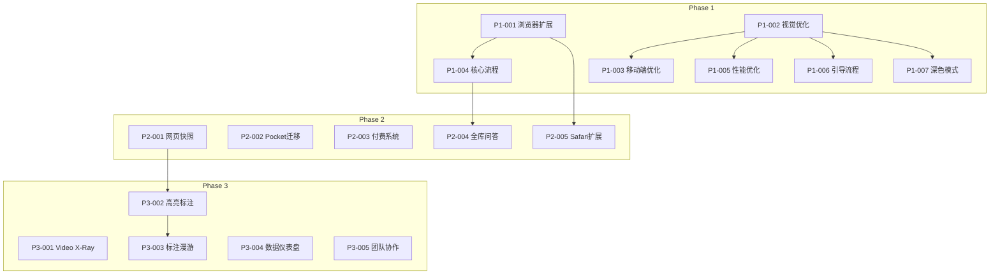

# AnyKeep 2025 开发任务清单

> **版本**: v1.0 (待审核)
> **制定日期**: 2025-12-15
> **规划周期**: 2025.01 - 2025.12
> **总工时估算**: ~52 周 (单人全职)

---

## 目录

1. [规划概述](#一规划概述)
2. [Phase 1: 首发版 (P0)](#二phase-1-首发版-p0)
3. [Phase 2: 增长版 (P1)](#三phase-2-增长版-p1)
4. [Phase 3: 成熟版 (P2)](#四phase-3-成熟版-p2)
5. [深化优化任务](#五深化优化任务)
6. [里程碑与验收标准](#六里程碑与验收标准)
7. [风险管理](#七风险管理)
8. [资源与成本估算](#八资源与成本估算)

---

## 一、规划概述

### 1.1 规划原则

```
┌─────────────────────────────────────────────────────────────┐
│                    开发规划核心原则                           │
├─────────────────────────────────────────────────────────────┤
│                                                              │
│  1️⃣ 最小可行产品优先 (MVP First)                             │
│     → 聚焦核心体验，快速上架验证                              │
│                                                              │
│  2️⃣ 增量交付 (Incremental Delivery)                         │
│     → 每周可见进展，避免大爆炸式发布                          │
│                                                              │
│  3️⃣ 时机驱动 (Timing Driven)                                │
│     → 抓住 Pocket 停服窗口 (2025.07)                         │
│                                                              │
│  4️⃣ 技术债务可控 (Managed Tech Debt)                        │
│     → 快速交付与代码质量的平衡                               │
│                                                              │
└─────────────────────────────────────────────────────────────┘
```

### 1.2 时间线总览

```
2025.01          2025.03          2025.06          2025.07          2025.12
   │                │                │                │                │
   ▼                ▼                ▼                ▼                ▼
┌──────────────┐ ┌──────────────┐ ┌──────────────┐ ┌──────────────┐
│   Phase 1    │ │   Phase 2    │ │   Phase 3    │ │   Phase 3    │
│   首发版     │ │   增长版     │ │  成熟版 Q3   │ │  成熟版 Q4   │
│              │ │              │ │              │ │              │
│ App Store    │ │ Pocket 迁移  │ │ Video X-Ray  │ │ 团队协作     │
│ 上架         │ │ 付费系统     │ │ 高亮标注     │ │ API 开放     │
└──────────────┘ └──────────────┘ └──────────────┘ └──────────────┘
     12周              12周              12周              12周
```

### 1.3 任务编号规则

| 前缀   | 含义           | 示例    |
| ------ | -------------- | ------- |
| `P1-`  | Phase 1 首发版 | P1-001  |
| `P2-`  | Phase 2 增长版 | P2-001  |
| `P3-`  | Phase 3 成熟版 | P3-001  |
| `OPT-` | 深化优化任务   | OPT-001 |

---

## 二、Phase 1: 首发版 (P0)

### 2.1 阶段目标

| 指标         | 目标值     | 说明                        |
| ------------ | ---------- | --------------------------- |
| **上架时间** | 2025.03.31 | iOS App Store + Google Play |
| **扩展上架** | 2025.02.28 | Chrome Web Store            |
| **注册用户** | 1,000+     | 首月目标                    |
| **次日留存** | > 40%      | 核心体验验证                |

### 2.2 任务清单

---

#### P1-001: Chrome/Edge 浏览器扩展开发

**优先级**: 🔴 P0 - 首发版必需
**工时估算**: 10 天
**前置依赖**: 无

##### 任务描述

开发支持 Chrome 和 Edge 的浏览器扩展，实现一键收藏当前网页到 AnyKeep。

##### 子任务分解

| 子任务ID  | 任务内容                    | 工时 | 状态 |
| --------- | --------------------------- | ---- | ---- |
| P1-001-1  | Manifest V3 项目搭建        | 0.5d | ⬜   |
| P1-001-2  | Popup UI 设计与实现         | 2d   | ⬜   |
| P1-001-3  | Content Script 页面信息提取 | 1.5d | ⬜   |
| P1-001-4  | Background Service Worker   | 1d   | ⬜   |
| P1-001-5  | Supabase Auth 集成          | 1d   | ⬜   |
| P1-001-6  | API 通信层封装              | 1d   | ⬜   |
| P1-001-7  | 离线队列与重试机制          | 1d   | ⬜   |
| P1-001-8  | Chrome Web Store 上架准备   | 1d   | ⬜   |
| P1-001-9  | Edge Add-ons 适配           | 0.5d | ⬜   |
| P1-001-10 | 测试与修复                  | 0.5d | ⬜   |

##### 技术实现要点

```typescript
// 扩展核心架构
src/extension/
├── manifest.json           // Manifest V3 配置
├── popup/
│   ├── Popup.tsx          // React 弹窗组件
│   ├── QuickSave.tsx      // 快速保存表单
│   └── FolderSelect.tsx   // 文件夹选择器
├── content/
│   └── extractor.ts       // 页面元数据提取
├── background/
│   └── service-worker.ts  // 后台服务
├── lib/
│   ├── api-client.ts      // API 通信
│   ├── auth.ts            // 认证管理
│   └── offline-queue.ts   // 离线队列
└── utils/
    └── metadata.ts        // Open Graph 解析
```

##### 验收标准

- [ ] 点击扩展图标弹出收藏界面
- [ ] 自动提取当前页面标题、URL、描述、封面图
- [ ] 支持选择目标文件夹
- [ ] 支持添加自定义标签
- [ ] 登录状态与 Web 端同步
- [ ] 离线时收藏可入队，恢复后自动同步
- [ ] Chrome Web Store 审核通过

##### 风险评估

| 风险             | 可能性 | 影响 | 缓解措施               |
| ---------------- | ------ | ---- | ---------------------- |
| Manifest V3 限制 | 中     | 中   | 提前研究 API 限制      |
| 商店审核延迟     | 中     | 高   | 预留 1 周缓冲          |
| 跨域请求限制     | 低     | 中   | 使用 background script |

---

#### P1-002: 首页视觉体验优化

**优先级**: 🔴 P0 - 首发版必需
**工时估算**: 7 天
**前置依赖**: 无

##### 任务描述

重构首页视觉体验，实现瀑布流大卡片布局、平台色标识系统，让用户 3 秒内惊呼"好看"。

##### 子任务分解

| 子任务ID | 任务内容                 | 工时 | 状态 |
| -------- | ------------------------ | ---- | ---- |
| P1-002-1 | 瀑布流布局组件 (Masonry) | 1.5d | ⬜   |
| P1-002-2 | 大卡片组件重构           | 1.5d | ⬜   |
| P1-002-3 | 平台色系统设计与实现     | 1d   | ⬜   |
| P1-002-4 | 封面图智能裁剪与展示     | 1d   | ⬜   |
| P1-002-5 | 骨架屏与加载动画         | 0.5d | ⬜   |
| P1-002-6 | 深色模式适配             | 0.5d | ⬜   |
| P1-002-7 | 响应式布局优化           | 0.5d | ⬜   |
| P1-002-8 | 视觉测试与微调           | 0.5d | ⬜   |

##### 技术实现要点

```typescript
// 平台色系统
const PLATFORM_COLORS = {
  wechat: {
    primary: '#07C160',     // 微信绿
    secondary: '#E8F7EE',
    icon: 'wechat-icon'
  },
  bilibili: {
    primary: '#FB7299',     // B站粉
    secondary: '#FFF0F5',
    icon: 'bilibili-icon'
  },
  xiaohongshu: {
    primary: '#FE2C55',     // 小红书红
    secondary: '#FFF5F5',
    icon: 'xiaohongshu-icon'
  },
  // ... 其他平台
}

// 瀑布流组件
<MasonryGrid
  columns={{ xs: 1, sm: 2, md: 3, lg: 4 }}
  gap={16}
  items={bookmarks}
  renderItem={(bookmark) => (
    <BookmarkCard
      variant="visual"
      platformColor={PLATFORM_COLORS[bookmark.platform]}
      coverImage={bookmark.cover_image}
      showPlatformBadge
    />
  )}
/>
```

##### 验收标准

- [ ] 首页默认展示瀑布流大卡片布局
- [ ] 每个平台有独特的色彩标识
- [ ] 封面图正确裁剪，无拉伸变形
- [ ] 首屏加载 < 2 秒
- [ ] 骨架屏流畅过渡
- [ ] 深色模式视觉协调
- [ ] 移动端、平板端、桌面端均有良好体验

##### 风险评估

| 风险           | 可能性 | 影响 | 缓解措施         |
| -------------- | ------ | ---- | ---------------- |
| 瀑布流性能问题 | 中     | 中   | 结合虚拟滚动     |
| 图片加载慢     | 中     | 中   | CDN + 渐进式加载 |

---

#### P1-003: 移动端体验优化

**优先级**: 🔴 P0 - 首发版必需
**工时估算**: 7 天
**前置依赖**: P1-002 (视觉优化)

##### 任务描述

优化 Capacitor 打包的移动端体验，完善系统分享菜单集成，达到 App Store 上架标准。

##### 子任务分解

| 子任务ID | 任务内容                   | 工时 | 状态 |
| -------- | -------------------------- | ---- | ---- |
| P1-003-1 | iOS Share Extension 开发   | 2d   | ⬜   |
| P1-003-2 | Android Intent Filter 配置 | 1d   | ⬜   |
| P1-003-3 | 移动端导航优化             | 1d   | ⬜   |
| P1-003-4 | 触摸交互优化 (手势)        | 0.5d | ⬜   |
| P1-003-5 | 启动屏与图标配置           | 0.5d | ⬜   |
| P1-003-6 | iOS TestFlight 准备        | 0.5d | ⬜   |
| P1-003-7 | Android 内测准备           | 0.5d | ⬜   |
| P1-003-8 | 应用商店素材准备           | 1d   | ⬜   |

##### 技术实现要点

```swift
// iOS Share Extension (Swift)
class ShareViewController: SLComposeServiceViewController {
    override func didSelectPost() {
        if let item = extensionContext?.inputItems.first as? NSExtensionItem {
            if let attachment = item.attachments?.first {
                attachment.loadItem(forTypeIdentifier: kUTTypeURL as String) { (url, error) in
                    // 发送到主 App 或直接调用 API
                    self.saveToAnyKeep(url: url as? URL)
                }
            }
        }
    }
}
```

```kotlin
// Android Intent Filter (AndroidManifest.xml)
<intent-filter>
    <action android:name="android.intent.action.SEND" />
    <category android:name="android.intent.category.DEFAULT" />
    <data android:mimeType="text/plain" />
</intent-filter>
```

##### 验收标准

- [ ] iOS 系统分享菜单显示 AnyKeep
- [ ] Android 系统分享菜单显示 AnyKeep
- [ ] 分享后自动打开收藏确认界面
- [ ] 启动时间 < 3 秒 (冷启动)
- [ ] 手势操作流畅自然
- [ ] 通过 App Store / Google Play 审核

##### 风险评估

| 风险                 | 可能性 | 影响 | 缓解措施       |
| -------------------- | ------ | ---- | -------------- |
| App Store 审核拒绝   | 中     | 高   | 严格遵循指南   |
| Share Extension 限制 | 中     | 中   | 最小化扩展功能 |

---

#### P1-004: 核心收藏流程打磨

**优先级**: 🔴 P0 - 首发版必需
**工时估算**: 5 天
**前置依赖**: P1-001 (浏览器扩展)

##### 任务描述

打磨从收藏到 AI 处理再到展示的完整闭环，确保流程流畅、反馈及时。

##### 子任务分解

| 子任务ID | 任务内容            | 工时 | 状态 |
| -------- | ------------------- | ---- | ---- |
| P1-004-1 | 收藏成功动效设计    | 0.5d | ⬜   |
| P1-004-2 | AI 处理状态实时反馈 | 1d   | ⬜   |
| P1-004-3 | 分类置信度可视化    | 1d   | ⬜   |
| P1-004-4 | 快速确认/修正交互   | 1d   | ⬜   |
| P1-004-5 | 错误状态处理与重试  | 0.5d | ⬜   |
| P1-004-6 | 流程埋点与监控      | 0.5d | ⬜   |
| P1-004-7 | 端到端测试          | 0.5d | ⬜   |

##### 技术实现要点

```typescript
// AI 处理状态机
enum BookmarkProcessingStatus {
  PENDING = "pending", // 等待处理
  FETCHING_CONTENT = "fetching", // 抓取内容
  GENERATING_SUMMARY = "summary", // 生成摘要
  GENERATING_TAGS = "tags", // 生成标签
  CLASSIFYING = "classifying", // 智能分类
  COMPLETED = "completed", // 处理完成
  FAILED = "failed", // 处理失败
}

// 实时状态推送 (Server-Sent Events)
// GET /api/bookmarks/{id}/processing-status
```

##### 验收标准

- [ ] 收藏成功有明确视觉反馈
- [ ] AI 处理进度实时可见
- [ ] 分类结果显示置信度百分比
- [ ] 低置信度分类可快速确认/修正
- [ ] 处理失败可一键重试
- [ ] 完整流程 < 30 秒

---

#### P1-005: 性能优化

**优先级**: 🔴 P0 - 首发版必需
**工时估算**: 5 天
**前置依赖**: P1-002 (视觉优化)

##### 任务描述

优化应用整体性能，确保首屏加载 < 2 秒，交互响应 < 100ms。

##### 子任务分解

| 子任务ID | 任务内容             | 工时 | 状态 |
| -------- | -------------------- | ---- | ---- |
| P1-005-1 | 首屏关键渲染路径优化 | 1d   | ⬜   |
| P1-005-2 | 代码分割与懒加载     | 1d   | ⬜   |
| P1-005-3 | 图片优化 (WebP/AVIF) | 0.5d | ⬜   |
| P1-005-4 | API 响应缓存策略     | 1d   | ⬜   |
| P1-005-5 | 数据库查询优化       | 0.5d | ⬜   |
| P1-005-6 | Bundle 分析与瘦身    | 0.5d | ⬜   |
| P1-005-7 | 性能监控集成         | 0.5d | ⬜   |

##### 技术实现要点

```typescript
// Next.js 优化配置
// next.config.js
module.exports = {
  images: {
    formats: ["image/avif", "image/webp"],
    minimumCacheTTL: 60 * 60 * 24 * 30, // 30 days
  },
  experimental: {
    optimizePackageImports: ["@radix-ui/react-*", "lucide-react"],
  },
};

// React 懒加载
const BookmarkDetail = lazy(() => import("./BookmarkDetail"));
const FolderTree = lazy(() => import("./FolderTree"));
```

##### 验收标准

- [ ] LCP (Largest Contentful Paint) < 2s
- [ ] FID (First Input Delay) < 100ms
- [ ] CLS (Cumulative Layout Shift) < 0.1
- [ ] 虚拟滚动 10,000+ 条目流畅
- [ ] Bundle 体积 < 300KB (gzipped)

---

#### P1-006: 新用户引导流程

**优先级**: 🟡 应该完成
**工时估算**: 3 天
**前置依赖**: P1-002, P1-004

##### 任务描述

设计并实现新用户引导流程，帮助用户快速理解产品价值并完成首次收藏。

##### 子任务分解

| 子任务ID | 任务内容               | 工时 | 状态 |
| -------- | ---------------------- | ---- | ---- |
| P1-006-1 | 引导流程设计           | 0.5d | ⬜   |
| P1-006-2 | 欢迎页与价值展示       | 1d   | ⬜   |
| P1-006-3 | 首次收藏引导           | 0.5d | ⬜   |
| P1-006-4 | 功能亮点提示 (Tooltip) | 0.5d | ⬜   |
| P1-006-5 | 引导完成状态追踪       | 0.5d | ⬜   |

##### 验收标准

- [ ] 新用户看到 3 步引导
- [ ] 引导中有清晰的产品价值说明
- [ ] 引导完成后用户完成至少 1 次收藏
- [ ] 可跳过引导

---

#### P1-007: 深色模式完善

**优先级**: 🟡 应该完成
**工时估算**: 2 天
**前置依赖**: P1-002

##### 任务描述

完善深色模式的视觉一致性，确保所有组件在深色模式下显示正常。

##### 子任务分解

| 子任务ID | 任务内容              | 工时  | 状态 |
| -------- | --------------------- | ----- | ---- |
| P1-007-1 | 色彩变量系统整理      | 0.5d  | ⬜   |
| P1-007-2 | 组件深色模式适配      | 1d    | ⬜   |
| P1-007-3 | 图片/图标深色模式处理 | 0.25d | ⬜   |
| P1-007-4 | 系统主题跟随          | 0.25d | ⬜   |

##### 验收标准

- [ ] 所有页面深色模式视觉协调
- [ ] 无对比度不足问题
- [ ] 支持系统主题自动切换

---

### 2.3 Phase 1 里程碑

| 里程碑   | 日期           | 交付物                           |
| -------- | -------------- | -------------------------------- |
| M1.1     | 2025.01.15     | 浏览器扩展 MVP                   |
| M1.2     | 2025.02.01     | 首页视觉重构完成                 |
| M1.3     | 2025.02.15     | 移动端体验优化完成               |
| M1.4     | 2025.02.28     | Chrome Web Store 上架            |
| M1.5     | 2025.03.15     | TestFlight / 内测发布            |
| **M1.6** | **2025.03.31** | **App Store / Google Play 上架** |

---

## 三、Phase 2: 增长版 (P1)

### 3.1 阶段目标

| 指标            | 目标值  | 说明       |
| --------------- | ------- | ---------- |
| **MAU**         | 10,000+ | 月活用户   |
| **付费转化**    | > 3%    | Pro 版订阅 |
| **Pocket 迁移** | 5,000+  | 迁移用户数 |

### 3.2 任务清单

---

#### P2-001: 网页快照功能

**优先级**: 🟠 P1 - 增长版核心
**工时估算**: 15 天
**前置依赖**: Phase 1 完成

##### 任务描述

实现网页内容永久保存功能，解决链接失效的核心痛点。

##### 子任务分解

| 子任务ID  | 任务内容             | 工时 | 状态 |
| --------- | -------------------- | ---- | ---- |
| P2-001-1  | 技术方案设计         | 1d   | ⬜   |
| P2-001-2  | Browserless.io 集成  | 2d   | ⬜   |
| P2-001-3  | Readability 正文提取 | 2d   | ⬜   |
| P2-001-4  | 截图存储服务         | 1d   | ⬜   |
| P2-001-5  | Markdown 转换与存储  | 1d   | ⬜   |
| P2-001-6  | 快照查看器组件       | 2d   | ⬜   |
| P2-001-7  | 存储配额管理         | 1d   | ⬜   |
| P2-001-8  | 批量快照任务队列     | 2d   | ⬜   |
| P2-001-9  | 快照失败重试机制     | 1d   | ⬜   |
| P2-001-10 | 离线阅读支持         | 2d   | ⬜   |

##### 技术实现要点

```typescript
// 快照服务架构
interface SnapshotService {
  // 创建快照
  createSnapshot(bookmarkId: string): Promise<Snapshot>

  // 快照内容
  getSnapshotContent(snapshotId: string): Promise<{
    html: string       // 原始 HTML
    markdown: string   // Markdown 正文
    screenshot: string // 截图 URL
    metadata: object   // 元数据
  }>

  // 存储管理
  getUserStorageUsage(userId: string): Promise<StorageQuota>
}

// 存储结构
supabase/
├── storage/
│   └── snapshots/
│       └── {user_id}/
│           └── {snapshot_id}/
│               ├── page.html
│               ├── content.md
│               └── screenshot.png
```

##### 验收标准

- [ ] 收藏时可选择"保存快照"
- [ ] 快照包含正文、截图、元数据
- [ ] 原链接失效后仍可查看快照
- [ ] 支持离线查看快照内容
- [ ] 存储配额可视化管理
- [ ] Pro 用户无限快照额度

---

#### P2-002: Pocket 数据迁移工具

**优先级**: 🟠 P1 - 战略级功能
**工时估算**: 5 天
**前置依赖**: 无

##### 任务描述

开发 Pocket 数据导入工具，抢占 2025.07 停服红利。

##### 子任务分解

| 子任务ID | 任务内容            | 工时 | 状态 |
| -------- | ------------------- | ---- | ---- |
| P2-002-1 | Pocket 导出格式分析 | 0.5d | ⬜   |
| P2-002-2 | HTML 格式解析器     | 1d   | ⬜   |
| P2-002-3 | 标签映射逻辑        | 0.5d | ⬜   |
| P2-002-4 | 批量导入流程        | 1d   | ⬜   |
| P2-002-5 | 进度追踪与错误处理  | 0.5d | ⬜   |
| P2-002-6 | 迁移指南文档        | 0.5d | ⬜   |
| P2-002-7 | 营销落地页          | 1d   | ⬜   |

##### 技术实现要点

```typescript
// Pocket HTML 格式
// <li><a href="..." time_added="..." tags="...">Title</a></li>

interface PocketImporter {
  parseExport(html: string): PocketItem[]
  mapTags(pocketTags: string[]): string[]
  import(items: PocketItem[], userId: string): ImportResult
}

// 迁移流程
1. 用户从 Pocket 导出数据 (HTML)
2. 上传到 AnyKeep
3. 解析并预览
4. 确认导入
5. AI 自动分类
```

##### 验收标准

- [ ] 支持 Pocket HTML 导出格式
- [ ] 保留原有标签
- [ ] 显示导入预览
- [ ] 进度实时反馈
- [ ] 导入后自动触发 AI 分类
- [ ] 迁移指南清晰易懂

---

#### P2-003: 付费系统

**优先级**: 🟠 P1 - 商业化基础
**工时估算**: 10 天
**前置依赖**: 无

##### 任务描述

实现完整的订阅付费系统，支持免费/Pro/Pro+ 三档定价。

##### 子任务分解

| 子任务ID | 任务内容            | 工时 | 状态 |
| -------- | ------------------- | ---- | ---- |
| P2-003-1 | 支付方案设计        | 0.5d | ⬜   |
| P2-003-2 | Stripe 集成 (海外)  | 2d   | ⬜   |
| P2-003-3 | 支付宝/微信支付集成 | 2d   | ⬜   |
| P2-003-4 | 订阅状态管理        | 1d   | ⬜   |
| P2-003-5 | 功能权限控制        | 1d   | ⬜   |
| P2-003-6 | 订阅页面 UI         | 1.5d | ⬜   |
| P2-003-7 | 续费与取消流程      | 1d   | ⬜   |
| P2-003-8 | 发票与收据          | 1d   | ⬜   |

##### 技术实现要点

```typescript
// 订阅体系
enum SubscriptionTier {
  FREE = "free",
  PRO = "pro", // ¥68/年
  PRO_PLUS = "pro+", // ¥128/年
}

// 功能权限矩阵
const FEATURE_LIMITS = {
  [SubscriptionTier.FREE]: {
    bookmarkLimit: 200,
    aiTagsPerMonth: 50,
    folderLimit: 2,
    semanticSearch: false,
    snapshot: false,
    smartList: false,
  },
  [SubscriptionTier.PRO]: {
    bookmarkLimit: Infinity,
    aiTagsPerMonth: Infinity,
    folderLimit: Infinity,
    semanticSearch: false,
    snapshot: true,
    smartList: true,
  },
  [SubscriptionTier.PRO_PLUS]: {
    bookmarkLimit: Infinity,
    aiTagsPerMonth: Infinity,
    folderLimit: Infinity,
    semanticSearch: true,
    snapshot: true,
    smartList: true,
    videoXray: true,
    knowledgeQA: true,
  },
};
```

##### 验收标准

- [ ] 支持支付宝/微信支付
- [ ] 支持 Stripe (海外用户)
- [ ] 订阅状态实时同步
- [ ] 功能受限时有明确提示
- [ ] 订阅页清晰展示各版本差异
- [ ] 支持年付优惠

---

#### P2-004: 全库知识问答

**优先级**: 🟠 P1 - Pro+ 核心卖点
**工时估算**: 15 天
**前置依赖**: Phase 1 完成

##### 任务描述

增强 RAG 检索能力，实现"问自己的收藏库"功能。

##### 子任务分解

| 子任务ID | 任务内容         | 工时 | 状态 |
| -------- | ---------------- | ---- | ---- |
| P2-004-1 | RAG 架构升级设计 | 1d   | ⬜   |
| P2-004-2 | 检索策略优化     | 2d   | ⬜   |
| P2-004-3 | 上下文窗口管理   | 2d   | ⬜   |
| P2-004-4 | 引用来源追踪     | 1.5d | ⬜   |
| P2-004-5 | 多轮对话状态管理 | 2d   | ⬜   |
| P2-004-6 | 问答 UI 优化     | 2d   | ⬜   |
| P2-004-7 | 答案质量评估     | 1.5d | ⬜   |
| P2-004-8 | 缓存与性能优化   | 2d   | ⬜   |
| P2-004-9 | 使用量统计与限制 | 1d   | ⬜   |

##### 技术实现要点

```typescript
// RAG 增强架构
interface EnhancedRAG {
  // 混合检索
  retrieve(
    query: string,
    options: {
      topK: number;
      minScore: number;
      filters?: {
        folders?: string[];
        dateRange?: DateRange;
        platforms?: string[];
      };
    },
  ): Promise<RetrievedChunk[]>;

  // 答案生成
  generate(
    query: string,
    context: RetrievedChunk[],
  ): AsyncIterable<{
    text: string;
    citations: Citation[];
  }>;
}

// 引用格式
interface Citation {
  bookmarkId: string;
  title: string;
  url: string;
  relevantText: string;
  score: number;
}
```

##### 验收标准

- [ ] 检索准确率 > 85%
- [ ] 答案引用可点击跳转
- [ ] 支持多轮对话上下文
- [ ] 响应时间 < 5 秒
- [ ] 支持文件夹/时间范围筛选
- [ ] Pro+ 专属功能

---

#### P2-005: Safari 浏览器扩展

**优先级**: 🟠 P1
**工时估算**: 5 天
**前置依赖**: P1-001

##### 任务描述

开发 Safari 浏览器扩展，支持 macOS 和 iOS Safari。

##### 子任务分解

| 子任务ID | 任务内容                      | 工时 | 状态 |
| -------- | ----------------------------- | ---- | ---- |
| P2-005-1 | Safari Web Extension 项目搭建 | 1d   | ⬜   |
| P2-005-2 | 复用 Chrome 扩展核心逻辑      | 1d   | ⬜   |
| P2-005-3 | Safari 特有 API 适配          | 1d   | ⬜   |
| P2-005-4 | iOS Safari 适配               | 1d   | ⬜   |
| P2-005-5 | App Store 上架准备            | 1d   | ⬜   |

##### 验收标准

- [ ] macOS Safari 正常工作
- [ ] iOS Safari 正常工作
- [ ] 功能与 Chrome 扩展一致
- [ ] App Store 审核通过

---

#### P2-006: 微信快捷指令

**优先级**: 🟡 应该完成
**工时估算**: 3 天
**前置依赖**: P1-003

##### 任务描述

支持在分享时使用 #标签 @文件夹 快捷语法。

##### 子任务分解

| 子任务ID | 任务内容       | 工时 | 状态 |
| -------- | -------------- | ---- | ---- |
| P2-006-1 | 语法解析器     | 1d   | ⬜   |
| P2-006-2 | 分享文本处理   | 0.5d | ⬜   |
| P2-006-3 | 模糊匹配文件夹 | 0.5d | ⬜   |
| P2-006-4 | 使用说明与引导 | 0.5d | ⬜   |
| P2-006-5 | 测试与优化     | 0.5d | ⬜   |

##### 验收标准

- [ ] `#标签1 #标签2` 自动添加标签
- [ ] `@文件夹名` 自动分类到指定文件夹
- [ ] 支持模糊匹配
- [ ] 新用户有使用提示

---

#### P2-007: 滑动清理功能

**优先级**: 🟡 应该完成
**工时估算**: 5 天
**前置依赖**: P1-003

##### 任务描述

移动端 Tinder 式滑动清理收藏，快速整理低质量书签。

##### 子任务分解

| 子任务ID | 任务内容              | 工时 | 状态 |
| -------- | --------------------- | ---- | ---- |
| P2-007-1 | 滑动手势组件          | 1.5d | ⬜   |
| P2-007-2 | 卡片堆叠效果          | 1d   | ⬜   |
| P2-007-3 | 左滑删除/右滑保留逻辑 | 0.5d | ⬜   |
| P2-007-4 | 撤销功能              | 0.5d | ⬜   |
| P2-007-5 | 清理统计与反馈        | 0.5d | ⬜   |
| P2-007-6 | 智能推荐清理列表      | 1d   | ⬜   |

##### 验收标准

- [ ] 左滑删除、右滑保留
- [ ] 动画流畅自然
- [ ] 支持撤销最近操作
- [ ] 显示清理进度统计
- [ ] 智能推荐长期未访问的书签

---

### 3.3 Phase 2 里程碑

| 里程碑   | 日期           | 交付物               |
| -------- | -------------- | -------------------- |
| M2.1     | 2025.04.15     | Pocket 迁移工具上线  |
| M2.2     | 2025.04.30     | 付费系统上线         |
| M2.3     | 2025.05.15     | 网页快照功能上线     |
| M2.4     | 2025.05.31     | 全库问答功能上线     |
| **M2.5** | **2025.06.30** | **Phase 2 全部完成** |

---

## 四、Phase 3: 成熟版 (P2)

### 4.1 阶段目标

| 指标    | 目标值   | 说明         |
| ------- | -------- | ------------ |
| **MAU** | 50,000+  | 月活用户     |
| **MRR** | ¥50,000+ | 月经常性收入 |
| **NPS** | > 40     | 净推荐值     |

### 4.2 任务清单

---

#### P3-001: Video X-Ray 视频分析

**优先级**: 🟡 P2 - 独家差异化
**工时估算**: 20 天
**前置依赖**: Phase 2 完成

##### 任务描述

实现视频关键时间点提取功能，30 分钟视频 3 分钟看完精华。

##### 子任务分解

| 子任务ID  | 任务内容              | 工时 | 状态 |
| --------- | --------------------- | ---- | ---- |
| P3-001-1  | 技术方案设计          | 1d   | ⬜   |
| P3-001-2  | 视频音频提取 (FFmpeg) | 2d   | ⬜   |
| P3-001-3  | Whisper API 集成      | 2d   | ⬜   |
| P3-001-4  | 时间戳对齐处理        | 2d   | ⬜   |
| P3-001-5  | LLM 关键点提取        | 3d   | ⬜   |
| P3-001-6  | 章节大纲生成          | 2d   | ⬜   |
| P3-001-7  | 时间线可视化组件      | 2d   | ⬜   |
| P3-001-8  | 视频跳转深度链接      | 2d   | ⬜   |
| P3-001-9  | B站/YouTube 平台适配  | 2d   | ⬜   |
| P3-001-10 | 任务队列与进度追踪    | 2d   | ⬜   |

##### 技术实现要点

```typescript
// Video X-Ray 服务
interface VideoXRayService {
  // 分析视频
  analyze(videoUrl: string): Promise<VideoAnalysis>;

  // 获取结果
  getAnalysis(bookmarkId: string): Promise<{
    transcript: TranscriptSegment[];
    keyPoints: KeyPoint[];
    chapters: Chapter[];
    summary: string;
  }>;
}

interface KeyPoint {
  timestamp: number; // 秒
  title: string; // 关键点标题
  content: string; // 关键内容
  importance: number; // 重要程度 1-5
}

interface Chapter {
  startTime: number;
  endTime: number;
  title: string;
  summary: string;
}
```

##### 验收标准

- [ ] 支持 B站、YouTube 视频
- [ ] 转录准确率 > 90%
- [ ] 关键点提取有意义
- [ ] 点击时间戳可跳转原视频
- [ ] 处理时间 < 视频时长的 1/3
- [ ] Pro+ 专属功能

---

#### P3-002: 高亮标注系统

**优先级**: 🟡 P2
**工时估算**: 10 天
**前置依赖**: P2-001 (网页快照)

##### 任务描述

实现网页正文多色高亮标注功能，支持阅读批注。

##### 子任务分解

| 子任务ID | 任务内容           | 工时 | 状态 |
| -------- | ------------------ | ---- | ---- |
| P3-002-1 | 高亮选择器组件     | 2d   | ⬜   |
| P3-002-2 | 多色高亮系统       | 1d   | ⬜   |
| P3-002-3 | 批注功能           | 1.5d | ⬜   |
| P3-002-4 | 高亮数据存储       | 1d   | ⬜   |
| P3-002-5 | 高亮列表管理       | 1.5d | ⬜   |
| P3-002-6 | 导出高亮内容       | 1d   | ⬜   |
| P3-002-7 | 与快照系统集成     | 1d   | ⬜   |
| P3-002-8 | 浏览器扩展高亮支持 | 1d   | ⬜   |

##### 验收标准

- [ ] 支持 4 种以上高亮颜色
- [ ] 高亮可添加批注
- [ ] 高亮内容可导出为 Markdown
- [ ] 快照中保留高亮
- [ ] 浏览器扩展支持实时高亮

---

#### P3-003: 标注漫游功能

**优先级**: 🟡 P2
**工时估算**: 5 天
**前置依赖**: P3-002

##### 任务描述

随机回顾高亮内容，加深记忆。

##### 子任务分解

| 子任务ID | 任务内容          | 工时 | 状态 |
| -------- | ----------------- | ---- | ---- |
| P3-003-1 | 漫游算法设计      | 1d   | ⬜   |
| P3-003-2 | 卡片式回顾界面    | 1.5d | ⬜   |
| P3-003-3 | 间隔重复策略      | 1d   | ⬜   |
| P3-003-4 | 回顾统计          | 0.5d | ⬜   |
| P3-003-5 | 桌面小组件 (可选) | 1d   | ⬜   |

##### 验收标准

- [ ] 随机展示高亮内容
- [ ] 支持间隔重复算法
- [ ] 记录回顾历史

---

#### P3-004: 数据分析仪表盘

**优先级**: 🟡 P2
**工时估算**: 10 天
**前置依赖**: Phase 2 完成

##### 任务描述

提供收藏统计、阅读习惯等数据洞察。

##### 子任务分解

| 子任务ID | 任务内容       | 工时 | 状态 |
| -------- | -------------- | ---- | ---- |
| P3-004-1 | 数据模型设计   | 1d   | ⬜   |
| P3-004-2 | 收藏趋势图表   | 2d   | ⬜   |
| P3-004-3 | 平台分布统计   | 1d   | ⬜   |
| P3-004-4 | 标签热力图     | 1.5d | ⬜   |
| P3-004-5 | 阅读时间追踪   | 1.5d | ⬜   |
| P3-004-6 | 分类准确率统计 | 1d   | ⬜   |
| P3-004-7 | 年度报告生成   | 2d   | ⬜   |

##### 验收标准

- [ ] 展示收藏趋势（日/周/月）
- [ ] 平台来源分布饼图
- [ ] 标签使用热力图
- [ ] 年度收藏报告

---

#### P3-005: 团队协作 (Beta)

**优先级**: 🟢 P3
**工时估算**: 20 天
**前置依赖**: Phase 3 Q3 完成

##### 任务描述

支持共享收藏夹和团队协作整理。

##### 子任务分解

| 子任务ID  | 任务内容         | 工时 | 状态 |
| --------- | ---------------- | ---- | ---- |
| P3-005-1  | 团队数据模型设计 | 2d   | ⬜   |
| P3-005-2  | 团队创建与管理   | 2d   | ⬜   |
| P3-005-3  | 成员邀请机制     | 1.5d | ⬜   |
| P3-005-4  | 共享文件夹功能   | 3d   | ⬜   |
| P3-005-5  | 权限控制系统     | 2d   | ⬜   |
| P3-005-6  | 协作编辑冲突处理 | 2d   | ⬜   |
| P3-005-7  | 团队活动流       | 2d   | ⬜   |
| P3-005-8  | 团队订阅计费     | 2d   | ⬜   |
| P3-005-9  | Beta 测试计划    | 1.5d | ⬜   |
| P3-005-10 | 用户反馈收集     | 2d   | ⬜   |

##### 验收标准

- [ ] 创建团队并邀请成员
- [ ] 共享文件夹给团队
- [ ] 权限分级（查看/编辑/管理）
- [ ] 协作不产生数据冲突
- [ ] 团队订阅独立计费

---

#### P3-006: API 开放

**优先级**: 🟢 P3
**工时估算**: 10 天
**前置依赖**: Phase 3 Q3 完成

##### 任务描述

开放 RESTful API 供第三方集成。

##### 子任务分解

| 子任务ID | 任务内容             | 工时 | 状态 |
| -------- | -------------------- | ---- | ---- |
| P3-006-1 | API 设计与文档       | 2d   | ⬜   |
| P3-006-2 | API Key 管理         | 1d   | ⬜   |
| P3-006-3 | Rate Limiting        | 1d   | ⬜   |
| P3-006-4 | Webhook 支持         | 2d   | ⬜   |
| P3-006-5 | SDK 开发 (JS/Python) | 2d   | ⬜   |
| P3-006-6 | 开发者门户           | 2d   | ⬜   |

##### 验收标准

- [ ] RESTful API 文档完整
- [ ] API Key 生成与管理
- [ ] 请求限流正常工作
- [ ] Webhook 回调可靠
- [ ] JS/Python SDK 可用

---

### 4.3 Phase 3 里程碑

| 里程碑   | 日期           | 交付物               |
| -------- | -------------- | -------------------- |
| M3.1     | 2025.07.31     | Pocket 停服流量承接  |
| M3.2     | 2025.08.31     | Video X-Ray 上线     |
| M3.3     | 2025.09.30     | 高亮标注系统上线     |
| M3.4     | 2025.10.31     | 数据分析仪表盘上线   |
| M3.5     | 2025.11.30     | 团队协作 Beta        |
| **M3.6** | **2025.12.31** | **Phase 3 全部完成** |

---

## 五、深化优化任务

### 5.1 已实现功能深化

以下是已实现但需要深化的功能优化任务：

---

#### OPT-001: URL 元数据获取优化

**当前状态**: ✅ 已实现
**优化方向**: 提升解析成功率，支持更多中国平台

| 子任务ID  | 任务内容           | 工时 | 状态 |
| --------- | ------------------ | ---- | ---- |
| OPT-001-1 | 微信公众号解析优化 | 1d   | ⬜   |
| OPT-001-2 | B站视频元数据增强  | 0.5d | ⬜   |
| OPT-001-3 | 小红书笔记解析     | 0.5d | ⬜   |
| OPT-001-4 | 抖音视频解析       | 0.5d | ⬜   |
| OPT-001-5 | 解析失败降级策略   | 0.5d | ⬜   |

**验收标准**:

- 中国主流平台解析成功率 > 95%

---

#### OPT-002: AI 标签质量优化

**当前状态**: ✅ 已实现
**优化方向**: 提升中文标签质量，支持用户自定义

| 子任务ID  | 任务内容             | 工时 | 状态 |
| --------- | -------------------- | ---- | ---- |
| OPT-002-1 | 中文标签 Prompt 优化 | 0.5d | ⬜   |
| OPT-002-2 | 标签去重与合并       | 0.5d | ⬜   |
| OPT-002-3 | 用户自定义标签词库   | 1d   | ⬜   |
| OPT-002-4 | 标签建议优先级调整   | 0.5d | ⬜   |

**验收标准**:

- 用户采纳率 > 70%

---

#### OPT-003: 搜索体验优化

**当前状态**: ✅ 已实现
**优化方向**: 混合搜索排序优化，召回率提升

| 子任务ID  | 任务内容          | 工时 | 状态 |
| --------- | ----------------- | ---- | ---- |
| OPT-003-1 | 混合搜索权重调优  | 1d   | ⬜   |
| OPT-003-2 | 搜索结果高亮      | 0.5d | ⬜   |
| OPT-003-3 | 搜索建议/自动补全 | 1d   | ⬜   |
| OPT-003-4 | 搜索历史记录      | 0.5d | ⬜   |
| OPT-003-5 | 高级筛选 UI 优化  | 0.5d | ⬜   |

**验收标准**:

- 召回率 > 85%
- 搜索响应 < 300ms

---

#### OPT-004: 分类反馈学习可视化

**当前状态**: ✅ 已实现
**优化方向**: 反馈效果可视化，用户可感知学习进步

| 子任务ID  | 任务内容           | 工时 | 状态 |
| --------- | ------------------ | ---- | ---- |
| OPT-004-1 | 反馈学习统计       | 0.5d | ⬜   |
| OPT-004-2 | 分类准确率趋势图   | 1d   | ⬜   |
| OPT-004-3 | 个人化模型状态提示 | 0.5d | ⬜   |

**验收标准**:

- 用户可看到"AI 越来越懂你"的进度

---

#### OPT-005: 图文摘要优化 (小红书)

**当前状态**: ⚡ 需深化
**优化方向**: 针对图文笔记的摘要生成优化

| 子任务ID  | 任务内容         | 工时 | 状态 |
| --------- | ---------------- | ---- | ---- |
| OPT-005-1 | 图文内容结构分析 | 1d   | ⬜   |
| OPT-005-2 | 摘要模板优化     | 0.5d | ⬜   |
| OPT-005-3 | 关键图片提取     | 1d   | ⬜   |

**验收标准**:

- 小红书笔记摘要质量评分 > 4/5

---

#### OPT-006: RAG 检索精度优化

**当前状态**: ✅ 已实现
**优化方向**: 上下文窗口优化，引用来源可点击

| 子任务ID  | 任务内容           | 工时 | 状态 |
| --------- | ------------------ | ---- | ---- |
| OPT-006-1 | 上下文窗口动态调整 | 1d   | ⬜   |
| OPT-006-2 | 引用来源 UI 优化   | 0.5d | ⬜   |
| OPT-006-3 | 检索结果排序优化   | 1d   | ⬜   |
| OPT-006-4 | 长文本分块策略优化 | 1d   | ⬜   |

**验收标准**:

- 检索准确率 > 85%
- 引用可点击跳转

---

### 5.2 深化任务汇总

| 任务ID   | 任务名称           | 工时    | 阶段建议 |
| -------- | ------------------ | ------- | -------- |
| OPT-001  | URL 元数据获取优化 | 3d      | Phase 1  |
| OPT-002  | AI 标签质量优化    | 2.5d    | Phase 1  |
| OPT-003  | 搜索体验优化       | 3.5d    | Phase 1  |
| OPT-004  | 分类反馈学习可视化 | 2d      | Phase 2  |
| OPT-005  | 图文摘要优化       | 2.5d    | Phase 2  |
| OPT-006  | RAG 检索精度优化   | 3.5d    | Phase 2  |
| **总计** |                    | **17d** |          |

---

## 六、里程碑与验收标准

### 6.1 总体里程碑

```
2025.01                                                          2025.12
   │                                                                │
   ▼                                                                ▼
┌──────┬──────┬──────┬──────┬──────┬──────┬──────┬──────┬──────┬──────┬──────┬──────┐
│ Jan  │ Feb  │ Mar  │ Apr  │ May  │ Jun  │ Jul  │ Aug  │ Sep  │ Oct  │ Nov  │ Dec  │
├──────┴──────┴──────┼──────┴──────┴──────┼──────┴──────┴──────┴──────┴──────┴──────┤
│     Phase 1        │     Phase 2        │              Phase 3                    │
│     首发版          │     增长版          │              成熟版                      │
└────────────────────┴────────────────────┴─────────────────────────────────────────┘
         │                    │                    │                    │
         ▼                    ▼                    ▼                    ▼
    🎯 App Store        🎯 Pocket 迁移      🎯 Pocket 停服       🎯 50K MAU
       上架               工具上线            流量高峰             ¥50K MRR
```

### 6.2 各阶段 Definition of Done

#### Phase 1 完成标准

- [ ] Chrome/Edge 扩展上架商店
- [ ] iOS App 通过 App Store 审核
- [ ] Android App 通过 Google Play 审核
- [ ] 首屏加载 < 2 秒
- [ ] 核心流程无阻断性 Bug
- [ ] 新用户引导流程完整
- [ ] 深色模式完整支持
- [ ] 注册用户 > 1,000

#### Phase 2 完成标准

- [ ] Pocket 迁移工具上线
- [ ] 网页快照功能可用
- [ ] 付费系统正常运行
- [ ] 全库问答功能可用
- [ ] 付费转化率 > 3%
- [ ] MAU > 10,000

#### Phase 3 完成标准

- [ ] Video X-Ray 功能上线
- [ ] 高亮标注系统可用
- [ ] 数据分析仪表盘上线
- [ ] 团队协作 Beta 发布
- [ ] API 开放并有文档
- [ ] MAU > 50,000
- [ ] MRR > ¥50,000

---

## 七、风险管理

### 7.1 技术风险

| 风险              | 可能性 | 影响 | 缓解措施                         | 负责人 |
| ----------------- | ------ | ---- | -------------------------------- | ------ |
| AI API 成本超预算 | 高     | 中   | 本地模型替代、结果缓存、批量处理 | -      |
| 平台反爬封锁      | 中     | 高   | 合规表述、用户主动分享、降级策略 | -      |
| Manifest V3 限制  | 中     | 中   | 提前研究、替代方案准备           | -      |
| 数据库性能瓶颈    | 中     | 中   | 读写分离、索引优化、缓存层       | -      |
| 第三方服务中断    | 低     | 高   | 多供应商备份、降级策略           | -      |

### 7.2 市场风险

| 风险                | 可能性 | 影响 | 缓解措施                             |
| ------------------- | ------ | ---- | ------------------------------------ |
| Pocket 迁移窗口错失 | 低     | 高   | 提前准备、快速响应、营销提前布局     |
| Cubox 降价竞争      | 中     | 中   | 差异化定位、功能领先、中国生态护城河 |
| 大厂入场            | 低     | 高   | 聚焦细分场景、用户粘性、快速迭代     |
| 用户增长不及预期    | 中     | 高   | A/B 测试、调整营销策略、优化转化漏斗 |

### 7.3 运营风险

| 风险         | 可能性 | 影响 | 缓解措施                             |
| ------------ | ------ | ---- | ------------------------------------ |
| 单人开发瓶颈 | 高     | 中   | 严格优先级管理、外包辅助、自动化工具 |
| 用户支持负担 | 中     | 中   | 自助文档、FAQ、社区互助              |
| 资金链紧张   | 低     | 高   | 控制成本、提前融资准备、付费转化优先 |

### 7.4 风险应急预案

```
┌─────────────────────────────────────────────────────────────┐
│                    风险应急预案                               │
├─────────────────────────────────────────────────────────────┤
│                                                              │
│  🔴 高优先级风险触发时:                                       │
│                                                              │
│  1. AI API 成本超预算 (>$500/月)                             │
│     → 立即启用本地 Ollama 模型                               │
│     → 启用结果缓存，重复请求不调用 API                       │
│     → 限制免费用户 AI 调用次数                               │
│                                                              │
│  2. App Store 审核被拒                                       │
│     → 24小时内修复问题重新提交                               │
│     → 准备 Web App 作为备选                                  │
│     → 联系 Apple 开发者支持                                  │
│                                                              │
│  3. Pocket 迁移工具未能按时上线                              │
│     → 发布简化版（手动导入）                                 │
│     → 提供迁移指南文档                                       │
│     → 延迟营销推广时间                                       │
│                                                              │
└─────────────────────────────────────────────────────────────┘
```

---

## 八、资源与成本估算

### 8.1 开发资源需求

| 阶段     | 工时        | 单人全职周期 | 建议团队配置               |
| -------- | ----------- | ------------ | -------------------------- |
| Phase 1  | ~39 天      | 8 周         | 1 全栈 + 0.5 设计          |
| Phase 2  | ~53 天      | 11 周        | 1 全栈 + 0.5 设计          |
| Phase 3  | ~75 天      | 15 周        | 1 全栈 + 1 后端 + 0.5 设计 |
| 深化优化 | ~17 天      | 穿插进行     | -                          |
| **总计** | **~184 天** | **~38 周**   | -                          |

### 8.2 基础设施成本

| 阶段    | 服务                          | 月成本估算 |
| ------- | ----------------------------- | ---------- |
| Phase 1 | Supabase Pro + Vercel Pro     | ~$50       |
| Phase 2 | + Browserless.io + 支付手续费 | ~$200      |
| Phase 3 | + Whisper API + CDN + 监控    | ~$500      |

### 8.3 AI API 成本估算

| 服务               | 单价           | 月用量估算 | 月成本   |
| ------------------ | -------------- | ---------- | -------- |
| DeepSeek Chat      | ¥1/1M tokens   | 10M tokens | ¥10      |
| DeepSeek Embedding | ¥0.5/1M tokens | 20M tokens | ¥10      |
| Whisper API        | $0.006/min     | 1000 min   | $6       |
| **总计**           |                |            | **~$30** |

### 8.4 营销预算

| 阶段             | 用途                         | 预算        |
| ---------------- | ---------------------------- | ----------- |
| Phase 1 (冷启动) | 产品测评、少数派/知乎发文    | ¥5,000      |
| Phase 2 (增长期) | Pocket 迁移营销、KOL 合作    | ¥20,000     |
| Phase 3 (成熟期) | 用户故事、社区运营、品牌广告 | ¥50,000     |
| **全年总计**     |                              | **¥75,000** |

---

## 附录

### A. 任务依赖关系图



### B. 文档版本历史

| 版本 | 日期       | 变更内容         |
| ---- | ---------- | ---------------- |
| v1.0 | 2025-12-15 | 初始版本，待审核 |

---

**文档状态**: 📝 待审核
**下一步**: 请审核后提供反馈，确认后开始执行
