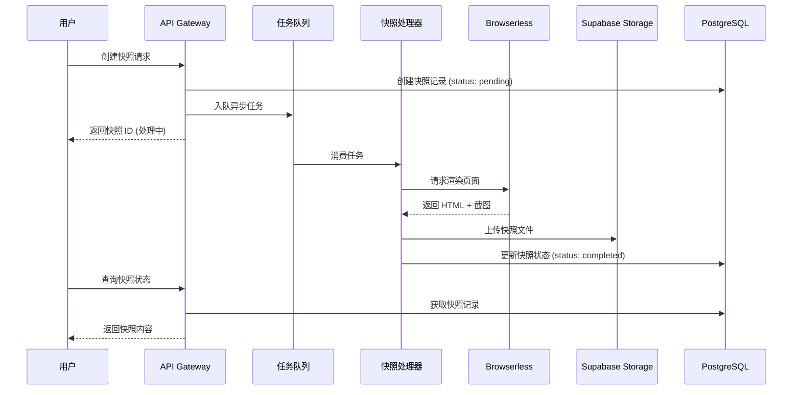

# AnyKeep 网页快照功能技术方案

> **版本**: v1.0
> **日期**: 2025-12-12
> **作者**: AI Assistant
> **状态**: 规划中

---

## 一、功能概述

### 1.1 功能定位

网页快照功能是 AnyKeep 的 **P0 优先级** 功能，对标 Cubox 的核心卖点。解决用户"收藏的网页可能会消失"的核心痛点。

### 1.2 核心价值

| 价值点           | 说明                                      |
| ---------------- | ----------------------------------------- |
| **内容永久保存** | 即使原网页删除/下线，用户仍可访问完整内容 |
| **离线阅读**     | 无需网络即可查看已保存的网页内容          |
| **原貌还原**     | 保留网页原始排版、样式、图片              |
| **防篡改证据**   | 保存时间戳，可作为内容存在的证据          |

### 1.3 目标用户场景

1. **知识收藏者**: 担心优质文章被删除
2. **研究人员**: 需要引用网页作为参考资料
3. **法律/合规**: 需要保存网页作为证据
4. **内容创作者**: 收集竞品/灵感资料

---

## 二、技术方案对比

### 2.1 方案概览

| 方案                    | 实现方式                   | 成本 | 存储大小 | 还原度     | 开发难度 |
| ----------------------- | -------------------------- | ---- | -------- | ---------- | -------- |
| **A: 外部渲染服务**     | Browserless.io + Puppeteer | $$$  | 中等     | ⭐⭐⭐⭐⭐ | ⭐⭐⭐   |
| **B: MHTML 打包**       | 浏览器扩展生成             | $    | 大       | ⭐⭐⭐⭐   | ⭐⭐     |
| **C: 截图 + HTML**      | 服务端截图 + 简化HTML      | $$   | 中等     | ⭐⭐⭐     | ⭐⭐⭐   |
| **D: Readability 正文** | Mozilla Readability 提取   | $    | 小       | ⭐⭐       | ⭐       |
| **E: 混合方案 (推荐)**  | D + C 分层                 | $$   | 按需     | ⭐⭐⭐⭐   | ⭐⭐⭐   |

### 2.2 推荐方案: 混合分层架构

```
┌─────────────────────────────────────────────────────────────┐
│                    网页快照分层架构                           │
├─────────────────────────────────────────────────────────────┤
│  Layer 1: 基础快照 (免费用户)                                │
│  ├── Readability 正文提取                                    │
│  ├── 纯文本 + 基础样式                                       │
│  └── 存储: ~50KB/篇                                          │
├─────────────────────────────────────────────────────────────┤
│  Layer 2: 标准快照 (Pro 用户)                                │
│  ├── 完整 HTML + CSS 内联                                    │
│  ├── 图片 Base64 或 CDN 代理                                 │
│  └── 存储: ~500KB-2MB/篇                                     │
├─────────────────────────────────────────────────────────────┤
│  Layer 3: 完整快照 (Pro+ 用户)                               │
│  ├── 全页截图 (PNG/WebP)                                     │
│  ├── 完整 MHTML 存档                                         │
│  └── 存储: ~2-10MB/篇                                        │
└─────────────────────────────────────────────────────────────┘
```

---

## 三、技术架构设计

### 3.1 系统架构图

```
┌──────────────────────────────────────────────────────────────────────┐
│                           客户端                                      │
│  ┌─────────────┐    ┌─────────────┐    ┌─────────────┐               │
│  │  Web App    │    │  Mobile App │    │  浏览器扩展  │               │
│  └──────┬──────┘    └──────┬──────┘    └──────┬──────┘               │
└─────────┼──────────────────┼──────────────────┼──────────────────────┘
          │                  │                  │
          ▼                  ▼                  ▼
┌──────────────────────────────────────────────────────────────────────┐
│                       API Gateway (Next.js)                          │
│  ┌─────────────────────────────────────────────────────────────────┐ │
│  │  POST /api/snapshots/create                                      │ │
│  │  GET  /api/snapshots/:id                                         │ │
│  │  GET  /api/snapshots/:id/preview                                 │ │
│  │  DELETE /api/snapshots/:id                                       │ │
│  └─────────────────────────────────────────────────────────────────┘ │
└──────────────────────────────────────────────────────────────────────┘
          │
          ▼
┌──────────────────────────────────────────────────────────────────────┐
│                    Supabase Edge Functions                           │
│  ┌─────────────────┐  ┌─────────────────┐  ┌─────────────────┐       │
│  │ create-snapshot │  │ process-snapshot │  │ cleanup-snapshots│      │
│  │   (入队任务)     │  │   (异步处理)     │  │   (定时清理)     │       │
│  └────────┬────────┘  └────────┬────────┘  └─────────────────┘       │
└───────────┼────────────────────┼────────────────────────────────────┘
            │                    │
            ▼                    ▼
┌──────────────────────────────────────────────────────────────────────┐
│                      外部服务 & 存储                                  │
│  ┌─────────────────┐  ┌─────────────────┐  ┌─────────────────┐       │
│  │  Browserless.io │  │ Supabase Storage │  │   PostgreSQL    │       │
│  │  (页面渲染)      │  │  (文件存储)       │  │   (元数据)       │       │
│  └─────────────────┘  └─────────────────┘  └─────────────────┘       │
└──────────────────────────────────────────────────────────────────────┘
```

### 3.2 核心流程



---

## 四、数据库设计

### 4.1 新增表: `bookmark_snapshots`

```sql
-- 网页快照表
CREATE TABLE IF NOT EXISTS public.bookmark_snapshots (
    id BIGSERIAL PRIMARY KEY,
    bookmark_id BIGINT NOT NULL REFERENCES public.bookmarks(id) ON DELETE CASCADE,
    user_id UUID NOT NULL REFERENCES auth.users(id) ON DELETE CASCADE,

    -- 快照类型
    snapshot_type VARCHAR(20) NOT NULL DEFAULT 'basic'
        CHECK (snapshot_type IN ('basic', 'standard', 'full')),

    -- 状态管理
    status VARCHAR(20) NOT NULL DEFAULT 'pending'
        CHECK (status IN ('pending', 'processing', 'completed', 'failed')),
    error_message TEXT,
    retry_count INT DEFAULT 0,

    -- 存储信息
    storage_path TEXT,              -- Supabase Storage 路径
    file_size BIGINT,               -- 文件大小 (bytes)
    content_hash VARCHAR(64),       -- SHA256 哈希值 (去重)

    -- 快照内容 (Layer 1: 基础快照直接存储)
    readable_content TEXT,          -- Readability 提取的正文
    readable_title VARCHAR(500),    -- 提取的标题
    readable_excerpt TEXT,          -- 摘要片段

    -- 截图信息 (Layer 2+)
    screenshot_path TEXT,           -- 截图存储路径
    screenshot_width INT,
    screenshot_height INT,

    -- 元数据
    original_url TEXT NOT NULL,     -- 原始 URL
    final_url TEXT,                 -- 最终 URL (处理重定向)
    captured_at TIMESTAMP WITH TIME ZONE DEFAULT NOW(),

    -- 时间戳
    created_at TIMESTAMP WITH TIME ZONE DEFAULT NOW(),
    updated_at TIMESTAMP WITH TIME ZONE DEFAULT NOW(),
    expires_at TIMESTAMP WITH TIME ZONE, -- Pro 用户永久，免费用户 30 天

    -- 唯一约束：同一书签只有一个最新快照
    CONSTRAINT unique_bookmark_snapshot UNIQUE (bookmark_id)
);

-- 索引
CREATE INDEX idx_snapshots_user_id ON public.bookmark_snapshots(user_id);
CREATE INDEX idx_snapshots_bookmark_id ON public.bookmark_snapshots(bookmark_id);
CREATE INDEX idx_snapshots_status ON public.bookmark_snapshots(status);
CREATE INDEX idx_snapshots_content_hash ON public.bookmark_snapshots(content_hash);
CREATE INDEX idx_snapshots_expires_at ON public.bookmark_snapshots(expires_at)
    WHERE expires_at IS NOT NULL;

-- RLS 策略
ALTER TABLE public.bookmark_snapshots ENABLE ROW LEVEL SECURITY;

CREATE POLICY "Users can view own snapshots" ON public.bookmark_snapshots
    FOR SELECT USING (auth.uid() = user_id);

CREATE POLICY "Users can create own snapshots" ON public.bookmark_snapshots
    FOR INSERT WITH CHECK (auth.uid() = user_id);

CREATE POLICY "Users can update own snapshots" ON public.bookmark_snapshots
    FOR UPDATE USING (auth.uid() = user_id);

CREATE POLICY "Users can delete own snapshots" ON public.bookmark_snapshots
    FOR DELETE USING (auth.uid() = user_id);

-- 注释
COMMENT ON TABLE public.bookmark_snapshots IS '网页快照存储表';
COMMENT ON COLUMN public.bookmark_snapshots.snapshot_type IS '快照类型: basic-基础正文, standard-完整HTML, full-含截图';
COMMENT ON COLUMN public.bookmark_snapshots.readable_content IS 'Mozilla Readability 提取的纯净正文';
COMMENT ON COLUMN public.bookmark_snapshots.expires_at IS '过期时间：免费用户30天，Pro用户永久';
```

### 4.2 扩展 `bookmarks` 表

```sql
-- 为 bookmarks 表添加快照相关字段
ALTER TABLE public.bookmarks
    ADD COLUMN IF NOT EXISTS has_snapshot BOOLEAN DEFAULT FALSE,
    ADD COLUMN IF NOT EXISTS snapshot_id BIGINT REFERENCES public.bookmark_snapshots(id),
    ADD COLUMN IF NOT EXISTS last_snapshot_at TIMESTAMP WITH TIME ZONE;

-- 更新索引
CREATE INDEX IF NOT EXISTS idx_bookmarks_has_snapshot ON public.bookmarks(has_snapshot)
    WHERE has_snapshot = TRUE AND deleted_at IS NULL;
```

### 4.3 快照任务队列表

```sql
-- 复用现有的 job_queue 表，或创建专用队列
-- 参考: 20251209000004_add_job_queue.sql

-- 快照任务类型枚举
-- job_type: 'create_snapshot'
-- payload: { bookmark_id, user_id, snapshot_type, url }
```

---

## 五、API 接口设计

### 5.1 创建快照

```typescript
// POST /api/snapshots/create
interface CreateSnapshotRequest {
  bookmarkId: number;
  snapshotType?: "basic" | "standard" | "full"; // 默认根据用户会员等级
}

interface CreateSnapshotResponse {
  success: boolean;
  data?: {
    snapshotId: number;
    status: "pending" | "processing";
    estimatedTime: number; // 预计完成时间 (秒)
  };
  error?: string;
}
```

### 5.2 查询快照

```typescript
// GET /api/snapshots/:id
interface GetSnapshotResponse {
  success: boolean;
  data?: {
    id: number;
    bookmarkId: number;
    status: "pending" | "processing" | "completed" | "failed";
    snapshotType: "basic" | "standard" | "full";

    // 基础内容 (status=completed 时返回)
    readableContent?: string;
    readableTitle?: string;
    readableExcerpt?: string;

    // 文件 URL (standard/full 时返回)
    htmlUrl?: string;
    screenshotUrl?: string;

    // 元数据
    originalUrl: string;
    capturedAt: string;
    fileSize?: number;
  };
  error?: string;
}
```

### 5.3 获取快照预览

```typescript
// GET /api/snapshots/:id/preview
// 返回快照的 HTML 内容或截图，用于 iframe 预览
```

### 5.4 删除快照

```typescript
// DELETE /api/snapshots/:id
interface DeleteSnapshotResponse {
  success: boolean;
  error?: string;
}
```

### 5.5 批量创建快照

```typescript
// POST /api/snapshots/batch
interface BatchCreateSnapshotRequest {
  bookmarkIds: number[];
  snapshotType?: "basic" | "standard" | "full";
}
```

---

## 六、存储策略

### 6.1 Supabase Storage Bucket 设计

```typescript
// 存储桶结构
const SNAPSHOT_BUCKETS = {
  // 快照 HTML 文件
  snapshots: {
    public: false,
    fileSizeLimit: "10MB",
    allowedMimeTypes: ["text/html", "application/mhtml+xml"],
  },

  // 快照截图
  "snapshot-screenshots": {
    public: false,
    fileSizeLimit: "5MB",
    allowedMimeTypes: ["image/png", "image/webp", "image/jpeg"],
  },
};

// 文件路径规范
// snapshots/{user_id}/{bookmark_id}/{timestamp}.html
// snapshot-screenshots/{user_id}/{bookmark_id}/{timestamp}.webp
```

### 6.2 存储配额

| 用户类型 | 快照类型 | 单个大小限制 | 总配额 | 保留时间 |
| -------- | -------- | ------------ | ------ | -------- |
| **FREE** | basic    | 100KB        | 50MB   | 30 天    |
| **PRO**  | standard | 2MB          | 500MB  | 永久     |
| **PRO+** | full     | 10MB         | 2GB    | 永久     |

### 6.3 去重策略

```typescript
// 使用 content_hash 实现去重
async function checkDuplicate(
  url: string,
  contentHash: string,
): Promise<number | null> {
  const existing = await supabase
    .from("bookmark_snapshots")
    .select("id, storage_path")
    .eq("content_hash", contentHash)
    .single();

  if (existing) {
    // 返回已存在的快照 ID，避免重复存储
    return existing.id;
  }
  return null;
}
```

---

## 七、技术实现细节

### 7.1 Layer 1: 基础快照 (Readability)

```typescript
// 使用 @mozilla/readability 提取正文
import { Readability } from "@mozilla/readability";
import { JSDOM } from "jsdom";

async function createBasicSnapshot(url: string): Promise<BasicSnapshot> {
  // 1. 获取 HTML
  const response = await fetch(url, {
    headers: { "User-Agent": "AnyKeep Bot/1.0" },
  });
  const html = await response.text();

  // 2. 解析 DOM
  const dom = new JSDOM(html, { url });
  const reader = new Readability(dom.window.document);
  const article = reader.parse();

  if (!article) {
    throw new Error("Unable to parse article content");
  }

  // 3. 返回结构化内容
  return {
    title: article.title,
    content: article.content, // HTML 格式正文
    textContent: article.textContent, // 纯文本
    excerpt: article.excerpt,
    byline: article.byline, // 作者
    length: article.length, // 字数
    siteName: article.siteName,
  };
}
```

### 7.2 Layer 2: 标准快照 (完整 HTML)

```typescript
// 使用 single-file 或自定义方案
async function createStandardSnapshot(url: string): Promise<StandardSnapshot> {
  // 1. 获取完整 HTML
  const response = await fetch(url);
  const html = await response.text();

  // 2. 内联 CSS
  const inlinedHtml = await inlineCSS(html, url);

  // 3. 处理图片 (转 Base64 或代理)
  const processedHtml = await processImages(inlinedHtml, url);

  // 4. 添加快照元数据
  const finalHtml = addSnapshotMeta(processedHtml, {
    originalUrl: url,
    capturedAt: new Date().toISOString(),
    source: "AnyKeep",
  });

  return {
    html: finalHtml,
    size: Buffer.byteLength(finalHtml, "utf8"),
  };
}
```

### 7.3 Layer 3: 完整快照 (含截图)

```typescript
// 使用 Browserless.io 服务
const BROWSERLESS_API = "https://chrome.browserless.io";

async function createFullSnapshot(url: string): Promise<FullSnapshot> {
  const apiKey = process.env.BROWSERLESS_API_KEY;

  // 1. 获取截图
  const screenshotResponse = await fetch(`${BROWSERLESS_API}/screenshot`, {
    method: "POST",
    headers: {
      "Content-Type": "application/json",
      Authorization: `Bearer ${apiKey}`,
    },
    body: JSON.stringify({
      url,
      options: {
        fullPage: true,
        type: "webp",
        quality: 80,
        viewport: {
          width: 1200,
          height: 800,
        },
      },
      waitFor: 3000, // 等待页面加载
    }),
  });

  const screenshot = await screenshotResponse.arrayBuffer();

  // 2. 获取 MHTML (完整存档)
  const mhtmlResponse = await fetch(`${BROWSERLESS_API}/content`, {
    method: "POST",
    headers: {
      "Content-Type": "application/json",
      Authorization: `Bearer ${apiKey}`,
    },
    body: JSON.stringify({
      url,
      mhtml: true, // 返回 MHTML 格式
      waitFor: 3000,
    }),
  });

  const mhtml = await mhtmlResponse.text();

  return {
    screenshot: Buffer.from(screenshot),
    mhtml,
    screenshotSize: screenshot.byteLength,
    mhtmlSize: Buffer.byteLength(mhtml, "utf8"),
  };
}
```

### 7.4 Edge Function: create-snapshot

```typescript
// supabase/functions/create-snapshot/index.ts
import { serve } from "https://deno.land/std@0.168.0/http/server.ts";
import { createClient } from "https://esm.sh/@supabase/supabase-js@2";

interface SnapshotRequest {
  bookmarkId: number;
  userId: string;
  url: string;
  snapshotType: "basic" | "standard" | "full";
}

serve(async (req) => {
  if (req.method !== "POST") {
    return new Response("Method not allowed", { status: 405 });
  }

  const supabase = createClient(
    Deno.env.get("SUPABASE_URL")!,
    Deno.env.get("SUPABASE_SERVICE_ROLE_KEY")!,
  );

  const { bookmarkId, userId, url, snapshotType }: SnapshotRequest =
    await req.json();

  try {
    // 1. 更新状态为处理中
    await supabase
      .from("bookmark_snapshots")
      .update({ status: "processing" })
      .eq("bookmark_id", bookmarkId);

    // 2. 根据类型创建快照
    let result;
    switch (snapshotType) {
      case "basic":
        result = await createBasicSnapshot(url);
        break;
      case "standard":
        result = await createStandardSnapshot(url);
        break;
      case "full":
        result = await createFullSnapshot(url);
        break;
    }

    // 3. 上传到 Storage
    const storagePath = `${userId}/${bookmarkId}/${Date.now()}`;

    if (result.html) {
      await supabase.storage
        .from("snapshots")
        .upload(`${storagePath}.html`, result.html, {
          contentType: "text/html",
        });
    }

    if (result.screenshot) {
      await supabase.storage
        .from("snapshot-screenshots")
        .upload(`${storagePath}.webp`, result.screenshot, {
          contentType: "image/webp",
        });
    }

    // 4. 更新数据库记录
    await supabase
      .from("bookmark_snapshots")
      .update({
        status: "completed",
        storage_path: `${storagePath}.html`,
        screenshot_path: result.screenshot ? `${storagePath}.webp` : null,
        file_size: result.size || result.mhtmlSize,
        readable_content: result.content,
        readable_title: result.title,
        content_hash: await hashContent(result.html || result.content),
        captured_at: new Date().toISOString(),
      })
      .eq("bookmark_id", bookmarkId);

    // 5. 更新 bookmark 状态
    await supabase
      .from("bookmarks")
      .update({
        has_snapshot: true,
        last_snapshot_at: new Date().toISOString(),
      })
      .eq("id", bookmarkId);

    return new Response(JSON.stringify({ success: true }), {
      headers: { "Content-Type": "application/json" },
    });
  } catch (error) {
    // 更新失败状态
    await supabase
      .from("bookmark_snapshots")
      .update({
        status: "failed",
        error_message: error.message,
        retry_count: supabase.rpc("increment_retry_count", {
          snapshot_id: bookmarkId,
        }),
      })
      .eq("bookmark_id", bookmarkId);

    return new Response(
      JSON.stringify({ success: false, error: error.message }),
      {
        status: 500,
        headers: { "Content-Type": "application/json" },
      },
    );
  }
});
```

---

## 八、成本估算

### 8.1 外部服务成本

| 服务                 | 定价模式      | 预估用量   | 月成本 |
| -------------------- | ------------- | ---------- | ------ |
| **Browserless.io**   | $10/1000 页面 | 5000 页/月 | ~$50   |
| **Supabase Storage** | $0.021/GB     | 50GB       | ~$1    |
| **Supabase Egress**  | $0.09/GB      | 100GB      | ~$9    |

### 8.2 优化建议

1. **基础快照优先**: 90% 用户使用 basic 类型，无需外部服务
2. **按需生成**: 用户主动触发才生成高级快照
3. **缓存去重**: 相同 URL 复用已有快照
4. **定时清理**: 免费用户快照 30 天后自动删除

---

## 九、用户界面设计

### 9.1 入口位置

1. **书签详情页**: 「保存快照」按钮
2. **书签卡片菜单**: 「创建快照」选项
3. **批量操作**: 「批量创建快照」
4. **收藏时自动**: 设置中开启「自动保存快照」

### 9.2 快照查看

```
┌────────────────────────────────────────────────────────┐
│ 📄 文章标题                                   [原文] [快照] │
├────────────────────────────────────────────────────────┤
│                                                         │
│  ┌─────────────────────────────────────────────────┐   │
│  │                                                   │   │
│  │         快照内容渲染区域                          │   │
│  │         (iframe / 内联 HTML)                      │   │
│  │                                                   │   │
│  └─────────────────────────────────────────────────┘   │
│                                                         │
│  📅 快照时间: 2025-12-12 14:30    📦 大小: 1.2MB        │
│  🔗 原始链接: https://example.com/article               │
└────────────────────────────────────────────────────────┘
```

### 9.3 快照状态指示

| 状态       | 图标 | 说明                  |
| ---------- | ---- | --------------------- |
| pending    | ⏳   | 排队等待处理          |
| processing | 🔄   | 正在创建快照          |
| completed  | ✅   | 快照已就绪            |
| failed     | ❌   | 创建失败，点击重试    |
| expired    | ⚠️   | 快照已过期 (免费用户) |

---

## 十、实施计划

### Phase 1: MVP (2 周)

**目标**: 实现基础快照功能

| 任务             | 工时 | 负责人 |
| ---------------- | ---- | ------ |
| 数据库迁移       | 2h   | -      |
| API 接口开发     | 8h   | -      |
| Readability 集成 | 4h   | -      |
| 前端 UI 开发     | 8h   | -      |
| 测试与调试       | 4h   | -      |

**产出**:

- ✅ basic 类型快照
- ✅ 书签详情页查看快照
- ✅ 手动创建快照

### Phase 2: 增强 (2 周)

**目标**: 支持完整 HTML 快照

| 任务             | 工时 | 负责人 |
| ---------------- | ---- | ------ |
| CSS 内联处理     | 4h   | -      |
| 图片代理/Base64  | 4h   | -      |
| Browserless 集成 | 8h   | -      |
| 存储配额管理     | 4h   | -      |
| Pro 用户权限     | 4h   | -      |

**产出**:

- ✅ standard 类型快照
- ✅ 存储配额展示
- ✅ Pro 用户特权

### Phase 3: 完善 (1 周)

**目标**: 截图与高级功能

| 任务         | 工时 | 负责人 |
| ------------ | ---- | ------ |
| 全页截图功能 | 4h   | -      |
| 批量快照创建 | 4h   | -      |
| 自动快照设置 | 4h   | -      |
| 过期清理任务 | 2h   | -      |

**产出**:

- ✅ full 类型快照 (含截图)
- ✅ 批量操作
- ✅ 自动快照选项

---

## 十一、风险与应对

| 风险           | 可能性 | 影响 | 应对措施                         |
| -------------- | ------ | ---- | -------------------------------- |
| 外部服务宕机   | 中     | 高   | 降级到 basic 快照，队列重试      |
| 存储成本超预算 | 中     | 中   | 严格配额控制，压缩优化           |
| 网站反爬       | 高     | 中   | 用户 Cookie 代理，浏览器扩展备选 |
| 快照内容侵权   | 低     | 高   | 仅供个人使用，不公开分享         |
| 性能瓶颈       | 中     | 中   | 异步队列，限流控制               |

---

## 十二、总结

### 核心决策

1. **分层架构**: basic/standard/full 三级快照，按用户等级和需求提供
2. **异步处理**: 使用任务队列，避免阻塞用户操作
3. **成本控制**: 优先 Readability 方案，按需使用外部服务
4. **存储优化**: 内容哈希去重，定期清理过期快照

### 技术选型

| 组件      | 技术方案              |
| --------- | --------------------- |
| 正文提取  | @mozilla/readability  |
| HTML 内联 | juice / custom        |
| 截图服务  | Browserless.io        |
| 文件存储  | Supabase Storage      |
| 任务队列  | Supabase job_queue 表 |

### 下一步行动

1. [ ] 评审本技术方案
2. [ ] 创建数据库迁移文件
3. [ ] 开发 MVP 版本
4. [ ] 用户测试与反馈
5. [ ] 迭代优化

---

**文档维护者**: AI Assistant
**最后更新**: 2025-12-12
