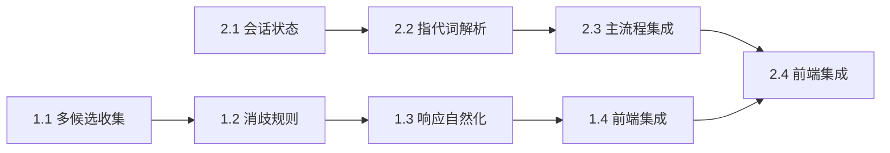

# Phase 1: 基础能力 - 子方案

> **版本**: 1.0.0
> **父方案**: [AGENT_UPGRADE_IMPLEMENTATION_PLAN.md](../AGENT_UPGRADE_IMPLEMENTATION_PLAN.md)
> **日期**: 2025-12-25
> **状态**: 待开发

---

## 概览

| 属性      | 值                                          |
| --------- | ------------------------------------------- |
| **目标**  | 解决意图误判 + 建立上下文记忆基础           |
| **周期**  | 4 周                                        |
| **工时**  | 46h (+8h 前端集成)                          |
| **Batch** | Batch 1 (意图精准化) + Batch 2 (上下文记忆) |

---

## 核心问题

### 问题 1: 意图误判

**现象**: 用户说"梳理内容总结纪要"，系统误判为 `organize` 而非 `create`

**根因分析**:

- 当前分类器采用"首次匹配"策略，遇到"梳理"就返回 organize
- 缺少对复合意图的消歧能力
- 无法识别"动词+宾语"的句法结构

### 问题 2: 上下文断裂

**现象**: 用户说"把刚才的保存下来"，系统无法理解"刚才的"指代什么

**根因分析**:

- 无会话级状态管理
- 指代词（刚才、这些、那个）无解析逻辑
- 每次请求独立处理，无记忆

---

## Batch 1: 意图精准化 (24h)

### 1.1 多候选收集机制 (6h)

**目标**: 收集所有匹配规则，而非返回第一个匹配

| #     | 任务                                | 工时 | 文件路径                                                       | 验收标准                                   |
| ----- | ----------------------------------- | ---- | -------------------------------------------------------------- | ------------------------------------------ |
| 1.1.1 | [ ] 创建 `IntentCandidate` 类型定义 | 0.5h | `src/lib/ai-skills/router/types.ts`                            | 类型包含 pattern, type, weight, matchIndex |
| 1.1.2 | [ ] 实现 `collectAllMatches()` 方法 | 2h   | `src/lib/ai-skills/router/intent-classifier.ts`                | 返回所有命中规则，不立即返回               |
| 1.1.3 | [ ] 添加候选去重逻辑                | 1h   | `src/lib/ai-skills/router/intent-classifier.ts`                | 相同 type 只保留最高权重                   |
| 1.1.4 | [ ] 编写单元测试                    | 1.5h | `src/lib/ai-skills/router/__tests__/intent-classifier.test.ts` | 覆盖 10+ 场景                              |
| 1.1.5 | [ ] 测试用例: "梳理内容总结纪要"    | 0.5h | 同上                                                           | 返回 organize + create 两个候选            |
| 1.1.6 | [ ] 测试用例: "整理并总结"          | 0.5h | 同上                                                           | 返回多候选                                 |

**最佳实践参考**: [best-practices.md#多候选收集](./best-practices.md#11-多候选收集机制)

---

### 1.2 消歧规则引擎 (8h)

**目标**: 多候选时智能选择正确意图

| #      | 任务                               | 工时 | 文件路径                                                    | 验收标准                                |
| ------ | ---------------------------------- | ---- | ----------------------------------------------------------- | --------------------------------------- |
| 1.2.1  | [ ] 创建 `DisambiguationRule` 类型 | 0.5h | `src/lib/ai-skills/router/types.ts`                         | 包含 conflicts, pattern, winner, reason |
| 1.2.2  | [ ] 创建消歧规则配置文件           | 1h   | `src/lib/ai-skills/router/disambiguation-rules.ts`          | 至少 10 条规则                          |
| 1.2.3  | [ ] 规则: 动词+宾语结构            | 0.5h | 同上                                                        | "梳理...总结" → create                  |
| 1.2.4  | [ ] 规则: 主谓结构                 | 0.5h | 同上                                                        | "总结并整理" → create                   |
| 1.2.5  | [ ] 规则: 搜索优先                 | 0.5h | 同上                                                        | "找一下...那篇" → query                 |
| 1.2.6  | [ ] 规则: 统计优先                 | 0.5h | 同上                                                        | "有多少" → query                        |
| 1.2.7  | [ ] 规则: 导出优先                 | 0.5h | 同上                                                        | "导出成..." → export                    |
| 1.2.8  | [ ] 实现 `disambiguate()` 方法     | 2h   | `src/lib/ai-skills/router/intent-classifier.ts`             | 按规则选择 winner                       |
| 1.2.9  | [ ] 集成到 `classify()` 主流程     | 1h   | 同上                                                        | 多候选时自动调用消歧                    |
| 1.2.10 | [ ] 编写测试用例                   | 1h   | `src/lib/ai-skills/router/__tests__/disambiguation.test.ts` | 覆盖所有规则                            |

**最佳实践参考**: [best-practices.md#消歧规则](./best-practices.md#12-消歧规则引擎)

---

### 1.3 响应自然化 (6h)

**目标**: 去除机械感，增加跟进建议

| #     | 任务                            | 工时 | 文件路径                                                       | 验收标准                         |
| ----- | ------------------------------- | ---- | -------------------------------------------------------------- | -------------------------------- |
| 1.3.1 | [ ] 创建响应风格配置            | 1h   | `src/lib/ai-skills/response/style-config.ts`                   | 定义禁用短语、直接模板、跟进建议 |
| 1.3.2 | [ ] 定义禁用短语列表            | 0.5h | 同上                                                           | "根据您的请求"等 10+ 短语        |
| 1.3.3 | [ ] 定义直接响应模板            | 1h   | 同上                                                           | search/list/stats 各类模板       |
| 1.3.4 | [ ] 定义跟进建议模板            | 0.5h | 同上                                                           | 各场景的下一步建议               |
| 1.3.5 | [ ] 创建 `ResponseStyler` 类    | 1.5h | `src/lib/ai-skills/response/response-styler.ts`                | format() 方法                    |
| 1.3.6 | [ ] 集成到 UnifiedOutputAdapter | 0.5h | `src/lib/ai-skills/output/adapter.ts`                          | 所有输出经过风格化               |
| 1.3.7 | [ ] 编写测试用例                | 1h   | `src/lib/ai-skills/response/__tests__/response-styler.test.ts` | 验证无禁用短语                   |

**最佳实践参考**: [best-practices.md#响应自然化](./best-practices.md#13-响应自然化)

---

### 1.4 前端集成 (4h)

**目标**: 将 Batch 1 后端改动集成到现有 AI Chat 前端

| #     | 任务                         | 工时 | 文件路径                                           | 验收标准                          |
| ----- | ---------------------------- | ---- | -------------------------------------------------- | --------------------------------- |
| 1.4.1 | [ ] 更新消息渲染支持跟进建议 | 1.5h | `src/components/ai-chat/message-item.tsx`          | 显示"继续找？/看详情？"等快捷按钮 |
| 1.4.2 | [ ] 创建跟进建议按钮组件     | 1h   | `src/components/ai-chat/follow-up-suggestions.tsx` | 可点击的建议按钮                  |
| 1.4.3 | [ ] 点击跟进建议自动发送消息 | 1h   | `src/components/ai-chat/chat-input.tsx`            | 点击后填充输入框并发送            |
| 1.4.4 | [ ] 前端集成测试             | 0.5h | 手动测试                                           | 响应自然化 + 跟进建议可用         |

**最佳实践参考**: [best-practices.md#前端集成](./best-practices.md#14-前端集成)

---

## Batch 2: 上下文记忆 (26h)

### 2.1 会话状态管理 (8h)

**目标**: 实现单会话内的上下文记忆

| #     | 任务                              | 工时 | 文件路径                                             | 验收标准                            |
| ----- | --------------------------------- | ---- | ---------------------------------------------------- | ----------------------------------- |
| 2.1.1 | [ ] 创建 `ConversationState` 类型 | 1h   | `src/lib/ai-memory/types.ts`                         | 包含 messages, lastOutput, mentions |
| 2.1.2 | [ ] 创建 `SessionMemory` 类       | 2h   | `src/lib/ai-memory/session-memory.ts`                | get/set/clear 方法                  |
| 2.1.3 | [ ] 实现内存存储适配器            | 1h   | `src/lib/ai-memory/adapters/memory-adapter.ts`       | Map<conversationId, State>          |
| 2.1.4 | [ ] 实现 `recordOutput()` 方法    | 1h   | `src/lib/ai-memory/session-memory.ts`                | 记录 AI 返回结果                    |
| 2.1.5 | [ ] 实现 `recordMention()` 方法   | 1h   | 同上                                                 | 记录提及的书签/文件夹               |
| 2.1.6 | [ ] 实现过期清理机制              | 1h   | 同上                                                 | 30 分钟无活动自动清理               |
| 2.1.7 | [ ] 编写测试用例                  | 1h   | `src/lib/ai-memory/__tests__/session-memory.test.ts` | 存取 + 过期测试                     |

**最佳实践参考**: [best-practices.md#会话状态管理](./best-practices.md#21-会话状态管理)

---

### 2.2 指代词解析 (8h)

**目标**: 解析"刚才"、"这些"、"那个"等指代词

| #     | 任务                            | 工时 | 文件路径                                                 | 验收标准                |
| ----- | ------------------------------- | ---- | -------------------------------------------------------- | ----------------------- |
| 2.2.1 | [ ] 创建 `ReferenceResolver` 类 | 1h   | `src/lib/ai-memory/reference-resolver.ts`                | resolve() 方法          |
| 2.2.2 | [ ] 实现"刚才/刚刚"解析         | 1h   | 同上                                                     | → lastOutput            |
| 2.2.3 | [ ] 实现"这些/这几个"解析       | 1h   | 同上                                                     | → lastSearchResults     |
| 2.2.4 | [ ] 实现"那个文件夹"解析        | 1h   | 同上                                                     | → mentionedFolders[0]   |
| 2.2.5 | [ ] 实现"那篇文章"解析          | 1h   | 同上                                                     | → mentionedBookmarks[0] |
| 2.2.6 | [ ] 实现"上一个"解析            | 1h   | 同上                                                     | → 上一轮的操作对象      |
| 2.2.7 | [ ] 编写测试用例                | 2h   | `src/lib/ai-memory/__tests__/reference-resolver.test.ts` | 覆盖所有指代词          |

**最佳实践参考**: [best-practices.md#指代词解析](./best-practices.md#22-指代词解析)

---

### 2.3 集成到主流程 (6h)

**目标**: 将记忆模块集成到 UnifiedEngine

| #     | 任务                                 | 工时 | 文件路径                                          | 验收标准                        |
| ----- | ------------------------------------ | ---- | ------------------------------------------------- | ------------------------------- |
| 2.3.1 | [ ] 创建 `MemoryManager` 门面类      | 1h   | `src/lib/ai-memory/memory-manager.ts`             | 统一入口                        |
| 2.3.2 | [ ] 修改 UnifiedEngine 构造函数      | 0.5h | `src/lib/ai-skills/engine/unified-engine.ts`      | 注入 MemoryManager              |
| 2.3.3 | [ ] 在请求前解析指代词               | 1h   | 同上                                              | 调用 ReferenceResolver          |
| 2.3.4 | [ ] 在响应后记录输出                 | 1h   | 同上                                              | 调用 SessionMemory.recordOutput |
| 2.3.5 | [ ] 修改 API 路由传递 conversationId | 0.5h | `src/app/api/agent/unified/route.ts`              | 从请求中提取                    |
| 2.3.6 | [ ] 编写集成测试                     | 2h   | `src/lib/ai-memory/__tests__/integration.test.ts` | 多轮对话场景                    |

---

### 2.4 前端集成 (4h)

**目标**: 前端维护 conversationId + 显示记忆状态

| #     | 任务                              | 工时 | 文件路径                                      | 验收标准                    |
| ----- | --------------------------------- | ---- | --------------------------------------------- | --------------------------- |
| 2.4.1 | [ ] 前端生成并维护 conversationId | 1h   | `src/hooks/use-ai-chat.ts`                    | UUID 生成，会话级存储       |
| 2.4.2 | [ ] API 请求携带 conversationId   | 0.5h | `src/lib/ai-chat/api.ts`                      | 所有请求带 conversationId   |
| 2.4.3 | [ ] 显示"AI 记住了"提示           | 1h   | `src/components/ai-chat/memory-indicator.tsx` | 指代解析成功时显示          |
| 2.4.4 | [ ] 新会话时重置 conversationId   | 0.5h | `src/components/ai-chat/chat-container.tsx`   | 点击"新对话"时重置          |
| 2.4.5 | [ ] 前端集成测试                  | 1h   | 手动测试                                      | "把刚才的...保存"能正确工作 |

**最佳实践参考**: [best-practices.md#前端集成](./best-practices.md#24-前端集成)

---

## 验收标准

### Batch 1 完成标准

- [ ] "梳理内容总结纪要" 正确识别为 `create` 意图
- [ ] "整理并总结" 正确识别为 `create` 意图
- [ ] "找一下那篇AI文章" 正确识别为 `query` 意图
- [ ] 响应不包含"根据您的请求"等机械短语
- [ ] 搜索结果后显示"继续找？"等跟进建议

### Batch 2 完成标准

- [ ] "把刚才的保存下来" 能正确解析"刚才的"
- [ ] "这些都移到学习文件夹" 能正确解析"这些"
- [ ] 30 分钟无活动后会话状态自动清理
- [ ] 新对话按钮点击后 conversationId 重置

---

## 风险与缓解

| 风险             | 影响     | 概率 | 缓解措施                           |
| ---------------- | -------- | ---- | ---------------------------------- |
| 消歧规则不够覆盖 | 仍有误判 | 中   | 收集真实对话数据验证，迭代补充规则 |
| 指代词解析歧义   | 错误引用 | 低   | 多个匹配时返回最近一个，或请求澄清 |
| 会话状态内存占用 | 性能问题 | 低   | 设置最大会话数限制 + 过期清理      |

---

## 依赖关系

---

## 相关文档

- [最佳实践参考](./best-practices.md)
- [验证用例](./validation-cases.md)
- [父方案](../AGENT_UPGRADE_IMPLEMENTATION_PLAN.md)
