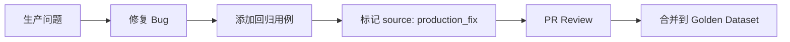

# 回归测试集标准 (Regression Test Suite Standard)

> **版本**: v1.0.0
> **创建日期**: 2026-01-10
> **状态**: 待审核
> **关联文档**: [intent-slot-schema.md](./intent-slot-schema.md)

---

## 一、概述

### 1.1 目的

建立意图识别系统的**黄金数据集 (Golden Dataset)**，确保：

1. 任何系统变更都必须通过回归测试
2. 自动发现的新模式不会破坏现有功能
3. 提供可量化的准确率基准
4. 支持 CI/CD 自动化验证

### 1.2 核心原则

| 原则           | 说明                              |
| -------------- | --------------------------------- |
| **稳定性优先** | Critical 用例 100% 通过才能发布   |
| **渐进增长**   | 生产问题修复后添加对应用例        |
| **多样覆盖**   | 涵盖标准/口语/指代/复合等多种表达 |
| **可追溯**     | 每个用例都有来源和优先级标记      |

---

## 二、测试用例分级

### 2.1 优先级定义

| 级别             | 标识 | 说明                 | 通过率要求 | 回归容忍 |
| ---------------- | ---- | -------------------- | ---------- | -------- |
| **Critical**     | 🔴   | 核心功能，生产事故级 | 100%       | 0 个     |
| **Important**    | 🟡   | 重要功能，体验影响   | ≥95%       | ≤2 个    |
| **Nice-to-have** | 🟢   | 边缘场景，可接受降级 | ≥85%       | 无硬限   |

### 2.2 发布门控规则

```typescript
// 位置: scripts/validate-intent-regression.ts

const RELEASE_GATE = {
  critical: {
    passRate: 100, // 必须全过
    maxRegression: 0, // 不允许回归
  },
  important: {
    passRate: 95, // 至少 95% 通过
    maxRegression: 2, // 最多降 2 个
  },
  overall: {
    passRate: 90, // 总体至少 90%
  },
};

export function checkReleaseGate(results: TestResults): GateResult {
  const critical = results.filter((r) => r.priority === "critical");
  const important = results.filter((r) => r.priority === "important");

  // Critical 检查
  const criticalPass = critical.filter((r) => r.passed).length;
  if (criticalPass < critical.length) {
    return {
      passed: false,
      reason: `Critical 用例未全部通过: ${criticalPass}/${critical.length}`,
      blocking: true,
    };
  }

  // Important 检查
  const importantPassRate =
    important.filter((r) => r.passed).length / important.length;
  if (importantPassRate < 0.95) {
    return {
      passed: false,
      reason: `Important 用例通过率不足: ${(importantPassRate * 100).toFixed(1)}%`,
      blocking: true,
    };
  }

  // 总体检查
  const overallPassRate =
    results.filter((r) => r.passed).length / results.length;
  if (overallPassRate < 0.9) {
    return {
      passed: false,
      reason: `总体通过率不足: ${(overallPassRate * 100).toFixed(1)}%`,
      blocking: false, // 警告但不阻塞
    };
  }

  return { passed: true };
}
```

---

## 三、测试用例结构

### 3.1 用例数据结构

```typescript
// 位置: src/lib/ai-skills/testing/types.ts

interface GoldenTestCase {
  id: string; // 唯一标识，如 "C001"
  priority: "critical" | "important" | "nice-to-have";
  category: TestCategory;

  // 输入
  input: string; // 用户输入
  context?: {
    // 可选上下文
    selectedBookmarks?: number;
    currentFolder?: string;
    lastIntent?: string;
    lastMentionedBookmark?: { title: string };
  };

  // 期望输出
  expected: {
    type: string;
    subType: string;
    slots?: Record<string, unknown>;
    // 允许多个正确答案
    alternatives?: Array<{ type: string; subType: string }>;
  };

  // 元信息
  source: "manual" | "production_fix" | "discovered";
  addedAt: string; // ISO 日期
  description?: string; // 用例说明
  tags?: string[]; // 分类标签
}

type TestCategory =
  | "standard" // 标准表达
  | "colloquial" // 口语化
  | "reference" // 指代（这些、那个）
  | "compound" // 复合意图
  | "edge_case" // 边缘情况
  | "negative" // 否定/取消
  | "ambiguous"; // 模糊场景
```

### 3.2 用例文件位置

```
src/lib/ai-skills/testing/
├── golden-dataset/
│   ├── index.ts                 # 汇总导出
│   ├── critical.ts              # Critical 用例 (30+)
│   ├── important.ts             # Important 用例 (50+)
│   ├── nice-to-have.ts          # Nice-to-have 用例 (20+)
│   └── production-fixes.ts      # 生产问题修复用例
├── runner.ts                    # 测试执行器
├── reporter.ts                  # 结果报告器
└── types.ts                     # 类型定义
```

---

## 四、Critical 用例 (30 条)

### 4.1 搜索类 (5 条)

```typescript
// 位置: src/lib/ai-skills/testing/golden-dataset/critical.ts

export const CRITICAL_SEARCH_CASES: GoldenTestCase[] = [
  {
    id: "C001",
    priority: "critical",
    category: "standard",
    input: "搜索 React",
    expected: {
      type: "query",
      subType: "search",
      slots: { keyword: "React" },
    },
    source: "manual",
    addedAt: "2026-01-10",
    description: "最基础的搜索场景",
  },
  {
    id: "C002",
    priority: "critical",
    category: "standard",
    input: "找一下关于前端的文章",
    expected: {
      type: "query",
      subType: "search",
      slots: { keyword: "前端" },
    },
    source: "manual",
    addedAt: "2026-01-10",
  },
  {
    id: "C003",
    priority: "critical",
    category: "colloquial",
    input: "帮我找找 Vue 相关的",
    expected: {
      type: "query",
      subType: "search",
      slots: { keyword: "Vue" },
    },
    source: "manual",
    addedAt: "2026-01-10",
    description: "口语化搜索",
  },
  {
    id: "C004",
    priority: "critical",
    category: "standard",
    input: "搜索上周收藏的 TypeScript 教程",
    expected: {
      type: "query",
      subType: "search",
      slots: {
        keyword: "TypeScript 教程",
        timeRange: { type: "relative", relative: "week" },
      },
    },
    source: "manual",
    addedAt: "2026-01-10",
    description: "带时间筛选的搜索",
  },
  {
    id: "C005",
    priority: "critical",
    category: "standard",
    input: "找 B站 的视频",
    expected: {
      type: "query",
      subType: "search",
      slots: {
        platform: ["bilibili"],
      },
    },
    source: "manual",
    addedAt: "2026-01-10",
    description: "带平台筛选的搜索",
  },
];
```

### 4.2 操作类 (8 条)

```typescript
export const CRITICAL_ACTION_CASES: GoldenTestCase[] = [
  {
    id: "C006",
    priority: "critical",
    category: "standard",
    input: "删除这个书签",
    context: { selectedBookmarks: 1 },
    expected: {
      type: "action",
      subType: "delete",
      slots: { target: { type: "selected" } },
    },
    source: "manual",
    addedAt: "2026-01-10",
  },
  {
    id: "C007",
    priority: "critical",
    category: "reference",
    input: "把这些移到工作文件夹",
    context: { selectedBookmarks: 5 },
    expected: {
      type: "action",
      subType: "move",
      slots: {
        target: { type: "selected" },
        destination: { type: "folder", folderName: "工作" },
      },
    },
    source: "manual",
    addedAt: "2026-01-10",
    description: "指代+移动",
  },
  {
    id: "C008",
    priority: "critical",
    category: "standard",
    input: "给这篇文章打上「前端」标签",
    context: { selectedBookmarks: 1 },
    expected: {
      type: "action",
      subType: "tag",
      slots: {
        target: { type: "selected" },
        tags: ["前端"],
      },
    },
    source: "manual",
    addedAt: "2026-01-10",
  },
  {
    id: "C009",
    priority: "critical",
    category: "colloquial",
    input: "这个不要了",
    context: { selectedBookmarks: 1 },
    expected: {
      type: "action",
      subType: "delete",
      slots: { target: { type: "selected" } },
    },
    source: "manual",
    addedAt: "2026-01-10",
    description: "口语化删除",
  },
  {
    id: "C010",
    priority: "critical",
    category: "standard",
    input: "收藏这个",
    expected: {
      type: "action",
      subType: "star",
      slots: { starred: true },
    },
    source: "manual",
    addedAt: "2026-01-10",
  },
  {
    id: "C011",
    priority: "critical",
    category: "standard",
    input: "标记为已读",
    context: { selectedBookmarks: 3 },
    expected: {
      type: "action",
      subType: "mark_read",
      slots: { isRead: true },
    },
    source: "manual",
    addedAt: "2026-01-10",
  },
  {
    id: "C012",
    priority: "critical",
    category: "reference",
    input: "那个文章移到学习文件夹",
    context: { lastMentionedBookmark: { title: "React Hooks 入门" } },
    expected: {
      type: "action",
      subType: "move",
      slots: {
        destination: { type: "folder", folderName: "学习" },
      },
    },
    source: "manual",
    addedAt: "2026-01-10",
    description: "指代上文提及的书签",
  },
  {
    id: "C013",
    priority: "critical",
    category: "negative",
    input: "取消删除",
    expected: {
      type: "action",
      subType: "undo",
    },
    source: "manual",
    addedAt: "2026-01-10",
    description: "撤销操作",
  },
];
```

### 4.3 整理类 (5 条)

```typescript
export const CRITICAL_ORGANIZE_CASES: GoldenTestCase[] = [
  {
    id: "C014",
    priority: "critical",
    category: "standard",
    input: "整理一下我的收藏",
    expected: {
      type: "organize",
      subType: "cleanup",
    },
    source: "manual",
    addedAt: "2026-01-10",
  },
  {
    id: "C015",
    priority: "critical",
    category: "colloquial",
    input: "帮我把收藏弄一弄",
    expected: {
      type: "organize",
      subType: "cleanup",
    },
    source: "manual",
    addedAt: "2026-01-10",
    description: "口语化整理",
  },
  {
    id: "C016",
    priority: "critical",
    category: "standard",
    input: "清理重复的书签",
    expected: {
      type: "organize",
      subType: "dedupe",
    },
    source: "manual",
    addedAt: "2026-01-10",
  },
  {
    id: "C017",
    priority: "critical",
    category: "standard",
    input: "自动分类未整理的书签",
    expected: {
      type: "organize",
      subType: "classify",
      slots: { target: { type: "filtered", filter: { hasFolder: false } } },
    },
    source: "manual",
    addedAt: "2026-01-10",
  },
  {
    id: "C018",
    priority: "critical",
    category: "standard",
    input: "给没有标签的书签打标签",
    expected: {
      type: "organize",
      subType: "tag",
      slots: { target: { type: "filtered", filter: { hasTag: false } } },
    },
    source: "manual",
    addedAt: "2026-01-10",
  },
];
```

### 4.4 创建类 (5 条)

```typescript
export const CRITICAL_CREATE_CASES: GoldenTestCase[] = [
  {
    id: "C019",
    priority: "critical",
    category: "standard",
    input: "导出为 Markdown",
    expected: {
      type: "create",
      subType: "export",
      slots: { format: "markdown" },
    },
    source: "manual",
    addedAt: "2026-01-10",
  },
  {
    id: "C020",
    priority: "critical",
    category: "standard",
    input: "生成摘要",
    context: { selectedBookmarks: 1 },
    expected: {
      type: "create",
      subType: "digest",
    },
    source: "manual",
    addedAt: "2026-01-10",
  },
  {
    id: "C021",
    priority: "critical",
    category: "standard",
    input: "朗读这篇文章",
    context: { selectedBookmarks: 1 },
    expected: {
      type: "create",
      subType: "tts",
    },
    source: "manual",
    addedAt: "2026-01-10",
  },
  {
    id: "C022",
    priority: "critical",
    category: "standard",
    input: "保存这段总结到笔记",
    expected: {
      type: "create",
      subType: "md_collection",
    },
    source: "manual",
    addedAt: "2026-01-10",
  },
  {
    id: "C023",
    priority: "critical",
    category: "standard",
    input: "导入 Chrome 书签",
    expected: {
      type: "create",
      subType: "import",
      slots: { source: "chrome" },
    },
    source: "manual",
    addedAt: "2026-01-10",
  },
];
```

### 4.5 闲聊类 (4 条)

```typescript
export const CRITICAL_CHITCHAT_CASES: GoldenTestCase[] = [
  {
    id: "C024",
    priority: "critical",
    category: "standard",
    input: "你好",
    expected: {
      type: "chitchat",
      subType: "greeting",
    },
    source: "manual",
    addedAt: "2026-01-10",
  },
  {
    id: "C025",
    priority: "critical",
    category: "standard",
    input: "帮助",
    expected: {
      type: "chitchat",
      subType: "help",
    },
    source: "manual",
    addedAt: "2026-01-10",
  },
  {
    id: "C026",
    priority: "critical",
    category: "standard",
    input: "谢谢",
    expected: {
      type: "chitchat",
      subType: "thanks",
    },
    source: "manual",
    addedAt: "2026-01-10",
  },
  {
    id: "C027",
    priority: "critical",
    category: "edge_case",
    input: "随便聊聊",
    expected: {
      type: "chitchat",
      subType: "general",
      alternatives: [{ type: "chitchat", subType: "*" }],
    },
    source: "manual",
    addedAt: "2026-01-10",
  },
];
```

### 4.6 查询类 (3 条)

```typescript
export const CRITICAL_QUERY_CASES: GoldenTestCase[] = [
  {
    id: "C028",
    priority: "critical",
    category: "standard",
    input: "我有多少收藏",
    expected: {
      type: "query",
      subType: "count",
    },
    source: "manual",
    addedAt: "2026-01-10",
  },
  {
    id: "C029",
    priority: "critical",
    category: "standard",
    input: "列出最近的书签",
    expected: {
      type: "query",
      subType: "list",
      slots: { timeRange: { type: "relative", relative: "recent" } },
    },
    source: "manual",
    addedAt: "2026-01-10",
  },
  {
    id: "C030",
    priority: "critical",
    category: "standard",
    input: "看看这个书签的详情",
    context: { selectedBookmarks: 1 },
    expected: {
      type: "query",
      subType: "get",
    },
    source: "manual",
    addedAt: "2026-01-10",
  },
];
```

---

## 五、Important 用例 (50 条示例)

### 5.1 复合意图 (10 条)

```typescript
export const IMPORTANT_COMPOUND_CASES: GoldenTestCase[] = [
  {
    id: "I001",
    priority: "important",
    category: "compound",
    input: "整理并导出为 Markdown",
    expected: {
      type: "compound",
      subType: "multi",
      slots: {
        intents: [
          { type: "organize", subType: "cleanup" },
          { type: "create", subType: "export", slots: { format: "markdown" } },
        ],
      },
    },
    source: "manual",
    addedAt: "2026-01-10",
  },
  {
    id: "I002",
    priority: "important",
    category: "compound",
    input: "搜索 React 然后导出",
    expected: {
      type: "compound",
      subType: "multi",
      slots: {
        intents: [
          { type: "query", subType: "search", slots: { keyword: "React" } },
          { type: "create", subType: "export" },
        ],
      },
    },
    source: "manual",
    addedAt: "2026-01-10",
  },
  // ... 更多复合意图用例
];
```

### 5.2 模糊表达 (10 条)

```typescript
export const IMPORTANT_AMBIGUOUS_CASES: GoldenTestCase[] = [
  {
    id: "I011",
    priority: "important",
    category: "ambiguous",
    input: "太多了",
    expected: {
      type: "organize",
      subType: "cleanup",
      // 隐含意图：整理，而非删除
    },
    source: "manual",
    addedAt: "2026-01-10",
    description: "表达数量多但不是要删除",
  },
  {
    id: "I012",
    priority: "important",
    category: "ambiguous",
    input: "乱七八糟的",
    expected: {
      type: "organize",
      subType: "cleanup",
    },
    source: "manual",
    addedAt: "2026-01-10",
  },
  // ... 更多模糊表达用例
];
```

### 5.3 否定/取消 (5 条)

```typescript
export const IMPORTANT_NEGATIVE_CASES: GoldenTestCase[] = [
  {
    id: "I021",
    priority: "important",
    category: "negative",
    input: "不要删除",
    expected: {
      type: "action",
      subType: "cancel",
    },
    source: "manual",
    addedAt: "2026-01-10",
  },
  {
    id: "I022",
    priority: "important",
    category: "negative",
    input: "算了，取消",
    expected: {
      type: "action",
      subType: "cancel",
    },
    source: "manual",
    addedAt: "2026-01-10",
  },
  // ... 更多否定用例
];
```

---

## 六、测试执行器

### 6.1 执行器实现

```typescript
// 位置: src/lib/ai-skills/testing/runner.ts

import { GoldenTestCase, TestResult } from "./types";
import { HybridIntentClassifier } from "../router/hybrid-intent-classifier";

export class IntentTestRunner {
  private classifier: HybridIntentClassifier;

  constructor(classifier: HybridIntentClassifier) {
    this.classifier = classifier;
  }

  async runAll(cases: GoldenTestCase[]): Promise<TestResult[]> {
    const results: TestResult[] = [];

    for (const testCase of cases) {
      const result = await this.runSingle(testCase);
      results.push(result);
    }

    return results;
  }

  async runSingle(testCase: GoldenTestCase): Promise<TestResult> {
    const startTime = Date.now();

    try {
      const actual = await this.classifier.classify(
        testCase.input,
        testCase.context || {},
      );

      const passed = this.compare(testCase.expected, actual);
      const latency = Date.now() - startTime;

      return {
        id: testCase.id,
        priority: testCase.priority,
        passed,
        expected: testCase.expected,
        actual: {
          type: actual.type,
          subType: actual.subType,
          slots: actual.slots,
          confidence: actual.confidence,
        },
        latency,
        error: null,
      };
    } catch (error) {
      return {
        id: testCase.id,
        priority: testCase.priority,
        passed: false,
        expected: testCase.expected,
        actual: null,
        latency: Date.now() - startTime,
        error: error instanceof Error ? error.message : String(error),
      };
    }
  }

  private compare(expected: any, actual: any): boolean {
    // 基础类型匹配
    if (expected.type !== actual.type) return false;
    if (expected.subType !== actual.subType) {
      // 检查备选项
      if (
        expected.alternatives?.some(
          (alt: any) =>
            alt.type === actual.type && alt.subType === actual.subType,
        )
      ) {
        return true;
      }
      return false;
    }

    // 槽位匹配（可选，宽松模式）
    if (expected.slots) {
      for (const [key, value] of Object.entries(expected.slots)) {
        if (!this.deepEqual(value, actual.slots?.[key])) {
          // 槽位不匹配时仅警告，不失败
          console.warn(
            `Slot mismatch for ${key}: expected ${JSON.stringify(value)}, got ${JSON.stringify(actual.slots?.[key])}`,
          );
        }
      }
    }

    return true;
  }

  private deepEqual(a: any, b: any): boolean {
    return JSON.stringify(a) === JSON.stringify(b);
  }
}
```

### 6.2 CLI 工具

```typescript
// 位置: scripts/intent-test.ts

import { IntentTestRunner } from "../src/lib/ai-skills/testing/runner";
import { ALL_GOLDEN_CASES } from "../src/lib/ai-skills/testing/golden-dataset";
import { checkReleaseGate } from "./validate-intent-regression";

async function main() {
  const args = process.argv.slice(2);
  const singleInput = args.find((a) => !a.startsWith("--"));

  const classifier = await createClassifier();
  const runner = new IntentTestRunner(classifier);

  if (singleInput) {
    // 单条测试模式
    console.log(`\n🔍 Testing: "${singleInput}"\n`);
    const result = await runner.runSingle({
      id: "CLI",
      priority: "nice-to-have",
      category: "standard",
      input: singleInput,
      expected: { type: "*", subType: "*" },
      source: "manual",
      addedAt: new Date().toISOString(),
    });

    console.log(`Intent: ${result.actual?.type}:${result.actual?.subType}`);
    console.log(`Confidence: ${(result.actual?.confidence * 100).toFixed(1)}%`);
    console.log(`Slots: ${JSON.stringify(result.actual?.slots, null, 2)}`);
    console.log(`Latency: ${result.latency}ms`);
    return;
  }

  // 全量回归测试
  console.log("\n📋 Running Intent Regression Tests...\n");

  const results = await runner.runAll(ALL_GOLDEN_CASES);

  // 按优先级统计
  const critical = results.filter((r) => r.priority === "critical");
  const important = results.filter((r) => r.priority === "important");
  const niceToHave = results.filter((r) => r.priority === "nice-to-have");

  console.log("=".repeat(60));
  console.log(
    `🔴 Critical:     ${critical.filter((r) => r.passed).length}/${critical.length}`,
  );
  console.log(
    `🟡 Important:    ${important.filter((r) => r.passed).length}/${important.length}`,
  );
  console.log(
    `🟢 Nice-to-have: ${niceToHave.filter((r) => r.passed).length}/${niceToHave.length}`,
  );
  console.log("=".repeat(60));

  // 显示失败用例
  const failed = results.filter((r) => !r.passed);
  if (failed.length > 0) {
    console.log("\n❌ Failed Cases:\n");
    for (const f of failed) {
      console.log(`  [${f.id}] ${f.priority}`);
      console.log(`    Expected: ${f.expected.type}:${f.expected.subType}`);
      console.log(`    Actual:   ${f.actual?.type}:${f.actual?.subType}`);
      if (f.error) console.log(`    Error:    ${f.error}`);
      console.log();
    }
  }

  // 门控检查
  const gate = checkReleaseGate(results);
  if (!gate.passed) {
    console.log(`\n🚫 Release Gate FAILED: ${gate.reason}\n`);
    process.exit(gate.blocking ? 1 : 0);
  } else {
    console.log("\n✅ Release Gate PASSED\n");
  }
}

main().catch(console.error);
```

### 6.3 NPM Scripts

```json
// package.json
{
  "scripts": {
    "intent:test": "tsx scripts/intent-test.ts",
    "intent:test:ci": "tsx scripts/intent-test.ts --ci",
    "intent:validate": "tsx scripts/validate-intent-regression.ts"
  }
}
```

---

## 七、CI/CD 集成

### 7.1 GitHub Actions

```yaml
# .github/workflows/intent-regression.yml
name: Intent Regression Tests

on:
  push:
    paths:
      - "src/lib/ai-skills/**"
      - "src/lib/classification/**"
  pull_request:
    paths:
      - "src/lib/ai-skills/**"
      - "src/lib/classification/**"

jobs:
  regression:
    runs-on: ubuntu-latest
    steps:
      - uses: actions/checkout@v4

      - name: Setup Node.js
        uses: actions/setup-node@v4
        with:
          node-version: "20"
          cache: "npm"

      - name: Install dependencies
        run: npm ci

      - name: Run Intent Regression Tests
        run: npm run intent:test:ci
        env:
          EMBEDDING_SERVICE_URL: ${{ secrets.EMBEDDING_SERVICE_URL }}

      - name: Upload Test Results
        if: always()
        uses: actions/upload-artifact@v4
        with:
          name: intent-test-results
          path: test-results/intent-regression.json
```

---

## 八、用例维护流程

### 8.1 添加新用例



### 8.2 用例审核标准

| 检查项   | 要求                   |
| -------- | ---------------------- |
| 唯一性   | ID 不重复              |
| 完整性   | 必填字段齐全           |
| 准确性   | expected 正确          |
| 描述性   | 边缘用例有 description |
| 分类正确 | category 准确          |

### 8.3 优先级升级规则

- 生产事故 → 自动升级为 Critical
- 用户反馈超过 3 次 → 升级为 Important
- 新发现模式 → 默认 Nice-to-have

---

## 九、版本历史

| 版本   | 日期       | 变更                                      |
| ------ | ---------- | ----------------------------------------- |
| v1.0.0 | 2026-01-10 | 初始版本，30 Critical + 50 Important 用例 |

---

**下一步**: 执行 `npm run intent:test` 验证现有系统
