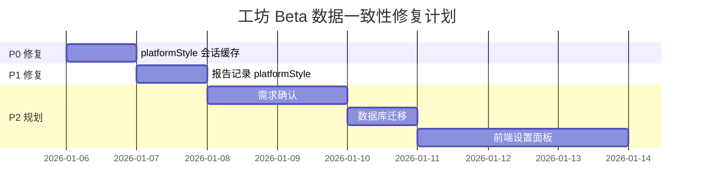

# 工坊 Beta 数据一致性与设置系统优化方案

> **版本**: v1.0
> **日期**: 2026-01-06
> **状态**: 待审核
> **关联文档**: [工坊beta优化.md](./工坊beta优化.md)

---

## 一、问题总览

| 优先级 | 问题                     | 风险等级 | 影响范围 | 工作量  |
| ------ | ------------------------ | -------- | -------- | ------- |
| **P0** | platformStyle 刷新丢失   | 🔴 高    | 用户体验 | 15 行   |
| **P1** | 报告未记录 platformStyle | 🟡 中    | 数据追溯 | 10 行   |
| **P2** | 缺少用户偏好设置系统     | 🔵 低    | 长期体验 | 150+ 行 |

---

## 二、P0 修复：platformStyle 会话缓存

### 问题描述

用户在 outline 步骤选择平台风格后刷新页面，选择会重置为 `"general"`，需要重新选择。

**当前代码** ([blueprint-workflow-client.tsx:200](<src/app/(main)/knowledge-studio/v2/[blueprintId]/blueprint-workflow-client.tsx#L200>)):

```typescript
const [platformStyle, setPlatformStyle] = useState<PlatformStyle>("general");
// ❌ 没有使用 saveToCache/loadFromCache
```

### 修复方案

使用现有的 sessionStorage 缓存机制持久化 platformStyle。

### 变更清单

| 文件                                                                                                              | 变更类型 | 说明         |
| ----------------------------------------------------------------------------------------------------------------- | -------- | ------------ |
| [blueprint-workflow-client.tsx](<src/app/(main)/knowledge-studio/v2/[blueprintId]/blueprint-workflow-client.tsx>) | 修改     | 添加缓存逻辑 |

### 代码变更

```typescript
// ============================================================
// 变更 1: 添加缓存 Key (约第 73 行)
// ============================================================
const CACHE_KEYS = {
  MATERIALS: "ks-v2-materials",
  OUTLINE: "ks-v2-outline",
  CONTENT: "ks-v2-content",
  STRUCTURED_OUTPUT: "ks-v2-structured-output",
  REPORT_ID: "ks-v2-report-id",
  CURRENT_STEP: "ks-v2-current-step",
  BRIEFING_CONTEXT: "ks-v2-briefing-context",
  PLATFORM_STYLE: "ks-v2-platform-style",  // 🆕 新增
} as const;

// ============================================================
// 变更 2: 修改 platformStyle 初始化 (约第 200 行)
// ============================================================
// 修改前:
// const [platformStyle, setPlatformStyle] = useState<PlatformStyle>("general");

// 修改后:
const [platformStyle, setPlatformStyle] = useState<PlatformStyle>(() => {
  const cached = loadFromCache<PlatformStyle>(CACHE_KEYS.PLATFORM_STYLE);
  return cached ?? "general";
});

// ============================================================
// 变更 3: 添加 platformStyle 变更处理器 (在 state 定义之后)
// ============================================================
const handlePlatformStyleChange = useCallback((style: PlatformStyle) => {
  setPlatformStyle(style);
  saveToCache(CACHE_KEYS.PLATFORM_STYLE, style);
}, []);

// ============================================================
// 变更 4: 更新 PlatformStyleSelector 调用 (约第 792 行)
// ============================================================
// 修改前:
// <PlatformStyleSelector
//   value={platformStyle}
//   onChange={setPlatformStyle}
// />

// 修改后:
<PlatformStyleSelector
  value={platformStyle}
  onChange={handlePlatformStyleChange}
/>
```

### 测试验收

- [ ] 选择平台风格后刷新页面，选择应保持
- [ ] 生成完成后调用 `clearAllCache()`，platformStyle 应被清理
- [ ] 不同蓝图之间共享 platformStyle 选择（符合用户习惯）

---

## 三、P1 修复：报告记录 platformStyle

### 问题描述

生成的报告在 `generation_metadata` 中没有记录使用的 platformStyle，无法追溯报告是用哪种风格生成的。

**当前代码** ([generate/route.ts:359-366](src/app/api/knowledge-studio/v2/generate/route.ts#L359)):

```typescript
generation_metadata: {
  blueprint_version: "v2",
  blueprint_id: blueprintId,
  source_bookmark_ids: materials.map((m) => m.bookmarkId),
  has_briefing: !!briefingContext,
  has_outline: !!outline,
  target_length: targetLength,
  // ❌ 缺少 platformStyle
},
```

### 修复方案

在 `generation_metadata` 中添加 `platform_style` 字段。

### 变更清单

| 文件                                                                   | 变更类型 | 说明                     |
| ---------------------------------------------------------------------- | -------- | ------------------------ |
| [generate/route.ts](src/app/api/knowledge-studio/v2/generate/route.ts) | 修改     | 添加 platform_style 字段 |

### 代码变更

```typescript
// ============================================================
// 变更: 在 generation_metadata 中添加 platform_style (约第 359 行)
// ============================================================
generation_metadata: {
  blueprint_version: "v2",
  blueprint_id: blueprintId,
  source_bookmark_ids: materials.map((m) => m.bookmarkId),
  has_briefing: !!briefingContext,
  has_outline: !!outline,
  target_length: targetLength,
  platform_style: platformStyle ?? "general",  // 🆕 新增
},
```

### 向后兼容性

- 旧报告没有 `platform_style` 字段，读取时使用可选链 `?.platform_style`
- 显示时提供默认值：`metadata?.platform_style ?? "通用"`

### 测试验收

- [ ] 新生成报告的 `generation_metadata` 包含 `platform_style`
- [ ] 报告详情页（如果展示）正确显示使用的平台风格
- [ ] 旧报告（无 platform_style）不会报错

---

## 四、P2 规划：用户偏好设置系统

### 问题描述

用户每次使用工坊都需要重新选择平台风格和输出长度，缺少默认偏好设置。

### 推荐方案

**分层设计**：用户设置（数据库持久化） + 页面状态（sessionStorage 临时缓存）

```
用户设置 (数据库持久化 - profiles.ks_preferences)
├── defaultPlatformStyle: "wechat" | "xiaohongshu" | "general"
├── defaultLengthMode: "short" | "medium" | "long"
├── rememberLastSelection: boolean
└── favoriteCondensePreset?: CondensePreset

页面状态 (sessionStorage 临时缓存)
├── platformStyle: 当前选择，默认读取用户设置
├── lengthMode: 当前选择，默认读取用户设置
└── 其他生成过程中的临时状态
```

### 建议放入设置系统的配置

| 配置项           | 理由                                     | 默认值      |
| ---------------- | ---------------------------------------- | ----------- |
| 默认平台风格     | 用户通常专注某一平台，设置后每次无需重选 | `"general"` |
| 默认输出长度     | 个人写作习惯相对固定                     | `"medium"`  |
| 是否记住上次选择 | 让用户选择是否保持上次的临时选择         | `true`      |

### 建议保留在页面选择的配置

| 配置项             | 理由                                               |
| ------------------ | -------------------------------------------------- |
| 当前生成的平台风格 | 允许覆盖默认值，因为同一用户可能为不同平台生成内容 |
| 当前生成的长度模式 | 允许针对具体内容调整                               |
| 精简目标字数       | 高度依赖当前内容，每次可能不同                     |

### 数据库迁移（示例）

```sql
-- supabase/migrations/YYYYMMDD_add_ks_preferences.sql

-- 在 profiles 表添加 ks_preferences JSONB 字段
ALTER TABLE profiles
ADD COLUMN IF NOT EXISTS ks_preferences JSONB DEFAULT '{
  "defaultPlatformStyle": "general",
  "defaultLengthMode": "medium",
  "rememberLastSelection": true
}'::jsonb;

-- 添加 RPC 函数更新偏好
CREATE OR REPLACE FUNCTION update_ks_preferences(
  p_user_id UUID,
  p_preferences JSONB
)
RETURNS VOID AS $$
BEGIN
  UPDATE profiles
  SET ks_preferences = p_preferences,
      updated_at = NOW()
  WHERE id = p_user_id;
END;
$$ LANGUAGE plpgsql SECURITY DEFINER;
```

### 实施建议

此方案工作量较大，建议拆分为多个迭代：

| 迭代       | 内容                                | 预计时间 |
| ---------- | ----------------------------------- | -------- |
| 本次       | P0 + P1 修复                        | 30 分钟  |
| 后续迭代 1 | 添加 `profiles.ks_preferences` 字段 | 1 小时   |
| 后续迭代 2 | UI 设置面板和首次引导               | 4-6 小时 |

---

## 五、执行计划



### 立即执行（本次）

| 任务                       | 文件                          | 变更量 | 风险 |
| -------------------------- | ----------------------------- | ------ | ---- |
| P0: platformStyle 缓存     | blueprint-workflow-client.tsx | ~15 行 | 低   |
| P1: 报告记录 platformStyle | generate/route.ts             | ~5 行  | 低   |

### 后续迭代（建议）

| 任务                 | 依赖                 | 工作量   |
| -------------------- | -------------------- | -------- |
| P2: 用户偏好设置系统 | 需求确认、数据库迁移 | 4-8 小时 |

---

## 六、风险评估

| 风险                                | 影响       | 缓解措施                                      |
| ----------------------------------- | ---------- | --------------------------------------------- |
| sessionStorage 在隐私模式下可能受限 | 缓存不生效 | 使用 try-catch 包裹，失败时静默降级（已实现） |
| generation_metadata 字段类型变化    | 旧数据查询 | 使用可选链访问，添加默认值                    |
| 偏好设置与页面选择冲突              | 用户困惑   | 页面选择优先级 > 偏好设置，明确 UI 提示       |

---

## 七、审核确认

请确认以下内容：

- [ ] **P0 方案**：platformStyle 会话缓存方案是否合理？
- [ ] **P1 方案**：报告记录 platformStyle 方案是否合理？
- [ ] **P2 规划**：用户偏好设置系统是否需要在本次迭代中实施？
- [ ] **执行顺序**：是否同意先执行 P0 + P1，P2 作为后续迭代？

---

**审核通过后，BMad Master 将立即执行 P0 和 P1 修复。**
