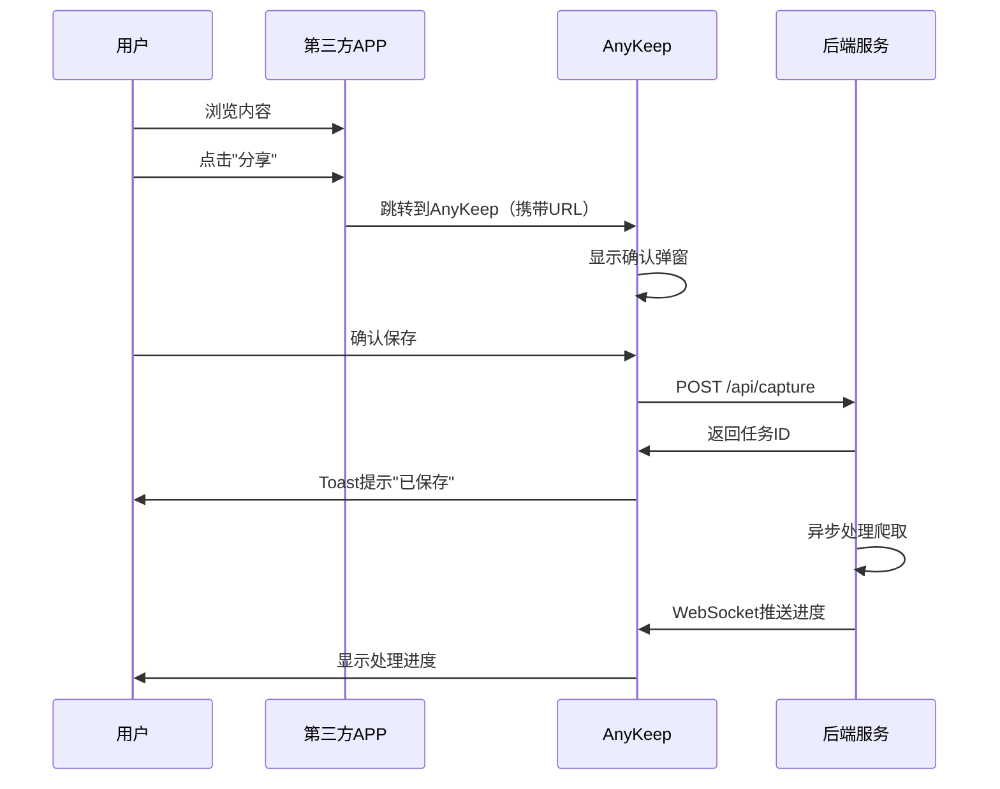

# AnyKeep MVP 产品需求文档（详细版）

**版本**: 2.1
**日期**: 2025-01-19
**状态**: Draft
**作者**: AnyKeep 产品团队

---

## 📋 文档版本记录

| 版本 | 日期       | 修改人   | 修改内容                                                                                                                                                      |
| ---- | ---------- | -------- | ------------------------------------------------------------------------------------------------------------------------------------------------------------- |
| 1.0  | 2025-01-15 | 产品团队 | 初始版本（聚焦微信公众号+视频号+小红书+B站）                                                                                                                  |
| 2.1  | 2025-01-19 | 产品团队 | 补充精华内容：①更精准的产品定位和价值主张②详细的用户画像（含平台使用百分比）③三个生动的核心场景④全面的风险应对策略（含隐私安全UI设计）⑤强调"仅元数据"隐私保护 |

---

## 📚 目录

1. [产品概述](#1-产品概述)
2. [目标用户与核心价值](#2-目标用户与核心价值)
3. [MVP 范围界定](#3-mvp-范围界定)
4. [详细功能规格](#4-详细功能规格)
5. [用户故事与验收标准](#5-用户故事与验收标准)
6. [技术架构设计](#6-技术架构设计)
7. [开发计划与里程碑](#7-开发计划与里程碑)
8. [成功指标](#8-成功指标)
9. [风险与依赖](#9-风险与依赖)

---

## 1. 产品概述

### 1.1 产品定位

AnyKeep 是一款面向职场新人、备考学生、生活规划族的**轻量型跨平台智能内容聚合工具**，通过打通微信公众号、B站、小红书、微信视频号的收藏壁垒，以"**轻量化AI能力 + 极简操作**"为核心，在不影响用户使用微信小红书等app时；帮助用户将分散在各个平台的优质内容统一收藏、智能管理和高效检索。

**核心定位**：

- **内容收藏器**：一键保存任何平台的优质内容的链接（标题/URL/类型等），同时完成标签分类、核心内容AI总结（限制50字以内）与存储
- **知识管理器**：AI 增强的智能分类与检索，自动生成场景化标签
- **学习助手**：快速回溯和应用已收藏的知识，1次检索覆盖四大平台

**核心价值主张**：

- **效率跃迁**：1次检索覆盖四大平台收藏内容，将跨APP查找耗时从平均**12分钟降至40秒内**
- **AI轻量化赋能**：自动生成场景化标签，减少80%手动标签工作量
- **低门槛体验**：3步完成初始化（登录-授权-使用），适配碎片化使用场景
- **隐私安全兜底**：仅获取收藏内容元数据（标题/URL/类型等），不存储完整内容，授权权限可随时回收

### 1.2 产品愿景

> 让每一条有价值的内容都能被妥善保存，让每一次搜索都能精准命中。

### 1.4 MVP 与完整产品的差异

| 维度         | MVP 版本                               | 完整产品                            |
| ------------ | -------------------------------------- | ----------------------------------- |
| **支持平台** | 4个（微信公众号、视频号、小红书、B站） | 10+ 平台                            |
| **收藏方式** | 系统分享菜单                           | 系统分享 + 浏览器插件 + 快捷指令    |
| **AI 功能**  | 摘要生成 + 标签提取                    | 摘要 + 标签 + 智能问答 + 内容推荐   |
| **搜索能力** | 混合检索（向量 + 关键词）              | 混合检索 + 多模态检索（图片、语音） |
| **协作功能** | ❌ 不支持                              | 收藏夹分享、多人协作                |
| **平台**     | iOS + Android + H5                     | iOS + Android + H5 + 浏览器插件     |

---

## 2. 目标用户与核心价值

### 2.1 目标用户画像

#### 主要用户群体（Primary Persona）

**Persona 1：学习型知识工作者（职场新人）**

- **基本信息**：22-28岁，互联网/新媒体行业从业者、设计师、产品经理
- **行为特征**：
  - 日均收藏 3-5 条工作资料，需高频调用案例/教程
  - **平台使用分布**：微信（80%使用时长，存行业报告）、B站（15%，学技能视频）、小红书（5%，看职场技巧）
  - 经常收藏教程、案例，但很少回看
  - 需要时想不起来收藏在哪里
- **核心诉求（按优先级排序）**：
  - **P0**：快速找到工作资料
  - **P1**：按项目分类内容
  - **P2**：标签批量修改
- **典型痛点场景**：写方案时记不清"竞品分析报告"存在微信还是B站，逐个APP翻找耗时15分钟
- **使用场景**：工作中遇到问题时快速检索相关资料，紧急调取素材完成报告

**Persona 2：内容消费重度用户（备考学生）**

- **基本信息**：18-24岁，考研/考公备考学生
- **行为特征**：
  - 日均收藏 5-8 条学习内容，需按科目整合多形式素材
  - **平台使用分布**：B站（50%，存网课视频）、微信（30%，存知识点总结）、小红书（20%，存记忆口诀）
  - 收藏了大量学习资料，但分散在各平台难以系统化复习
  - 想用时找不到，反复搜索
- **核心诉求（按优先级排序）**：
  - **P0**：按科目聚合素材
  - **P1**：快速定位考点内容
  - **P2**：标签关联知识点
- **典型痛点场景**：复习英语阅读时，B站的技巧视频、微信的词汇表、小红书的答题模板分散，无法联动复习
- **使用场景**：备考期间系统化整理学习内容，快速调取知识点

**Persona 3：自我提升爱好者（生活规划族）**

- **基本信息**：25-35岁，追求个人成长，计划旅行/装修等生活场景
- **行为特征**：
  - 阶段性集中收藏，需按场景关联攻略类内容
  - **平台使用分布**：小红书（40%，存攻略笔记）、微信（35%，存行程文档）、B站（25%，存避坑视频）
  - 收藏的内容有明确使用目标，但分散难以统一管理
  - 每天刷小红书、B站、微信公众号超过 2 小时
- **核心诉求（按优先级排序）**：
  - **P0**：按场景整合攻略
  - **P1**：快速调取地址/清单
  - **P2**：内容批量导出
- **典型痛点场景**：整理国庆旅行计划时，小红书的景点攻略、微信的机票酒店文档、B站的当地美食视频无法统一管理
- **使用场景**：周末出游前查找旅游攻略，装修期间整合设计灵感
- **行为特征**：
  - 关注公众号学习干货、看视频号学技能
  - 希望建立个人知识库
  - 需要系统化整理学习内容
- **核心诉求**：将碎片化内容系统化管理
- **使用场景**：定期复习已收藏的学习内容

### 2.2 核心用户价值

#### 价值主张（Value Proposition）

**For** 需要管理跨平台内容的知识工作者和内容重度用户
**Who** 面临内容收藏分散、难以回溯的痛点
**AnyKeep is** 一款跨平台智能内容聚合工具
**That** 提供一键收藏、AI 增强、智能检索的完整解决方案
**Unlike** 各平台原生收藏功能或单一的稍后读工具
**Our product** 支持四大主流平台，AI 自动摘要和标签，混合智能检索

#### 用户价值阶梯

```
Level 4: 自我实现
└─ 建立个人知识体系，持续学习成长

Level 3: 尊重需求
└─ 被认为"有条理"、"高效"的人

Level 2: 社交需求
└─ 与朋友分享优质内容（未来功能）

Level 1: 安全需求
└─ 内容永久保存，不怕丢失

Level 0: 生理需求
└─ 快速找到需要的信息
```

### 2.3 非目标用户

❌ **不适合的用户**：

- 不使用微信/小红书/B站的用户
- 从不收藏内容的用户
- 只使用单一平台的用户

---

## 3. MVP 范围界定

### 3.2 核心功能范围（Feature Scope）

#### ✅ P0 功能（Must Have - MVP 必备）

| 功能模块          | 功能点                         | 优先级 | 开发周期 |
| ----------------- | ------------------------------ | ------ | -------- |
| **F1 内容收藏**   | F1.1 系统分享菜单接收链接      | P0     | Sprint 1 |
|                   | F1.2 URL 解析与平台识别        | P0     | Sprint 1 |
|                   | F1.3 异步爬虫任务队列          | P0     | Sprint 1 |
|                   | F1.4 爬取进度实时推送          | P0     | Sprint 2 |
| **F2 内容管理**   | F2.1 收藏列表展示（瀑布流）    | P0     | Sprint 2 |
|                   | F2.2 按平台筛选                | P0     | Sprint 2 |
|                   | F2.3 按时间排序                | P0     | Sprint 2 |
|                   | F2.4 收藏详情页                | P0     | Sprint 2 |
| **F3 智能检索**   | F3.1 混合检索（向量 + 关键词） | P0     | Sprint 3 |
|                   | F3.2 AI 自动摘要生成           | P0     | Sprint 3 |
|                   | F3.3 AI 自动标签提取           | P0     | Sprint 3 |
|                   | F3.4 搜索历史记录              | P0     | Sprint 3 |
| **F4 图片持久化** | F4.1 图片下载与上传 OSS        | P0     | Sprint 1 |
|                   | F4.2 防盗链处理                | P0     | Sprint 1 |
|                   | F4.3 CDN 加速                  | P0     | Sprint 1 |
| **F5 B站时间戳**  | F5.1 字幕获取与解析            | P0     | Sprint 4 |
|                   | F5.2 AI 提取关键时间点         | P0     | Sprint 4 |
|                   | F5.3 时间戳快速跳转            | P0     | Sprint 4 |
| **F6 用户系统**   | F6.1 手机号登录注册            | P0     | Sprint 1 |
|                   | F6.2 会员体系（FREE/PREMIUM）  | P0     | Sprint 1 |
|                   | F6.3 存储配额管理              | P0     | Sprint 1 |

#### 🔶 P1 功能（Should Have - 重要但非必需）

| 功能模块        | 功能点              | 优先级 | 计划周期 |
| --------------- | ------------------- | ------ | -------- |
| **F7 高级搜索** | F7.1 按标签筛选     | P1     | Sprint 5 |
|                 | F7.2 按日期范围筛选 | P1     | Sprint 5 |
|                 | F7.3 多条件组合搜索 | P1     | Sprint 5 |
| **F8 内容编辑** | F8.1 手动修改标签   | P1     | Sprint 6 |
|                 | F8.2 添加笔记       | P1     | Sprint 6 |
| **F9 数据统计** | F9.1 收藏数量统计   | P1     | Sprint 6 |
|                 | F9.2 平台分布统计   | P1     | Sprint 6 |

#### ❌ P2 功能（Could Have - 暂不实现）

- 收藏夹分享
- 多人协作
- 浏览器插件
- 桌面端应用
- 导出为 PDF/Markdown

### 3.3 技术债务约定

**为了快速验证 MVP，允许的技术债务**：

1. ✅ 爬虫策略暂时写死（不做动态调整）
2. ✅ AI 推理暂时使用云服务（不自建模型）
3. ✅ 前端暂不做离线缓存
4. ✅ 暂不支持批量操作

**不允许的技术债务**：

1. ❌ 数据库设计不能有硬伤（避免后期迁移）
2. ❌ 安全问题（用户数据泄露）
3. ❌ 核心爬虫逻辑不能有明显 bug

---

## 4. 详细功能规格

### 4.1 F1 内容收藏模块

#### F1.1 系统分享菜单接收链接

**功能描述**：
用户在微信、小红书、B站等 APP 中点击"分享"，选择 AnyKeep，系统自动接收并识别链接。

**交互流程**：



**技术实现要点**：

**iOS 端**：

```swift
// Info.plist 配置
<key>CFBundleURLTypes</key>
<array>
    <dict>
        <key>CFBundleURLSchemes</key>
        <array>
            <string>anykeep</string>
        </array>
        <key>CFBundleURLName</key>
        <string>com.anykeep.share</string>
    </dict>
</array>

// AppDelegate.swift 处理分享
func application(_ app: UIApplication, open url: URL, options: [UIApplication.OpenURLOptionsKey : Any] = [:]) -> Bool {
    if url.scheme == "anykeep" {
        let sharedURL = url.absoluteString.replacingOccurrences(of: "anykeep://", with: "")
        // 发送到 Vue 页面处理
        NotificationCenter.default.post(name: NSNotification.Name("ShareURL"), object: sharedURL)
    }
    return true
}
```

**Android 端**：

```xml
<!-- AndroidManifest.xml -->
<activity android:name=".ShareActivity">
    <intent-filter>
        <action android:name="android.intent.action.SEND" />
        <category android:name="android.intent.category.DEFAULT" />
        <data android:mimeType="text/plain" />
    </intent-filter>
</activity>
```

**验收标准**：

- ✅ 能够从微信、小红书、B站分享链接到 AnyKeep
- ✅ 确认弹窗显示内容预览（标题、来源平台）
- ✅ 点击"保存"后 < 200ms 返回响应
- ✅ Toast 提示清晰友好

#### F1.2 URL 解析与平台识别

**功能描述**：
自动识别链接来源平台，提取内容 ID。

**支持的 URL 格式**：

| 平台       | URL 格式示例                                       | 提取规则                        |
| ---------- | -------------------------------------------------- | ------------------------------- |
| 微信公众号 | `https://mp.weixin.qq.com/s/xxxxx`                 | 正则：`/s/([a-zA-Z0-9_-]+)`     |
| 微信视频号 | `https://channels.weixin.qq.com/video/xxxxx`       | 正则：`/video/([a-zA-Z0-9_-]+)` |
| 小红书     | `https://www.xiaohongshu.com/discovery/item/xxxxx` | 正则：`/item/([a-f0-9]+)`       |
| B站        | `https://www.bilibili.com/video/BVxxxxx`           | 正则：`/video/(BV[a-zA-Z0-9]+)` |

**实现代码**：

```java
@Service
public class UrlParserService {

    private static final Map<String, Pattern> PLATFORM_PATTERNS = Map.of(
        "WECHAT_OFFICIAL_ACCOUNT", Pattern.compile("https://mp\\.weixin\\.qq\\.com/s/([a-zA-Z0-9_-]+)"),
        "WECHAT_CHANNELS", Pattern.compile("https://channels\\.weixin\\.qq\\.com/video/([a-zA-Z0-9_-]+)"),
        "XIAOHONGSHU", Pattern.compile("https://www\\.xiaohongshu\\.com/(?:discovery/item|explore)/([a-f0-9]+)"),
        "BILIBILI", Pattern.compile("https://(?:www\\.)?bilibili\\.com/video/(BV[a-zA-Z0-9]+)")
    );

    public PlatformInfo parseUrl(String url) {
        for (Map.Entry<String, Pattern> entry : PLATFORM_PATTERNS.entrySet()) {
            Matcher matcher = entry.getValue().matcher(url);
            if (matcher.find()) {
                return new PlatformInfo(entry.getKey(), matcher.group(1));
            }
        }
        throw new BusinessException("不支持的链接格式");
    }
}
```

**验收标准**：

- ✅ 准确识别四个平台的标准链接
- ✅ 识别短链接（经过跳转的链接）
- ✅ 不支持的链接给出明确错误提示
- ✅ 链接解析耗时 < 50ms

#### F1.3 异步爬虫任务队列

**功能描述**：
使用 RabbitMQ 消息队列异步处理爬虫任务，避免阻塞用户请求。

**架构设计**：

```
用户请求 → API Gateway → 创建任务 → RabbitMQ → 爬虫Worker → OSS + DB
   ↓                         ↓                    ↓
 返回任务ID              入队消息            处理完成推送
   ↓                                              ↓
 WebSocket订阅 ←───────────────────────── Redis Pub/Sub
```

**消息格式**：

```json
{
  "taskId": "uuid-xxxx-xxxx",
  "userId": 12345,
  "url": "https://www.xiaohongshu.com/discovery/item/abc123",
  "platform": "XIAOHONGSHU",
  "priority": 1,
  "createdAt": "2025-01-19T10:00:00Z"
}
```

**任务状态流转**：

```
QUEUED → PROCESSING → COMPLETED
   ↓                       ↓
  RETRY (最多3次)        FAILED
```

**验收标准**：

- ✅ 任务创建后 100ms 内返回任务 ID
- ✅ 任务处理失败自动重试（最多 3 次）
- ✅ 并发处理能力 ≥ 10 个任务/秒
- ✅ 任务队列支持优先级（会员优先）

#### F1.4 爬取进度实时推送

**功能描述**：
通过 WebSocket 实时推送爬取进度，提升用户体验。

**推送事件**：

```json
// 事件1：开始处理
{
  "event": "task_started",
  "taskId": "uuid-xxxx",
  "progress": 0,
  "message": "正在获取内容..."
}

// 事件2：进度更新
{
  "event": "task_progress",
  "taskId": "uuid-xxxx",
  "progress": 50,
  "message": "正在下载图片 (2/4)..."
}

// 事件3：完成
{
  "event": "task_completed",
  "taskId": "uuid-xxxx",
  "progress": 100,
  "bookmarkId": 789,
  "message": "保存成功！"
}

// 事件4：失败
{
  "event": "task_failed",
  "taskId": "uuid-xxxx",
  "error": "网络超时，请稍后重试"
}
```

**验收标准**：

- ✅ WebSocket 连接稳定性 > 99%
- ✅ 进度推送延迟 < 1s
- ✅ 断线重连后自动恢复订阅

---

### 4.2 F3 智能检索模块

#### F3.1 混合检索算法

**算法设计**：

```
最终得分 = 向量相似度 × 0.6 + 关键词匹配度 × 0.3 + 时间衰减 × 0.1
```

**向量检索**（60% 权重）：

- 使用通义千问 `text-embedding-v2` 模型生成 1536 维向量
- PgVector 的 HNSW 索引进行相似度检索
- 相似度计算：余弦相似度（Cosine Similarity）

**关键词检索**（30% 权重）：

- PostgreSQL 全文检索（中文分词）
- `ts_rank` 计算 TF-IDF 得分

**时间衰减**（10% 权重）：

```java
timeScore = 1 - (currentTime - createdTime) / (365 * 24 * 3600 * 1000)
```

**SQL 实现**：

```sql
WITH vector_results AS (
    SELECT id,
           1 - (embedding_vector <=> :queryVector) AS vector_score
    FROM bookmarks
    WHERE user_id = :userId AND deleted_at IS NULL
    ORDER BY embedding_vector <=> :queryVector
    LIMIT 100
),
keyword_results AS (
    SELECT id,
           ts_rank(
               to_tsvector('chinese', title || ' ' || content || ' ' || ai_summary),
               plainto_tsquery('chinese', :query)
           ) AS keyword_score
    FROM bookmarks
    WHERE user_id = :userId
      AND to_tsvector('chinese', title || ' ' || content) @@ plainto_tsquery('chinese', :query)
)
SELECT b.*,
       (COALESCE(v.vector_score, 0) * 0.6 +
        COALESCE(k.keyword_score, 0) * 0.3 +
        (1 - EXTRACT(EPOCH FROM (NOW() - b.created_at)) / 31536000) * 0.1
       ) AS final_score
FROM bookmarks b
LEFT JOIN vector_results v ON b.id = v.id
LEFT JOIN keyword_results k ON b.id = k.id
WHERE b.user_id = :userId AND b.deleted_at IS NULL
  AND (v.id IS NOT NULL OR k.id IS NOT NULL)
ORDER BY final_score DESC
LIMIT 20;
```

**验收标准**：

- ✅ 搜索响应时间 P95 < 500ms
- ✅ 搜索成功率（用户点击结果） > 75%
- ✅ 语义相似内容能被正确召回

#### F3.2 AI 自动摘要生成

**技术方案**：

- 使用阿里云通义千问 `qwen-max` 模型
- 摘要长度限制：150-200 字

**Prompt 设计**：

```
你是一个专业的内容摘要助手。请为以下内容生成一个150-200字的精炼摘要，要求：
1. 提取核心观点和关键信息
2. 使用简洁、客观的语言
3. 保留重要的数据和结论
4. 不要添加原文没有的信息

内容标题：{title}
内容平台：{platform}
内容正文：{content}

请生成摘要：
```

**实现代码**：

```java
@Service
public class AiSummaryService {

    @Autowired
    private DashScopeClient dashScopeClient;

    public String generateSummary(String title, String content, String platform) {
        String prompt = String.format("""
            你是一个专业的内容摘要助手。请为以下%s内容生成一个150-200字的精炼摘要...

            标题：%s
            正文：%s

            摘要：
            """, getPlatformName(platform), title, truncateContent(content, 2000));

        GenerationResult result = dashScopeClient.generate(prompt);
        return result.getOutput().getText();
    }
}
```

**验收标准**：

- ✅ 摘要生成成功率 > 95%
- ✅ 摘要生成耗时 P95 < 3s
- ✅ 摘要质量人工抽检合格率 > 85%

#### F3.3 AI 自动标签提取

**Prompt 设计**：

```
请为以下内容提取5个最相关的标签，要求：
1. 标签应该是名词或名词短语
2. 优先提取具体的、可搜索的标签
3. 标签长度控制在2-4个字
4. 返回JSON数组格式

内容：{title} {content}

返回格式示例：["编程", "Python", "数据分析", "机器学习", "教程"]
```

**验收标准**：

- ✅ 标签数量固定为 5 个
- ✅ 标签质量人工抽检合格率 > 80%
- ✅ 用户使用 AI 标签进行搜索的比例 > 60%

---

### 4.3 F5 B站时间戳模块（核心差异化功能）

#### F5.1 字幕获取与解析

**技术方案**：
B站提供了字幕 API，可以通过视频 CID 获取字幕文件。

**API 端点**：

```
GET https://api.bilibili.com/x/player/v2?cid={cid}&aid={aid}
```

**字幕格式**（JSON）：

```json
{
  "body": [
    {
      "from": 0.0,
      "to": 2.5,
      "content": "大家好，欢迎来到本期课程"
    },
    {
      "from": 2.5,
      "to": 5.8,
      "content": "今天我们将学习Python数据分析"
    }
  ]
}
```

**实现代码**：

```java
@Service
public class BiliSubtitleService {

    public List<SubtitleItem> fetchSubtitle(Long cid, Long aid) {
        String apiUrl = String.format(
            "https://api.bilibili.com/x/player/v2?cid=%d&aid=%d", cid, aid
        );

        RestTemplate restTemplate = new RestTemplate();
        BiliPlayerResponse response = restTemplate.getForObject(apiUrl, BiliPlayerResponse.class);

        if (response.getData().getSubtitle() != null) {
            String subtitleUrl = response.getData().getSubtitle().getSubtitles().get(0).getSubtitleUrl();
            return downloadSubtitle(subtitleUrl);
        }

        return Collections.emptyList();
    }
}
```

#### F5.2 AI 提取关键时间点

**策略 1：基于字幕的 AI 推理**

**Prompt 设计**：

```
你是一个视频时间轴分析专家。请分析以下B站视频字幕，提取5-8个关键时间点，要求：

1. 识别内容章节的转折点（如"接下来我们看..."）
2. 识别重点知识点（如"重点来了"、"核心概念"）
3. 时间点应该相对均匀分布
4. 每个时间点用简短的文字描述（8字以内）

视频标题：{title}
视频时长：{duration}秒
字幕内容：
{subtitleText}

返回JSON格式：
[
  {"time": "00:00", "event": "课程介绍", "type": "chapter"},
  {"time": "02:15", "event": "环境搭建", "type": "chapter"},
  {"time": "05:30", "event": "核心知识点", "type": "highlight"}
]
```

**策略 2：无字幕时的降级方案**

如果视频没有字幕，则基于视频描述和标题进行推断：

```
视频标题：{title}
视频简介：{description}
视频时长：{duration}

请推断3-5个可能的章节划分点。
```

**实现代码**：

```java
@Service
public class BiliTimestampExtractor {

    public List<VideoTimestamp> extractTimestamps(BiliVideo video) {
        // 策略1：尝试从字幕提取
        if (video.getSubtitleUrl() != null) {
            return extractFromSubtitle(video);
        }

        // 策略2：从视频描述推断
        return extractFromDescription(video);
    }

    private List<VideoTimestamp> extractFromSubtitle(BiliVideo video) {
        List<SubtitleItem> subtitles = biliSubtitleService.fetchSubtitle(video.getCid(), video.getAid());

        // 构建字幕文本（带时间戳）
        StringBuilder subtitleText = new StringBuilder();
        for (SubtitleItem item : subtitles) {
            subtitleText.append(String.format("[%s] %s\n",
                formatTime(item.getFrom()),
                item.getContent()
            ));
        }

        // AI 分析字幕
        String prompt = buildTimestampPrompt(video.getTitle(), video.getDuration(), subtitleText.toString());
        String aiResponse = dashScopeClient.generate(prompt);

        return parseTimestamps(aiResponse);
    }
}
```

**验收标准**：

- ✅ 有字幕视频的时间戳提取成功率 > 90%
- ✅ 提取的时间点数量：5-8 个
- ✅ 时间点准确性人工抽检合格率 > 75%
- ✅ 时间点分布均匀（间隔不少于 30 秒）

#### F5.3 时间戳快速跳转

**功能描述**：
点击时间戳后，通过 Deep Link 跳转到 B站 APP 对应时间点。

**Deep Link 格式**：

```
bilibili://video/{bvid}?start_progress={seconds}
```

**示例**：

```
// 跳转到 BV1xx411c7mD 的 2分15秒
bilibili://video/BV1xx411c7mD?start_progress=135
```

**前端实现**：

```vue
<view class="timestamp-list">
  <view
    v-for="timestamp in timestamps"
    :key="timestamp.time"
    class="timestamp-item"
    @tap="handleTimestampClick(timestamp)"
  >
    <text class="timestamp-time">{{ timestamp.time }}</text>
    <text class="timestamp-event">{{ timestamp.event }}</text>
  </view>
</view>

<script>
function handleTimestampClick(timestamp) {
  const seconds = timeToSeconds(timestamp.time); // "02:15" -> 135
  const deepLink = `bilibili://video/${video.bvid}?start_progress=${seconds}`;

  // #ifdef APP-PLUS
  plus.runtime.openURL(deepLink);
  // #endif

  // #ifdef H5
  window.location.href = deepLink;
  // #endif
}
</script>
```

**验收标准**：

- ✅ Deep Link 跳转成功率 > 95%
- ✅ 跳转到的时间点误差 < 2 秒
- ✅ 未安装 B站 APP 时给出友好提示

---

## 5. 用户故事与验收标准

### 5.0 核心用户场景（MVP阶段聚焦3个高频场景）

在进入详细的用户故事之前，我们先梳理三个最核心的用户场景，这些场景代表了 AnyKeep 最高价值的使用路径。

#### 场景 1：职场新人紧急调取工作资料（P0 - 最高优先级）

**场景背景**：
互联网运营小李在周一上午10点接到领导紧急任务：需要在 1 小时内完成竞品分析报告。小李记得 3 天前在浏览行业资讯时，收藏过微信公众号的《XX竞品运营策略深度解析》和 B站的《竞品拆解实战视频》，但现在完全记不清具体收藏在哪个平台。

**传统方式痛点**：

1. 打开微信 → 点击"我" → "收藏" → 在 200+ 条收藏中逐条翻找（耗时 7 分钟）
2. 打开 B站 → 点击"收藏" → 在 30+ 个收藏夹中查找（耗时 5 分钟）
3. 来回切换 APP，思路被打断，效率低下
4. **总耗时：约 15 分钟**，焦虑值拉满

**使用 AnyKeep 的流程**：

1. **10:05** - 打开 AnyKeep APP
2. **10:05:10** - 在顶部检索框输入"XX竞品 运营"（耗时 10 秒）
3. **10:05:12** - 系统实时展示 2 条结果：
   - 📰 微信公众号：《XX竞品运营策略深度解析》（3天前收藏）
   - 🎬 B站：《竞品拆解实战视频》（3天前收藏）
4. **10:05:15** - 点击微信公众号结果 → 自动跳转微信打开文章（深度链接）
5. **10:05:25** - 快速复制核心数据到Word文档
6. **10:05:35** - 返回 AnyKeep，点击 B站视频 → 跳转 B站观看关键章节
7. **10:45** - 报告完成提交

**产品价值量化**：

- ✅ 检索耗时：从 15 分钟 → **40 秒**（效率提升 **22 倍**）
- ✅ 报告撰写效率提升：60%
- ✅ 焦虑值：从爆表 → 平静

#### 场景 2：备考学生按科目整合学习素材（P0 - 最高优先级）

**场景背景**：
考研学生小王正在准备"考研英语阅读"专项复习。过去 2 个月，小王在不同平台收藏了大量学习资料：

- B站收藏了 10 个网课视频（讲解阅读技巧）
- 微信收藏了 5 篇公众号文章（高频词汇表）
- 小红书收藏了 8 篇笔记（答题模板、记忆口诀）

现在小王需要将这些分散的素材整合成"考研英语阅读"专属学习包，方便系统化复习。

**传统方式痛点**：

1. B站收藏夹中视频混在一起（编程、健身、考研都有）
2. 微信收藏只能按时间排序，无法按科目分类
3. 小红书收藏没有文件夹功能，只能翻很久
4. **每次复习都要重新在三个APP找一遍，耗时 10+ 分钟**

**使用 AnyKeep 的流程**：

1. 打开 AnyKeep → 点击底部"文件夹"
2. 点击"+ 新建文件夹" → 输入"考研英语阅读"
3. 返回首页 → 在检索框输入"英语阅读"
4. 系统展示 23 条跨平台结果（B站 10条、微信 5条、小红书 8条）
5. 点击右上角"批量选择" → 勾选需要的内容（用时 2 分钟）
6. 点击"移入文件夹" → 选择"考研英语阅读"
7. 下次复习时，直接打开该文件夹，所有素材一目了然

**产品价值量化**：

- ✅ 整合素材耗时：从 30 分钟（手动在三个APP整理）→ **5 分钟**（AnyKeep批量操作）
- ✅ 后续复习时查找耗时：从 10 分钟 → **10 秒**（直接打开文件夹）
- ✅ 学习效率提升：形成专属知识体系，复习更系统化

#### 场景 3：生活规划族同步旅行攻略（P0 - 最高优先级）

**场景背景**：
小张计划 2 月春节去三亚度假，从 1 月开始在各平台收集攻略：

- 小红书收藏了 12 篇攻略笔记（景点推荐、避坑指南）
- 微信收藏了 3 篇公众号文章（行程规划模板、酒店对比）
- B站收藏了 5 个美食视频（当地特色餐厅探店）

现在春节临近，小张需要将这些内容统一整理，制定详细行程计划。

**传统方式痛点**：

1. 小红书的攻略笔记截图保存到相册，但没分类
2. 微信收藏的文章要逐条打开复制粘贴到备忘录
3. B站视频只能记下餐厅名字，但忘记具体地址
4. **制定计划时来回切换APP，信息零散，耗时 2+ 小时**

**使用 AnyKeep 的流程**：

1. 首次授权小红书/B站/微信后，系统自动同步所有收藏内容
2. AI自动识别旅游相关内容，生成标签："旅行/三亚/美食/景点"
3. 用户创建"三亚春节旅行"文件夹
4. 在首页点击"三亚"标签 → 系统展示所有相关内容（20条）
5. 批量勾选 → 移入"三亚春节旅行"文件夹
6. 制定计划时，打开文件夹：
   - 景点攻略：10 篇小红书笔记（按收藏时间排序）
   - 行程规划：3 篇微信文章（点击跳转微信查看详细模板）
   - 美食清单：5 个B站视频（点击时间戳快速跳转关键部分）
7. 所有信息聚合在一个页面，边看边记录到行程表

**产品价值量化**：

- ✅ 内容整合耗时：从 2 小时（手动整理） → **30 分钟**（AI自动标签 + 批量操作）
- ✅ 信息查找效率：从来回切换APP → **一个页面集中展示**
- ✅ 计划制定体验：从焦虑混乱 → 有条不紊

---

### 5.1 Epic 1：内容收藏

#### 用户故事 1.1：从小红书保存笔记

**As a** 小红书用户
**I want to** 快速保存感兴趣的笔记
**So that** 我可以在需要时快速找到这些内容

**验收标准**：

- ✅ Given 我在小红书看到一篇美食攻略
  When 我点击"分享"并选择 AnyKeep
  Then 系统在 2 秒内保存成功并显示 Toast 提示

- ✅ Given 笔记包含 5 张图片
  When 保存完成后
  Then 所有图片都已永久化存储，且在详情页正常显示

- ✅ Given 保存成功
  When 我打开 AnyKeep 首页
  Then 该笔记出现在列表顶部，显示标题、封面、平台标签

**测试场景**：

```gherkin
Scenario: 保存带多图的小红书笔记
  Given 用户已登录 AnyKeep
  And 用户在小红书浏览笔记 "北京超全火锅攻略"
  When 用户点击分享按钮
  And 选择 AnyKeep
  And 确认保存
  Then 系统显示 "已保存" Toast
  And 2秒内完成爬取
  And 笔记包含 5 张图片全部保存成功
  And 首页列表显示该笔记
```

#### 用户故事 1.2：从 B站保存教程视频

**As a** 学习者
**I want to** 保存 B站的编程教程
**So that** 我可以系统化学习并快速回顾关键知识点

**验收标准**：

- ✅ Given 我在 B站看到一个 Python 教程视频
  When 我通过分享菜单保存到 AnyKeep
  Then 系统自动提取视频标题、UP主、时长、封面

- ✅ Given 视频有中文字幕
  When 保存完成后
  Then AI 自动生成 5-8 个关键时间戳

- ✅ Given 时间戳已生成
  When 我点击某个时间戳
  Then 跳转到 B站 APP 对应时间点（误差 < 2s）

**测试场景**：

```gherkin
Scenario: 保存有字幕的B站教程视频
  Given 用户在B站观看视频 "Python数据分析从入门到精通"
  And 视频时长为 45分钟
  And 视频有完整中文字幕
  When 用户分享到 AnyKeep
  Then 系统保存视频基础信息（标题、UP主、封面）
  And AI生成6个关键时间戳
  And 时间戳分布均匀（间隔约7分钟）
  And 每个时间戳有清晰的描述（如"数据清洗"）
```

### 5.2 Epic 2：智能检索

#### 用户故事 2.1：搜索旅游攻略

**As a** 即将出游的用户
**I want to** 快速找到之前收藏的成都旅游攻略
**So that** 我可以规划行程

**验收标准**：

- ✅ Given 我之前收藏了 10 条成都相关内容（小红书笔记、公众号文章）
  When 我搜索"成都美食"
  Then 系统在 500ms 内返回相关结果，按相关度排序

- ✅ Given 搜索结果包含语义相关内容
  When 我收藏的某篇笔记标题是"蓉城必打卡小吃"
  Then 该笔记也能被"成都美食"召回（虽然标题不含"成都"）

- ✅ Given 搜索结果展示
  When 每条结果显示
  Then 包含标题、平台标签、AI 摘要、匹配的标签高亮

**测试场景**：

```gherkin
Scenario: 语义搜索召回相关内容
  Given 用户收藏了以下内容：
    | 标题 | 平台 | AI标签 |
    | 成都火锅探店 | 小红书 | 成都,火锅,美食 |
    | 蓉城必打卡小吃 | 小红书 | 小吃,成都,旅游 |
    | 四川旅游攻略 | 公众号 | 四川,旅游,攻略 |
  When 用户搜索 "成都美食"
  Then 返回结果包含前两条笔记
  And "成都火锅探店" 排在第一位
  And "蓉城必打卡小吃" 也被召回（语义相关）
```

#### 用户故事 2.2：按标签筛选

**As a** 内容重度用户
**I want to** 查看所有 "编程" 相关的收藏
**So that** 我可以系统化复习

**验收标准**：

- ✅ Given 我收藏了 50 条内容，其中 15 条被 AI 打上 "编程" 标签
  When 我在搜索页点击 "编程" 标签筛选
  Then 只显示这 15 条内容

- ✅ Given 筛选结果
  When 按时间倒序排列
  Then 最新收藏的排在前面

**测试场景**：

```gherkin
Scenario: 按AI标签筛选内容
  Given 用户收藏了以下内容：
    | 标题 | AI标签 |
    | Python入门 | 编程,Python,教程 |
    | 前端开发指南 | 编程,前端,JavaScript |
    | 成都旅游攻略 | 旅游,攻略,成都 |
  When 用户点击标签 "编程"
  Then 返回前两条内容
  And 不包含 "成都旅游攻略"
```

### 5.3 Epic 3：会员体系

#### 用户故事 3.1：免费用户达到存储上限

**As a** 免费用户
**I want to** 在达到存储上限时收到提示
**So that** 我可以决定是否升级会员

**验收标准**：

- ✅ Given 免费用户存储配额为 500MB
  When 已使用 480MB（96%）
  Then 首页顶部显示橙色提示条 "存储空间即将用完"

- ✅ Given 已使用 500MB（100%）
  When 尝试新增收藏
  Then 显示弹窗 "存储空间已满，请升级会员或删除部分内容"

- ✅ Given 弹窗显示
  When 点击 "升级会员"
  Then 跳转到会员购买页

**测试场景**：

```gherkin
Scenario: 免费用户存储空间已满
  Given 用户是免费会员
  And 存储配额为 500MB
  And 已使用 500MB
  When 用户尝试保存新内容
  Then 显示弹窗提示 "存储空间已满"
  And 提供 "升级会员" 和 "管理存储" 两个选项
  When 用户点击 "管理存储"
  Then 跳转到存储管理页，显示各平台占用详情
```

---

## 6. 技术架构设计

### 6.1 总体架构图

```
┌─────────────────────────────────────────────────────────────┐
│                          客户端层                             │
├─────────────┬─────────────┬─────────────┬──────────────────┤
│  iOS App    │ Android App │    H5       │  小程序（未来）   │
│  (UniApp)   │  (UniApp)   │  (UniApp)   │                  │
└─────────────┴─────────────┴─────────────┴──────────────────┘
                              │
                    ┌─────────▼────────┐
                    │   API Gateway    │
                    │  (Spring Cloud)  │
                    └─────────┬────────┘
                              │
        ┌─────────────────────┼─────────────────────┐
        │                     │                     │
┌───────▼────────┐  ┌─────────▼────────┐  ┌────────▼────────┐
│  用户服务       │  │  内容收藏服务     │  │  搜索服务        │
│  User Service  │  │ Bookmark Service │  │ Search Service  │
└───────┬────────┘  └─────────┬────────┘  └────────┬────────┘
        │                     │                     │
        └─────────────────────┼─────────────────────┘
                              │
        ┌─────────────────────┼─────────────────────┐
        │                     │                     │
┌───────▼────────┐  ┌─────────▼────────┐  ┌────────▼────────┐
│  爬虫服务       │  │   AI服务         │  │  OSS服务         │
│ Crawler Worker │  │  AI Service      │  │  OSS Service    │
└───────┬────────┘  └─────────┬────────┘  └────────┬────────┘
        │                     │                     │
        └─────────────────────┼─────────────────────┘
                              │
        ┌─────────────────────┼─────────────────────┐
        │                     │                     │
┌───────▼────────┐  ┌─────────▼────────┐  ┌────────▼────────┐
│  PostgreSQL    │  │  Redis           │  │  RabbitMQ       │
│  (主数据库)     │  │  (缓存+会话)     │  │  (消息队列)      │
└────────────────┘  └──────────────────┘  └─────────────────┘
```

### 6.2 后端技术栈

| 层级         | 技术选型              | 版本        | 职责                       |
| ------------ | --------------------- | ----------- | -------------------------- |
| **应用框架** | Spring Boot           | 3.2.1       | 核心应用框架               |
| **数据访问** | MyBatis Plus          | 3.5.5       | ORM 框架                   |
| **数据库**   | PostgreSQL + PgVector | 15+         | 关系型数据库 + 向量检索    |
| **缓存**     | Redis                 | 7.0         | 缓存、分布式锁、会话       |
| **消息队列** | RabbitMQ              | 3.12        | 异步任务队列               |
| **爬虫引擎** | Playwright + Jsoup    | 1.40 / 1.17 | 无头浏览器 + HTML解析      |
| **AI 服务**  | 阿里云通义千问        | -           | 摘要生成、标签提取、向量化 |
| **对象存储** | 阿里云 OSS            | -           | 图片/文件存储              |
| **认证授权** | Sa-Token              | 1.37        | JWT 认证、权限控制         |
| **API 文档** | Knife4j               | 4.4.0       | Swagger UI 增强            |

### 6.3 前端技术栈

| 层级           | 技术选型                    | 版本 | 职责                        |
| -------------- | --------------------------- | ---- | --------------------------- |
| **跨平台框架** | UniApp                      | 3.0  | iOS + Android + H5 统一开发 |
| **前端框架**   | Vue                         | 3.4  | 响应式 UI 框架              |
| **语言**       | TypeScript                  | 5.3  | 类型安全                    |
| **状态管理**   | Pinia                       | 2.1  | Vuex 替代方案               |
| **状态持久化** | pinia-plugin-persistedstate | 3.2  | 本地存储                    |
| **构建工具**   | Vite                        | 5.0  | 快速构建                    |
| **样式方案**   | SCSS                        | -    | CSS 预处理器                |

### 6.4 核心技术选型理由

#### 为什么选择 PostgreSQL + PgVector？

**优势**：

1. ✅ **向量检索原生支持**：PgVector 扩展提供 HNSW 索引，性能接近专业向量数据库
2. ✅ **关系型 + 向量混合查询**：一次查询同时完成关系查询和向量检索
3. ✅ **成本低**：无需额外部署 Milvus 或 Qdrant
4. ✅ **事务一致性**：ACID 保证数据可靠性

**劣势**：

- ❌ 百万级向量规模后性能下降（MVP 阶段数据量 < 10万，可接受）

**替代方案对比**：
| 方案 | 优势 | 劣势 | 是否采用 |
|------|------|------|---------|
| PgVector | 简单、成本低 | 大规模性能差 | ✅ MVP 采用 |
| Milvus | 专业向量库，性能强 | 部署复杂，成本高 | ❌ 后期考虑 |
| Elasticsearch | 全文检索强 | 向量检索弱 | ❌ 不适合 |

#### 为什么选择 Playwright 而不是 Selenium？

**优势**：

1. ✅ **更快的执行速度**：启动速度比 Selenium 快 2-3 倍
2. ✅ **自动等待**：内置智能等待，减少 `Thread.sleep()`
3. ✅ **更好的反爬能力**：检测指纹更少，不易被识别
4. ✅ **原生支持多浏览器**：Chromium, Firefox, WebKit

**对比**：
| 维度 | Playwright | Selenium |
|------|-----------|----------|
| 启动速度 | ~2s | ~5s |
| 反爬能力 | 强（检测指纹少） | 弱（易被识别） |
| API 易用性 | 现代化 Promise API | 传统同步 API |
| 维护状态 | 活跃（微软维护） | 较少更新 |

#### 为什么选择 UniApp 而不是 React Native？

**优势**：

1. ✅ **一次编写，多端运行**：iOS、Android、H5、小程序统一代码
2. ✅ **中文生态丰富**：国内用户多，文档齐全
3. ✅ **学习成本低**：Vue 语法简单，团队熟悉
4. ✅ **官方维护**：DCloud 持续更新

**对比**：
| 维度 | UniApp | React Native | Flutter |
|------|--------|--------------|---------|
| 学习曲线 | 低（Vue） | 中（React） | 高（Dart） |
| 多端支持 | iOS + Android + H5 + 小程序 | iOS + Android | iOS + Android + Web |
| 性能 | 中 | 中 | 高 |
| 中文生态 | 强 | 中 | 弱 |

### 6.5 数据库设计核心表

#### bookmarks（收藏主表）

```sql
CREATE TABLE bookmarks (
    id BIGSERIAL PRIMARY KEY,
    user_id BIGINT NOT NULL REFERENCES users(id),

    -- 基础信息
    original_url TEXT NOT NULL,
    platform VARCHAR(50) NOT NULL,
    title TEXT NOT NULL,
    content TEXT,
    author VARCHAR(200),

    -- AI 增强字段
    ai_summary TEXT,
    ai_tags JSONB,
    embedding_vector vector(1536), -- 向量检索

    -- 媒体资源
    oss_cover_key VARCHAR(255),
    oss_images_keys JSONB,

    -- 状态
    status VARCHAR(20) DEFAULT 'PENDING',

    -- 时间戳
    created_at TIMESTAMP DEFAULT NOW(),
    published_at TIMESTAMP,

    deleted_at TIMESTAMP
);

-- 向量检索索引（HNSW）
CREATE INDEX idx_bookmarks_vector ON bookmarks
USING hnsw (embedding_vector vector_cosine_ops)
WITH (m = 16, ef_construction = 64);

-- 全文检索索引
CREATE INDEX idx_bookmarks_fulltext ON bookmarks
USING GIN (to_tsvector('chinese', title || ' ' || content));
```

#### bili_videos（B站视频扩展表）

```sql
CREATE TABLE bili_videos (
    id BIGSERIAL PRIMARY KEY,
    bookmark_id BIGINT UNIQUE REFERENCES bookmarks(id),

    bvid VARCHAR(20) UNIQUE NOT NULL,
    up_name VARCHAR(100),
    duration INT, -- 秒

    -- 核心差异化功能：时间戳
    timestamps JSONB,
    /*
    [
      {"time": "00:00", "event": "课程介绍", "type": "chapter"},
      {"time": "02:15", "event": "环境搭建", "type": "chapter"}
    ]
    */
    timestamps_ai_generated BOOLEAN DEFAULT FALSE,

    created_at TIMESTAMP DEFAULT NOW()
);
```

### 6.6 API 设计规范

#### RESTful API 设计

**基础路径**：`/api/v1`

**核心接口列表**：

| 模块     | 方法   | 路径                    | 描述         |
| -------- | ------ | ----------------------- | ------------ |
| **认证** | POST   | `/auth/login`           | 登录         |
|          | POST   | `/auth/register`        | 注册         |
|          | POST   | `/auth/send-code`       | 发送验证码   |
| **收藏** | POST   | `/capture`              | 创建收藏任务 |
|          | GET    | `/capture/task/:taskId` | 查询任务状态 |
|          | GET    | `/bookmarks`            | 获取收藏列表 |
|          | GET    | `/bookmarks/:id`        | 获取收藏详情 |
|          | DELETE | `/bookmarks/:id`        | 删除收藏     |
| **搜索** | POST   | `/bookmarks/search`     | 搜索收藏     |
|          | GET    | `/search/history`       | 搜索历史     |
| **用户** | GET    | `/user/info`            | 获取用户信息 |
|          | PUT    | `/user/profile`         | 更新用户资料 |
|          | GET    | `/user/storage`         | 存储空间统计 |

**统一响应格式**：

```json
{
  "code": 200,
  "message": "操作成功",
  "data": { ... },
  "timestamp": 1705656000000
}
```

**错误码设计**：
| 错误码 | 含义 | 示例 |
|--------|------|------|
| 200 | 成功 | - |
| 400 | 参数错误 | "手机号格式不正确" |
| 401 | 未授权 | "登录已过期，请重新登录" |
| 403 | 禁止访问 | "无权限访问该资源" |
| 404 | 资源不存在 | "收藏内容不存在" |
| 429 | 请求过快 | "操作过于频繁，请稍后重试" |
| 500 | 服务器错误 | "系统繁忙，请稍后重试" |
| 1001 | 存储空间不足 | "存储空间已满，请升级会员" |
| 1002 | 爬取失败 | "内容获取失败，请重试" |

### 6.7 性能指标

| 指标             | 目标值       | 测量方法             |
| ---------------- | ------------ | -------------------- |
| **API 响应时间** | P95 < 500ms  | Prometheus + Grafana |
| **爬虫处理速度** | 单任务 < 5s  | RabbitMQ 监控        |
| **搜索响应时间** | P95 < 500ms  | 慢查询日志           |
| **并发处理能力** | 100 QPS      | JMeter 压测          |
| **数据库连接池** | 最大 20 连接 | HikariCP 监控        |
| **缓存命中率**   | > 80%        | Redis INFO 命令      |

---

## 7. 开发计划与里程碑

### 7.1 整体时间规划

**MVP 开发周期**：12 周（3 个月）

```
Week 1-2:  Sprint 1 - 基础架构 + 爬虫核心
Week 3-4:  Sprint 2 - 内容管理 + 前端基础
Week 5-6:  Sprint 3 - AI 增强 + 搜索
Week 7-8:  Sprint 4 - B站时间戳 + 优化
Week 9-10: Sprint 5 - 测试 + Bug修复
Week 11-12: Sprint 6 - Beta测试 + 上线准备
```

### 7.2 Sprint 详细计划

#### Sprint 1：基础架构 + 爬虫核心（Week 1-2）

**目标**：搭建基础架构，完成四个平台的爬虫服务

**开发任务**：
| 任务 | 负责人 | 工时 | 优先级 |
|------|--------|------|--------|
| 后端项目脚手架搭建 | 后端工程师 | 4h | P0 |
| 数据库初始化脚本 | 后端工程师 | 4h | P0 |
| 用户认证模块（手机号登录） | 后端工程师 | 8h | P0 |
| 微信公众号爬虫服务 | 后端工程师 | 16h | P0 |
| 微信视频号爬虫服务 | 后端工程师 | 12h | P0 |
| 小红书爬虫服务 | 后端工程师 | 16h | P0 |
| B站爬虫服务（不含时间戳） | 后端工程师 | 12h | P0 |
| OSS 图片上传服务 | 后端工程师 | 8h | P0 |
| RabbitMQ 任务队列 | 后端工程师 | 8h | P0 |

**交付物**：

- ✅ 四个平台爬虫服务可用
- ✅ 图片永久化存储功能
- ✅ 异步任务队列
- ✅ 用户登录注册

**验收标准**：

- ✅ 四个平台链接均能成功爬取
- ✅ 图片上传成功率 > 95%
- ✅ 任务队列并发处理 ≥ 10 个/秒

#### Sprint 2：内容管理 + 前端基础（Week 3-4）

**目标**：完成前端基础框架和内容管理功能

**开发任务**：
| 任务 | 负责人 | 工时 | 优先级 |
|------|--------|------|--------|
| UniApp 项目初始化 | 前端工程师 | 4h | P0 |
| 登录注册页面 | 前端工程师 | 12h | P0 |
| 首页收藏列表（瀑布流） | 前端工程师 | 16h | P0 |
| 收藏详情页 | 前端工程师 | 12h | P0 |
| 系统分享接收功能 | 前端工程师 | 8h | P0 |
| WebSocket 进度推送 | 前端工程师 | 8h | P0 |
| 后端收藏列表 API | 后端工程师 | 8h | P0 |
| 后端收藏详情 API | 后端工程师 | 4h | P0 |
| 按平台筛选功能 | 后端工程师 | 4h | P0 |

**交付物**：

- ✅ iOS + Android 可运行的 App
- ✅ 登录注册流程完整
- ✅ 收藏列表和详情页
- ✅ 系统分享功能

**验收标准**：

- ✅ 从四个平台分享到 AnyKeep 成功率 > 95%
- ✅ 列表滑动流畅（60 FPS）
- ✅ 详情页加载时间 < 1s

#### Sprint 3：AI 增强 + 搜索（Week 5-6）

**目标**：集成 AI 服务，完成智能检索功能

**开发任务**：
| 任务 | 负责人 | 工时 | 优先级 |
|------|--------|------|--------|
| 通义千问 SDK 集成 | 后端工程师 | 4h | P0 |
| AI 摘要生成服务 | 后端工程师 | 12h | P0 |
| AI 标签提取服务 | 后端工程师 | 12h | P0 |
| 内容向量化服务 | 后端工程师 | 8h | P0 |
| PgVector 索引优化 | 后端工程师 | 4h | P0 |
| 混合检索算法实现 | 后端工程师 | 16h | P0 |
| 搜索页 UI | 前端工程师 | 12h | P0 |
| 搜索结果页 | 前端工程师 | 8h | P0 |
| 标签筛选功能 | 前端工程师 | 8h | P1 |

**交付物**：

- ✅ AI 自动摘要和标签
- ✅ 混合检索功能
- ✅ 搜索页面

**验收标准**：

- ✅ AI 摘要生成成功率 > 95%
- ✅ 搜索响应时间 P95 < 500ms
- ✅ 搜索成功率（用户点击结果） > 75%

#### Sprint 4：B站时间戳 + 优化（Week 7-8）

**目标**：完成 B站时间戳核心功能，整体优化

**开发任务**：
| 任务 | 负责人 | 工时 | 优先级 |
|------|--------|------|--------|
| B站字幕获取服务 | 后端工程师 | 8h | P0 |
| AI 时间戳提取算法 | 后端工程师 | 16h | P0 |
| Deep Link 跳转功能 | 前端工程师 | 8h | P0 |
| 时间戳列表 UI | 前端工程师 | 8h | P0 |
| 性能优化（数据库索引） | 后端工程师 | 8h | P0 |
| 缓存策略优化 | 后端工程师 | 8h | P1 |
| 前端性能优化（懒加载） | 前端工程师 | 8h | P1 |

**交付物**：

- ✅ B站视频时间戳功能
- ✅ Deep Link 跳转
- ✅ 性能优化

**验收标准**：

- ✅ 时间戳提取成功率（有字幕） > 90%
- ✅ Deep Link 跳转成功率 > 95%
- ✅ API 响应时间 P95 < 500ms

#### Sprint 5：测试 + Bug 修复（Week 9-10）

**目标**：全面测试，修复已知 bug

**测试计划**：
| 测试类型 | 内容 | 工时 |
|---------|------|------|
| 功能测试 | 四个平台收藏流程 | 16h |
| 兼容性测试 | iOS 14+, Android 8+ | 8h |
| 性能测试 | 并发 100 QPS 压测 | 8h |
| 安全测试 | SQL 注入、XSS 等 | 8h |
| 用户体验测试 | 真实用户内测 20 人 | 16h |

**Bug 修复优先级**：

- P0：影响核心流程（必须修复）
- P1：影响用户体验（尽量修复）
- P2：次要问题（记录后续迭代）

#### Sprint 6：Beta 测试 + 上线准备（Week 11-12）

**目标**：小范围 Beta 测试，准备正式上线

**Beta 测试计划**：

- 邀请 100 名种子用户
- 测试周期：2 周
- 收集反馈：问卷调查 + 一对一访谈

**上线准备清单**：

- ✅ 服务器部署（阿里云 ECS）
- ✅ 数据库备份策略
- ✅ 监控告警（Prometheus + Grafana）
- ✅ 日志收集（ELK）
- ✅ CDN 配置
- ✅ App Store / Google Play 提交审核
- ✅ 用户协议、隐私政策
- ✅ 客服渠道（微信群）

---

## 8. 成功指标

### 8.1 北极星指标

**定义**：每周活跃用户收藏内容数（Weekly Active Bookmark Count）

**目标值**：MVP 上线 30 天后达到 **5000 次/周**

**为什么选择这个指标**：

- ✅ 直接反映产品核心价值（收藏）
- ✅ 与留存、增长强相关
- ✅ 可拆解为增长杠杆

### 8.2 关键指标体系（AARRR）

#### Acquisition（获取）

| 指标         | 目标值              | 计算公式                                              |
| ------------ | ------------------- | ----------------------------------------------------- |
| 新用户注册数 | 100+ / 周           | COUNT(DISTINCT user_id WHERE created_at >= last_week) |
| 注册转化率   | > 60%               | 注册成功数 / 访问落地页数                             |
| 分享渠道效果 | Top3 渠道贡献 > 80% | 各渠道注册数占比                                      |

#### Activation（激活）

| 指标              | 目标值   | 计算公式                        |
| ----------------- | -------- | ------------------------------- |
| Aha Moment 达成率 | > 80%    | 首次收藏成功用户数 / 注册用户数 |
| 首次收藏时长      | < 5 分钟 | AVG(首次收藏时间 - 注册时间)    |

**Aha Moment 定义**：用户首次成功保存内容并看到 AI 生成的摘要

#### Retention（留存）

| 指标       | 目标值 | 计算公式                       |
| ---------- | ------ | ------------------------------ |
| 次日留存率 | > 40%  | D1 活跃用户数 / D0 注册用户数  |
| 7日留存率  | > 30%  | D7 活跃用户数 / D0 注册用户数  |
| 30日留存率 | > 20%  | D30 活跃用户数 / D0 注册用户数 |

#### Revenue（收入）

| 指标       | 目标值 | 备注                  |
| ---------- | ------ | --------------------- |
| 付费转化率 | > 5%   | 付费用户数 / 总用户数 |
| ARPU       | > ¥10  | 总收入 / 总用户数     |

**MVP 阶段暂不强求收入**，重点验证产品价值

#### Referral（推荐）

| 指标            | 目标值 | 计算公式                      |
| --------------- | ------ | ----------------------------- |
| NPS（净推荐值） | > 35   | (推荐者% - 贬损者%) × 100     |
| 自然分享率      | > 10%  | 分享功能使用用户数 / 总用户数 |

### 8.3 产品健康度指标

#### 内容质量

| 指标           | 目标值 | 说明                      |
| -------------- | ------ | ------------------------- |
| 爬取成功率     | > 95%  | 成功爬取数 / 总任务数     |
| AI 摘要生成率  | > 95%  | AI 摘要生成数 / 总收藏数  |
| 图片保存成功率 | > 98%  | 图片上传成功数 / 总图片数 |

#### 搜索效率

| 指标          | 目标值 | 说明                              |
| ------------- | ------ | --------------------------------- |
| 搜索成功率    | > 75%  | 用户点击搜索结果数 / 总搜索数     |
| 搜索使用率    | > 50%  | 使用搜索的用户数 / DAU            |
| AI 标签使用率 | > 60%  | 通过 AI 标签搜索次数 / 总搜索次数 |

#### 技术性能

| 指标              | 目标值  | 监控工具   |
| ----------------- | ------- | ---------- |
| API 可用性        | > 99.5% | Prometheus |
| P95 响应时间      | < 500ms | Grafana    |
| 错误率            | < 0.5%  | Sentry     |
| 服务器 CPU 使用率 | < 70%   | CloudWatch |

### 8.4 数据埋点计划

#### 关键事件埋点

| 事件名称           | 触发时机       | 上报字段                       |
| ------------------ | -------------- | ------------------------------ |
| `user_register`    | 用户注册成功   | user_id, channel, device_type  |
| `bookmark_create`  | 创建收藏任务   | user_id, platform, url         |
| `bookmark_success` | 收藏成功       | user_id, bookmark_id, duration |
| `search_query`     | 搜索内容       | user_id, query, result_count   |
| `search_click`     | 点击搜索结果   | user_id, bookmark_id, rank     |
| `timestamp_click`  | 点击 B站时间戳 | user_id, bookmark_id, time     |
| `share_app`        | 分享 App       | user_id, share_to              |

#### 页面浏览埋点

| 页面     | 事件名称       | 关键指标           |
| -------- | -------------- | ------------------ |
| 首页     | `page_home`    | 停留时长、滑动深度 |
| 搜索页   | `page_search`  | 搜索次数、筛选使用 |
| 详情页   | `page_detail`  | 停留时长、跳转原文 |
| 个人中心 | `page_profile` | 会员页访问率       |

---

## 9. 风险与依赖

### 9.1 技术风险

#### 风险 1：平台反爬机制升级

**风险描述**：小红书、B站等平台可能升级反爬机制，导致爬虫失效

**影响程度**：🔴 高
**发生概率**：🟡 中

**应对策略**：

1. ✅ **技术手段**：使用 Playwright 模拟真实用户，降低被识别概率
2. ✅ **监控告警**：爬取失败率超过 10% 时立即告警
3. ✅ **降级方案**：提供手动输入内容的备用方案
4. ✅ **IP池**：使用代理 IP 池，避免单 IP 请求过多

**监控指标**：

- 爬取成功率 < 90% → 黄色告警
- 爬取成功率 < 80% → 红色告警，立即人工介入

#### 风险 2：AI 服务成本过高

**风险描述**：通义千问 API 调用成本超预算

**影响程度**：🟡 中
**发生概率**：🟡 中

**应对策略**：

1. ✅ **成本控制**：设置每用户每日 AI 调用上限（免费用户 10 次/天）
2. ✅ **结果缓存**：相同内容只调用一次 AI，结果入库
3. ✅ **分级服务**：会员享受更多 AI 配额
4. ✅ **开源模型备选**：评估本地部署 LLaMA 2 的可行性

**成本估算**：

```
通义千问定价：
- 文本生成：¥0.008 / 1000 tokens
- 向量化：¥0.0007 / 1000 tokens

假设：
- 日活 500，每人每天收藏 2 条
- 每条内容：摘要生成 500 tokens + 标签提取 200 tokens + 向量化 300 tokens

日成本 = 500 × 2 × (500 × 0.008 + 200 × 0.008 + 300 × 0.0007) / 1000
      = 500 × 2 × 0.0061
      ≈ ¥6.1 / 天
      ≈ ¥183 / 月
```

#### 风险 3：数据库性能瓶颈

**风险描述**：用户量增长后，PgVector 向量检索性能下降

**影响程度**：🟡 中
**发生概率**：🟢 低（MVP 阶段用户量 < 1 万）

**应对策略**：

1. ✅ **HNSW 索引优化**：调整 `m` 和 `ef_construction` 参数
2. ✅ **分库分表**：按用户 ID 哈希分表
3. ✅ **迁移专业向量库**：数据量 > 10 万后迁移到 Milvus

**性能基准测试**：
| 数据量 | 检索耗时 P95 | 索引大小 |
|--------|-------------|----------|
| 1万 | 50ms | 200MB |
| 10万 | 200ms | 2GB |
| 100万 | 1s | 20GB |

### 9.2 产品风险

#### 风险 1：用户留存率低

**风险描述**：用户注册后不再使用，7 日留存率 < 20%

**影响程度**：🔴 高
**发生概率**：🟡 中

**应对策略**：

1. ✅ **缩短 Aha Moment**：引导用户首次收藏成功
2. ✅ **Push 推送**：收藏成功后推送「内容已保存」
3. ✅ **邮件召回**：7 日未活跃用户发送邮件提醒
4. ✅ **功能提示**：展示搜索功能价值

**监控指标**：

- 次日留存率 < 30% → 启动留存优化计划
- 7 日留存率 < 20% → 产品方向需调整

#### 风险 2：付费转化率低

**风险描述**：用户不愿意为存储空间付费

**影响程度**：🟡 中
**发生概率**：🟡 中

**应对策略**：

1. ✅ **免费配额足够**：500MB 足够普通用户使用 6 个月
2. ✅ **增值服务**：会员提供 AI 问答、批量导出等功能
3. ✅ **价格测试**：A/B 测试不同价格档位
4. ✅ **年费优惠**：年费享受 8 折优惠

**定价策略**：
| 会员类型 | 月费 | 年费 | 存储空间 | 其他权益 |
|---------|------|------|---------|---------|
| 免费版 | ¥0 | - | 500MB | 基础功能 |
| 高级版 | ¥9.9 | ¥79（8折） | 5GB | AI 问答、批量导出 |
| 企业版 | ¥49 | ¥399 | 50GB | 团队协作、API 接口 |

### 9.3 用户体验风险

#### 风险 1：AI标签准确率低导致用户不满

**风险描述**：AI生成的标签不准确，导致用户手动修改成本高，引发不满

**影响程度**：🟡 中
**发生概率**：🟡 中

**应对策略**：

1. ✅ **上线前充分测试**：用 1 万条真实数据测试，确保准确率 ≥ 85%
2. ✅ **快速反馈入口**：提供"一键反馈标签错误"按钮，快速收集问题优化模型
3. ✅ **用户可选择关闭**：允许用户关闭 AI 自动标签，完全手动添加
4. ✅ **持续优化**：基于用户反馈数据，每周迭代优化模型

**成功指标**：

- AI 标签准确率 > 85%
- 用户手动修改标签比例 < 30%
- 标签错误反馈率 < 10%

#### 风险 2：增量同步延迟导致内容不一致

**风险描述**：用户在原平台收藏后，AnyKeep 同步延迟过长，导致用户困惑

**影响程度**：🟡 中
**发生概率**：🟡 中

**应对策略**：

1. ✅ **实时推送优先**：优先使用各平台的 Webhook 推送（如 B站收藏事件推送）
2. ✅ **定时轮询兜底**：每 2 小时自动增量校验，防止遗漏
3. ✅ **手动刷新按钮**：提供"立即同步"按钮，用户可主动触发
4. ✅ **同步状态提示**：首页顶部显示"最后同步时间"，让用户心中有数

**性能目标**：

- Webhook 推送延迟 < 30 秒
- 定时轮询周期：2 小时
- 手动同步响应时间 < 5 秒

### 9.4 授权隐私风险

#### 风险 1：用户担心隐私泄露拒绝授权

**风险描述**：用户担心授权后隐私泄露（尤其是微信），拒绝授权核心平台，导致产品价值大打折扣

**影响程度**：🔴 高（严重影响 MVP 验证）
**发生概率**：🔴 高

**应对策略**：

1. ✅ **透明化授权说明**：授权页明确标注"**仅获取收藏内容元数据（标题、URL、类型），不读取聊天记录/支付信息/联系人**"
2. ✅ **权威认证背书**：上线前通过公安部等保三级认证、ISO 27001 信息安全认证
3. ✅ **数据可随时删除**：提供"撤销授权"按钮，承诺授权后数据可随时删除，删除后立即生效
4. ✅ **隐私政策可视化**：用图表展示"我们收集什么数据"vs"我们不收集什么数据"
5. ✅ **本地存储选项**：提供"仅本地存储"模式（数据不上传云端，仅手机本地）

**用户协议关键条款**：

> "**隐私承诺**：AnyKeep 仅获取您主动收藏的内容元数据（如标题、链接、收藏时间），绝不读取您的聊天记录、支付信息、联系人等敏感数据。所有数据均采用 AES-256 加密存储，您可随时撤销授权并删除数据。"

**UI 设计要点**：

```
授权页示例：

┌─────────────────────────────────────┐
│   授权微信收藏                       │
├─────────────────────────────────────┤
│                                     │
│  ✅ 我们仅获取：                     │
│   • 收藏内容的标题                   │
│   • 收藏内容的链接                   │
│   • 收藏时间                         │
│                                     │
│  ❌ 我们不会获取：                   │
│   • 聊天记录                         │
│   • 支付信息                         │
│   • 联系人列表                       │
│   • 朋友圈内容                       │
│                                     │
│  🔒 已通过等保三级认证               │
│  🔒 数据AES-256加密存储              │
│  🔒 可随时撤销授权并删除数据         │
│                                     │
│  [ 查看隐私政策 ]                    │
│                                     │
│  [   授权并同步   ]  [ 暂不授权 ]   │
└─────────────────────────────────────┘
```

**成功指标**：

- 授权成功率 > 98%（对照组：无详细说明时授权率可能 < 70%）
- 授权后7日内撤销率 < 5%

#### 风险 2：平台 API 政策变动导致授权失效

**风险描述**：微信/B站/小红书修改 API 政策或关闭部分接口，导致授权或同步功能失效

**影响程度**：🔴 高
**发生概率**：🟡 中

**应对策略**：

1. ✅ **接入官方开发者社区**：提前获取 API 变动预警通知
2. ✅ **开发备用方案**：
   - 小红书：若 API 失效，启用"分享链接"接收方式（用户分享笔记到 AnyKeep）
   - B站：若收藏 API 关闭，使用"稍后再看"API 作为备选
3. ✅ **同步失败时清晰提示**：显示"重新授权"按钮及失败原因（如"授权已过期，请重新授权"）
4. ✅ **多平台分散风险**：不依赖单一平台，即使某平台 API 失效，其他平台仍可用

**监控指标**：

- 同步成功率 < 90% → 黄色告警
- 同步成功率 < 80% → 红色告警，立即人工介入

### 9.5 业务风险

#### 风险 1：版权纠纷

**风险描述**：平台方认为爬取内容侵权

**影响程度**：🔴 高
**发生概率**：🟢 低

**应对策略**：

1. ✅ **仅供个人使用**：用户协议明确仅个人学习使用
2. ✅ **不公开分享**：MVP 阶段不提供分享功能
3. ✅ **保留原文链接**：始终引导用户跳转原平台
4. ✅ **法律咨询**：咨询专业律师，确保合规

**用户协议关键条款**：

> "AnyKeep 仅为用户提供个人内容管理工具，所有收藏内容仅供个人学习使用，不得用于商业用途或公开传播。用户应遵守原平台的用户协议和版权声明。"

#### 风险 2：竞品快速跟进

**风险描述**：大厂推出类似功能

**影响程度**：🟡 中
**发生概率**：🟡 中

**应对策略**：

1. ✅ **快速迭代**：MVP 上线后 2 周一个迭代
2. ✅ **差异化功能**：B站时间戳、AI 智能推荐等
3. ✅ **用户粘性**：建立用户社群，增强归属感
4. ✅ **数据壁垒**：积累用户收藏数据，优化推荐算法

### 9.6 运营风险

#### 风险 1：种子用户招募不足

**风险描述**：邀请制测试无法招募足够种子用户，无法收集足够反馈支撑迭代

**影响程度**：🟡 中
**发生概率**：🟡 中

**应对策略**：

1. ✅ **KOL 合作**：与知识管理类/效率工具类 KOL 合作，免费发放测试资格
2. ✅ **精准社群投放**：针对备考学生、职场新人集中的社群（考研群、运营群、产品经理群）定向邀请
3. ✅ **反馈激励机制**：设置反馈奖励（如正式版 VIP 体验卡、免费存储空间升级）
4. ✅ **内推裂变**：每个种子用户可邀请 3 位好友，内推成功奖励双方权益

**目标**：

- 招募 10,000 名种子用户
- 有效反馈 > 2,000 条
- 核心功能满意度 > 80 分（100 分制）

### 9.7 外部依赖

| 依赖项       | 风险       | 备选方案                   |
| ------------ | ---------- | -------------------------- |
| 阿里云 OSS   | 服务不可用 | 七牛云、腾讯云 COS         |
| 通义千问 API | 限流、涨价 | OpenAI API、本地部署 LLaMA |
| RabbitMQ     | 消息堆积   | Kafka、Redis Streams       |
| Playwright   | 反爬识别   | Selenium + 代理 IP         |

---

## 附录

### 附录 A：术语表

| 术语       | 英文                               | 解释                             |
| ---------- | ---------------------------------- | -------------------------------- |
| MVP        | Minimum Viable Product             | 最小可行产品                     |
| Aha Moment | -                                  | 用户首次体验到产品核心价值的瞬间 |
| DAU        | Daily Active Users                 | 日活跃用户数                     |
| ARPU       | Average Revenue Per User           | 单用户平均收入                   |
| NPS        | Net Promoter Score                 | 净推荐值                         |
| HNSW       | Hierarchical Navigable Small World | 一种向量检索算法                 |
| Deep Link  | -                                  | 应用间跳转链接                   |

### 附录 B：参考资料

1. 《用户故事与敏捷方法》 - Mike Cohn
2. 《精益创业》 - Eric Ries
3. PostgreSQL PgVector 官方文档: https://github.com/pgvector/pgvector
4. Playwright 官方文档: https://playwright.dev/
5. UniApp 官方文档: https://uniapp.dcloud.net.cn/

---

**文档结束** | 下一步：技术架构详细设计与原型设计 🚀
