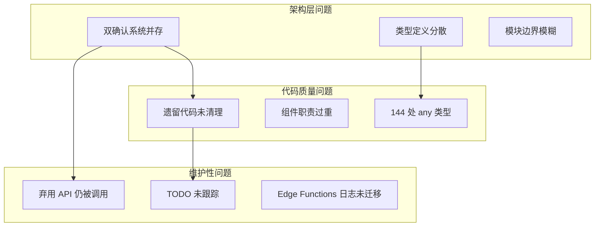

# AnyKeep 系统性修复方案 - 架构升级优化

> **版本**: 1.0.0
> **日期**: 2025-12-25
> **目的**: 针对代码审查发现的问题，制定系统性、全局性的修复方案

---

## 一、问题全景分析

### 1.1 问题分类与关联图



### 1.2 问题根因分析

| 问题       | 表面现象                      | 根本原因               | 影响范围           |
| ---------- | ----------------------------- | ---------------------- | ------------------ |
| 双确认系统 | `/api/agent/confirm` 仍被调用 | 架构升级未完成前端迁移 | 用户体验、代码维护 |
| 类型重复   | `ConfirmationResult` 5 处定义 | 缺乏共享类型层         | 类型安全、重构成本 |
| 遗留代码   | ~6000 行未使用代码            | 渐进式重构后清理不完整 | 构建体积、认知负担 |
| 组件臃肿   | HomePageClient 1200+ 行       | 功能累积未拆分         | 可维护性、测试性   |

---

## 二、统一确认系统方案

### 2.1 当前架构分析

**现状**：两套确认系统并存

```
┌─────────────────────────────────────────────────────────────────┐
│                      当前架构 (双轨制)                            │
├─────────────────────────────────────────────────────────────────┤
│                                                                 │
│  [旧系统 - V1]                    [新系统 - Effect Layer]        │
│                                                                 │
│  use-ai-chat.ts                   ConfirmationService           │
│       │                                │                        │
│       ▼                                ▼                        │
│  /api/agent/confirm ──X──        /api/agent/unified             │
│       │              弃用              │                        │
│       ▼                                ▼                        │
│  ConfirmationHandler             EffectManager                  │
│  (ai-agent/core)                 (ai-skills/effects)            │
│                                                                 │
└─────────────────────────────────────────────────────────────────┘
```

### 2.2 目标架构设计

```
┌─────────────────────────────────────────────────────────────────┐
│                      目标架构 (统一 Effect Layer)                 │
├─────────────────────────────────────────────────────────────────┤
│                                                                 │
│  [前端层]                                                        │
│  useUnifiedConfirmation.ts (已存在，需启用)                       │
│       │                                                         │
│       ▼                                                         │
│  [API 层]                                                        │
│  /api/agent/unified (SSE 流式响应，包含 confirmation chunk)       │
│       │                                                         │
│       ▼                                                         │
│  [服务层]                                                        │
│  ConfirmationService (统一处理 Tool + Skill 确认)                 │
│       │                                                         │
│       ▼                                                         │
│  [Effect 层]                                                     │
│  EffectManager (发出 confirmation/notification/audit Effect)     │
│                                                                 │
└─────────────────────────────────────────────────────────────────┘
```

### 2.3 迁移实施步骤

#### 阶段 1：前端 Hook 切换 (优先级: 高)

**目标文件**: `src/hooks/domain/ai/use-ai-chat.ts`

**当前代码 (第 665-690 行)**:

```typescript
// 旧实现 - 直接调用弃用端点
const handleConfirm = useCallback(async () => {
  const response = await fetch("/api/agent/confirm", {
    method: "POST",
    headers: { "Content-Type": "application/json" },
    body: JSON.stringify({
      confirmationId: confirmation.confirmationId,
      toolName: confirmation.toolName,
      params: confirmation.params,
      action: "confirm",
    }),
  });
  // ...
}, [confirmation]);
```

**修复方案**:

```typescript
// 新实现 - 使用 UnifiedEngine 响应确认
import { confirmationService } from "@/lib/ai-skills/effects";

const handleConfirm = useCallback(async () => {
  if (!confirmation?.confirmationId) return;

  const result = confirmationService.respondToConfirmation(
    confirmation.confirmationId,
    "confirm",
    { toolName: confirmation.toolName, params: confirmation.params },
  );

  if (result) {
    // 清除确认状态
    setConfirmation(null);
    // 触发工具执行（通过 SSE 流接收结果）
  }
}, [confirmation]);

const handleCancel = useCallback(() => {
  if (!confirmation?.confirmationId) return;

  confirmationService.respondToConfirmation(
    confirmation.confirmationId,
    "cancel",
  );

  setConfirmation(null);
}, [confirmation]);
```

#### 阶段 2：API 端点适配

**文件**: `src/app/api/agent/unified/route.ts`

确保 unified 端点正确处理确认响应：

```typescript
// 在处理 POST 请求时，检查是否为确认响应
if (body.type === "confirmation_response") {
  const { confirmationId, selectedOption, data } = body;
  const result = confirmationService.respondToConfirmation(
    confirmationId,
    selectedOption,
    data,
  );
  // 继续执行已确认的操作...
}
```

#### 阶段 3：删除旧系统代码

**待删除文件** (日落日期后):

- `src/app/api/agent/confirm/route.ts` (已标记弃用)
- `src/lib/ai-agent/core/confirmation-handler.ts` (被 ConfirmationService 替代)

**待更新文件**:

- `src/lib/constants/api-paths.ts` - 删除 `confirm: "/api/agent/confirm"` 行

### 2.4 回滚策略

```typescript
// 特性开关配置 (可选)
// src/lib/config/feature-flags.ts
export const FEATURE_FLAGS = {
  USE_NEW_CONFIRMATION_SYSTEM: true, // 设为 false 可回滚到旧系统
};

// 使用示例
if (FEATURE_FLAGS.USE_NEW_CONFIRMATION_SYSTEM) {
  confirmationService.respondToConfirmation(id, option);
} else {
  await fetch("/api/agent/confirm", { ... });
}
```

---

## 三、共享类型层架构方案

### 3.1 当前问题分析

**类型定义分散位置**:

| 类型名               | 定义位置数 | 文件列表                                                                         |
| -------------------- | ---------- | -------------------------------------------------------------------------------- |
| `ConfirmationResult` | 5          | effects/types, orchestration/types, ai-agent/core, ai-actions/types, tools/types |
| `Context`            | 20+        | 分散在各模块                                                                     |
| `ConfirmOption`      | 3          | effects/types, output/types, orchestration/types                                 |

### 3.2 共享类型层设计

```
src/lib/shared/
├── types/
│   ├── index.ts           # 统一导出
│   ├── confirmation.ts    # 确认相关类型
│   ├── context.ts         # 上下文类型
│   ├── effect.ts          # Effect 类型
│   └── common.ts          # 通用类型
└── README.md              # 使用说明
```

### 3.3 类型定义规范

**文件**: `src/lib/shared/types/confirmation.ts`

````typescript
/**
 * 共享确认类型定义
 *
 * 所有模块使用此处定义的确认相关类型
 *
 * @module @/lib/shared/types/confirmation
 * @since 2025-12-25
 */

// ============================================
// 确认选项
// ============================================

/**
 * 确认选项样式
 */
export type ConfirmOptionVariant = "default" | "destructive" | "outline";

/**
 * 确认选项
 */
export interface ConfirmOption {
  /** 选项 ID */
  id: string;
  /** 选项标签 */
  label: string;
  /** 选项样式 */
  variant?: ConfirmOptionVariant;
  /** 是否为主要选项 */
  primary?: boolean;
  /** 是否为危险选项 */
  danger?: boolean;
  /** 是否为默认选项 */
  isDefault?: boolean;
  /** 选项描述 */
  description?: string;
}

// ============================================
// 确认结果
// ============================================

/**
 * 确认状态
 */
export type ConfirmationStatus =
  | "pending"
  | "confirmed"
  | "rejected"
  | "expired"
  | "cancelled";

/**
 * 确认结果 (统一定义)
 *
 * @example
 * ```typescript
 * const result: ConfirmationResult = {
 *   confirmed: true,
 *   selectedOption: "confirm",
 *   status: "confirmed",
 * };
 * ```
 */
export interface ConfirmationResult {
  /** 是否已确认 */
  confirmed: boolean;
  /** 选择的选项 ID */
  selectedOption: string;
  /** 确认状态 */
  status?: ConfirmationStatus;
  /** 额外数据 */
  data?: unknown;
  /** 时间戳 */
  timestamp?: string;
  /** 上下文数据 */
  contextData?: Record<string, unknown>;
}

// ============================================
// 确认来源
// ============================================

/**
 * 确认来源
 */
export type ConfirmationSource = "tool" | "skill";

/**
 * 确认模式
 */
export type ConfirmationMode = "atomic" | "orchestration";
````

### 3.4 迁移步骤

#### 步骤 1：创建共享类型文件

1. 创建 `src/lib/shared/types/` 目录
2. 定义规范化的类型接口
3. 添加 JSDoc 文档和使用示例

#### 步骤 2：逐模块迁移

```typescript
// 迁移前 (ai-skills/effects/types.ts)
export interface ConfirmationResult {
  confirmed: boolean;
  selectedOption: string;
  data?: unknown;
  timestamp: string;
}

// 迁移后
export type { ConfirmationResult } from "@/lib/shared/types";
// 如需扩展
export interface ExtendedConfirmationResult extends ConfirmationResult {
  effectSpecificField?: string;
}
```

#### 步骤 3：更新导入路径

使用 VS Code 批量替换或脚本：

```bash
# 示例脚本 (伪代码)
find src -name "*.ts" -exec sed -i \
  's/from ".*\/types"/from "@\/lib\/shared\/types"/g' {} \;
```

### 3.5 类型统一对照表

| 统一类型名           | 来源模块                         | 合并策略                  |
| -------------------- | -------------------------------- | ------------------------- |
| `ConfirmationResult` | effects, orchestration, ai-agent | 取并集字段，status 可选   |
| `ConfirmOption`      | effects, output                  | 保留所有字段，部分可选    |
| `ToolContext`        | ai-agent, orchestration          | 合并为 `ExecutionContext` |
| `EffectContext`      | effects                          | 保持独立，特定场景使用    |

---

## 四、遗留代码清理策略

### 4.1 待清理代码清单

#### 高优先级 (立即删除，无风险)

| 文件/目录                           | 行数  | 原因          | 验证方式      |
| ----------------------------------- | ----- | ------------- | ------------- |
| `src/types/supabase.ts.new`         | 1     | 空文件        | 直接删除      |
| `src/types/chrome.d.ts`             | ~50   | 无引用        | grep 搜索确认 |
| `src/lib/classification/v3/`        | ~1500 | V4 已完全替代 | 运行测试      |
| `src/lib/classification/config/v3/` | ~300  | V4 已完全替代 | 运行测试      |

#### 中优先级 (需验证后删除)

| 文件/目录                        | 行数 | 原因       | 验证方式            |
| -------------------------------- | ---- | ---------- | ------------------- |
| `src/components/wechat-article/` | ~500 | 无页面引用 | 全局搜索 + 构建测试 |
| `src/components/snapshot/`       | ~600 | 无页面引用 | 全局搜索 + 构建测试 |
| `src/components/knowledge/`      | ~200 | 无页面引用 | 全局搜索 + 构建测试 |

#### 低优先级 (日落日期后删除)

| 文件/目录                                       | 日落日期   | 替代方案            |
| ----------------------------------------------- | ---------- | ------------------- |
| `src/app/api/agent/confirm/`                    | 2025-06-01 | /api/agent/unified  |
| `src/lib/ai-agent/core/confirmation-handler.ts` | 2025-06-01 | ConfirmationService |

### 4.2 删除执行脚本

```bash
#!/bin/bash
# scripts/cleanup-legacy-code.sh
# 遗留代码清理脚本

set -e

echo "=== AnyKeep 遗留代码清理 ==="

# 阶段 1: 高优先级清理
echo "阶段 1: 清理高优先级文件..."

# 删除空文件
rm -f src/types/supabase.ts.new
echo "✓ 删除 supabase.ts.new"

# 删除未使用的类型定义
rm -f src/types/chrome.d.ts
echo "✓ 删除 chrome.d.ts"

# 删除 Classification V3
rm -rf src/lib/classification/v3/
rm -rf src/lib/classification/config/v3/
echo "✓ 删除 Classification V3 目录"

# 阶段 2: 中优先级清理 (需确认)
echo ""
echo "阶段 2: 清理未使用组件..."
read -p "确认删除 wechat-article, snapshot, knowledge 组件? (y/n) " -n 1 -r
echo
if [[ $REPLY =~ ^[Yy]$ ]]; then
    rm -rf src/components/wechat-article/
    rm -rf src/components/snapshot/
    rm -rf src/components/knowledge/
    echo "✓ 删除未使用组件目录"
fi

# 运行构建验证
echo ""
echo "运行构建验证..."
npm run build

echo ""
echo "=== 清理完成 ==="
```

### 4.3 清理验证检查清单

```markdown
## 清理前检查

- [ ] 创建 git 分支: `git checkout -b chore/cleanup-legacy-code`
- [ ] 运行完整测试: `npm test`
- [ ] 记录当前构建大小

## 清理后验证

- [ ] `npm run build` 成功
- [ ] `npm run type-check` 无新错误
- [ ] `npm test` 全部通过
- [ ] 手动测试关键功能:
  - [ ] AI 对话功能
  - [ ] 书签管理功能
  - [ ] 数据导出功能
- [ ] 比较构建大小变化
```

---

## 五、组件架构优化方案

### 5.1 问题组件分析

| 组件             | 当前行数 | 问题                     | 建议                      |
| ---------------- | -------- | ------------------------ | ------------------------- |
| `HomePageClient` | 1200+    | 混合列表、筛选、批量操作 | 拆分为 3-4 个子组件       |
| `AIChatPanel`    | 800+     | 混合对话、确认、工具调用 | 拆分确认逻辑              |
| `ExportDialogV2` | 600+     | 混合多种导出格式         | 策略模式已实现，UI 可拆分 |

### 5.2 HomePageClient 拆分方案

**当前结构**:

```
HomePageClient (1200+ lines)
├── 状态管理 (选中、筛选、视图)
├── 书签列表渲染
├── 批量操作工具栏
├── 筛选面板
└── 分页逻辑
```

**目标结构**:

```
HomePageClient (300 lines) - 容器组件
├── BookmarkListContainer (400 lines)
│   ├── 虚拟滚动列表
│   └── 列表/卡片视图切换
├── BatchOperationBar (200 lines)
│   ├── 选中状态显示
│   └── 批量操作按钮
├── FilterPanel (200 lines)
│   ├── 平台筛选
│   └── 标签筛选
└── hooks/
    ├── useBookmarkSelection.ts
    ├── useBookmarkFilter.ts
    └── useBatchOperation.ts
```

### 5.3 拆分实施步骤

#### 步骤 1：提取自定义 Hook

```typescript
// src/hooks/domain/bookmark/use-bookmark-selection.ts
export function useBookmarkSelection(bookmarks: Bookmark[]) {
  const [selectedIds, setSelectedIds] = useState<Set<string>>(new Set());
  const [lastSelectedId, setLastSelectedId] = useState<string | null>(null);

  const handleSelect = useCallback(
    (id: string, shiftKey?: boolean) => {
      // Shift 选择逻辑
    },
    [bookmarks, lastSelectedId],
  );

  const handleSelectAll = useCallback(() => {
    setSelectedIds(new Set(bookmarks.map((b) => b.id)));
  }, [bookmarks]);

  const handleClearSelection = useCallback(() => {
    setSelectedIds(new Set());
  }, []);

  return {
    selectedIds,
    selectedCount: selectedIds.size,
    isAllSelected: selectedIds.size === bookmarks.length,
    handleSelect,
    handleSelectAll,
    handleClearSelection,
  };
}
```

#### 步骤 2：提取 UI 组件

```typescript
// src/components/home/bookmark-list-container.tsx
interface BookmarkListContainerProps {
  bookmarks: Bookmark[];
  viewMode: "card" | "list";
  selectedIds: Set<string>;
  onSelect: (id: string, shiftKey?: boolean) => void;
  isLoading: boolean;
}

export function BookmarkListContainer({
  bookmarks,
  viewMode,
  selectedIds,
  onSelect,
  isLoading,
}: BookmarkListContainerProps) {
  if (viewMode === "list") {
    return (
      <BrowserBookmarkVirtualList
        bookmarks={bookmarks}
        selectedIds={selectedIds}
        onSelect={onSelect}
      />
    );
  }

  return (
    <BookmarkGrid
      bookmarks={bookmarks}
      selectedIds={selectedIds}
      onSelect={onSelect}
    />
  );
}
```

#### 步骤 3：重构容器组件

```typescript
// src/components/home/home-page-client.tsx (精简后)
export function HomePageClient() {
  // 数据获取
  const { bookmarks, isLoading, refetch } = useBookmarks();

  // 选择逻辑 (提取到 Hook)
  const selection = useBookmarkSelection(bookmarks);

  // 筛选逻辑 (提取到 Hook)
  const filter = useBookmarkFilter();

  // 应用筛选
  const filteredBookmarks = useMemo(() => {
    return applyFilters(bookmarks, filter.activeFilters);
  }, [bookmarks, filter.activeFilters]);

  return (
    <div className="flex flex-col h-full">
      {/* 筛选面板 */}
      <FilterPanel {...filter} />

      {/* 批量操作栏 */}
      {selection.selectedCount > 0 && (
        <BatchOperationBar
          selectedCount={selection.selectedCount}
          onClearSelection={selection.handleClearSelection}
          onBatchDelete={handleBatchDelete}
          onBatchTag={handleBatchTag}
        />
      )}

      {/* 书签列表 */}
      <BookmarkListContainer
        bookmarks={filteredBookmarks}
        viewMode={viewMode}
        selectedIds={selection.selectedIds}
        onSelect={selection.handleSelect}
        isLoading={isLoading}
      />
    </div>
  );
}
```

---

## 六、任何类型 (any) 消除策略

### 6.1 any 类型分布

```
144 处 any 类型使用
├── components/  (42 处)
├── lib/        (58 处)
├── hooks/      (23 处)
└── app/api/    (21 处)
```

### 6.2 消除优先级

| 优先级 | 位置          | 原因         | 方法            |
| ------ | ------------- | ------------ | --------------- |
| P0     | API 输入/输出 | 类型安全关键 | Zod 验证 + 推断 |
| P1     | 组件 Props    | 开发体验     | 显式接口定义    |
| P2     | 内部实现      | 代码质量     | 渐进式修复      |
| P3     | 测试文件      | 影响小       | 可延后处理      |

### 6.3 修复模式示例

```typescript
// 修复前
function processData(data: any): any {
  return data.items.map((item: any) => item.value);
}

// 修复后
interface DataItem {
  value: string;
}

interface ProcessableData {
  items: DataItem[];
}

function processData(data: ProcessableData): string[] {
  return data.items.map((item) => item.value);
}
```

---

## 七、Edge Functions 日志迁移方案

### 7.1 待迁移函数

| 函数名             | 文件路径                                       | 当前状态    |
| ------------------ | ---------------------------------------------- | ----------- |
| fetch-metadata     | supabase/functions/fetch-metadata/index.ts     | console.log |
| sync-bookmarks     | supabase/functions/sync-bookmarks/index.ts     | console.log |
| process-import     | supabase/functions/process-import/index.ts     | console.log |
| generate-embedding | supabase/functions/generate-embedding/index.ts | console.log |
| ai-summarize       | supabase/functions/ai-summarize/index.ts       | console.log |

### 7.2 迁移方案

```typescript
// supabase/functions/_shared/logger.ts
// Edge Functions 日志适配器

import { serve } from "https://deno.land/std@0.177.0/http/server.ts";

type LogLevel = "debug" | "info" | "warn" | "error";

interface LogEntry {
  level: LogLevel;
  message: string;
  data?: Record<string, unknown>;
  timestamp: string;
  function: string;
}

class EdgeLogger {
  private functionName: string;

  constructor(functionName: string) {
    this.functionName = functionName;
  }

  private log(
    level: LogLevel,
    message: string,
    data?: Record<string, unknown>,
  ) {
    const entry: LogEntry = {
      level,
      message,
      data,
      timestamp: new Date().toISOString(),
      function: this.functionName,
    };

    // Deno 环境下使用 console，但格式化为 JSON
    const logFn =
      level === "error"
        ? console.error
        : level === "warn"
          ? console.warn
          : console.log;
    logFn(JSON.stringify(entry));
  }

  debug(message: string, data?: Record<string, unknown>) {
    this.log("debug", message, data);
  }

  info(message: string, data?: Record<string, unknown>) {
    this.log("info", message, data);
  }

  warn(message: string, data?: Record<string, unknown>) {
    this.log("warn", message, data);
  }

  error(message: string, data?: Record<string, unknown>) {
    this.log("error", message, data);
  }
}

export function createLogger(functionName: string): EdgeLogger {
  return new EdgeLogger(functionName);
}
```

### 7.3 使用示例

```typescript
// supabase/functions/fetch-metadata/index.ts
import { createLogger } from "../_shared/logger.ts";

const logger = createLogger("fetch-metadata");

serve(async (req) => {
  logger.info("Function invoked", { method: req.method });

  try {
    // 业务逻辑...
    logger.debug("Processing URL", { url });

    const result = await fetchMetadata(url);
    logger.info("Metadata fetched successfully", { title: result.title });

    return new Response(JSON.stringify(result), {
      headers: { "Content-Type": "application/json" },
    });
  } catch (error) {
    logger.error("Failed to fetch metadata", {
      error: error.message,
      stack: error.stack,
    });
    throw error;
  }
});
```

---

## 八、实施计划与时间线

### 8.1 阶段划分

```
阶段 1: 紧急修复 (1-2 天)
├── 确认系统前端迁移
└── 高优先级遗留代码删除

阶段 2: 类型系统优化 (2-3 天)
├── 创建共享类型层
├── 迁移核心类型定义
└── 修复 P0 any 类型

阶段 3: 组件重构 (3-5 天)
├── 提取 Hook
├── 拆分大组件
└── 更新测试

阶段 4: 长期清理 (持续)
├── 渐进式 any 消除
├── Edge Functions 日志迁移
└── 日落弃用 API
```

### 8.2 详细任务清单

#### 阶段 1 任务 (紧急)

- [ ] **Task 1.1**: 修改 `use-ai-chat.ts` 使用 ConfirmationService
  - 文件: `src/hooks/domain/ai/use-ai-chat.ts`
  - 行数: 665-690, 732-755
  - 预计: 2 小时

- [ ] **Task 1.2**: 删除高优先级遗留文件
  - 执行: `scripts/cleanup-legacy-code.sh`
  - 验证: `npm run build && npm test`
  - 预计: 1 小时

- [ ] **Task 1.3**: 更新 api-paths.ts
  - 文件: `src/lib/constants/api-paths.ts`
  - 行数: 29 (删除 confirm 路径)
  - 预计: 10 分钟

#### 阶段 2 任务 (类型)

- [ ] **Task 2.1**: 创建共享类型目录
  - 创建: `src/lib/shared/types/`
  - 文件: index.ts, confirmation.ts, context.ts, common.ts
  - 预计: 3 小时

- [ ] **Task 2.2**: 迁移 ConfirmationResult 类型
  - 更新 5 个文件的导入
  - 验证类型兼容性
  - 预计: 2 小时

- [ ] **Task 2.3**: 修复 API 层 any 类型
  - 文件: `src/app/api/` 下 21 处
  - 使用 Zod 推断
  - 预计: 4 小时

#### 阶段 3 任务 (组件)

- [ ] **Task 3.1**: 创建 useBookmarkSelection Hook
  - 文件: `src/hooks/domain/bookmark/use-bookmark-selection.ts`
  - 预计: 2 小时

- [ ] **Task 3.2**: 创建 useBookmarkFilter Hook
  - 文件: `src/hooks/domain/bookmark/use-bookmark-filter.ts`
  - 预计: 2 小时

- [ ] **Task 3.3**: 拆分 HomePageClient
  - 创建 BookmarkListContainer, BatchOperationBar, FilterPanel
  - 预计: 6 小时

- [ ] **Task 3.4**: 更新组件测试
  - 拆分后的组件单独测试
  - 预计: 3 小时

---

## 九、风险评估与缓解

### 9.1 风险矩阵

| 风险                     | 可能性 | 影响 | 缓解措施              |
| ------------------------ | ------ | ---- | --------------------- |
| 确认系统迁移导致功能故障 | 中     | 高   | 特性开关 + 充分测试   |
| 类型迁移导致构建失败     | 低     | 中   | 逐文件迁移 + CI 验证  |
| 组件拆分破坏现有功能     | 中     | 中   | 保留原组件 + 渐进替换 |
| 删除代码误删有用代码     | 低     | 高   | Git 分支 + 代码审查   |

### 9.2 回滚计划

```bash
# 每个阶段独立分支
git checkout -b fix/phase-1-confirmation-migration
git checkout -b fix/phase-2-type-system
git checkout -b fix/phase-3-component-refactor

# 出问题时快速回滚
git checkout feature/ai-skills
git branch -D fix/phase-X-xxx

# 或选择性回滚
git revert <commit-hash>
```

---

## 十、成功标准

### 10.1 量化指标

| 指标                    | 当前值 | 目标值 | 验证方法          |
| ----------------------- | ------ | ------ | ----------------- |
| 确认系统端点            | 2 套   | 1 套   | API 调用追踪      |
| ConfirmationResult 定义 | 5 处   | 1 处   | grep 搜索         |
| 遗留代码行数            | ~6000  | <500   | 代码统计          |
| any 类型使用            | 144    | <50    | TypeScript strict |
| HomePageClient 行数     | 1200+  | <400   | 代码统计          |

### 10.2 验收检查清单

```markdown
## 功能验收

- [ ] AI 对话功能正常
- [ ] 工具确认流程正常
- [ ] Skill 执行流程正常
- [ ] 批量操作功能正常
- [ ] 数据导出功能正常

## 技术验收

- [ ] `npm run build` 成功
- [ ] `npm run type-check` 无错误
- [ ] `npm test` 全部通过 (202 测试)
- [ ] 无 TypeScript 编译警告
- [ ] 代码覆盖率 > 80%

## 文档验收

- [ ] 更新 CLAUDE.md 变更记录
- [ ] 更新 API 文档
- [ ] 更新组件文档
```

---

## 附录

### A. 参考文件列表

| 文件                                            | 用途                 |
| ----------------------------------------------- | -------------------- |
| `src/hooks/domain/ai/use-ai-chat.ts`            | 确认系统迁移主文件   |
| `src/lib/ai-skills/effects/`                    | 新 Effect Layer 实现 |
| `src/lib/ai-agent/core/confirmation-handler.ts` | 旧确认处理器         |
| `src/app/api/agent/confirm/route.ts`            | 弃用 API 端点        |
| `src/components/home/home-page-client.tsx`      | 待拆分组件           |

### B. 相关文档

- [代码审查报告](./代码审查报告-架构升级后.md)
- [AI Skills 架构设计](./AI-Skills-Architecture-Phase2.md)
- [CLAUDE.md 项目文档](../CLAUDE.md)

---

**文档维护者**: Claude Code Assistant
**最后更新**: 2025-12-25
