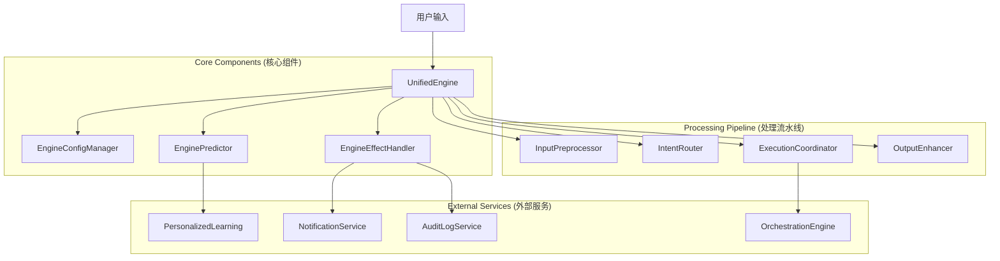

# Unified AI Engine (统一 AI 引擎)

`UnifiedEngine` 是 AnyKeep AI 能力的核心调度中心，负责协调意图识别、技能编排、原子工具执行、副作用管理以及智能预测。

## 架构概览 (v3.1.0)

为遵循 SOLID 原则，引擎在 v3.1.0 版本进行了重大重构，将核心职责拆分为独立的组件：

## 核心组件

### 1. EngineConfigManager

- **路径**: `components/config-manager.ts`
- **职责**: 集中管理引擎配置，处理默认值合并与类型安全的配置访问。

### 2. EngineEffectHandler

- **路径**: `components/effect-handler.ts`
- **职责**: 管理副作用（Side Effects），包括：
  - **Confirmation**: 高风险操作的用户确认。
  - **Notification**: 系统通知推送。
  - **Audit**: 操作审计日志。

### 3. EnginePredictor

- **路径**: `components/predictor.ts`
- **职责**: 聚合 AI 智能预测能力：
  - **意图预测**: 基于历史推测用户下一步操作。
  - **规则学习**: 从用户纠正中学习个性化规则。
  - **推测执行**: 评估操作风险与置信度。
  - **快捷指令**: 匹配用户自定义的快捷命令。

## 执行流程

1.  **输入预处理**: 解析指代词，注入上下文。
2.  **快捷指令匹配**: 检查是否命中用户定义的 Shortcut。
3.  **意图路由**: 决定是使用原子模式 (Atomic) 还是编排模式 (Orchestration)。
4.  **推测执行**:
    - 计算风险等级 (Risk Assessment)。
    - 意图消歧 (Disambiguation)。
    - 如果需要，请求用户确认。
5.  **执行**: 调度 `ExecutionCoordinator` 执行具体逻辑。
6.  **输出增强**: 注入后续操作建议 (Suggestions) 和记忆记录。

## 扩展指南

### 添加新的预测能力

修改 `EnginePredictor`，在 `components/predictor.ts` 中集成新的 AI 服务。

### 添加新的系统副作用

1. 在 `src/lib/ai-agent/effects/types.ts` 定义新的 Effect 类型。
2. 在 `EngineEffectHandler` 中注册默认监听器。

## 历史版本

- **v3.1.0**: 拆分上帝类，引入 ConfigManager/EffectHandler/Predictor。
- **v3.0.0**: 引入统一流式输出与 OutputEnhancer。
- **v2.0**: 引入置信度分层与风险评估。
